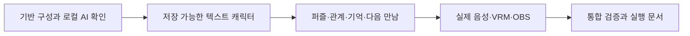

# AI Character Runtime — 구현 계획

> 2026-10-11 최신 BUILD: §18.10 grounded-v2 구현·검증 결과는 §18.11입니다. 관련 회귀44/44·실제 J: DB Q03 5/5·타입 PASS. Gemma dev18/24·형식18/24·진단2/4, 집중10/16·형식14/16·금지 사실4로 품질 FAIL입니다. 추론50회·유료0·다운로드0, 새 final/Stage 미실행. 운영 Qwen/Jev 유지, 새 자료는 J:/ai/ai-character-runtime/model-comparison/grounding-v2입니다. 이번 서버와 새 테스트 DB를 종료했고 다음은 AUDIT입니다.

작성일: 2026-09-27  
계획 버전: `implementation-v1`  
상태 (2026-10-03): P00/P01/P06 DONE. P02–P05 BLOCKED(실제 자원/음성 선택), P07–P15 IN_PROGRESS(텍스트 경로 구현 및 대표 검사 PASS), P16–P19 NOT_STARTED(P05 gate), P20 BLOCKED, P21 IN_PROGRESS. 상세 근거: [BUILD 인계](./BUILD_HANDOFF.md), [실행 문서](./RUNBOOK.md).

이전 작업 기록 (2026-10-04): **Jev는 MVP 필수 구성이다.** 사용자가 기존 제외 결정을 바로잡았다. PLAN 이후 사용자가 개발을 승인해 BUILD를 진행했다. 실제 Jev API는 별도 비용·전송 승인 및 예산 전까지 호출하지 않는다. 바로 이어서 개발할 범위·계약·검사는 [§14 Jev 필수 복원 개발 계획](#14-jev-필수-복원-개발-계획)에 정리했다. 앞선 로컬 전용 계획과 다른 명세의 Jev 제외 문구는 당시 결정의 기록이며, 이번 작업의 요구사항을 대신하지 않는다. 유료 호출은 아직 승인되지 않았다.

관련 문서: [MVP 범위](./MVP_SPEC.md), [캐릭터 preset](./CHARACTER_PRESET.md), [도메인 규칙](./CHARACTER_DOMAIN_SPEC.md), [로컬 AI](./LOCAL_AI_INTEGRATION.md), [DB 설계](./DATABASE_SPEC.md), [런타임 통신](./RUNTIME_PROTOCOL.md), [검증 계획](./VALIDATION_PLAN.md), [기술 설계](./technical_architecture_v1.md)

## 1. 첫 구현 목표와 순서

**첫 제품 동작은 입력 한 건이 관측되고, 상태에 한 번 적용되어 저장되며, 재시작 후에도 이어지는 것**이다. 그 전에 현재 PC에서 실제 로컬 모델·음성 환경이 작동하는지 작은 실험으로 확인한다.

큰 틀은 다음 순서를 따른다.



처음부터 아바타 동작이나 방송 연출을 완성하지 않는다. 핵심 경험이 실제로 저장되는 경로를 먼저 만든 뒤 동일한 출력 계획을 음성과 표정으로 표현한다. 문서에 등장하는 모든 확장 기능을 구현하지 않고 F01–F25만 완료한다.

실행 순서의 기본 경로는 P00→P01→P02/P03/P04→P05→P06–P10→P11–P15→P16–P19→P20→P21이다. `/`로 묶은 작업은 선행 조건이 같다는 뜻이며 여러 agent를 실행하라는 지시가 아니다. 실제 추론은 단일 GPU 슬롯 규칙을 지킨다.

## 2. 문서와 코드의 책임

| 판단할 내용 | 기준 |
|---|---|
| 포함 기능·제외 기능·완료 범위 | MVP_SPEC |
| 말투·기억을 드러내는 방식 | CHARACTER_PRESET |
| 감정·관계·활동·Agenda 계산 | CHARACTER_DOMAIN_SPEC |
| provider·worker 입출력과 자원 제한 | LOCAL_AI_INTEGRATION |
| 테이블·키·정정·복구 | DATABASE_SPEC |
| Studio·Stage·HTTP/WS·전달 보고 | RUNTIME_PROTOCOL |
| 합격 판정과 성능 문턱 | VALIDATION_PLAN |
| 작업 의존성·산출물·개발 순서 | 이 문서 |

초기 기술 설계보다 구체적인 명세를 우선한다. 충돌을 발견하면 실제 행동에 영향을 주는 한 가지 결정을 해당 원본 문서에 반영하고 직접 연결된 설명을 맞춘다. 서로 다른 세 종류의 메시지·epoch·상태 이름을 코드에 동시에 남기지 않는다.

검증 ID는 검사 결과를 연결하는 이름이다. 문서에 ID가 있다는 사실이나 fake provider 통과를 실제 모델·OBS 검증 통과로 표시하지 않는다.

## 3. 생성할 코드 구조

```text
apps/
  runtime/src/
    http/                  API·인증·음성 파일 전송
    ws/                    연결·메시지 순서·snapshot
    coordinator/           mailbox·commit·작업 dispatch·취소
    output/                출력 소유권·segment·전달 기록
    tasks/                 종료 정리·lease
  studio/src/
    studio/                입력·활동·상태·기억·준비 화면
    stage/                 VRM·자막·AudioContext
packages/
  contracts/src/           Zod·DTO·ID·버전 직렬화
  character-core/src/      순수 reducer·주의·관계·표현·Agenda
  database/src/            Drizzle schema·queries·transactions
  database/migrations/    검토된 SQL
  adapters/src/            Ollama·Python worker 연결·퍼즐 검증기
workers/
  tts/                     기존 OmniVoice 환경의 Python wrapper
  stt/                     별도 환경의 STT wrapper
character-presets/         curious-puzzle-v1 설정
fixtures/puzzles/          문제 3개·검증기용 비공개 정답 자료
evals/                    개발/최종 입력·rubric·검사 실행기
scripts/                  환경 진단·로컬 실험·실행 보조
validation/runs/           버전별 측정·검증 결과
runtime-data/tmp/          재생·전사용 임시 파일, 버전 관리 제외
```

해당 작업을 시작할 때 필요한 폴더만 만든다. 기존 명세 파일은 루트에 유지하며 문서 정리를 위해 지금 이동하지 않는다. Python 가상환경·모델·참조 음성·DB 데이터·원문 로그는 Git에 넣지 않는다. 검증 결과도 원문·음성 없는 작은 요약만 명시적으로 선택해 관리한다.

의존성 방향:

- contracts는 DB·브라우저·모델 실행기에 의존하지 않는다.
- character-core는 contracts와 순수 설정만 사용한다. 시간·유효 근거·현재 상태는 외부에서 전달한다.
- database와 adapters는 Core의 상태를 직접 변경하지 않는다.
- runtime이 입력·DB·Core·adapter를 조정한다. 모델을 기다리며 트랜잭션을 열어 두지 않는다.
- studio/stage는 공개 DTO만 사용한다. database·서버용 퍼즐 fixture를 import하지 않는다.

MVP Core는 결정적이므로 난수 인자를 추가하지 않는다. HTTP/WS JSON과 worker JSONL의 bigint는 십진 문자열로 변환하고, 작은 ms·sample rate와 혼동하지 않는다.

## 4. 작업 목록과 상태

2026-10-03 현재 P00/P01/P06은 `DONE`, P02–P05/P20은 `BLOCKED`, P07–P15/P21은 `IN_PROGRESS`, P16–P19는 `NOT_STARTED`다. 실제 PostgreSQL 텍스트 경로/대표 관계·기억·Agenda 검사와 합성 provider 브라우저 시연을 확인했다. 실제 모델/음성/전체 검증은 완료가 아니며 performance gate는 UNFROZEN이다. 정확한 작업별 근거와 남은 경계는 [BUILD_HANDOFF.md](./BUILD_HANDOFF.md)를 읽는다.

| 완료 작업 | 확인한 결과 |
|---|---|
| P00 | pnpm workspace·TypeScript·contracts·Zod·Vitest 구성. Node 22.19.0, pnpm 11.9.0에서 `pnpm typecheck`와 `pnpm test:unit` 9개 통과 |
| P01 | `.env.example`과 읽기 전용 `pnpm diagnose` 실행. DB 미설정·Ollama API 연결 불가·TTS Python 존재와 snapshot 메타데이터 후보 2개·STT 미설정을 구분 |

2026-09-27 기준 실제 모델 추론·DB 연결·TTS 합성은 실행하지 않았다. `pnpm diagnose`의 파일 존재·포트 상태를 기능 준비 완료로 해석하지 않는다. 당시 디렉터리는 Git 저장소가 아니었다. 이후 저장소 생성·푸시는 BUILD_HANDOFF.md의 날짜별 기록을 따른다.

### M0 — 기반과 로컬 실행 가능성

| ID | 작업·산출물 | 선행 | 완료 기준 |
|---|---|---|---|
| P00 | pnpm workspace·TypeScript 설정·최소 contracts·검사 runner | 없음 | 필요한 package만 생성, typecheck·최소 계약 검사 실행 가능 |
| P01 | 환경 진단·비밀값 없는 설정 예시·준비 상태 | P00 | 실제 설치 경로·모델·DB 준비 여부와 누락을 구분, 자동 다운로드 없음 |
| P02 | Ollama adapter·token counter·실제 구조화/대사 실험 | P01 | 로컬 Qwen 해석·대사·풀이 후보 호출 성공, tokenizer 예산·오류 처리 확인 |
| P03 | 기존 OmniVoice wrapper의 최소 합성 실험 | P01 | 선택한 참조 음성으로 유효 WAV 생성, sample rate·소요 시간·VRAM 기록 |
| P04 | 별도 STT 환경·최소 전사 실험 | P01 | 짧은 한국어 WAV를 CPU int8로 전사, 빈 입력·누락 모델 처리 |
| P05 | 직렬 추론·자원 파일럿·성능 gate 고정 | P02, P03, P04 | 실제 연결 실험·공존 VRAM 측정·설정 고정, 검증 계획 gate가 FROZEN |

### M1 — 저장 가능한 텍스트 캐릭터

| ID | 작업·산출물 | 선행 | 완료 기준 |
|---|---|---|---|
| P06 | DB M1 schema·migration·기본 seed·명령 중복 키 | P00, P01 | 실제 PostgreSQL에 생성·재실행·rollback·빈 DB 복원 검사 |
| P07 | 상태 reducer·주의·시간·초기 행동·표현 규칙 | P00 | 해당 D 검사와 주의/표현 경계 검사 통과, DB 없이 실행 가능 |
| P08 | runtime coordinator·상태 commit·Ollama 연결 | P02, P06, P07 | 입력 하나를 한 번만 적용, stale 결과 폐기, commit 후만 출력 |
| P09 | 인증·HTTP/WS·snapshot·text segment/ACK | P06, P08 | 역할별 접근·명령 재시도·단일 출력 권한의 텍스트 경로 작동 |
| P10 | 최소 Studio·자막 Stage·실제 텍스트 시연 | P09 | A/B/C 입력·상태·선택 이유·오류 표시, 재시작 후 상태 유지 |

### M2 — 경험이 다음 행동으로 연결

| ID | 작업·산출물 | 선행 | 완료 기준 |
|---|---|---|---|
| P11 | 퍼즐 schema·fixture 3개·활동 adapter·풀이 | P08, P10 | 실제 후보 제출→검증 결과, 정답 비노출·힌트/시도 한도·재개 유지 |
| P12 | 관계 evidence·source group·일일/반복 집계 | P11 | 같은 도움 중복 증가 없음, 날짜/독립 근거·재계산 검사 통과 |
| P13 | 사실 기억 생성·출처·검색·종료 정리 task | P12 | 중요 사실 즉시 저장, 종료 정리 멱등성·lease·5개/600 tokens 제한 |
| P14 | Agenda 생성·예약·전달·수락/거절·재개 | P13 | 세션당 한 번, 실제 완전 전달 뒤 offered, 기존 활동 재개 |
| P15 | 기억/원본 정정·삭제·관계 재집계·출력 무효화 | P14 | 삭제 두 종류 구분, 파생 자료 정리·재생성 방지·경합 검사 |

### M3 — 음성·아바타·운영 복구

| ID | 작업·산출물 | 선행 | 완료 기준 |
|---|---|---|---|
| P16 | production worker 계약·통합 scheduler·실패 복구 | P03, P04, P05, P08, P15 | TTS/STT JSONL·단일 GPU 슬롯·timeout·소유 worker 정리·늦은 결과 폐기 |
| P17 | 마이크 capture·WAV 업로드·전사·입력 취소 | P09, P16 | start/end 순서, 실제 sample rate 변환, 최종 발화만 입력, 기존 출력 취소 |
| P18 | VRM Stage·음성 재생·OBS·전달 보고 | P14, P16, P17 | 실제 표정·자막·입 움직임·음성, 단일 소유권·즉시 취소·재접속 |
| P19 | 전체 재시작·삭제·장애·backpressure 통합 | P15, P18 | DB/통신 장애 경계·복구·출력 unknown·오프라인 검증 통과 |

### M4 — 검증과 인계

| ID | 작업·산출물 | 선행 | 완료 기준 |
|---|---|---|---|
| P20 | 실제 모델 품질·고정 성능·세 세션·20분 결과 | P19 | 검증 계획의 필수 항목 PASS, F01–F25 증거, 알려진 제한 기록 |
| P21 | RUNBOOK·실행/종료/백업/복원 절차·최종 인계 | P20 | 문서의 실제 명령을 확인한 로컬 실행, 경로/버전/검증 결과 연결 |

P00–P21은 22개 작업이다. 작업 하나가 반드시 commit 하나라는 뜻은 아니다. 수정·검증 가능한 작은 단위로 나누되 같은 행동 계약을 여러 번 다른 형태로 구현하지 않는다.

## 5. M0의 실제 진행 방법

### 5.1 P00–P01: 먼저 확인할 것

현재 workspace에는 기획·명세 문서가 있다. Node·pnpm·PostgreSQL 설치·DB 계정·개발용 package lock 존재를 가정하지 않고 필요한 범위만 확인한다. Git 저장소 여부도 착수 시 확인하고 기존 저장소가 있으면 사용자 변경을 보존한다. 원격 저장소 생성·push는 첫 작업의 필수 조건이 아니다.

프로젝트 설정 검사기는 다음을 나눠 보여 준다.

- 파일/프로세스 존재와 실제 로드 가능 상태.
- 설치된 Ollama 모델과 허용한 local 모델.
- OmniVoice Python·snapshot·audio tokenizer·참조 음성·전사문.
- STT 전용 환경과 CTranslate2 형식 모델.
- tokenizer 계수 준비 상태, DB 접속·schema 상태.

누락됐다고 자동 다운로드·자동 환경 업그레이드·Gradio 데모 실행을 하지 않는다. 필요한 무료 의존성 준비는 구체적인 파일·용량·설치 대상이 정해진 단계에서 수행한다. 유료 fallback 설정은 만들지 않는다.

### 5.2 P02–P04: 버리지 않을 작은 adapter

P02는 production에서 사용할 Ollama adapter로 실제 한 건을 호출한다. 별도 LangChain/LangGraph 계층을 먼저 만들지 않는다. JSON schema·출처 ID·token 예산·timeout·abort와 계산 종료의 차이를 검사한다.

P03은 `J:\ai\omnivoice tts\omnivoice-env\Scripts\python.exe`에서 프로젝트 wrapper를 실행한다. 기존 `run_omnivoice.bat`를 수정하지 않는다. 참조 음성·전사문은 사용자가 선택한 preset이 있어야 실제 음색을 고정할 수 있다. 미선택이면 TTS 작업만 BLOCKED로 표시하고 독립된 텍스트·DB 작업은 계속할 수 있다.

P04는 별도 환경에서 WAV 입력→최종 전사만 연결한다. 마이크 UI·부분 전사·자동 VAD는 이 단계에 추가하지 않는다. 정상 입력과 무음 fixture를 구분하고 실제 녹음 품질은 P17에서 확인한다.

실험용 CLI는 adapters/worker의 실제 함수를 호출한다. 이후 UI 연결 때 같은 provider를 다시 만드는 구조를 피한다. 미완성 UI 없이도 진단을 실행할 수 있게 하되 실험 전용 코드에 DB 상태 변경을 넣지 않는다.

### 5.3 P05: 자원과 성능 판단

Qwen 단독, OmniVoice 단독, 두 모델 상주, 직렬 해석→대사→합성, CPU STT 병행을 순서대로 측정한다. 모델 파일 크기를 VRAM 피크로 간주하지 않는다. 본격 Stage 전에는 작은 재생 probe로 오디오 경로를 확인하고, OBS/VRM이 준비되면 렌더 부하를 포함한 최종 결과는 P18–P20에서 다시 측정한다.

메모리가 부족하면 기존 불필요한 데모의 상태 확인, context·출력 길이, CPU 배치, 더 작은 무료 모델 순으로 검토한다. 다른 앱을 무차별 종료하거나 GPU 메모리 부족을 무한 재시도로 해결하지 않는다.

M0 결과는 파일럿이며 최종 검증 표본에 합치지 않는다. 검증 계획의 gate version·고정 시각·측정 run ID·config hash·합격 문턱을 기록해야 P05가 DONE이다. P05가 미완료여도 독립적인 P06–P15 구현은 가능하지만 **M3 착수와 성능 통과 판정은 금지**한다.

## 6. M1: 한 사건의 저장 경로

### 6.1 P06–P08의 구현 단위

첫 migration은 characters/configs/identities/sessions, events/appraisals/state/transitions, response_runs/response_sources/speech_segments를 만든다. 관계·기억의 영구 테이블은 M2에서 추가한다. 아직 없는 schema를 조회하는 빈 repository 메서드를 미리 만들지 않는다.

첫 동작의 확인 순서:

1. 고정 캐릭터·계정 seed, 세션 시작.
2. 같은 request ID로 채팅 두 번 제출 → events 원본 한 건.
3. 주의 선택과 해석 채택을 별도 단계 사건으로 저장.
4. Core의 감정 변화·표현 계획·transition·state version을 원자적으로 commit.
5. commit 이후 대사 생성과 text segment 전달.
6. 정상 종료·재시작 후 같은 상태에서 경과 시간 감쇠 확인.

처음에는 fake 해석으로 상태/DB 경계를 확인하고 P08 완료 전에 실제 Ollama를 연결한다. rollback 검사와 늦게 도착한 결과 폐기를 먼저 검증한 뒤 기능을 늘린다. GPU 자원이 없는 순수 Core·DB 검사는 가짜 provider로 충분하다.

familiarity·affinity의 순수 계산은 P07에서 일부 검사할 수 있지만 영구 저장·한국 날짜별 한도·신뢰 근거는 P12 전에는 완료라고 표시하지 않는다. D06처럼 여러 계층에 걸친 ID는 부분 결과를 남기고 마지막 통합 검사가 끝날 때 통과시킨다.

### 6.2 P09–P10의 화면 범위

Studio에는 계정 선택·채팅 입력·현재 활동 영역·상태·근거 timeline·준비/오류 표시를 둔다. 아직 구현되지 않은 활동/기억 기능은 연결되지 않은 데모로 보여 주지 않는다. Stage는 초기에는 검증된 자막과 중립/듣기 표시만 출력한다.

텍스트 단계부터 페어링·역할 검사·command ACK·outputEpoch·source revision을 적용한다. 공개 Stage에 원본 채팅·상태 숫자·기억 원문을 보내지 않는다. 같은 Stage 코드를 이후 음성·VRM에 확장한다.

M1 완료의 시연은 **실제 텍스트 입력→실제 해석→저장된 상태→검증된 대사→자막 ACK**다. 관계 지속성·음성·아바타·세 세션 전체 완료를 주장하지 않는다.

## 7. M2: 퍼즐·관계·기억·Agenda

### 7.1 P11–P12: 검증 가능한 활동과 도움

퍼즐은 기존 명세의 한 종류로 제한한다. 등록 문제 세 개와 정답 validator를 서버 영역에 둔다. 브라우저와 모델에는 공개 문제·답 형식·이미 공개된 힌트만 제공한다. 후보 답 제출, 판정, 힌트 사용, 추가 시도 허용은 서로 다른 사건이다.

관계 근거는 활동을 연결한 뒤 구현한다. 칭찬·관측 날짜·검증된 도움의 업무 키와 source group을 생성하고, 동일 문제를 다른 activity_run에서 다시 풀어도 독립된 새 신뢰로 세지 않는다. 적용량 0인 사회적 근거도 반복 수 계산에 필요한 경우 남긴다.

테스트에서는 오답·도움 성공을 주입해 한도를 확인할 수 있다. 실제 모델 시연에서 일부러 정답을 숨겨 답을 틀리게 하거나 가짜 성공 결과를 만들지 않는다. 정상 풀이에서 도움이 발생하지 않으면 해당 시연 분기는 미검증으로 남긴다.

### 7.2 P13–P14: 사실 기억과 다음 만남

활동 결과·사용한 도움·미완료 의도는 확정 시점에 즉시 저장한다. 종료 task는 이미 있는 사실을 묶으며 새 경험을 만들어 내는 두 번째 reducer가 아니다. LLM 회고·semantic memory·embedding은 구현하지 않는다.

검색은 유효 source·현재 활동·참여자·최근 사건 순으로 제한한다. 낮은 우선순위 기억을 통째로 제외해 token 예산을 맞추며 원문 중간 절단으로 사실을 바꾸지 않는다.

Agenda는 pending→reserved→offered→종료 흐름이다. plan commit 때 attempt 예산을 소비하고, 완전한 자막 또는 음성 전달 뒤 offered로 바꾼다. P14에서는 text ACK로 우선 검증한다. 실제 음성·부분 전달·OBS 재접속 검사는 P18에서 추가한다.

### 7.3 P15: 삭제를 마지막 장식으로 두지 않기

DB 출처 연결을 사용해 기억-only 삭제와 원본 삭제를 각각 구현한다. 관계 재집계, 독립 source group 보존, tombstone 재생성 방지, 현재 대사 취소를 같은 기능으로 검증한다. 삭제된 내용을 로그·작업 결과·segment에 그대로 남기지 않는다.

이 단계는 M2의 완료 조건이다. “데이터는 저장되지만 수정할 수 없음” 상태로 음성 기능을 먼저 완성하지 않는다. 영향이 작은 문구 정정과 관측 사실 정정을 구분하고 사실은 validator 근거로만 바꾼다.

M2 완료 시 실제 텍스트 세션 사이에 미완료 활동과 근거가 이어져야 한다. 최종 실제 음성 포함 세 번의 만남은 P20에서 별도로 실행한다.

## 8. M3: 음성·VRM·OBS

### 8.1 P16–P17: 작업 수명과 마이크

P03/P04의 wrapper를 production 계약으로 완성한다. stdout JSONL·stderr 로그, worker instance ID, 상대 경로 검사, 제한된 재기동, 모델 누락 준비 상태, 임시 파일 수명을 연결한다. STT는 CPU, 해석·대사·풀이·TTS는 통합 GPU 슬롯 하나다.

취소된 계산은 끝날 수 있지만 출력은 금지한다. worker 종료 확인 전 슬롯 재사용, 시스템의 모든 Python 종료, 실패한 녹음/문장의 무한 재호출을 금지한다.

마이크는 AudioWorklet에서 실제 sample rate를 읽고 PCM16 16kHz로 변환한다. 누름 시 start, 놓음 시 end, 완성 WAV HTTP 업로드 순서다. 짧은 발화·start ACK 전 종료·장치 권한 거부·blur·세션 종료·잘못된 파일을 검사한다. 부분 발화를 확정 event로 만들지 않는다.

### 8.2 P18: 출력의 실제 완료

기존 보유 또는 무료 VRM 에셋 한 개를 연결한다. 에셋 선택과 사용 조건이 확인되지 않으면 맞춤 모델 구매를 제안하며 작업을 대체하지 않고 해당 단계만 미완료로 남긴다. 기본 다섯 표현을 지원 범위에서 매핑하고 입 움직임은 음량 기반으로 시작한다.

Stage는 검증된 한 문장 WAV를 재생하며 다음 문장을 장시간 예약하지 않는다. text_shown, audio_started, audio_completed, cancelled, unknown을 분리한다. `ended` callback이 취소 때문에 발생한 경우 완료 ACK로 처리하지 않는다.

OBS와 일반 브라우저에서 각각 준비/재생을 확인하고, 둘을 동시에 열어 소유 Stage 하나만 발성하는지 검증한다. 이전 Stage의 중지 ACK가 없으면 timeout만으로 다른 Stage를 자동 활성화하지 않는다. 브라우저의 autoplay 해제와 OBS 상호작용 절차는 실제 확인 뒤 RUNBOOK 초안에 기록한다.

### 8.3 P19: 실제 복구

텍스트 단계부터 있던 복구 절차를 실제 worker·AudioContext·임시 파일까지 확장한다. 정상 재연결, 서버 재시작, DB 실패, ACK 유실, 원본 삭제와 decode 완료 경합을 각각 검사한다. 오래된 결과가 끝났다는 이유로 새 음성을 내지 않는다.

정상 20분 시연과 강제 종료·OOM 주입은 다른 시험이다. 장애 시험에서 사용한 데이터·성능 통계를 정상 시연 결과와 섞지 않는다. offline 검증을 위해 사용자 PC의 네트워크를 문서나 앱 시작만으로 임의 차단하지 않는다.

M3 완료에는 fake audio 검사뿐 아니라 실제 마이크·TTS·VRM·OBS, 고정된 performance gate의 통과가 필요하다.

## 9. P20–P21: 최종 결과와 실행 문서

P20은 [검증 계획](./VALIDATION_PLAN.md)을 그대로 실행한다. 새 합격 기준을 이 문서에서 만들지 않는다. 기본 검사·한국어 해석/대사·STT/TTS·채널별 30건·취소 20회·세 세션·20분·오프라인 결과를 run manifest에 연결한다.

실패하면 관련 작업을 다시 IN_PROGRESS로 돌리고 원인을 수정한다. 기존 실패 기록은 유지하고 새 run ID로 재검증한다. 모델·설정 변경은 성능 gate·평가 데이터의 유효성을 검토하며 최종 결과를 보고 사후에 문턱을 완화하지 않는다.

RUNBOOK 초안은 실제 실행 명령이 생긴 작업부터 작성할 수 있다. P21에서 다음을 최종 확인한다.

- 새 터미널에서 개발/방송 모드 실행, 로컬 모델과 DB 준비 상태 확인.
- 목소리 preset·VRM·Stage 페어링·OBS 출력 소유권 선택.
- 정상 종료, 미종료 프로세스/worker 구분, 복구 후 재시작.
- 테스트 DB 초기화와 실제 경험 DB 초기화의 구분.
- DB 백업·별도 DB 복원 확인, 삭제 반영 전 백업의 격리.
- 모델 누락·메모리 부족·자동 재생 차단·TTS/STT 실패의 실제 오류별 대응.
- 코드·migration·의존성·모델 버전과 검증 report 위치.

MVP 완료는 P20의 필수 결과와 P21 실행 문서가 모두 확인된 상태다. 문서에 “완료”를 적기 위해 미확인 명령을 추측하지 않는다.

## 10. 개발 명령의 예정 계약

다음은 package scripts의 현재 상태와 앞으로 구현할 이름이다. 실행 가능 항목은 위 P00–P01에서 확인했으며 나머지는 앞으로 만들 계약이다. 실제 설치 도구 버전·프로젝트 구조를 확인한 뒤 RUNBOOK에 검증 결과를 남긴다.

| 예정 명령 | 목적·제한 |
|---|---|
| `pnpm typecheck` | 구현됨: 현재 존재하는 package의 타입 검사 |
| `pnpm test:unit` | 구현됨: 계약 검사 9개, 모델 로드 없음. Core 검사는 P07에서 추가 |
| `pnpm test:db` | 명시한 test DB만 사용, 실제 PostgreSQL |
| `pnpm test:protocol` | HTTP/WS·역할·명령 수명·오류 경로 |
| `pnpm test:e2e` | fake provider 기반 브라우저 반복 검사 |
| `pnpm diagnose` | 구현됨: 경로·설치·환경 준비 상태, 자동 수정/다운로드 없음 |
| `pnpm db:migrate` | 검토된 migration만 적용, 일반 앱 시작과 분리 |
| `pnpm db:seed` | 고정 기본 자료를 중복 없이 추가, 관계/기억 가짜 seed 없음 |
| `pnpm dev` | 개발 화면·서버 실행, 기존 Ollama/DB를 무단 재시작하지 않음 |
| `pnpm build` / `pnpm start` | production 화면 build와 로컬 실행 |
| `pnpm eval:models` | 고정 실제 모델 품질 세트, GPU 작업 중복 실행 금지 |
| `pnpm eval:latency` | manifest·고정 gate를 확인한 실제 측정 |

기본 unit/e2e 명령이 모델을 자동 다운로드하거나 음성을 재생하지 않게 한다. 실제 모델 평가는 명시적인 eval 경로로 실행한다. 테스트 편의를 위해 임의 셸 실행 API·운영 상태 강제 변경 API를 공개하지 않는다.

## 11. 검증과 작업의 연결

| 작업 | 우선 확인할 검사·기능 |
|---|---|
| P00–P02 | schema·bigint 직렬화·AI01–AI04·AI08·AI13 |
| P03–P05 | 실제 TTS/STT 준비·자원·품질 파일럿·성능 gate |
| P06–P08 | D01–D06·D09·D17–D18의 해당 부분, DB01–DB06·DB16·DB18 |
| P09–P10 | RT01–RT05·RT13·RT16–RT18의 텍스트 부분, F01·F03–F06·F23 |
| P11–P12 | D07–D11, AI11, DB07–DB09·DB17 |
| P13–P15 | D12–D16, DB10–DB13·DB15, AI07, RT12·RT14의 텍스트 부분 |
| P16–P19 | AI05–AI10·AI12–AI14, DB14·DB16–DB18, RT01–RT18의 실제 출력 부분 |
| P20–P21 | 모든 필수 결과·추적표·실제 모델·F01–F25·실행/복원 문서 |

이 표는 우선순위이며 전체 검사 목록의 대체물이 아니다. 정확한 68개 ID와 보완 기능 검사는 검증 계획에서 추적한다. 이미 통과한 관련 검사를 코드 변화 없이 이유 없이 반복하지 않는다. 반대로 같은 ID의 실제 환경 하위 검사가 남았으면 fake 결과만으로 완료시키지 않는다.

## 12. 미확정 항목과 진행 가능한 범위

| 미확정 항목 | 해결 작업 | 해결 전 가능한 작업 |
|---|---|---|
| Node·pnpm·PostgreSQL 실제 설치/계정 | P01 | 문서·순수 계약 설계, 의존성 준비 계획 |
| TTS snapshot 완전성·audio tokenizer | P03 | 텍스트 Core·DB·Ollama |
| 사용할 참조 목소리·전사문 | P03 | 파일 검사·worker 계약, 실제 합성 완료는 보류 |
| STT 환경·모델 | P04 | 텍스트·TTS·DB |
| 두 모델 상주·실제 응답성 | P05 | M1/M2의 독립 구현, M3 통과는 보류 |
| 사용할 무료/보유 VRM | P18 | 텍스트 Stage·오디오·표현 DTO |
| OBS 실제 오디오 준비·지연 | P18–P20 | 브라우저 검사, OBS 완료 주장은 보류 |

설치나 선택이 필요한 시점에는 이미 확인한 로컬 후보를 먼저 제시한다. 범위가 명확한 구현 결정을 매번 재확인하지 않는다. 다만 목소리/에셋의 선택, 필수 범위 변경, 유료 전환, 사용자 데이터 파괴를 임의로 결정하지 않는다. 유료 전환은 현재 요구사항과 맞지 않는다.

추가 모델·새 라이브러리를 찾기 전에 기존 구성에서 실패한 사례와 자원 기록을 남긴다. 같은 접근의 수정이 세 번 연속 진전이 없으면 원인을 재평가하고 지원되는 대안을 검토한다.

## 13. 일정 추정과 첫 착수 범위

아직 실행 성능과 개발 환경을 확인하지 않았으므로 날짜·인일을 확정하지 않는다. P05와 M1 저장 경로를 완료한 뒤 실제 작업량·모델 한계·남은 범위를 근거로 일정표를 만든다. 테스트 수를 줄이거나 음성·기억을 빼서 일정에 맞춘다고 가정하지 않는다.

**첫 개발 범위 P00–P01은 완료했다. 다음 작업은 P02–P04의 로컬 모델 연결이다.** 아래는 이번 범위에서 수행한 순서다.

1. 환경·기존 파일·저장소 상태를 필요한 범위에서 확인한다.
2. workspace와 최소 contracts/runtime/Core/DB 진입점을 해당 구현에 필요한 만큼 생성한다.
3. 설정 schema, bigint 전송 변환, `.env.example`, 원문·모델·임시 파일을 제외하는 ignore 규칙을 만든다.
4. `typecheck`, 최소 계약 검사, 읽기 위주의 환경 진단을 실행한다.
5. 실제 결과와 다음 미확정 항목을 기록하고 P02–P04로 이어간다.

현재 완료된 코드는 workspace·설정 계약·진단이며 검증은 타입 검사·계약 검사 9개·읽기 전용 진단까지다. 모델 로드·DB 생성·Studio/Stage·MVP 통합 검증은 남아 있다.

## 14. Jev 필수 복원 개발 계획

### 14.1 요청·단계·현재 기준선

- 계획 ID: `jev-required-v1`, 작성일 2026-10-04. 단계 **PLAN 완료 → 다음 BUILD**, 수정/재감사 라운드 0.
- 요청: “MVP에서 제브가 빠지면 안 된다.” 이어서 “일단 계획만 해. 개발만 남은 단계에 멈춰.” 이번 편집은 이 계획 파일 하나로 한정한다.
- 목표: **합성 입력 → 실제 Jev 사건 해석 → 기존 Core 상태/행동 결정 → 로컬 Qwen 대사 → Stage 표시·완료 ACK**. 정상 실행에서 Jev를 빼거나 Qwen 해석으로 자동 대체한 결과는 이 목표의 완료가 아니다.
- 기존 코드: `OllamaProvider.appraise()`가 해석까지 담당하며 `Coordinator.drain()`은 동일 provider의 결과를 `Store.commitAppraisal()`에 전달한다. `createServer()`의 준비 상태는 대화 모델만 구분한다. Jev adapter는 없다.
- 앞선 완료 작업: Prompt v2 4개와 local config 2개 적용, 기존 Readiness 5개 보존. 실제 Qwen→Stage 두 만남의 전달 성공은 `BUILD_HANDOFF.md`의 10-04 기록을 따른다. 첫 대사의 중국어 혼합/문장 품질과 target=activity 분류도 남아 있다. 이를 Jev 검증 증거로 재사용하지 않는다.
- 작업 폴더는 Git 저장소가 아니다. HEAD/commit을 가정하지 않는다. 구현자는 아래 해시와 실제 파일을 비교하고 후속 변경이 있으면 해당 부분만 다시 확인한다. `runtime-data/stage-validation-20261004/source-hashes.json`에 이전 관련 소스의 전체 목록도 있다.

| 현재 기존 파일 | 계획 작성 시 SHA256 |
|---|---|
| `packages/adapters/src/ollama.ts` | `ee94acf5b34eee9f8598992ee48215546473ff7861be111260085a84b281e36b` |
| `packages/contracts/src/domain.ts` | `99dbfe849d40b3a892efbff14d2ba78c9346c0ec45d785dca7e5330c5f40f710` |
| `packages/contracts/src/local-config.ts` | `93cb3024ef357af777ee12267dd8a356e2abe4dd5df32e0a5b485f8f51b34fce` |
| `apps/runtime/src/coordinator/index.ts` | `5d184fe1171849870f601b384f054c34085c487ce7fccbe9faa23500502f50a7` |
| `apps/runtime/src/http/server.ts` | `a6e012bfc7a419e532e6b339107b287684165d2e31ad3d8c2becac8a196ee54a` |
| `apps/runtime/src/index.ts` | `de3069213efa46adec5a44f7890cf95bda709263058d0d12f7b0a6737d04cb70` |
| `apps/studio/src/main.tsx` | `ff7543cbf1a54b0450286edc774094dbb1bc4e1425089287724089ff29798328` |
| `packages/database/src/store.ts` | `4132eb0fc4eceb68c34896b84de818e4a56b389830f8c15d1be8694ff381e2ed` |
| `evals/real-stage.ts` | `969ae6eded62976e21a6b8535fb5547b40de134e59514d164b3c6c8ae898c63f` |

### 14.2 공식 연동 계약과 비용 경계

2026-10-04 공식 문서를 직접 확인했다. API 규격·제품 조건은 아래 출처에 근거하며, 이 PC/계정의 실제 Jev 호출 성공은 아직 확인하지 않았다.

- [API reference](https://docs.typesafe.ai/api): `POST https://api.typesafe.ai/v1/systemone`, Bearer API key, `{model,state,questions}` 요청과 `{model,answers,usage}` 응답. HTTP client는 기존 Node `fetch`를 사용하고 새 SDK는 설치하지 않는다.
- [Models](https://docs.typesafe.ai/models): 현재 고정 모델 `jev-1.13.0`, 입력 100만 토큰당 USD 0.042, 출력 토큰 무료. 계정의 접근·잔액·실제 청구는 확인하지 않았다. `jev-latest` alias 대신 위 버전을 고정하고 응답 model도 검사한다.
- [Choice](https://docs.typesafe.ai/primitives/choice), [Score](https://docs.typesafe.ai/primitives/score), [Confidence](https://docs.typesafe.ai/confidence): 각 질문은 같은 state를 독립적으로 평가한다. Choice의 confidence와 선택 확률은 서로 다르며, Score 값은 정수가 아닌 가중 평균일 수 있다. JSON schema 일치나 confidence만으로 한국어 정확성이 증명되지는 않는다.
- 기존 설치 모델만 사용하는 조건으로 실제 Jev를 대신 구현할 수 있다고 가정하지 않는다. 이번에 확인한 공식 제공 경로는 원격 API다. 로컬 Jev 배포/가중치 경로는 확인되지 않았다.

**개발 진행 조건:** 명세 수정, adapter·runtime 연결, 모의 응답 및 로컬 DB/브라우저 검사는 개발할 수 있다. 실제 Jev 요청은 이전의 유료 API 금지와 충돌하므로 사용자의 Jev API 비용·외부 전송 예외 승인 및 사용 가능한 `TYPESAFE_API_KEY`가 필요하다. 키는 실행 환경 또는 무시되는 `.env`로만 제공하고 채팅/로그/브라우저/문서에 넣지 않는다. 승인·키가 없으면 JR08만 BLOCKED로 남기며 Jev를 다시 제외하지 않는다.

이 계획과 후속 개발 승인은 실제 유료 호출 승인 자체가 아니다. 개발자가 flags를 바꾸어 승인으로 간주하거나 무료 체험·Playground로 우회하지 않는다. 과금 예외가 승인돼도 이 작업의 외부 입력은 명시된 합성 fixture뿐이다. 개인 파일·음성, 새 모델 다운로드, 음성·VRM·OBS 신규 개발, activation steering, Core 감정 수치 개편은 범위 밖이다.

### 14.3 확정할 코드 계약과 동작

**책임 분리**

1. 새 `AppraisalProvider`는 `name`, `model`, `promptVersion`, `readiness()`와 `evaluate(event, context)`를 제공한다. 반환은 `{appraisal: Appraisal, metadata: {provider, model, promptVersion, latencyMs, usage, providerResult}}`다. 공유 Evaluation/Metadata 타입은 `packages/contracts`가 소유하며 DB가 adapters를 import하지 않는다. `Appraisal`의 기존 필드·정수 범위는 바꾸지 않는다. providerResult의 버전·질문 rubric·confidence gate는 `jev-appraisal-v1`에 묶는다.
2. `JevAppraisalProvider`만 정상 runtime의 appraiser로 주입한다. 생성 provider는 기존 Ollama 객체이며 대사·퍼즐·token counter를 담당한다. 기존 `OllamaProvider.appraise()`는 명시적 로컬 비교 검사에서만 유지한다. 일반 runtime에 자동 fallback이나 선택용 플러그인 registry를 만들지 않는다.
3. `Coordinator(store, generationProvider, sink, appraiser)`는 별도 appraiser를 필수 인자로 받고 `drain()`에서 해당 `evaluate()`만 호출한다. 결과 metadata를 `Store.commitAppraisal()`에 전달한다. `createServer(store, generationProvider, appraiser, options?)`로 조립하며 직접 호출자도 전부 수정한다. Core와 DB가 감정·관계·기억의 writer인 경계는 유지한다.

**원격 전송과 질문**

- 요청 state는 이번 사건의 text, 사용자→캐릭터라는 역할 정보, 현재 활동의 공개 prompt/status만 allowlist로 구성한다. 전체 context 객체를 그대로 직렬화하지 않는다. 상대 계정 정보·장기 기억·DB 원문·비공개 정답·힌트·API 키를 보내지 않는다. event ID/source revision은 로컬 요청과 결과를 연결한다.
- 질문은 5개: `target`, `act`, `goal_relation`은 기존 enum 값의 Choice, `strength`, `hostility`는 0–3의 Score. 모든 질문 instructions에 평가 대상을 명시한다. API의 질문 key 이름이나 다른 질문의 답에 의존하지 않는다.
- strength rubric은 0 없음/1 약함/2 명확함/3 강함, hostility는 0 없음/1 날카로움/2 직접 비하/3 명백한 공격이다. 기존 `CHARACTER_DOMAIN_SPEC.md` §5의 의미를 유지한다. 인용·제삼자·활동 불만을 캐릭터 공격으로 바꾸지 않도록 각 질문에 경계를 명시한다.
- adapter가 원격 판단을 기존 `Appraisal`로 변환한다. `evidence_refs=[현재 사건 ID]`는 로컬에서 붙인다. 이것은 해석 대상의 provenance이며, 도움·성공이 검증됐다는 근거가 아니다.

**엄격한 변환과 불확실성**

- 필수 5개 answers, type, option/level keys, 유한한 score/confidence/probability, 범위를 검사한다. 확률은 각각 0–1이며, 합 오차는 기본 `1e-4`다. 2026-10-09 v3에서는 모든 확률이 두 자리 반올림 값인 경우에만 `항목 수 × 0.005 + 1e-8`까지 허용한다(실제 0.99 응답 근거). 원래 분포와 최빈값·동률은 보존한다. Choice는 최대 확률 option이어야 한다. Score의 legend는 0–3 rubric과 대응하고 score는 분포 가중 평균과 `0.035 + 1e-8` 이내에서 일치해야 한다(10-05 실제 응답의 독립 반올림 호환 수정). 확률 합은 위 v3의 반올림 조건을 적용한다. 미지 label·누락·모델 버전 불일치·malformed 응답은 거부한다.
- Score 평균을 정수로 반올림하지 않는다. 유일하게 가장 높은 확률의 등급을 strength/hostility 정수로 채택한다. 평균 score와 전체 확률·confidence는 providerResult에 보존한다.
- 초기 gate는 5개 질문 confidence의 최솟값 `0.80`이다. 하나라도 미달하거나 최고 확률이 동률이면 `uncertain=true`, strength/hostility=0으로 유보한다. 유효한 target/act/goal_relation은 유지해 질문인 경우 기존 Core의 clarify가 가능하게 한다. target 또는 act가 unknown이어도 uncertain=true다. goal_relation=unknown만으로는 불확실성을 강제하지 않는다.
- `0.80`은 검증 전 초기 보수 정책이다. 개발용 24건에서만 조정할 수 있고 최종 24건 평가 전에 rubric/threshold/version/hash를 고정한다. 판정 후 문턱을 낮춰 PASS로 만들지 않는다. confidence를 affinity/trust에 직접 더하지 않는다.

**실패·취소·설정·준비 상태**

- 실시간 해석은 한 사건당 최대 1회, 자동 재시도 없음. 시작 시/health poll에서 Jev 추론하지 않는다. deadline 15초, 입력 state 16KiB 이하 및 기존 채팅 1,000자/4,096 bytes 제한, 응답 body 64KiB 이하로 제한한다. redirect는 거부하고 endpoint는 위 HTTPS 주소에 고정한다.
- 401/403, 422, 429, 5xx, timeout, malformed는 구분된 오류 코드로 저장·표시한다. 실패는 기존 neutralAppraisal과 failureCode로 commit한다. 단순 관측 처리는 유지하되 실패한 의미 판단으로 감정·호감·도움·성공을 만들지 않는다.
- Jev는 원격 호출이므로 로컬 GPU 슬롯을 점유하지 않는다. timeout의 논리적 종료와 원격 계산/청구 종료를 동일시하지 않는다. 늦은 결과, 세션 종료, 삭제, generationEpoch 변경은 기존 stale 검사로 재적용·출력을 차단한다.
- `APPRAISAL_MODEL`의 정상 기본값/허용값은 `jev-1.13.0`, `DIALOGUE_MODEL`은 기존 `qwen2.5:7b`다. 기존 APPRAISAL_MODEL=qwen 설정은 Jev 필수 조건 오류와 정정 방법을 표시하며 조용히 대체하지 않는다. Ollama 생성에는 DIALOGUE_MODEL을 사용한다.
- 기존 LOCAL_ONLY/ALLOW_PAID_PROVIDERS 값을 boolean 설정으로 받되 defaults `true`/`false`를 유지한다. Jev 요청은 **LOCAL_ONLY=false AND ALLOW_PAID_PROVIDERS=true AND TYPESAFE_API_KEY 존재**를 모두 만족할 때만 가능하다. 이 예외는 고정 Jev endpoint에만 적용하며 Ollama/DB/음성의 로컬 제한은 유지한다. 어떤 실제 설정 파일도 개발자가 임의로 활성화하지 않는다.
- `readiness()`는 blocked/configured/ready/unavailable와 inferenceVerified, 오류 코드를 구분한다. 키가 있고 flags가 열려도 첫 유효한 Jev 응답 전까지 configured·inferenceVerified=false다. Studio에는 **사건 해석(Jev)**과 **대사 생성(Qwen)**을 별도로 표시한다. Qwen만 ready인 경우 Jev까지 준비됐다고 표시하지 않는다. `diagnose`는 키 존재 여부만 확인하며 원격 호출을 하지 않는다.

**저장·삭제 계약**

- `appraisals.result`는 기존 엄격한 Appraisal JSON이다. 새 nullable `provider_result jsonb` 컬럼에 검증된 typed answers, mappingVersion, confidenceThreshold, gateReasons만 저장한다. 요청 원문·header·키·원격 오류 body를 보관하지 않는다. model/prompt_version/latency_ms/usage는 기존 컬럼을 사용한다.
- 기존 두 migration을 편집하지 않고 `0003_jev_appraisal.sql`로 additive 변경한다. 기존 Qwen/합성 행은 provider_result=NULL 상태로 유지한다. 정상 result와 metadata는 같은 기존 트랜잭션에서 commit한다. 별도 Jev 상태 테이블이나 두 번째 canonical 상태는 만들지 않는다.
- 원본 삭제/무효화 때 `Store.deleteEvent()`가 기존 appraisals.result/context_refs와 함께 provider_result도 제거한다. memory-only 삭제는 기존 원본 유지 의미를 바꾸지 않는다. 새 데이터 때문에 기존 삭제 계약에 흔적이 남으면 완료가 아니다.
- SQL migration이 현재 배포 원본이고 appraisals는 Drizzle mapping에 없다. 이번 컬럼을 위해 사용하지 않는 Drizzle 테이블 mapping을 새로 만들지 않는다. startup과 restore 검사에 있는 migration 개수 2를 신규 migration 3과 일치시킨다.

### 14.4 성공 기준

아래는 개발 후 필요한 증거이며 이번 PLAN에서 테스트한 결과가 아니다.

| ID | 관측 가능한 기준·경계 사례 | 증거·검사 | 상태 |
|---|---|---|---|
| JR01 | MVP/기술/AI/검증 명세가 Jev 필수 해석 + 로컬 Qwen 생성에 일치. 유료 예외 미승인은 미완료 조건으로 남음 | 관련 문서 diff, Jev 제외·완전 오프라인 성공 문구의 현재 의미 확인 | NOT VERIFIED |
| JR02 | disabled/missing key면 fetch 0회. 고정 endpoint/모델/전송 whitelist만 사용. health/diagnose/startup에서 Jev 요청 0회 | config·adapter·protocol spies, 유효/거절 counterexample | NOT VERIFIED |
| JR03 | 정상 typed 결과→기존 Appraisal, 분수 Score·동률·0.80 경계·미지 label·잘못된 분포·불완전 response를 정해진 규칙대로 처리 | 새 Jev adapter unit tests. confidence를 강도로 오인하지 않는 사례 포함 | NOT VERIFIED |
| JR04 | Coordinator는 Jev appraiser만 호출하고 Qwen.appraise 호출 0회. 생성/풀이 기존 경로 유지. 낮은 confidence는 의미 자극 없음 | 실제 PG coordinator tests, 호출 spy, 상태·관계 delta 검사 | NOT VERIFIED |
| JR05 | provider/model/prompt/원래 typed 판단/usage가 같은 appraisal 행에 저장. 중복 1회, stale 재적용 없음, 원본 삭제 시 provider_result 제거 | 실제 PG migration/commit/delete/restart tests + 전용 DB dump/restore | NOT VERIFIED |
| JR06 | 401/429/5xx/timeout/late success를 대체 Qwen 해석으로 숨기지 않음. 취소/삭제 뒤 자막·상태 적용 없음 | adapter·coordinator·HTTP/WS 오류 주입 및 지연 Promise 검사 | NOT VERIFIED |
| JR07 | Studio가 Jev와 Qwen 준비 상태를 구분. mock Jev→Core→mock dialogue→Stage의 표시·완료 ACK가 정상 | Chrome fixture E2E + 실제 PG; providerFixture=true 명시 | NOT VERIFIED |
| JR08 | 실제 Jev→Core→실제 Qwen→Stage, 별도 두 만남·모든 segment shown/finished·response completed. 한국어 최종 해석 24건 중 22건 이상 및 중대한 잘못된 상태 반영 0건 | 승인·키 제공 후 실제 공급자 run, source hashes, model/rubric/usage/지연 및 화면 캡처. 모의 결과로 대체 불가 | NOT VERIFIED — 실호출 승인·키 필요 |

JR01–JR07은 개발과 오프라인 검증으로 구현 완료를 판정한다. JR08이 없으면 실제 Jev 통합은 미검증이며 전체 MVP 완료도 아니다. 한국어 대사 품질은 기존 `VALIDATION_PLAN.md` §6.2와 별개로 계속 남는다. 이번 변경이 Qwen 대사의 중국어 혼합까지 해결했다고 주장하지 않는다.

### 14.5 구현 순서와 정확한 변경 대상

| 순서 | 파일·심볼 (새 파일은 명시) | 작업·이유 | 기준 |
|---|---|---|---|
| B1 | 기존 `MVP_SPEC.md` §1/3/F04/6, `technical_architecture_v1.md` §1/2.2/설정 예, `jev_ai_character_runtime_plan_v2.md` 머리말/§6, `LOCAL_AI_INTEGRATION.md` §1/2/6/설정/오프라인 경계, `VALIDATION_PLAN.md` §1/2/3/6/오프라인/F04, `DATABASE_SPEC.md` §5.2/삭제 | Jev 필수와 이번 계약 반영. 기존 dated PASS는 과거 조건으로 보존. 오프라인 검사는 Jev 완성 시연이 아니라 차단·중립처리 복구 검사로 명확화 | JR01 |
| B2 | **새** `packages/contracts/src/appraisal.ts`의 AppraisalEvaluation/Metadata 및 providerResult 검증, 기존 `packages/contracts/src/index.ts` export, **새** `packages/adapters/src/appraisal.ts`의 AppraisalProvider/Readiness 인터페이스, **새** `packages/adapters/src/jev.ts`의 JevAppraisalProvider 및 request/mapping 함수 | §14.3의 실제 HTTP adapter·검증·안전한 오류·readiness 구현. DB는 공통 계약만 import. SDK/모델 설치 없음 | JR02/03/06 |
| B3 | 기존 `packages/contracts/src/local-config.ts` configSchema/parseConfig, `.env.example`, `scripts/diagnose.ts` check/report | 모델 역할과 명시적 API gate. 진단은 Jev 설정 존재만 보고 원격 무호출. 비밀값 미출력 | JR02 |
| B4 | **새** `packages/database/migrations/0003_jev_appraisal.sql`, 기존 `packages/database/src/store.ts` commitAppraisal/deleteEvent, `apps/runtime/src/index.ts` migration 검사, `scripts/check-restore.py` 결과 검사 | bounded provider_result 추가와 metadata 저장/삭제. 기존 migration 불변. migration 3개에 맞게 직접 소비자 갱신 | JR05 |
| B5 | 기존 `apps/runtime/src/coordinator/index.ts` constructor/drain, `apps/runtime/src/http/server.ts` createServer/health-ready, `apps/runtime/src/index.ts` provider 조립 | appraiser를 필수로 주입. Jev 실패/미준비 시 Qwen appraise fallback 없음. 생성은 DIALOGUE_MODEL 사용 | JR04/06 |
| B6 | 기존 `apps/studio/src/main.tsx` readiness 표시, 기존 `RUNTIME_PROTOCOL.md` 준비 상태 계약, `README.md`, `RUNBOOK.md`, `BUILD_HANDOFF.md` | Jev/Qwen 분리 표시·실행법·정확한 검증 범위. Stage 렌더/디자인/음성은 변경 필요 없음 | JR01/07 |
| B7 | **새** `packages/adapters/src/jev.test.ts`, 기존 `packages/contracts/src/contracts.test.ts`, `evals/helpers.ts`, `evals/db.test.ts`, `evals/coordinator.test.ts`, `evals/protocol.test.ts`, `evals/browser/text.spec.ts` | JR02–JR07 경계/정상 사례. helper에 명시적인 mock appraiser를 만들고 mock임을 보존 | JR02–07 |
| B8 | 기존 `scripts/test-server.ts`, `scripts/smoke-runtime.ts`, `evals/real-stage.ts` | 모든 createServer 호출자에 appraiser 인자를 연결. smoke는 원격 Jev 추론 없이 준비 상태 검사. real-stage는 기본 Jev, 기존 Ollama 해석 비교는 명시적 `--local-baseline` 때만 허용 | JR02/07/08 |
| B9 | **새** `evals/fixtures/jev-appraisal.json`, **새** `evals/jev-quality.ts` | 기존 검증 계획의 12범주×4 합성 사례를 24 dev/24 final로 구분. 최종 정답은 request에 포함하지 않음. stage·quality 두 도구 모두 명시적 `--allow-jev-api` 없으면 외부 요청 전에 종료 | JR08 |

B1→B2/B3→B4→B5→B6→B7/B8의 순서다. B9의 fixture와 실행기는 호출 없이 개발 가능하며 실제 실행은 승인·키 조건을 충족한 뒤다. B7의 regression 사례는 해당 구현 변경 전에 먼저 실패를 확인하고 이후 PASS를 확인한다. 공유 계약과 DB가 바뀌므로 adapter만 검사하고 끝내지 않는다.

기존 `packages/character-core`의 계산식, `packages/contracts/src/domain.ts`의 Appraisal/state/Stage 메시지, `apps/studio/src/wire.ts`, worker, fixture puzzle 정답은 이번 구현 변경 대상이 아니다. 필요성이 실제 오류로 입증될 경우 이유·영향·검사를 기록한 뒤 최소 변경한다. `runtime-data/ai-local.json`과 local-probe-status는 기존 내용을 보존한다. 준비된 Readiness 패치를 다시 복사하지 않는다.

### 14.6 집중 검증 명령과 실행 조건

작업 디렉터리: `C:\Users\ltk90\vibe_coding_projects\ai-character-runtime`. 기존 Node·node_modules·Chrome·전용 PostgreSQL 사용. 새 의존성 설치·모델 다운로드 없이 진행한다. 아래는 **앞으로 실행할 명령**이다. 이번 PLAN에서는 실행하지 않았다.

```powershell
node node_modules/typescript/bin/tsc --noEmit -p tsconfig.json
node node_modules/vitest/vitest.mjs run --config vitest.config.ts packages/contracts/src/contracts.test.ts packages/adapters/src/adapter.test.ts packages/adapters/src/jev.test.ts
node node_modules/vitest/vitest.mjs run --config vitest.integration.config.ts evals/db.test.ts evals/coordinator.test.ts evals/protocol.test.ts
node node_modules/vite/bin/vite.js build --config apps/studio/vite.config.ts
node node_modules/@playwright/test/cli.js test --config playwright.config.ts
python scripts/check-restore.py
node --experimental-strip-types scripts/diagnose.ts
```

DB 검사는 `character_runtime_test`, restore는 `character_runtime_restore_test`만 초기화할 수 있다. migration 3개 신규 설치뿐 아니라 기존 2개가 적용된 테스트 DB 업그레이드도 확인한다. 테스트/mock 결과에 Jev 실제 추론 성공이라는 표기를 하지 않는다. pytest나 전체 repo 검사를 추가로 도입하지 않는다.

실제 공급자 검증은 사용자 승인 후, 키와 허용 flags가 명시된 환경에서만 아래 **개발 예정 CLI**로 실행한다. `--allow-jev-api`는 오실행 방지 인자이며 사람의 비용 승인을 대신하지 않는다.

```powershell
node --experimental-transform-types evals/jev-quality.ts --synthetic-inputs --allow-jev-api --split dev
# dev에서 rubric/gate 고정 후 별도 final 평가. 총 48건, 자동 retry 없음.
node --experimental-transform-types evals/jev-quality.ts --synthetic-inputs --allow-jev-api --split final
node --experimental-transform-types evals/real-stage.ts --synthetic-inputs --allow-jev-api --validation-env 'J:/AI-Character-Runtime-Local-20261003-P02P04/validation.env'
```

첫 실호출 묶음은 quality 48건과 Stage 2건으로 최대 50회다. 종료/health/준비검사는 Jev 요청을 추가하지 않는다. quota·401·지속 장애가 생기면 중단하고 비용·실패를 기록한다. 비용 승인 금액/계정 한도가 없으면 실호출하지 않는다. input_tokens는 실제 usage로 합산하며 문서 가격에 근거한 추정과 계정 청구를 구분한다. 평가 기록은 전용 `validation/runs/`에 저장하고 원본 실패를 덮어쓰지 않는다.

결과물에는 source hash, 고정 model, rubric/mapping version, 각 사례 입력 ID·판정·confidence·usage·시간, Core 반영, Stage 캡처와 ACK를 연결한다. 최종 24건을 본 후 프롬프트를 바꿨으면 기존 결과를 유지하고 해당 세트를 dev로 돌린 뒤 새 final을 고정한다. 공급자 광고 지연을 로컬 실측 목표의 통과 근거로 사용하지 않는다.

### 14.7 감사 초점·정지 지점·다음 지시

- 가장 중요한 감사 대상은 (1) 실제 경로에 Jev 대신 Ollama 해석이 남는가, (2) confidence/확률/강도를 혼동하는가, (3) Jev readiness와 생성 모델 readiness가 섞이는가, (4) 취소·삭제 후 늦은 결과/새 provider_result가 남는가, (5) 원격 전송 state에 비공개 자료가 섞이는가다.
- 0원·완전 로컬이라는 기존 문구를 계속 완료 조건으로 사용하면서 실제 Jev 성공을 주장할 수 없다. 비용·외부 전송 승인 전에는 JR08을 BLOCKED로 남긴다. 사용자 선택이 필요한 사항은 이 실제 서비스 사용 조건이며, mock 기반 코드 개발 자체는 진행 가능한 설계다.
- 이번 PLAN의 확인은 현재 소스/호출자/DB 컬럼·삭제 경로·설정 소비자·공식 API를 읽은 것까지다. 개발, migration 적용, 네트워크 추론, 테스트 실행, 서비스 기동은 하지 않았다.
- 다음 개발 지시: **“IMPLEMENTATION_PLAN.md §14의 jev-required-v1 계획대로 B1–B9를 개발하고 모의/로컬 검증을 완료해. 실제 Jev API는 별도 승인과 키·예산이 없으면 호출하지 말고 JR08을 미검증으로 남겨. 개발 결과를 기록한 뒤 감사 전에서 멈춰.”**
- 사용자 요청에 따라 **현재는 여기서 정지한다.** 실제 코드 개발이나 자동 후속 실행을 시작하지 않는다.

### 14.8 BUILD 인계 — 2026-10-04

사용자가 이후 “이어서 개발해 그럼”으로 BUILD를 승인했다. B1–B9의 코드·문서·평가 도구와 모의/로컬 검증을 완료했으며 **BUILD → AUDIT 대기**, 수정/재감사 라운드 0이다. 14.1–14.7은 당시 PLAN 기록이며 현재 결과는 이 절과 BUILD_HANDOFF.md 마지막 절을 따른다.

JR01 문서·계약 정정 완료, JR02–JR07 개발 범위 PASS: unit 47/47, 실제 PG/Coordinator/HTTP·WS 41/41, startup 이전 spy 보강 protocol 10/10, 실제 Chrome mock Jev/fixture 생성 Stage 표시·shown/finished ACK·completed 1/1, typed metadata 포함 dump/restore PASS, 타입·build·diagnose·Qwen 준비 smoke PASS. 기존 2-migration DB에서 3으로 업그레이드했고 운영/validation 데이터는 보존했다. Qwen 앱 해석과 도메인 schema 소스는 기준선 해시와 같다.

실제 변경 파일·심볼과 검증 범위는 BUILD_HANDOFF.md, 소스 manifest/기록은 validation/runs/jev-required-build-20261004에 있다. 작은 조정: diagnose는 strip-only 호환성을 위해 config 모듈을 직접 import하며, 두 실호출 CLI는 사람이 정한 비용 예산을 명시 인자로 요구한다. 이 예산은 usage 기반 중단 정책이며 계정의 강제 과금 상한을 보장하지 않는다.

사용자가 무시 경로 runtime-data/jev.env에 키를 입력했고 존재만 확인했다. 유료 요청 flags는 true/false 차단 기본값을 유지한다. **JR08은 BLOCKED**: 비용·합성 입력 외부 전송 승인과 예산이 아직 없다. 실제 API 호출은 0회이며 실제 Jev 한국어 22/24·위험 오반영 0·Jev→Qwen→Stage 두 만남을 완료로 표시하지 않는다. 개발 완료는 전체 MVP 완료가 아니다.

다음 행동은 요청받으면 AUDIT, 실제 공급자 검증은 별도 승인 후다. 이 BUILD에서 자동 감사나 유료 호출을 이어서 수행하지 않는다.

## 15. 4e608b4 감사 지적 수정 — 라운드 1

사용자가 전달한 정적 검토 6건을 재현한 뒤 BUILD로 수정한다. 기준선 HEAD=4e608b43d0d8df966bdf4624a95891559f162c6e, 착수 시 작업 트리 clean. 실제 Jev와 새 기능은 이번 검증 범위 밖이다.

성공 기준: AR01 기억 수정/삭제 후 기존 Stage가 새 epoch의 자막을 표시·완료 ACK하고 다음 입력도 처리하며, 취소된 frame/timer는 새 재생을 건드리지 않는다. AR02 같은 인증 Stage 재연결은 새로운 output epoch로 소유권을 복구하고 과거 응답을 재생하지 않으며 다른 Stage의 무확인 takeover는 계속 거부한다. AR03 이전 정답 근거 삭제는 새 열린 활동을 보존하고 삭제 commit에 성공한다. AR04 같은 날 새 유효 관측은 무효화된 familiarity 근거를 중복 증가 없이 재활성화한다. AR05 정정된 기억 content는 현재 version/facts와 함께 생성 context에 전달하고 삭제/무효화된 기억은 제외한다. AR06 문장 전체를 보존하며 무공백 구두점과 소수점을 처리하고 기존 길이·문장 개수 제한을 유지한다.

순서: browser/protocol로 AR01·02를 먼저 FAIL 재현하고 Stage/main.tsx와 서버 연결·소유권 경로를 최소 수정한다. 이어 db/adapter의 AR03–06 FAIL을 재현해 Store 삭제/근거/context와 validateDialogue를 수정한다. 기존 전용 test DB·Chrome·mock Jev/fixture 생성만 사용한다. 관련 회귀와 타입/build를 실행하고 실제 결과를 BUILD_HANDOFF.md에 남겨 AUDIT 전에서 멈춘다. 자동 commit/push/실제 API 호출은 하지 않는다.

### 15.1 BUILD 결과 — 2026-10-04

AR01–AR06은 수정 전 실행 FAIL을 확인하고 수정 후 집중 검증 PASS를 얻었다. 직접 관련 기존 묶음까지 DB/Coordinator/HTTP·WS 45/45, 대사 adapter 15/15, 실제 Chrome browser 3/3, TypeScript/Vite PASS다. browser는 idle 기억 정정, 진행 중 삭제와 지연된 렌더 ACK, 같은 인증 Stage 재연결, 새 응답의 shown/finished·completed를 확인했다. AR05는 실제 DB context를 Ollama adapter의 모의 transport에 넘겨 요청 JSON의 정정 문구·버전·facts까지 확인했다. 실제 Jev/Qwen 모델 품질 검증은 아니다.

수정 파일: apps/studio/src/main.tsx의 generation/playback lifecycle, apps/runtime/src/http/server.ts의 소유권 목록·grant·stage.ready·disconnect, packages/database/src/store.ts의 evidence/responseContext/deleteEvent, packages/adapters/src/ollama.ts의 validateDialogue. 검사는 evals/browser/text.spec.ts, evals/db.test.ts, evals/protocol.test.ts, packages/adapters/src/adapter.test.ts에 추가했다. 직접 계약 문서는 RUNTIME_PROTOCOL.md·DATABASE_SPEC.md·LOCAL_AI_INTEGRATION.md에 반영했다.

계획의 작은 조정: browser 재현 중 실제 기억 삭제 UI가 빈 body에 application/json을 붙여 Fastify에서 거부되는 경로를 확인했다. 같은 삭제 계약을 충족하기 위해 apps/studio/src/wire.ts에서 body가 있을 때만 Content-Type을 붙이도록 수정했고 실제 삭제 버튼으로 검증했다. 중간 검사의 잘못된 버튼 이름/삭제 후 관계 행 존재 가정도 검사 코드에서 바로잡았으며 그 실패를 제품 결함 증거로 사용하지 않았다.

소스 상태는 HEAD=4e608b43d0d8df966bdf4624a95891559f162c6e 위의 이 작업 소유 미커밋 변경이다. 실제 결과·명령은 BUILD_HANDOFF.md 마지막 절, 소스 해시는 validation/runs/audit-repair-4e608b4-20261004/source-manifest.json에 기록한다. **BUILD 완료 → AUDIT 제안 대기**, 수정 라운드 1. 자동 감사·commit·push는 하지 않았다. 실제 Jev API 호출은 0회이며 JR08과 전체 MVP 품질/음성·아바타·OBS의 미검증 경계는 유지한다.

### 15.2 A01 heartbeat timeout 복구 — 수정 라운드 2

라운드 1 감사는 AR01·03–06 PASS, AR02 FAIL이었다. 정상 소켓 종료의 재연결은 동작하지만 서버의 1008/heartbeat_timeout 이후 Wire가 재접속하지 않는 기존 경로를 실제 WS·PG·Wire로 확인했다. 사용자가 “어 해”로 수정 BUILD를 승인했다. 기준선은 위 라운드 1 미커밋 소스이며 기존 수정은 보존한다.

성공 기준 A01: heartbeat timeout 뒤 기존 backoff로 같은 인증 Stage가 재접속하고 새 output epoch·새 자막·완료 ACK를 얻는다. 인증 만료와 그 밖의 1008 인증/프로토콜 종료는 자동 재시도하지 않는다. server.ts의 만료 사유와 wire.ts의 재시도 분기를 함께 수정하고 Wire 정책 검사·실제 WS 만료 검사·실제 Chrome timeout 복구로 증명한다.

검증 중 발견한 작은 추가 범위: protocol 테스트의 다음 reset에서 deadlock이 발생했다. 종료가 queued ownership 취소와 진행 중 tick을 기다리지 않는 두 경로를 별도 gate로 각각 FAIL 재현했다. server.onClose는 ownershipTail을 기다리고 Coordinator.stop은 전체 tick 완료를 기다리도록 수정했다. 임의 대기나 테스트 재시도로 숨기지 않고 종료 계약 자체를 보완한다. 검증은 기존 protocol/coordinator 묶음과 두 종료 회귀 검사에 한정한다. 결과는 BUILD_HANDOFF.md 마지막 절을 따른다.

라운드 2 BUILD 결과: A01 및 두 종료 경계 검사 PASS, Wire/protocol/coordinator 33/33 PASS, Chrome 4/4 PASS, 타입/build PASS. 실제 API 0회, 기존 DB/adapter 소스와 증거 유지, commit/push 없음. 결과·수정 파일·제한은 BUILD_HANDOFF.md 마지막 절에 기록했다. 소스 manifest는 validation/runs/audit-repair-4e608b4-20261004/round2-source-manifest.json이다. 다음은 이 수정분의 AUDIT이며 자동 수행하지 않았다.

### 15.3 A02 명시적 종료와 재접속 취소 — 수정 라운드 3

2026-10-05 재감사에서 A01 및 서버 종료 순서는 PASS였고 A02는 FAIL이었다. heartbeat 재접속이 예약된 뒤 Wire.close를 호출해도 650ms 뒤 소켓이 1개에서 2개가 되고 closed=false로 돌아오는 기존 타이머 정리 누락을 재현했다. 사용자 “그래 수정하고 나머지도 ㄱㄱ”는 A02 수정·검증, 지금까지의 수정 커밋/푸시, 합성 입력의 실제 Jev 품질 및 Stage 검증을 승인한다. 실제 API 최대 총예산은 후속 답변으로 USD 1을 승인했다.

성공 기준: close 시 타이머 취소, 늦은 콜백의 종료 상태 검사, 기존 timeout 복구/인증 차단 유지. wire.ts의 reconnectTimer/close/onclose를 수정하고 evals/wire.test.ts에 명시적 close와 이미 대기한 콜백 두 검사를 추가한다. 실제 API는 dev 24 → 결과 확인 및 mapping 고정 → final 24 → Stage 2 순서로 최대 50회, 합산 USD 1의 usage 추정 예산을 적용하며 공급자 오류 시 재시도 없이 중단한다. 정상 앱의 유료 flags는 바꾸지 않고 승인된 CLI 프로세스에만 적용한다. 모델·의존성 다운로드 및 개인 자료/음성 사용은 하지 않는다.

이번 요청은 수정 후 다음 실행까지 승인했으므로 단계마다 다시 승인받지 않는다. 코드 수정/검증 결과와 실제 API 결과는 BUILD_HANDOFF.md 마지막 절에 기록한다. 기존 검증은 관련 소스가 유효한 범위에서 재사용한다. 사용자 요청으로 진행한 3차 수정이며 이후 같은 수정/재감사 루프를 자동 확장하지 않는다.

## 16. 연구 검토 후 계획 개선안

작성일: 2026-10-09. 단계: **후속 개발 승인 / BUILD 진행**. 사용자가 제공한 연구는 검토할 아이디어이며 필수 요구사항이 아니다. 이 절은 기존 P00–P21, H1–H4, JR01–JR08에 연결하는 개선 제안이다. 명세에 없는 감정 행동이나 새 시스템을 완료 조건에 추가하지 않는다.

### 16.1 계획 착수 당시 기준선과 유지할 목표

- 확인한 HEAD: `d4a91e86715ad87c542d99266a7447911e7c36f4`. 계획 작성 전 working tree는 clean이었다. 계획 단계에서는 이 문서만 수정했고, 후속 BUILD의 변경·실행 결과는 §16.8과 BUILD_HANDOFF.md에 기록한다.
- 당장 증명할 결과: **합성 입력 → 실제 Jev → Core/DB → 기존 로컬 Qwen → 실제 Stage 자막 및 완료 ACK**. 최종 제품 목표는 함께 겪은 일이 다음 만남의 행동에 남는 것이다.
- 6건 수정과 Stage 복구 보완, Jev 반올림 호환 수정은 이미 구현된 기준선이다. 재구현하지 않는다. 10-05 Jev 단위 31/31 및 저장 응답 오프라인 재생 2/2 PASS는 실제 한국어 품질 PASS가 아니다.
- 실제 dev는 전체 완료 전 중단됐다. 인사에서 낮은 confidence로 유보한 품질 문제는 남아 있다. final 24건과 실제 Jev→Qwen→Stage 두 만남은 미실행이다. 과거 local-baseline Qwen→Stage와 모의 브라우저 PASS를 이 결과로 대체하지 않는다.
- 후속 사용자 의견을 반영해 먼저 **텍스트 단계**를 마무리하고 음성·VRM·OBS는 후속 확장 단계로 미루는 안을 채택한다(§16.7). 음성 포함 전체 MVP와 P05 성능 gate는 여전히 미완료이며 텍스트 단계 완료로 대체하지 않는다.

### 16.2 아이디어 채택 판단

| 후보 | 이번 판단 | 이유와 적용 범위 |
|---|---|---|
| 감정이 실제 선택·표현에 영향을 주는지 확인 | **기존 검증 보강** | H1/H2에 이미 있는 목표다. Core의 허용된 변화와 변하면 안 되는 사실을 쌍으로 검사한다. |
| 자기 설명의 출처 확인 | **기존 검증 보강** | 생성된 자기 설명을 새 감정·성공·도움의 증거로 승격하지 않는 D08/D10/D16 및 기억 출처 경계를 확인한다. 새 자기성찰 기능은 추가하지 않는다. |
| 감정 대상 구분 | **기존 세트 활용** | Jev 세트의 직접 비하·인용·활동 불만·모호함과 D04/D09가 이미 다룬다. 별도 유료 평가 세트를 늘리지 않는다. |
| 고통·valence 축, 감정 종류·수치 추가 | **보류** | 현재 제품의 구체적 결함을 해결한다는 증거가 없고 기존 Core 의미·회귀 범위를 크게 바꾼다. |
| J-space·activation/KV cache 조작·기하 표현 검사 | **별도 연구로 보류** | 현재 Ollama 대화 경로에서 측정하지 않는 내부 표현이며 MVP 자막·기억 연결의 선행 조건이 아니다. |
| 의식·기만·roleplay 관련 억제 제거 | **채택하지 않음** | 연구 결과에서 캐릭터 제품의 필요성이나 현재 모델의 개선 효과를 도출할 수 없다. |
| Elasticsearch/Typesense/벡터 DB 도입 | **보류** | 현재 후보 검색이 필요한 기억을 놓친다는 평가 근거가 먼저 필요하다. 출처·정정·삭제를 책임지는 PostgreSQL 경계는 유지한다. |

연구에서 얻는 제한적인 설계 힌트는 “감정처럼 보이는 문장과 실제 동작을 따로 확인하자”다. [Anthropic emotion concepts](https://www.anthropic.com/research/emotion-concepts-function)는 특정 모델의 감정 관련 표현과 행동의 연결을 보였지만, 우리 Core 수치와 Qwen 내부 활성값의 대응을 증명하지 않는다. [Introspection 연구](https://www.anthropic.com/research/introspection)도 자기 보고를 항상 신뢰할 수 있는 계측값으로 취급할 근거가 아니다. 나머지 연구를 재현하거나 의식 여부를 판정하는 일은 이번 제품 검증 범위에 포함하지 않는다.

앞선 대화의 “감정에 따라 힌트·중단 선택을 바꾸자”는 제안은 이번 계획에서 채택하지 않는다. CHARACTER_DOMAIN_SPEC §7.2/9/10/11은 기분의 영향을 표현·말수에 제한하고 활동 선택은 검증 결과·한도·근거에 연결한다. 실제 코드도 `dialoguePlan`의 길이·전달 방식과 `Coordinator.solve`의 오답 후 힌트 경로를 나눈다. 감정 점수만으로 새 행동 규칙을 만들 필요가 없다.

### 16.3 보강할 관측 기준

아래 RI ID는 기존 기준을 추적하기 위한 보조 ID다. 계획 당시 모두 NOT VERIFIED였으며 후속 실행 결과는 §16.8을 따른다. 이미 같은 조건을 증명한 테스트가 있으면 재사용하고 부족한 경우만 추가한다.

| ID / 기존 기준 | 입력·비교 조건 | 관측할 결과와 증거 |
|---|---|---|
| RI01 / H1, F09 | 같은 입력·purpose·사실·기억, frustration 또는 embarrassment 0.59/0.60. 기분 0.45/0.65의 직전·경계·직후 | 명세대로 한/두 문장과 calm/normal/lively가 결정됨. action/purpose·대상·허용 사실은 보존. Core 결정 검사와 Qwen에 보낸 plan/context 검사로 나누어 증명. |
| RI02 / D04, D09, JR04/08 | 기존 dev/final의 직접 공격·인용·활동 불만·불확실 응답 | 해석 rubric 정확도와 실제 상태 반영을 별도 보고. 인용·활동 불만으로 상대 호감을 떨어뜨리지 않음. 불확실한 의미 판단으로 감정·호감·검증된 도움/성공을 만들지 않음. 관측에 따른 familiarity는 허용. |
| RI03 / H2/H3, D07/11/12 | 오답 뒤 힌트가 남은 경우, 제출 예산 소진, 같은 다음 만남에 유효/무효 Agenda 근거 | 각각 기존 힌트 요청·자동 제출 중단·재개 제안 조건대로 선택. 실제 원인 사건→활동/기억→plan의 연결을 확인. 감정만 바꿔 제출 한도·성공 사실이 바뀌지 않음. |
| RI04 / D08/10/14–16 | 생성 대사의 근거 없는 도움/성공/자기 설명, 출처 정정·삭제, 재시작 | 생성 문구만으로 도움/성공 근거를 생성하지 않음. 삭제된 원인 참조·기억이 다음 context에 남지 않음. 감정 숫자는 명세대로 감쇠하며 삭제 시 0으로 소급 초기화할 것을 요구하지 않음. |
| RI05 / JR08 | 실제 Jev 결과와 두 만남의 실제 Qwen/Stage 출력 | 고정 final 22/24 이상, 중대한 오반영 0. Stage 모든 segment shown/finished 및 response completed. 실제 appraisal·plan·전달 ACK와 run/source hash 연결. |
| RI06 / VALIDATION_PLAN §6.2 | 기존 12상황×2회의 실제 Qwen 대사 평가 | 기존 22/24 및 허위 공동 경험·미판정 성공·삭제 내용 재인용 0 유지. 강한 당황·힌트 요청·기억 없음 사례에서 허용 사실과 목적을 함께 판정. 2건 Stage 성공으로 이 기준을 대신하지 않음. |

계획 당시 발견한 측정 한계: `jev-quality.ts`가 실제 DB 검사 없이 `verifiedHelpOrSuccessCreated:false`를 기록했다. BUILD에서 이 값을 null로 바꾸고 databaseEffectsVerified=false를 명시했다. 실제 DB 효과는 별도 `jev-replay.ts`의 전용 test DB 재생으로 확인한다. 순수 사회적 효과 계수로 모든 DB 부작용을 증명했다고 표기하지 않는다.

### 16.4 실행 순서와 최소 변경 대상

| 순서 | 작업 / 정확한 대상 | 종료 조건 |
|---|---|---|
| R1 | `VALIDATION_PLAN.md` §6에 RI 관측 범위와 증거 구분 반영. `IMPLEMENTATION_PLAN.md` §14.3의 과거 Score 평균 1e-4 설명을 현재 0.035+여유 구현과 구분하고 승인·진행 요약을 현행화. `BUILD_HANDOFF.md`에 이후 실제 결과만 기록 | 기존 문턱과 날짜별 기록을 보존하고 현재 코드·실행 상태와 모순되는 현재형 안내 해소 |
| R2 | `packages/character-core/src/core.test.ts`의 기존 검사 활용 및 RI01 부족분. `packages/adapters/src/adapter.test.ts`의 `OllamaProvider.dialogue` 요청 검사 활용. `evals/db.test.ts`, `evals/coordinator.test.ts`의 `Store.commitAppraisal/responseContext/generated/deleteEvent`, `Coordinator.solve` 검사 중 RI02–04 부족분만 보강 | 모의·저장 응답 기반의 원인/선택/데이터 경계를 증명. 결함이 재현된 함수만 최소 수정. Core 감정 공식·DB schema·Plan DTO 변경은 예정하지 않음 |
| R3 | `evals/jev-quality.ts`의 main 평가/보고 블록에서 DB 미검증 항목을 명시. 저장된 typed 결과를 R2 DB 검사에 재생할 검증 경로 연결. 운영 키·응답 원문은 commit하지 않고 합성 fixture만 사용 | 보고 값마다 실제 검사 범위 식별. 새 유료 호출 없이 기존 낮은 confidence와 실패 응답의 영향 확인 |
| R4 | 실제 Jev dev 재개. `packages/adapters/src/jev.ts`의 `JEV_QUESTIONS/mapJevResponse/JEV_THRESHOLD/JEV_VERSION`은 dev 결과가 구체적인 변경 필요를 입증할 때만 수정. `evals/fixtures/jev-appraisal.json`의 final을 튜닝에 사용하지 않음 | dev 오류 원인과 품질 검토 후 mapping/rubric/hash 고정. 인사 2건만 보고 일괄 threshold를 낮추지 않음 |
| R5 | 고정 final → `evals/real-stage.ts`의 실제 두 만남 → 기존 Qwen §6.2 평가. 자동 실행기가 필요하면 **새** `evals/dialogue-quality.ts`와 **새** `evals/fixtures/dialogue-quality.json`을 기존 `OllamaProvider.dialogue`를 호출하는 12상황×2회 실행/기록 용도로만 작성 | RI05/06 각각 실제 결과. Qwen 평가는 원문을 보존하고 수동 rubric 판정을 분리하며 모델 자체의 PASS 선언을 사용하지 않음 |
| R6 | 위 결과를 반영해 남은 M2 기준과 텍스트의 재시작·취소·정정/삭제·다음 만남을 검증하고 실행 방법을 인계 | 텍스트 단계 결과를 보고하고 종료. 음성 파일럿 P03–P05 및 M3로 자동 진행하지 않음. 음성 포함 전체 P20/21 완료와 구분 |

R2는 기존 검사의 커버 범위부터 확인한다. 검사 부족은 제품 결함과 구분한다. 실제 결함이 있으면 수정 전 실패를 재현하고 직접 관련 검사만 확대한다. R4에서 공급자 오류가 나면 해당 실행을 중단하고 이후 유료 단계로 자동 진행하지 않는다. 최종 평가를 본 뒤 조정하면 기존 실패를 남기고 새 final을 고정한다.

### 16.5 검증 방법과 실행 경계

작업 디렉터리는 저장소 루트다. 아래는 PLAN에서 지정한 검증 명령이다. 후속 BUILD의 실제 결과는 §16.8과 BUILD_HANDOFF.md를 따른다.

```powershell
node node_modules/vitest/vitest.mjs run --config vitest.config.ts packages/character-core/src/core.test.ts packages/adapters/src/adapter.test.ts
node node_modules/vitest/vitest.mjs run --config vitest.integration.config.ts evals/db.test.ts evals/coordinator.test.ts
node --experimental-transform-types evals/jev-quality.ts --validate-fixtures
node node_modules/typescript/bin/tsc --noEmit -p tsconfig.json
```

DB 검사는 기존 전용 test PostgreSQL에서만 실행하며 운영 DB를 초기화하지 않는다. Jev adapter가 바뀌면 `packages/adapters/src/jev.test.ts`를 추가 실행한다. Stage 전달/취소 경로를 수정했을 때만 기존 Chrome 회귀 `node node_modules/@playwright/test/cli.js test --config playwright.config.ts`를 확대 실행한다. fixture 브라우저 PASS와 실제 Stage PASS를 분리한다.

실제 공급자 검증은 기존 `evals/jev-quality.ts --synthetic-inputs --allow-jev-api --max-cost-usd <남은예산> --split dev`의 node 실행 방식과 final, `evals/real-stage.ts`의 기존 validation env를 따른다. 키는 `runtime-data/jev.env`에서 비밀값 출력 없이 로드한다. 설치된 Qwen2.5:7b·Chrome·Ollama만 사용한다. Qwen 평가 실행기를 새로 작성하는 경우 합성 fixture만 허용하고 자동 다운로드를 금지한다.

후속 “하고 나머지 개발해” 지시로 실제 검증 재개도 진행한다. 기존 누적 USD 1 승인과 오류 시 중단 조건을 유지한다. 이전 실패 1회의 비용은 미확인, 이후 2회의 usage 기반 추정은 USD 0.000089964다. 미확인 비용을 0으로 두지 않으며, 실행 전 이전 사용량/예약 여유를 포함한 합산 예산을 정한다. 각 CLI의 개별 예산을 새 총예산으로 오인하지 않는다. 공급자 오류·예산 한도 도달 시 중단하고 자동 유료 재시도하지 않는다.

### 16.6 인계와 멈춤 조건

계획 검토 초점은 (1) 연구가 기존 제품 요구를 불필요하게 늘렸는가, (2) 낮은 confidence를 통과시키려고 정답·문턱을 바꾸는가, (3) 생성된 설명을 사실 근거로 되먹이는가, (4) mock·오프라인·실제 모델·Stage의 증거가 섞이는가다.

다음 개발 지시 예시: **“§16 개선안의 R1–R3부터 진행해. 기존 동작을 보존하고 부족한 검증만 보강해. 제품 결함은 재현된 것만 최소 수정하고 결과를 알려줘.”** 실제 호출 재개를 포함하려면 **“이어서 기존 총 USD 1 범위에서 R4–R5를 재개해. 오류가 나면 중단해.”**를 함께 지정할 수 있다. 위 문장은 계획 당시 인계 예시다. 후속 지시로 문서 동기화와 R1–R6 개발·검증을 진행한다. 이번 요청으로 commit/push를 자동 수행하지 않는다.

### 16.7 텍스트 우선, 모델은 필요한 검증에만 사용

2026-10-09 후속 의견: 준비한 모델과 음성을 지금 모두 연결해 자원을 쓸 필요는 없으며, 핵심 개발이 잘 된 뒤 추가하는 방향을 검토한다. 이번 개선안의 당장 납품 범위는 **텍스트로 경험이 이어지는 캐릭터**로 좁힌다. 준비된 파일이 있다는 이유로 모델이나 worker를 추가하지 않는다.

| 단계 | 사용할 구성 | 완료 또는 착수 기준 |
|---|---|---|
| 일반 개발·회귀 검사 | 결정적 Core, 전용 DB, mock provider·저장 응답 | 감정·기억·관계·활동·취소 경계를 모델 상주 없이 검증. 모의 대사는 실제 캐릭터 품질의 증거로 쓰지 않음 |
| 텍스트 실제 검증 | 필수 Jev, 기존 Qwen, 자막 Stage | RI05/06과 R6의 지속성·정정/삭제·다음 만남 확인. Qwen은 이 검증이나 실제 대화 실행 때 사용하며 개발 내내 상주시키지 않음 |
| 후속 음성 확장 | 기존 TTS/STT 후보, 마이크, VRM/OBS | 텍스트 결과와 사용 경험을 본 뒤 착수 결정. 그때 필요한 모델·음성 자료·자원 조건을 확인하고 기존 P03–P05→M3 계획을 재검토 |

로컬 대사 모델까지 모든 개발 과정에서 실행할 필요는 없다. 다만 실제 대화 품질을 평가하는 시점에는 생성 모델이 필요하므로 Qwen 연결 자체를 제거하거나 템플릿 대사를 완성 증거로 삼지 않는다. 이미 필수로 정한 Jev도 유지한다. 추가 모델·유료 생성 API·다운로드는 도입하지 않는다.

기존 adapter와 Plan/segment 경계를 활용하고, 미래의 음성을 위해 지금 새 범용 플러그인 계층이나 미구현 worker를 만들지 않는다. 음성 추가 시에는 실제 오디오 재생·취소·ACK·지연·GPU 공존 검증이 별도로 필요하므로 단순히 모델 하나를 붙이면 끝난다고 가정하지 않는다.

후속 R1에서 범위 원본인 `MVP_SPEC.md`에 텍스트 단계와 음성 포함 확장 범위를 구분하고 `VALIDATION_PLAN.md` 및 `BUILD_HANDOFF.md`의 직접 관련 완료 조건을 맞춘다. 기존 F01–F25와 과거 결과는 삭제하지 않는다. 텍스트 단계에서는 실제 자막 지연과 실패를 기록하되, 아직 UNFROZEN인 음성 포함 P05 gate 통과를 주장하지 않는다. 준비된 모델은 삭제하지 않는다. 검증용 서비스와 모델은 필요한 동안만 사용하고 소유한 검증 자원을 정리한다.

### 16.8 BUILD 결과 — 2026-10-09

R1–R3 구현과 문서 동기화를 완료했다. R4 실제 Jev dev는 v1 기준 7/24, R5 final은 v2의 12번째 응답 오류로 중단됐다. 확률 합 0.99의 독립 반올림을 오프라인에서 재현·수정한 현재 버전은 v3다. confidence 0.80과 기존 합격 문턱은 유지한다. v3의 실제 final·Stage 검증은 미실행이다. 새 유료 재시도는 하지 않았다.

RI01 단위/요청 전달 검사, RI02/04의 합성 대상·생성 대사와 DB 근거 분리 검사 PASS. RI03은 기존 실제 test DB/coordinator의 힌트·예산·재개·삭제·재시작 검사를 재사용했고 이번 41개 묶음도 PASS다. 실제 모델을 포함한 RI03 전체 경험은 여전히 미검증이다. RI05는 Jev final 중단 및 실제 Stage 미실행으로 미완료, RI06은 새 고정 final 24건의 Codex rubric 검토 12/24로 FAIL이다. 독립 사람 검토는 수행하지 않았다.

Qwen 개발 중 3개 세트 실행(각 24건, 첫 기준선과 두 번의 수정 결과)을 보존하고 최종 세트를 별도로 고정했다. 한국어 의도·발화 주체·기억 부재 지침을 보강했지만 존댓말·중국어 혼합·확인 질문 오해가 남는다. final 결과에 맞춰 추가 튜닝하지 않았다. R6 텍스트 완료를 선언하지 않고, 다음은 이 실패를 근거로 한 제한된 품질 수정 계획이다. 실제 호출 재개는 공급자 오류 중단 조건을 먼저 확인한다. 상세 증거·실행법·비용은 BUILD_HANDOFF.md와 RUNBOOK.md에 있다.

## 17. 검수 후 검색 기반 개선계획 — 2026-10-10

계획 작성 당시 단계: **PLAN 완료 / 미구현**. 사용자 요청은 검색을 포함한 개선계획 작성이었다. 이후 “진행해”로 BUILD를 승인했으며 실제 구현·검사는 §17.6을 따른다. 기존 §15의 3차 수정 루프와 구분되는 텍스트 품질 후속 계획이며, 앞선 프롬프트 후보 실패를 없던 일로 취급하지 않는다.

### 17.1 기준선과 해결할 문제

HEAD는 `d4a91e86715ad87c542d99266a7447911e7c36f4`이고 작업 대상은 그 위의 기존 미커밋 변경까지 포함한다. `validation/runs/text-resume-20261010/source-hashes.json`과 최종 Stage run의 6개 소스 해시가 검수 당시 파일과 일치했다. 이미 적용한 Readiness, 원래 6개 수정, Stage 복구·종료 경계, Jev v3 반올림 호환, Han 출력 거부를 보존한다.

| ID | 분류 | 확인된 근거와 필요한 결과 |
|---|---|---|
| QF01 | REQUIRED / P1, 기존 품질 실패 재확인 | 실제 “2 더하기 3은 얼마야?”에서 Jev act=question/confidence=1, target=character/confidence=0.52 → uncertain → Core clarify → “그때의 기억은 남아 있지 않아, 알려 줄래?”. 입력과 목적에 맞는 대사가 필요하다. 낮은 confidence에서 clarify를 선택한 Core 자체는 현행 계약대로 동작했다. |
| QF02 | REQUIRED / P2, 평가 공백 | `dialogue-final.json`은 speaker/helper 이름과 이름이 들어간 기억을 직접 제공하지만 `Store.responseContext`는 UUID 중심의 실제 자료를 반환한다. 기존 fixture로 실제 A/B 경험 구분을 입증할 수 없다. 런타임이 만드는 문맥으로 평가해야 한다. |

QF01의 두 원인을 분리한다. Jev 질문·criteria의 대상 정의가 모호할 가능성은 **수정 후 비교로 검증할 가설**이다. Qwen이 clarify 목적과 무관한 기억 문장을 생성한 것은 **관측된 실패**다. 전역 기억 부재 예문이 원인이라는 해석도 제거 전후 비교가 필요하며 단정하지 않는다. QF02는 실제 A/B 오발화를 재현한 결함으로 과장하지 않는다.

검수에서 단위 76/76, TypeScript, dev/final fixture 구조 검사는 재실행 PASS였다. DB/coordinator 42/42와 실제 Stage 2/2는 이전 실행 근거다. 현재 소스의 Jev/Qwen 전체 final은 미검증이며 10-09 Qwen 12/24 FAIL을 현재 소스의 점수로 옮기지 않는다.

### 17.2 검색 근거와 채택 판단

검색·원문 확인일: 2026-10-10. 아래는 공식 자료의 주장과 이 저장소에 적용할 판단을 구분한 것이다. 문서의 예제·성능 주장은 설치 모델의 실제 성공 증거가 아니다.

| 공식 자료 | 확인한 내용 | 이번 판단 |
|---|---|---|
| [TypeSafe Confidence](https://docs.typesafe.ai/confidence) | confidence는 반환 확률 분포의 집중도를 요약한 값이다. | 0.8을 정답률 80%로 설명하지 않는다. threshold를 낮추거나 choice 확률로 대체하지 않고, 선택지 정의와 실패 항목별 분포를 먼저 점검한다. |
| [TypeSafe 설계 지침](https://docs.typesafe.ai/concepts/how-to-build-with-system-one) | 좁고 명시적인 질문, 관련 state, 선택지별 포함·제외 설명을 권장한다. | 기존 5개 판단을 유지하면서 target의 instructions와 criteria를 함께 정리한다. 질문 개수를 늘리거나 Core 판단을 모델에 이관하지 않는다. |
| [TypeSafe API](https://docs.typesafe.ai/api) | questions의 식별 key는 추론에 사용되지 않는다. instructions와 criteria에 판단 의미를 담는다. | `target`이라는 이름만으로 의미가 전달된다고 가정하지 않는다. 명시적 정의를 요청 본문에 둔다. |
| [TypeSafe State](https://docs.typesafe.ai/concepts/state) | 질문들은 같은 state를 독립 평가한다. 주 학습 언어는 영어이며 CJK 등의 정확도는 더 낮다고 명시한다. | 한국어 원문을 유지해 평가한다. act 결과를 target이 이미 안다고 가정하지 않는다. 한국어 품질 개선을 보장하지 않으며 실패 시 그대로 보고한다. |
| [Qwen2.5-7B-Instruct 모델 카드](https://huggingface.co/Qwen/Qwen2.5-7B-Instruct) | 한국어 지원과 system/user chat template 사용 예제를 제공한다. | 이미 확인한 설치 Instruct 모델과 템플릿을 유지한다. 지원 언어라는 사실로 반말·역할·기억 정확성을 보증하지 않는다. |
| [Ollama Structured Outputs](https://docs.ollama.com/capabilities/structured-outputs) | JSON schema로 출력 구조를 제한할 수 있다. | 의미 정확성 해결책으로 채택하지 않는다. 이 저장소에서 JSON 후보가 형식을 통과해도 과거 사실·역할 오류를 냈던 근거를 우선한다. |
| [TypeSafe Models](https://docs.typesafe.ai/models) | 현재 문서에 `jev-1.13.0`, 입력 Mtok당 USD 0.042와 출력 무료가 기재돼 있다. | pinned 모델을 유지하고 usage 기반 추정치를 기록한다. 계정 청구액 확인으로 표현하지 않는다. |

### 17.3 변경 계약과 순서

**S1 — 실제 문맥을 평가의 기준으로 고정한다(QF02).**

- `evals/db.test.ts`와 **새 파일** `evals/dialogue-context.ts`에 전용 test DB의 합성 시나리오 구성 함수를 둔다. 기존 Store의 관측 → 등록 힌트 사용 → 판정 → 만남 종료/다음 만남 → `responseContext` 경로를 호출한다. 생성 문장이나 임의 SQL로 성공·도움 기억을 대신 만들지 않는다. 필요한 모의 appraisal은 별도 표시한다.
- A가 도움을 주고 A가 묻는 경우, B가 A의 공개 경험을 묻는 경우, 기억 문구 정정 후, 원본 삭제 후를 구성한다. 반환 plan/context를 그대로 저장하며 speaker/helper 이름을 수동 보충하지 않는다. 삭제 후에는 구체적 도움을 기억한다고 말하면 실패다.
- `evals/dialogue-quality.ts`가 이 context를 사용하는 평가를 지원하게 한다. 기억 관련 상황과 활동 결과의 sources는 Store 산출물을 사용하고, 표현 강도 비교에 고정 plan을 쓰는 경우 `planOrigin=fixture`를 명시한다. 각 case에 context 출처, 시나리오 버전, source hash를 기록한다. 전체 fixture를 종단간 실행으로 표시하지 않는다.
- 원문 출력·fixture·adapter뿐 아니라 Store/시나리오 helper와 비밀 값을 제외한 실제 runtime 설정의 해시를 기록한다. 평가 전후 관련 소스가 달라지면 해당 run은 채택하지 않는다. DB 검사는 다른 reset 검사와 직렬 실행한다.

**S2 — 확인된 인물 정보 누락을 최소 보완한다(QF02).**

현재 `responseContext`에는 `identities.display_name`과 UUID의 대응표가 없다. 먼저 S1 검사에서 이를 재현한다. 재현되면 소유자인 `packages/database/src/store.ts:Store.responseContext`가 기존 `{sources,memories}`에 로컬 생성 전용 `identities: Array<{id,displayName}>`를 더한다. DB schema, Plan, WS 메시지는 변경하지 않는다.

- 대응표의 ID는 해당 response의 targetIdentityId, 유효 sources의 identityId, 선택된 유효 memories의 participants와 검증된 facts.identityId로 한정한다. 이름은 identities 테이블에서 조회하며 UUID 끝자리나 사용자 발언으로 추측하지 않는다. 관계 전체·미선택 기억·플랫폼 식별자는 보내지 않는다.
- 이름은 표시용 자료다. 동명이인도 ID가 다르면 다른 사람이다. 없는 대응은 미상으로 두며 helper를 현재 질문자로 바꾸지 않는다. 표가 과거 도움·성공의 추가 근거가 되지는 않는다.
- `packages/adapters/src/ollama.ts:OllamaProvider.dialogue`는 로컬 문맥의 대응표를 사용하도록 안내한다. Jev evaluate의 public-state 허용 목록은 그대로 유지하고 새 이름/기억이 유료 요청에 나가지 않는 검사를 보존한다.
- `apps/runtime/src/coordinator/index.ts:memoryBudget`는 직접 결합 소비자다. 추가 표시 정보를 포함한 요청이 기존 입력 3328 tokens 및 기억 600 tokens/최대 5개 경계를 넘는지 검사한다. 필요한 경우 동일한 최소 인물 정보를 기억 비용 계산에 포함한다. 전체 context 상한 검사는 그대로 유지하고 한도를 늘려 통과시키지 않는다. 메모리 검색 순위·중복 정책 변경은 별도 실패가 확인되지 않으면 하지 않는다.
- 수정/삭제 후 재조회에서 무효 기억만이 제공하던 인물·사실이 되살아나지 않아야 한다. 기존 `generated`의 epoch/source-version 재검사도 유지한다. 추가 projection은 휘발 자료이며 새 저장소나 캐시를 만들지 않는다.

**S3 — 대사 지침의 목적 간 간섭을 줄인다(QF01).**

대상은 `packages/adapters/src/ollama.ts:OllamaProvider.dialogue`와 `packages/adapters/src/adapter.test.ts`다. 설치 Qwen, 평문 출력, temperature 0.2, token/문장 제한은 먼저 고정해 한 번에 원인 하나를 비교한다.

- 모든 빈 memories에 붙는 “그때의 기억…” 완성 예문을 제거한다. 짧은 규칙으로 현재 질문과 과거 회상을 구분한다: 기억 부재는 제공된 과거 근거가 없다는 뜻이며 현재 질문에 답할 수 없다는 뜻은 아니다. 과거 사실을 묻는 경우만 모름을 표현한다. 한국어 키워드 정규식으로 회상 여부를 결정하는 새 분기는 만들지 않는다.
- `clarify`는 현재 사용자 발언의 대상·뜻을 확인하고, `question`은 현재 질문에 답한다. Qwen이 이미 정해진 plan을 재분류하거나 불확실성을 임의로 해제하지 않게 한다. “항상 한 문장”과 plan.maxSentences 지침도 일치시킨다.
- 관련 없는 다수의 완성 대사 예시를 덜어내고 현재 목적·허용 사실·역할을 간결하게 제시한다. 사실 자료는 system 지시에 섞지 않고 user JSON으로 전달한다. “사용자는 힌트를 주고 캐릭터가 푼다”는 기존 역할은 유지한다.
- 먼저 동일한 현재 질문에 question/clarify plan을 각각 주는 dev 비교, 실제 모호한 입력, 과거 기억 없음, A/B 기억, 정답/오답/힌트를 검사한다. question은 정확한 답, clarify는 해당 입력의 확인 질문이어야 한다. 두 결과를 같은 성공 기준으로 혼합하지 않는다.
- 형식 거부가 생기면 failed/busy 해제와 다음 입력 복구를 유지한다. 자동 재생성, canned 답변, 번역 후처리, 의미 판정용 추가 모델 호출은 넣지 않는다.

**S4 — Jev target의 의미를 instructions와 criteria 양쪽에서 일치시킨다(QF01).**

대상은 `packages/adapters/src/jev.ts:JEV_QUESTIONS, targets, JEV_VERSION`이다. 반환 5개 필드·enum과 `mapJevResponse`, 전 항목 confidence 0.8 gate, 반올림 허용, Core의 `chooseSocial`은 유지한다.

- 직접 질문·인사는 현재 캐릭터에게 하는 의사소통으로 character, 문제·답·난이도 자체에 대한 평가와 퍼즐 힌트는 activity, 별도 제삼자는 other, 지지하지 않은 전달 인용은 quoted, 해소 못한 지시는 unknown으로 기존 rubric과 일치시킨다. “너”가 포함됐다는 이유만으로 activity/quoted를 character로 뒤집지 않는다.
- “질문에 수학/퍼즐 단어가 있다”와 “그 활동 자체를 평가한다”를 구분하는 설명을 criteria에 둔다. 기존 짧은 문자열로 충분하면 유지하고, 필요한 경우 같은 형태의 포함·제외 항목으로 구조화한다. stage 계산 문구나 final 정답을 그대로 예제로 외우게 하지 않는다.
- 5개 질문은 독립이므로 target 지시가 act의 답을 참조하지 않게 한다. 입력 state에는 기존 utterance/speaker/addressee/public activity만 유지한다. 번역 모델이나 추가 원격 호출은 도입하지 않는다.
- 채택할 요청이 바뀌면 `JEV_VERSION=jev-appraisal-v4`로 구분하고 `packages/contracts/src/appraisal.ts:providerResultSchema`는 v1/v2/v3/v4를 읽도록 확장한다. `jev.test.ts`, DB metadata 검사, 브라우저 fixture의 현재 버전 기대를 함께 갱신한다. 과거 원문·결과를 v4 성능으로 재명명하지 않는다.
- 기존 dev 24건의 category별 정확도, gateReasons, target/act confidence를 비교한다. 정확도가 나빠졌는데 confidence만 높아지면 채택하지 않는다. 위험 사회 효과가 생긴 후보도 채택하지 않는다. 실패 문장을 특정 문자열 규칙으로 강제 정답화하지 않는다.

**S5 — 새 final과 실제 Stage로 검증하고 문서를 갱신한다.**

- 기존 노출된 final은 보존한다. **새 파일** `evals/fixtures/jev-appraisal-v2.json`은 같은 12종류×dev/final 각 2건(48건) 구조를 유지하고 새 final 24건을 평가 전에 고정한다. **새 파일** `evals/fixtures/dialogue-final-v2.json`은 기존 12상황×2회 기준을 유지하되 S1의 실제 문맥 시나리오를 사용한다. 이름·ID 순서를 바꾼 사례도 포함한다. 생성 정답·API 원문을 보고 rubric을 바꾸지 않는다.
- `evals/jev-quality.ts`와 `evals/dialogue-quality.ts`에 평가 파일 선택 `--fixture <path>`를 추가한다. 생략하면 기존 경로를 유지한다. 엄격한 synthetic/schema 검증과 split 선택은 유지하며 version v1/v2를 명시적으로 지원한다. final run 전에 파일·rubric·소스를 고정한다.
- `evals/jev-replay.ts`는 새 결과를 과거 하드코딩 fixture와 연결하지 않도록 해당 run에 저장한 fixture snapshot을 사용한다. 오래된 run은 기록된 fixture hash가 기존 파일과 일치할 때만 재생하고 불일치 시 중단한다. 최종 API raw 결과와 DB 효과를 각각 보고한다.
- `evals/real-stage.ts`는 두 유료 입력을 (1) 일반 질문과 (2) 앞선 합성 A의 실제 도움·판정 기억을 다음 만남의 B가 묻는 것으로 고정한다. 준비는 전용 합성 DB/기존 Store로 수행하고 준비용 모의 appraisal을 명시한다. 이 두 응답은 실제 Jev→Qwen→Stage여야 한다. 원문 의미 판정과 모든 shown/finished/completed를 따로 보고한다. 기억 준비를 포함한 전체 활동이 실제 모델로 수행됐다고 표현하지 않는다.
- `VALIDATION_PLAN.md` §6, `RUNBOOK.md`의 명령, `LOCAL_AI_INTEGRATION.md`의 실제 생성 계약, 이 절의 상태, `BUILD_HANDOFF.md`의 결과를 BUILD 종료 때 동기화한다. README 등 현재 요약은 결과가 달라진 부분만 수정하고 역사 기록은 보존한다. 계획의 문장을 구현 완료형으로 미리 바꾸지 않는다.

### 17.4 성공 기준과 검증 명령

모든 새 기준은 현재 **NOT VERIFIED**다. 기존 RI05/06·H2·D 삭제/정정 기준을 구체화하며 문턱을 완화하지 않는다.

| ID / 연결 | 소유 파일 | 관측할 결과 |
|---|---|---|
| Q01 / QF01·RI06 | ollama.ts, adapter.test.ts, dialogue-quality.ts | 같은 현재 입력의 question은 답, clarify는 현재 입력 확인. 과거를 묻지 않았는데 기억 부재 예문으로 대체하는 dev 오류 0. 실제 모호함·과거 기억 없음도 별도로 올바르게 처리. |
| Q02 / QF01·RI05 | jev.ts, jev-quality.ts, appraisal.ts | 0.8 gate와 불확실성의 중립 효과 유지. dev에서 기존 분류 오류 개선·위험 효과 0을 확인한 뒤 고정 final 22/24 이상, 중대한 오반영 0. 일반 질문의 실제 흐름에서 임의 유보 없이 question 선택을 확인. |
| Q03 / QF02·H2 | store.ts, dialogue-context.ts, db.test.ts | 실제 Store 산출물의 A/B ID와 이름 대응, 도움 주체, 기억 version과 출처가 일치. 정정 문구 반영, 삭제 근거 제외, 인물 이름만으로 성공/도움 근거 생성 금지. |
| Q04 / QF02·RI06 | dialogue-quality.ts, 새 final fixture | 실제 문맥을 쓰는 고정 12상황×2회에서 22/24 이상. 허위 경험·미판정 성공·삭제 내용 재인용 0. 의미/역할 오류·형식 실패·review 미완료를 숨기지 않음. Codex rubric 검토와 독립 사람 검토 여부 구분. |
| Q05 / RI05 | real-stage.ts | 실제 두 응답의 의미가 rubric에 맞고 각 segment의 shown/finished, response completed 확인. 계산·기억 실패를 transport PASS로 덮지 않음. |
| Q06 / RI02·04 | jev.test.ts, db.test.ts, coordinator.test.ts | 이름/기억은 원격 Jev에 미전송, 생성 문장만으로 DB 사실 생성 금지, 무효 출력 뒤 busy 해제·다음 출력, 진행 중 정정/삭제의 기존 차단 보존. |

실행 디렉터리: `C:\Users\ltk90\vibe_coding_projects\ai-character-runtime`. 기존 설치 의존성·PostgreSQL·Qwen·tokenizer·Chrome만 사용한다. 다음은 **BUILD에서 실행할 명령**이며 이번 PLAN의 실행 결과가 아니다.

```powershell
node node_modules/vitest/vitest.mjs run --config vitest.config.ts packages/character-core/src/core.test.ts packages/adapters/src/adapter.test.ts packages/adapters/src/jev.test.ts packages/contracts/src/contracts.test.ts
node node_modules/typescript/bin/tsc --noEmit -p tsconfig.json
node node_modules/vitest/vitest.mjs run --config vitest.integration.config.ts evals/db.test.ts evals/coordinator.test.ts
node --experimental-transform-types evals/dialogue-quality.ts --validate-fixtures --split final --fixture evals/fixtures/dialogue-final-v2.json
node --experimental-transform-types evals/jev-quality.ts --validate-fixtures --fixture evals/fixtures/jev-appraisal-v2.json
node --experimental-transform-types evals/dialogue-quality.ts --synthetic-inputs --split dev --validation-env 'J:/AI-Character-Runtime-Local-20261003-P02P04/validation.env'
node --experimental-transform-types evals/dialogue-quality.ts --synthetic-inputs --split final --fixture evals/fixtures/dialogue-final-v2.json --validation-env 'J:/AI-Character-Runtime-Local-20261003-P02P04/validation.env'
```

새 fixture/`--fixture`/DB context 지원은 S1/S5에서 구현할 대상이다. DB를 reset하는 검사·대사 평가·재생은 동시에 실행하지 않는다. 공급자 준비 검사까지 호출 수·시간 기록에 포함하고 24개 평가 출력과 구분한다.

실제 Jev 명령은 기존 `--synthetic-inputs --allow-jev-api --max-cost-usd <이번 실행 잔여 한도> --split dev|final`에 S5의 `--fixture`를 추가한다. 해당 프로세스만 `LOCAL_ONLY=false`, `ALLOW_PAID_PROVIDERS=true`를 사용한다. 키는 기존 ignored env에서 읽고 값·헤더는 출력하지 않는다. dev가 준비 기준을 만족한 후 final, 두 final이 준비된 후 Stage 순서로 실행한다.

### 17.5 제한, 중단 조건, 인계

- Jev는 필수이며 `jev-1.13.0` 고정, Qwen은 설치된 `qwen2.5:7b`만 사용한다. 새 모델·번역 모델·유료 생성 API·다운로드·개인 파일·음성·RAG 엔진은 범위 밖이다. JSON 출력이나 Han 필터만으로 의미 품질 성공을 선언하지 않는다.
- 실제 평가를 재개하는 BUILD에서도 기존 승인 총 USD 1과 공급자 오류 즉시 중단 조건을 유지한다. 알려진 누적 usage 추정 USD 0.002022972와 과거 1회 미확인 비용을 구분하고 여유를 남긴다. 다음 한 묶음은 Jev dev 24 + final 24 + Stage 2, 최대 50회로 제한하며 단계별 잔여 한도를 갱신한다. 과거 비용·실패 usage를 누락한 채 실행별 예산을 새로 부여하지 않는다. 이 PLAN에서는 유료 호출 0회다.
- 같은 자료로 프롬프트를 무기한 바꾸지 않는다. S3은 현재 코드와 사전 고정한 간결 후보를 동일 dev에 비교하고, 개선이 없는 경우 새로운 원인 근거 없이 예시/JSON 후보 반복으로 확장하지 않는다. S4도 한 후보 dev가 개선되지 않으면 final 호출을 보류하고 한국어 정확도·선택지 정의 한계를 보고한다. 이는 모델 교체나 기준 완화의 자동 승인이 아니다.
- final 실패 후 그 정답에 맞춰 즉시 튜닝하고 동일 세트 PASS를 최종 결과로 보고하지 않는다. 구조/단위/DB PASS, 실제 provider 의미 PASS, 실제 Stage 전달 PASS를 별도 유지한다. `NEEDS_HUMAN_REVIEW`는 PASS가 아니다.
- 감사 초점: 인물 대응표의 범위와 삭제 후 누출, 동명이인·이름 교환, token 예산, target 의미 변경으로 직접 비하/인용을 혼동하는 회귀, 낮은 confidence에서 사회 효과가 생기는 회귀, 새 fixture와 실제 Store의 재불일치. 기존 소스가 바뀐 항목의 과거 증거만 무효화하고 무관한 전체 suite를 반복하지 않는다.
- 다음 BUILD 입력: **“IMPLEMENTATION_PLAN.md §17대로 개발해. 기존 미커밋 변경을 보존하고 S1부터 진행해. 실제 평가는 기존 승인 범위와 중단 조건을 지켜.”** 성공 기준을 확인한 뒤 BUILD 결과를 남기고 검수 단계로 인계한다. 구현·commit/push는 이 계획 작성에 포함하지 않는다.

### 17.6 BUILD 결과 — 2026-10-10

사용자 “진행해”로 개발·기존 승인 범위의 실제 검증을 수행했다. 현재 HEAD d4a91e8 위 미커밋 변경을 보존했다. 이번에 commit/push하지 않았다.

- **S1/S2 구현**: `dialogue-context.ts`가 실제 Store의 관측·등록 힌트·정답 판정·다음 만남·정정/삭제·agenda를 구성한다. 준비 appraisal은 모의이며 실제 대사 호출과 구분한다. `responseContext`는 참조된 ID의 로컬 이름만 제공하고 event source revision을 검사한다. 이름은 Jev 전송 목록에 추가하지 않았다. 같은 이름의 두 ID와 정정/삭제를 실제 test DB에서 검사했다.
- **관측에 따른 최소 추가 수정**: 고정 test 시각에서 같은 활동의 기억이 UUID 순서로 선택되어 힌트 사용만 남고 정답 확인 근거가 빠지는 실제 dev 문맥을 확인했다. 기존 검색 순위·최대 5개·600 tokens·활동당 1개는 유지하면서 recency 동률일 때 `verified_help/result=verified_help`를 우선했다. 이름 대응의 비용도 memoryBudget에 포함한다. 검색 엔진이나 새 저장소는 만들지 않았다.
- **S3 후보 거부**: 실제 Store dev의 간결 후보와 기존 말투를 유지한 최소 후보를 비교했으나 존댓말·중국어 혼합·문장 초과·역할/기억 답변 문제가 남았다. 두 후보의 review는 DEV_REJECTED이며 formal final rubric/human review 완료를 주장하지 않는다. 대사 지침은 이 BUILD 전 소스로 복원했다. Q01의 실제 목적 수행 개선은 미완료다. 후보는 더 반복하지 않았다.
- **S4 구현·평가**: Jev target의 instructions와 criteria를 정리한 v4가 기존 동일 dev에서 12/24(이전 v1 7/24), 새 고정 final에서 16/24다. 두 실행 모두 24회 정상 응답, 위험 사회 효과 0. threshold 0.8과 전체 confidence gate를 유지했다. 일반 계산 final 질문은 question/uncertain=false로 분류됐지만 전체 22/24 gate는 FAIL이다. 활동 불만·모호한 대상·힌트·거절 등은 남은 실패다.
- **S5 도구 구현**: `--fixture`, 새 v2 세트, exact fixture snapshot 기반 DB replay, source/config 기록, actual Store context 출처 표기, dev/final 불일치 차단을 구현했다. Stage 실행기는 A의 Store 경험 준비와 다음 B 입력, 실제 두 응답의 ACK/문맥 기록을 지원한다. 두 모델 품질이 준비되지 않아 새 Qwen final과 Stage는 실행하지 않았다.

| 기준 | 결과·근거 |
|---|---|
| Q01 목적별 실제 대사 | **FAIL/미완료**, 후보 거부·기준선 지침 복원 |
| Q02 Jev final | **FAIL 16/24**, 위험 사회 효과 0, 0.8 유지 |
| Q03 실제 문맥·인물·정정/삭제 | **PASS 해당 DB 회귀 범위**, 생성 대사 정확성의 증거가 아님 |
| Q04 실제 Qwen 새 final | **NOT RUN**, dev 준비 조건 미달 |
| Q05 새 실제 Stage 의미·전달 | **NOT RUN**, 모델 품질 gate 미달. 이전 transport PASS는 과거 소스 증거 |
| Q06 데이터·출력 경계 | **PASS 관련 단위/DB 범위**, 새로운 실제 모델 전체 성공을 뜻하지 않음 |

최종 단위 76/76, 실제 전용 test DB/coordinator 47/47, 새 final 결과의 DB 재생 24/24, TypeScript PASS다. 구조 검사 PASS와 모델 품질을 구분한다. 변경 후 실제 Chrome는 재실행하지 않았다. 새 provider_result v4는 v1/v2/v3와 함께 읽히며 DB migration은 없다.

실제 Jev run: `validation/runs/jev-dev-2026-10-10T04-41-59-557Z/`, `jev-final-2026-10-10T04-44-09-786Z/`. raw usage는 ignored `jev-v4-dev-raw-20261010/`, `jev-v4-final-raw-20261010/`에 있다. API 48회, 입력 65,238 tokens, 신규 추정 USD 0.002739996, 알려진 누적 추정 USD 0.004762968다. 과거 1회 비용·계정 청구액 미확인 경계를 유지한다. 공급자 오류는 없었으며 품질 실패 후 Stage를 호출하지 않았다.

Qwen: 04:38:01 run은 합성 agenda 준비 누락으로 16건 뒤 중단했다. 다음 만남의 참가자 관측을 보완한 기준선 04:39:43은 24건을 완료했다. 후보 04:41:23·04:43:57은 각각 형식 18/24·19/24이나 의미 PASS가 아니다. 기준선과 후보 사이에 관측된 기억 동률 선택 수정도 있어 순수 프롬프트 효과 비교로 주장하지 않는다. 새 모델·음성·다운로드는 사용하지 않았다.

최종 소스/비용/요약은 `validation/runs/text-quality-build-20261010/`다. 다음은 유지한 데이터 경계·Jev v4·검증 도구의 AUDIT와 미완료 Q01/Q02의 후속 판단이다. 실패 final을 그대로 튜닝해 새 성공으로 바꾸거나 기준을 낮추지 않는다.

### 17.7 AUDIT · 기술 검색 · REPLAN — 2026-10-10

사용자 요청은 “감사 및 해법 및 기술 검색”이다. §17 BUILD 이후 첫 감사이며 같은 대화 문맥에서 코드와 증거를 검토했다. 독립 사람 검토가 아니다. 범위는 HEAD `d4a91e8`와 §17.6의 미커밋 변경이다. `text-quality-build-20261010/source-hashes.json`의 관련 10개 파일 해시가 현재 파일과 모두 일치했다. 기존 수정은 보존했고 이번에는 production/test 코드, 명세, Git 상태를 변경하지 않았다. 이 절은 수정 계획이며 구현 완료를 뜻하지 않는다.

#### 판정과 이번 확인

**전체 FAIL.** 모델 품질 실패가 남았고 Stage 검증 준비의 새 결함을 재현했다. 모델 품질 문제를 전부 코드 회귀로 분류하지 않는다.

| 기준 | 감사 결과 | 근거와 범위 |
|---|---|---|
| Q01 목적에 맞는 대사 | FAIL | 현재 `OllamaProvider.dialogue` 블록은 기준선 저장 소스와 개행 정규화 후 동일. 기준선의 clarify가 “그때의 기억은 남아 있지 않아…”를 출력. 의미 오류이며 형식 검사는 통과함. 현재 전체 Store 조합을 다시 실제 호출한 것은 아님. |
| Q02 Jev 의미 품질 | FAIL | 저장 final 16/24. 현재 `mapJevResponse`로 24건 오프라인 재생해 저장 evaluation 24/24 동일. API 0회. 기존 live final의 의미 점수를 새 실행 점수로 바꾸지 않음. |
| Q03 문맥·인물·정정/삭제 | PASS, 검사한 DB 범위 | 관련 소스 해시 일치, 이전 DB 회귀 증거 유지. 실모델에서 이름/ID를 교환한 일반화 검사는 빠져 있음(AF04). |
| Q04 새 실제 Qwen final | NOT VERIFIED | 새 final 미실행. 후보 dev의 형식 18/24·19/24는 의미 합격이 아니며 두 후보 모두 거부됐음. |
| Q05 새 Stage | FAIL 준비 경계 / 전체 NOT VERIFIED | 기존 미완료 활동이 있으면 `activity_exists`, 빈 test DB 준비는 성공. 브라우저·실제 두 모델·ACK는 이번 감사에서 실행하지 않음. |
| Q06 데이터·출력 경계 | PASS, 기존 검사 범위 | 이전 76/76 단위, 47/47 DB/coordinator 및 타입 증거 유지. 이번 감사에서 전체 suite를 재실행하지 않음. |

추가 직접 확인: 현재 `validateDialogue`는 기억 부재 오답과 `unfinished puzzle … boxes-v1 …`를 허용했다. 이는 형식 검사가 의미·한국어 말투 검사가 아니라는 증거다. 모든 Latin 문자를 금지하는 수정은 이름 A/B와 정상 숫자·기호까지 막으므로 해법으로 채택하지 않는다.

#### 확인된 문제

**AF01 · P1 · REQUIRED · 기존 QF01 미해결 — Qwen의 목적·역할·언어 품질.** 소유자는 `packages/adapters/src/ollama.ts:103–113`의 `dialogue`, 직접 입력 소유자는 `Store.responseContext`다. 실제 기준선 dev `dialogue-2026-10-10T04-39-43-892Z`에서 “그거 말고 저거.”에 과거 기억 부재 응답 2/2, 오답 인정에서 사용자에게 다시 생각하라고 지시, 정답 반응에서 중국어 혼합을 관측했다. 후보 `04-43-57-381Z`는 A/B 대응과 `verified_help` 근거를 모두 받아도 도움 경험을 명확히 설명하지 못했다. 현재 문장의 반복 예문 간섭은 가설이며 제거만으로 해결됐다는 근거는 없다. 필요한 결과는 Q01/Q04의 올바른 질문 응답, 역할 유지, 근거 있는 회상이다.

**AF02 · P1 · REQUIRED · Q02 품질 미달 — Jev의 Score/대상 판단과 전체 gate 결합.** 소유자는 `packages/adapters/src/jev.ts:JEV_QUESTIONS, mapJevResponse`(현재 9–20, 51–58행)와 `evals/jev-quality.ts`다. 이는 v4 매퍼의 계약 위반이 아니라 실제 품질 실패다. final 실패를 원문으로 분해하면 다음과 같다.

| 사례 | 관측 |
|---|---|
| correction-4 | target .99, act 1, goal .96, strength .82지만 hostility .70 때문에 uncertain=true, strength=0 |
| activity_complaint-3/4 | target/act는 각 1.0. goal 및 intensity/hostility 불확실성 때문에 유보 |
| free_hint-4 | target .96, act .98, goal .91이나 strength .77로 유보 |
| decline-3/4 | target/act/goal는 모두 .8 이상이나 Score가 불확실. decline-3은 강도 평균 1.76으로 “평가 강도 0” 기준 자체에도 어긋남 |
| ambiguous-3/4 | uncertain=true로 사회 효과는 0이나 target이 activity/other로 나와 unknown rubric과 불일치 |

6건의 유보와 2건의 대상 불일치를 구분한다. 여덟 건 모두 사회 효과 0이다. 특히 `ambiguous-4`의 “누구인지는 밝히지 않은 그 사람”은 **대상 종류 other**와 **인물 식별 불가 unknown**를 혼동할 여지가 있어 계약 정의도 재검토해야 한다. 이 사례를 사후 PASS로 바꾸거나 원래 16/24를 재작성하지 않는다. 0.8은 정답 확률 80%라는 뜻이 아니며 문턱을 낮추는 것만으로 강도 오류는 고쳐지지 않는다. Core는 불확실한 question에는 clarify, 다른 act에는 listen을 선택한다. hint/decline는 확실해도 현재 Core에서 listen이므로 이 점수 실패를 모두 “대사가 막힘”으로 과장하지 않는다.

**AF03 · P2 · REQUIRED · 새 검증 도구 결함 — 이전 미완료 활동과 Stage 준비 충돌.** `evals/real-stage.ts:68–71`이 recover 뒤 무조건 `sharedExperience`를 호출하고, `evals/dialogue-context.ts:15`에서 새 활동을 시작한다. `Store.recover/stopSession`은 미완료 활동을 보존하므로 기존 `boxes-v1`이 있으면 `startActivity`가 `activity_exists`를 던진다. 재현: 전용 `character_runtime_test` 초기화 → Store로 만남/boxes-v1 시작 → 만남 종료 → recover → 새 준비 만남 → sharedExperience. 실제 결과 activity_exists, 기존 활동 보존=true. 다시 빈 test DB에서는 준비 성공. 모델/API 0회이며 이번에 시작한 PostgreSQL은 종료했다. 제품의 활동 보존 규칙은 옳고 변경 대상은 검증 실행기다.

**AF04 · P2 · REQUIRED · 검증 누락 — 계획한 교차 검사가 없다.** `evals/dialogue-context.ts:11,56`은 helper를 IDENTITY_IDS[0]에 고정하고, `evals/dialogue-quality.ts:48–50`은 같은 seed로 재설정한다. 실제 Qwen final에 이름/ID 교환 사례가 없으며 같은 입력을 question/clarify로 비교하는 Q01 짝 검사도 없다. 동명이인 DB 검사는 존재하지만 생성 모델의 역할 일반화를 증명하지는 않는다. §17.3 S5에서 약속한 범위의 증거 누락이며 역할 반전이 현재 제품에서 반드시 생긴다는 새 주장과는 다르다.

#### 공식 기술 검색의 결론

검색·원문 확인일은 2026-10-10이다. 아래 권고의 효과는 이 프로젝트에서 아직 검증되지 않았다.

- [TypeSafe Confidence](https://docs.typesafe.ai/confidence): confidence는 분포의 집중도 통계이며 선택 확률이나 실제 정확도와 동일하지 않다. 위험에 따라 행동의 gate를 구분할 수 있다. **현재 전체 .8 gate를 자동으로 완화할 근거는 아니다.**
- [How to build with TypeSafe](https://docs.typesafe.ai/concepts/how-to-build-with-system-one): 좁고 독립적인 판단, 구체적인 선택지·단계 정의, 코드에서의 결합을 권장한다. 따라서 target 문구를 계속 늘리는 것보다 Score의 평가 강도/문장 단호함 구분을 검증할 이유가 있다.
- [TypeSafe State](https://docs.typesafe.ai/concepts/state): 영어 중심 학습이며 CJK는 허용되지만 정확도가 낮다고 명시한다. 이는 한국어 실패의 가능한 배경이지 개별 오류의 원인 확정이나 번역 모델 추가 근거가 아니다.
- [Qwen2.5 Chat](https://qwen.readthedocs.io/en/v2.5/inference/chat.html): system/user와 ChatML 사용이 공식 경로다. 현재 역할 경로를 버리거나 Qwen3의 thinking 지침을 Qwen2.5에 적용할 이유가 없다.
- [Ollama Modelfile](https://docs.ollama.com/modelfile): seed·sampling·template를 명시할 수 있다. 비교 실험의 입력/설정 기록에 유용하다. 특정 temperature 값이 한국어 품질을 해결한다는 문서는 아니다.
- [Ollama Structured Outputs](https://docs.ollama.com/capabilities/structured-outputs): JSON schema는 출력 구조를 제한한다. 이 기능만으로 역할·기억 사실·반말 품질을 보장한다고 해석하지 않는다. 이미 실패한 JSON/예문 후보를 이유 없이 반복하지 않는다.

#### 커뮤니티·독립 평가 검색 보완 — 2026-10-10

사용자 “공식 도큐먼트만 보지 말고 레딧같은데도 찾아봐”를 반영했다. Reddit 원글/댓글, 사용자가 공개한 구현, 독립 측정자의 분석을 확인했다. 아래는 외부 저자의 보고이며 우리 PC에서 재현한 결과가 아니다. 한국어 Qwen2.5 7B 캐릭터·동일 quant/backend에 그대로 적용되는 검증된 해결책은 이번 검색에서 찾지 못했다.

| 자료 | 실제 내용과 제한 | 계획에 적용할 판단 |
|---|---|---|
| [Reddit: Qwen 언어 전환](https://www.reddit.com/r/LocalLLaMA/comments/1h2xl5o/qwq_seems_to_switch_to_chinese_on_its_own/) — 2024-11-29 | 원글은 QwQ지만 댓글에는 일반 Qwen2.5에서도 영어 지시 중 중국어로 전환된다는 직접 사용 보고가 있다. 언어 지시가 도움 된다는 댓글과 실패했다는 댓글이 함께 존재한다. | “한국어로만” 문구를 늘리면 해결된다고 가정하지 않는다. 같은 실패의 외부 관측으로만 사용한다. |
| [Reddit: Qwen2.5 7B Instruct 사용기](https://www.reddit.com/r/LocalLLaMA/comments/1hw6dt3/having_a_hard_time_trying_to_find_the_ideal_9b/) — 2025-01-08 | 포르투갈어 사용자가 7B Instruct Q4_K_L/ChatterUI에서 갑작스러운 중국어 출력을 보고한다. 모델 크기는 같지만 언어·quant·앱이 다르다. | 우리 중국어 혼합이 프롬프트 작성 오류만으로 설명된다고 단정하지 않는다. 모델 교체·다운로드의 근거로 사용하지 않는다. |
| [독립 Jev confidence 분석](https://logentropy.com/articles/is-jev-confident) — 2026-09-18, 10-03 갱신 | 저자가 실응답에서 Choice/Score confidence 공식을 분석했다. Choice는 최상위 확률과 선택지 수에 의존하며, 같은 수치가 실제 정확도나 전체 분포의 차이를 증명하지 않는다는 지적이다. | confidence 상승과 정답 증가를 구분한다. 선택지 수·순서를 기록하고, 점수를 높이려고 enum을 늘리지 않는다. |
| [jev-mcp 작성자의 측정 보고](https://github.com/blakestone-x/jev-mcp#what-we-measured) | 작성자는 선택지 순서 반전으로 200건 중 32건의 선택이 달라졌다고 보고했다. 업무 분류 데이터이며 한국어 캐릭터 평가가 아니다. 상세한 label 설명의 개선에도 입력 토큰 증가가 있었다. | 현재 후보의 선택지 순서를 고정해 비교한다. description을 무조건 늘리지 않는다. 순서 반전 실호출·ensemble은 호출 한도를 늘리므로 이번 필수 작업에서 보류한다. |
| [독립 Jev calibration audit](https://lsmeng.github.io/blog-jev-confidence.html) | 저자는 Jev 1.13.0을 영어 뉴스·감성 벤치마크에서 측정했고 calibration이 task·질문·버전에 따라 달라진다고 보고했다. 논문/코드 링크는 있으나 이번에 원데이터·전체 측정을 재현하지 않았다. | 우리 24건 결과만으로 “confidence .8이면 80% 정확”이나 도메인 calibration을 주장하지 않는다. 기존 .8 정책과 정확도 증거를 구분한다. |

**R2에 반영:** 기존 `/api/show` 준비 검사에서 읽는 설치 모델의 template/parameters와 요청 options를 평가 manifest에 함께 기록한다. 키나 환경 전체를 출력하지 않는다. 동일 소스·temperature만 같고 모델 기본 sampling이 달라진 비교를 같은 조건으로 취급하지 않는다. 이미 확인된 Instruct/template를 이유 없이 다시 교체하거나 설치하지 않는다.

**R3에 반영:** 저장된 answers로 target/act/goal_relation/strength/hostility 각각의 rubric 일치 여부, confidence, gateReasons를 요약한다. confidence가 높은 오답과 낮아서 보류된 정답을 별도 집계한다. Choice의 top 확률·차순위와 Score의 등급별 분포는 이미 받은 원문을 사용한다. 전체 gate를 적용한 최종 24건 점수도 계속 보고한다. 이 진단은 추가 API 호출·threshold 변경 없이 수행하며 dev와 final 통계를 섞지 않는다. 작은 표본을 calibration 보장으로 표현하지 않는다.

**채택하지 않은 커뮤니티 제안:** ASCII-only grammar는 한국어도 막는다. QwQ/Qwen3의 min_p 권고, Coder의 빈 system prompt, frequency/repetition penalty 변경은 현재 Qwen2.5 7B 한국어 캐릭터에 대한 검증이 부족하다. 지금 후보에 여러 sampling 값을 함께 바꾸거나 번역 후처리·새 roleplay 모델·fine-tuning을 추가하지 않는다. 별도 연구가 필요하면 현재 후보 결과를 먼저 보고 다음 범위를 정한다. 기존 Qwen 최대 80개 평가 대사와 Jev 최대 50회·총 USD 1·오류 즉시 중단 조건은 유지한다.

#### 필요한 수정 순서와 성공 기준

**R1 — AF04의 평가 경계부터 보완.** 소유 파일은 `evals/dialogue-context.ts:sharedExperience/dialogueContext`, `evals/dialogue-quality.ts:fixtureSchema/실행 루프`, `evals/db.test.ts`와 평가 fixture다. helperIdentityId와 speakerIdentityId를 합성 시나리오 준비에 명시하고 이름은 실제 identities 행에서만 읽는다. 일반화를 확인할 dev에서 A/B 이름과 두 UUID의 대응을 교환해 helper/질문자가 뒤집히지 않는지 검사한다. 동일한 현재 입력을 question/clarify에 각각 주는 작은 별도 진단을 추가하며 12상황×2회 점수의 분모에 몰래 섞지 않는다. 진단용 plan override는 fixture origin으로 기록한다. 동일 Store 문맥을 고정해 baseline/candidate에 넣고 전처리·지침·sampling을 동시에 바꾸지 않는다. 기존 final은 보존한다. 교환 사례를 추가한 Qwen final은 새 `dialogue-final-v3.json`으로 평가 전에 고정하고 버전을 명시적으로 지원한다. 통과 기준은 이름 교환/동명이인에서 helper 오귀속 0, 수정 문구 보존, 삭제 근거 재노출 0, question/clarify 목적 구분이다.

**R2 — AF01의 입력 표현을 최소화한 후보 1개를 검증.** `Store.responseContext`의 출처·version 검사는 유지한다. `OllamaProvider.dialogue`에서 생성용 자료를 현재 사용자 발화, 이번 목적, 현재 상대의 이름, 선택된 기억의 원문, 도움 주체/푸는 주체/검증 결과로 명확히 나눈다. UUID 관계를 모델이 추측하게 하지 않고 실제 선택된 facts/identities만 대응한다. source/기억 ID·version은 내부 추적에 보존하며 출력용 이름이나 사실을 새로 만들지 않는다. 수정한 memory.content를 facts로 재작성하지 않는다. 자연스러운 활동 이름이 없으면 “이전에 하던 퍼즐”처럼 일반 표현을 허용하고 raw problemId를 읽어 말하게 하지 않는다. 완성 답변을 코드에서 대신 만들거나 생성문으로 DB 사실을 추가하지 않는다. 빈 기억의 완성 예문과 상충하는 문장 수 지침을 정리하되, 이 변경만으로 성공을 가정하지 않는다. 투영을 바꾸면 `Coordinator.memoryBudget`의 비용 계산과 실제 요청 3328/기억 600 tokens를 함께 확인한다. adapter 단위 검사 및 실제 고정 dev 24건을 비교하고 실패 사례별 rubric 판정을 남긴다. 후보가 개선되지 않으면 복원하고 추가 예문 튜닝은 중단한다. 개선된 후보만 새 final 24건에서 ≥22, 허위 경험/삭제 내용/미판정 성공 0을 검사한다. 형식 FAIL은 의미 점수에서도 FAIL이며 Codex 검토를 사람 검토로 표시하지 않는다.

**R3 — AF02는 현 계약 안에서 한 후보만 평가.** `JEV_QUESTIONS`의 strength/hostility instructions를 구체화해 단호한 거절·정보성 힌트 자체를 평가 강도로 해석하지 않도록 정의한다. 강도는 인격 평가에만 한정하지 않는다. 활동에 대한 명확한 불만도 평가 강도를 가지되 캐릭터에 대한 적대성으로 바꾸지 않는다. 기존 Score legend와 0–3 등급은 유지하고 instructions에 단계별 포함/제외 범위를 짧게 명시한다. 대상이 누구인지 숨긴 지시어는 기존 보수적 unknown 기준을 유지하고, 명시된 제삼자·활동·인용과 구분한다. 새 완성 정답 문장으로 final을 외우게 하지 않는다. 후보는 `jev-appraisal-v5`로 기록하며 `JEV_VERSION`, `providerResultSchema`, adapter/contract/DB/browser의 버전 기대를 함께 갱신하고 v1–v4 읽기는 보존한다. `mapJevResponse`의 전체 .8, ties/unknown 처리, 불확실 사회 효과 0은 유지한다. 기존과 동일한 dev로 비교한 뒤 통과한 후보만 새 final로 평가한다. 기존 v2 final은 진단 자료이며 새 최종 증거로 재사용하지 않는다. ≥22/24와 위험 효과 0에 미달하면 실패로 종료한다. 승인된 총 USD 1과 오류 즉시 중단을 유지하고 알려진 누적 추정 USD 0.004762968+과거 1회 미확인을 차감한다. 실행마다 새 예산을 부여하지 않는다.

**R4 — AF03의 실행 전제 검사 후 Q05를 수행.** `evals/real-stage.ts`에서 DB 소유권 확보 뒤 recover/준비 만남 생성 전에 기존 미완료 활동을 읽는다. 있으면 의미가 분명한 `stage_preparation_requires_no_active_activity`로 기록하고 유료 호출·추가 준비 사건 없이 종료한다. 기존 활동을 자동 삭제/종료하거나 DB를 자동 reset하지 않는다. 없는 경우에는 기존 준비를 실행한다. `evals/db.test.ts` 또는 좁은 실행기 검사에서 두 경계와 기존 활동 보존을 회귀 검증한다. 모델 품질 gate가 준비된 뒤, 미완료 활동이 없는 전용 합성 DB를 확인하고 기존 실Stage 도구로 계산과 B의 A 회상을 검증한다. 각 응답의 원문 의미와 모든 segment의 shown/finished/completed를 따로 확인한다. 적절한 실행 DB가 없으면 기존 test 도구의 명시적 초기화 절차를 사용하며 실제 사용자 DB를 대상으로 바꾸지 않는다.

#### 실행 확정 — 사용자 “수정 및 개선 계획 작성” 반영

목표는 **합성 입력에 대해 현재 목적과 검증된 기억에 맞는 한국어 응답을 만들고, 실제 Stage가 표시·완료를 확인하는 것**이다. 데이터 경계와 합격 기준은 그대로 둔다. 이번 요청에서 코드는 변경하지 않는다. 아래 순서는 R1–R4의 실행 세부사항이며 별도의 기능 계획이 아니다.

| 순서 | 변경 단위 | 완료 조건 / 다음 단계 조건 |
|---|---|---|
| 1 | R4의 준비 충돌 차단 | 기존 미완료 활동이 있으면 명시적 종료 사유, 새 준비 사건·API 호출 0, 기존 활동 보존. 빈 test DB 준비 성공. |
| 2 | R1의 평가 보완 | 이름/ID 교환과 동일 입력 목적 비교를 실행할 수 있고 fixture·문맥·rubric을 출력 전에 고정. 모의 준비와 실제 대사 구분. |
| 3 | R2의 Qwen 후보 1개 | 같은 문맥의 baseline 대비 의미 합격 수 개선, 집중 진단 오류 0, dev ≥22/24·금지 사실 오류 0이면 final 진입. |
| 4 | R3의 Jev 후보 1개 | 동일 dev의 현재 12/24보다 개선하고 dev ≥22/24·위험 효과 0이면 새 final 진입. Qwen 실패가 Jev 오프라인 수정을 막지는 않음. |
| 5 | 두 모델 final | 각각 ≥22/24, Jev 위험 사회 효과 0, Qwen 허위 경험·삭제 내용·미판정 성공 0. 어느 쪽이든 실패하면 Stage 유료 호출 보류. |
| 6 | R4의 실제 Stage + 문서 | 계산·B의 A 회상 2건의 의미 검토와 segment별 shown/finished, response completed 확인. 최신 문서·실행 명령을 결과와 동기화. |

**R1의 구체적인 준비 계약.** `sharedExperience`에 합성 helper ID를 받는 선택 인자를 추가하되 생략 시 현재 IDENTITY_IDS[0] 동작을 보존한다. 질문자 ID의 단일 소유자는 fixture의 `plan.targetIdentityId`이며 별도의 상충하는 speaker 필드를 만들지 않는다. 이름 교환은 전용 test DB의 seeded identities에만 적용한다. fixture 시나리오 설정은 helper ID와 필요한 이름 override만 허용하고 seeded ID 범위 밖 입력을 거부한다. UUID 문자열·배열 순서·A/B 문자에서 도움 주체를 추정하지 않는다. Store의 실제 등록 힌트·정답 사건을 그대로 사용한다. API·DB schema·production seed는 변경하지 않는다.

새로 만들 평가 파일은 `evals/fixtures/dialogue-quality-v3.json`, `evals/fixtures/dialogue-final-v3.json`, `evals/fixtures/jev-appraisal-v3.json`이다. 각 대사 세트는 기존 12상황×2회 구조를 유지하며 도움 기억 사례에 이름/ID 교환을 배치한다. Jev v3 fixture는 비교 가능한 기존 dev 24건을 유지하고 새 final 24건을 평가 전에 고정한다. 해당 version 문자열을 각 평가기의 엄격한 enum에 추가한다. 구버전 파일과 저장 결과는 변경하지 않는다. 동일 입력을 question/clarify로 주는 진단은 별도 이름으로 기록하며 24건 품질 점수에 합산하지 않는다. fixture schema/분포/split 오류는 모델 호출 전에 거부해야 한다.

**R2의 생성 입력 경계.** DB의 정본 `{sources, memories, identities}`는 유지하고 adapter에서 생성 요청용 표현만 만든다. 표현은 현재 발화, plan의 purpose/delivery/maxSentences, 현재 상대, 선택된 각 기억의 수정된 content와 확인된 facts로 한정한다. helper 이름은 해당 기억의 facts.identityId와 identities의 ID가 일치할 때만 붙인다. participants에 존재한다는 사실만으로 도움을 인정하지 않는다. 검증 결과가 없는 힌트는 힌트 사용으로만, verified_help는 확인된 도움으로만 표현한다. 이름이 없으면 미상으로 남긴다. UUID·problemId를 발화용 이름으로 사용하지 않되 memory.content를 임의 삭제·치환하지 않는다. 편집된 content와 구조화된 facts의 의미가 충돌하면 새로운 사실을 합성하지 않고 불확실성을 표현하도록 한다.

자료와 명령은 각각 user/system 역할에 둔다. production Plan이나 Store에 새 판단 필드를 저장하지 않는다. 문자열 단어 검색으로 질문/회상을 다시 분류하지 않는다. 바뀐 요청 형태를 검사하는 `adapter.test.ts`의 기존 소비자도 갱신하되 사실 보존·감정에 따른 delivery 변화·토큰 초과 차단의 assertions를 없애지 않는다. R2는 입력 표현과 지침을 함께 정리한 **한 후보의 효과**로 보고하며 개별 변경이 원인이라고 주장하지 않는다. temperature .2, 기존 모델·sampling·입력/출력 한도는 고정한다. 동일 Store 문맥을 보존해 baseline/candidate를 각각 24건 평가하고, 하나가 실패하면 임의의 두 번째 후보를 만들지 않는다.

**R3의 경계와 호환성.** 매퍼의 정수화·gate는 바꾸지 않고 질문 정의를 개선한다. 정보성 질문/힌트/단순 거절, 활동 비판, 인격 비하, 비동의 인용, 특정할 수 없는 지시어를 dev에서 구분한다. 이름이 밝혀지지 않았다는 이유만으로 모든 제삼자를 unknown으로 만들지 않는다. 문맥상 대상이 분명한 제삼자는 other, 제공된 문맥으로 지시 대상을 해소할 수 없는 경우만 unknown이다. 기존 ambiguous-4 rubric과 충돌하는 정의를 사후에 채택해 점수를 올리지 않는다. 계약에 맞는 원칙으로도 경계가 모호하면 그 항목을 문제로 보고하고 새 final을 진행하지 않는다. v1–v4 provider_result 읽기와 새 v5 쓰기를 모두 검사하고, 최종 fixture·소스 hash를 평가 전에 저장한다.

**R4의 검증 소유권.** 오류는 Store의 활동 보존 규칙이 아니라 실행기 준비 경로에서 고친다. 준비 preflight를 테스트하기 위해 필요할 경우 기존 `evals/dialogue-context.ts`에 작은 준비 검사 함수를 두고 실행기와 DB 회귀가 같은 함수를 사용한다. 새 서버 endpoint나 범용 준비 프레임워크는 만들지 않는다. 오류 경로도 DB 소유권·연결 정리와 결과 파일 저장을 보장한다. 자동 reset 대신 실행자가 명시한 전용 합성 DB만 사용한다. Stage의 준비용 모의 appraisal은 모델의 실제 문제 풀이 성공으로 기록하지 않는다.

**작업량과 중단 조건.** Qwen은 baseline 24 + 후보 dev 24 + 동일 입력 진단 최대 8 + 채택 후보 final 24의 최대 80 대사 출력을 계획하며 readiness 호출은 별도로 센다. Jev는 dev 24 + 준비된 후보 final 24 + Stage 2의 최대 50 평가 호출이다. Stage Qwen 대사 2건도 대사 평가와 구분한다. 실제 실행에서 기존 총 USD 1의 남은 한도를 확인하고 과거 미확인 호출 비용을 위한 여유를 남긴다. API 오류·잔여 예산 부족이면 즉시 중단하고 자동 유료 재시도하지 않는다. dev/final 실패 후 정답에 맞춘 튜닝·평가기 완화·새 모델 추가는 하지 않는다. 한 모델의 후보가 실패해도 독립적인 코드 수정·로컬 회귀·다른 모델의 이미 계획된 검증은 완료할 수 있지만 전체 성공은 선언하지 않는다.

#### 검증 명령과 인계

작업 디렉터리는 저장소 루트다. 필요한 기존 자원은 Node/설치 의존성, 전용 PostgreSQL test DB, 설치 Qwen/Ollama와 tokenizer, 마지막 Stage 검사용 Chrome다. 아래는 **개발 후 실행할 명령**이며 이번 PLAN의 테스트 결과가 아니다.

```powershell
node node_modules/vitest/vitest.mjs run --config vitest.integration.config.ts evals/db.test.ts evals/coordinator.test.ts
node node_modules/vitest/vitest.mjs run --config vitest.config.ts packages/adapters/src/adapter.test.ts packages/adapters/src/jev.test.ts packages/contracts/src/contracts.test.ts packages/character-core/src/core.test.ts
node node_modules/typescript/bin/tsc --noEmit -p tsconfig.json
node --experimental-transform-types evals/dialogue-quality.ts --validate-fixtures --split dev --fixture evals/fixtures/dialogue-quality-v3.json
node --experimental-transform-types evals/dialogue-quality.ts --validate-fixtures --split final --fixture evals/fixtures/dialogue-final-v3.json
node --experimental-transform-types evals/jev-quality.ts --validate-fixtures --fixture evals/fixtures/jev-appraisal-v3.json
node --experimental-transform-types evals/dialogue-quality.ts --synthetic-inputs --split dev --fixture evals/fixtures/dialogue-quality-v3.json --validation-env 'J:/AI-Character-Runtime-Local-20261003-P02P04/validation.env'
```

마지막 명령은 test DB를 reset한다. DB reset 검사를 병렬 실행하지 않는다. 진단/고정 문맥 비교 옵션이 추가되면 RUNBOOK에 실제 구현된 인자를 반영한다. 새 옵션을 기존 명령에 이미 존재하는 것처럼 적지 않는다. paid Jev는 기존 `--synthetic-inputs --allow-jev-api --max-cost-usd`와 명시적 split/새 fixture를 사용하고, 실제 잔여 한도는 실행 직전에 계산한다. 두 final 합격 후에만 기존 `evals/real-stage.ts`의 두 실제 응답을 실행한다.

증거 갱신 범위: 생성 입력이 바뀌면 이전 Qwen 품질 결과로 새 요청을 PASS 처리하지 않는다. Jev 질문 버전이 바뀌면 새 실제 품질 평가가 필요하고 저장 원문 재생은 매핑/DB 효과 검사로만 쓴다. Stage 준비 변경 후 이전 Stage 성공을 새 실행의 증거로 쓰지 않는다. 무관한 schema·통신 회귀를 반복하지 않고 영향이 있는 검사만 재실행한다. `BUILD_HANDOFF.md`, `LOCAL_AI_INTEGRATION.md`, `VALIDATION_PLAN.md`, `RUNBOOK.md`의 현재 계약·실행법·결과를 수정하고 README 등 현재 요약도 실제 결과가 바뀐 경우에만 맞춘다. 과거 날짜의 실패/PASS 기록은 보존한다.

**보류:** Elasticsearch/Typesense 도입, 새 모델/음성/번역기, 모든 Latin 차단, 자동 재생성은 이번 실패의 확인된 해법이 아니다. 행동별 confidence gate는 공식 문서와 부합하는 설계 대안이지만 현재 전 항목 .8/단일 uncertain 계약을 바꾸므로 이 필수 수정 묶음에서 제외한다. 먼저 R3 결과를 보고 계약 변경의 편익과 위험을 별도로 결정한다. recency 동률 외 기억 선택 결함은 이번 감사에서 재현하지 않았으므로 추가 검색 정책 변경도 넣지 않는다.

다음 BUILD 입력: **“IMPLEMENTATION_PLAN.md §17.7의 R1–R4를 진행해. 기존 변경을 보존하고 평가 도구 보완과 Stage 준비 회귀부터 검증해. 품질은 같은 기준으로 보고하고 실패하면 후보를 더 늘리지 마.”** 개발을 시작하면 실제로 바뀐 계약/현재 상태만 BUILD_HANDOFF, LOCAL_AI_INTEGRATION, VALIDATION_PLAN, RUNBOOK과 동기화한다. 지금은 감사·해법·기술 검색을 마쳤고 구현·commit/push는 하지 않았다.

### 17.8 BUILD 결과 — §17.7 R1–R4 / 2026-10-10

사용자 “진행해”로 개발과 기존 승인 범위의 실제 합성 검증을 실행했다. HEAD d4a91e8 위 기존 변경을 보존했으며 commit/push하지 않았다. **준비·평가 도구 수정은 완료, 대사/해석 품질 개선은 미달**이다. 한 후보 및 공급자 오류 중단 조건을 지켰다.

- **R4 준비 오류 수정:** `assertStagePreparationReady`가 Stage 실행기의 DB 소유권 확보 후 recover/새 준비 만남 전에 미완료 활동을 확인한다. 충돌 시 `stage_preparation_requires_no_active_activity`로 중단하고 기존 활동을 보존한다. 오류 기록/연결 정리는 기존 finally 경로를 따른다. 실제 test DB에서 기존 활동·이벤트 수 보존과 빈 DB 준비 성공을 회귀 검증했다. 새 endpoint·DB reset 기능은 없다.
- **R1 평가 보완:** `sharedExperience`의 helper ID와 seeded identities 이름 override를 추가했다. 질문자는 기존 fixture plan.targetIdentityId를 사용한다. non-seeded ID는 준비 이벤트 전에 거부한다. 실제 Store에서 helper를 두 번째 ID로 바꾸고 이름 A/B를 교환한 검사를 통과했다. CONTEXT_VERSION은 store-dialogue-v2다. v3 dev/final fixture를 새 파일로 고정했고 구파일은 보존했다.
- **고정 문맥과 진단:** `--contexts <이전 results.json>`이 fixture hash/split과 Store provenance를 확인한 뒤 동일 문맥을 재사용한다. 같은 입력의 question/clarify를 `--diagnostics`로 각 2회 추가하고 24건 점수와 구분한다. 다른 final fixture에 dev 문맥을 재사용하면 `contexts_fixture_mismatch`로 모델 호출 전 거부한다. 설치 template/parameters/model_info와 실제 요청 options를 manifest에 기록한다.
- **R2 Qwen 후보 거부:** 기준선과 후보에 동일 Store 문맥을 사용했다. 기준선은 형식 24/24, Codex rubric 14/24이며 무근거 상호 도움 서술 1건이다. 역할·기억 표현을 정리한 후보는 형식 13/24, Codex rubric 7/24다. 중국어/존댓말/문장 초과/기억 부정/내부 problemId 문제가 남았다. 두 실행의 목적 진단은 각각 2/4다. 후보의 source와 원문을 보존하고 production Ollama와 memoryBudget를 후보 전 소스로 복원했다. 독립 사람 검토나 새 final 합격을 뜻하지 않는다.
- **R3 Jev 중단·복원:** v5 dev에서 API 정상 HTTP 응답 16개 중 15개가 typed 검증을 통과했고 그중 rubric 7개가 합격했다. 16번째 ambiguous-2에서 act.choice=question(.39), modal=teasing(.40) 불일치로 `jev_invalid_output`을 반환했다. 잘못된 선택을 정답화하거나 validator를 완화하지 않았다. API 오류 후 자동 재시도 없이 중단했으며 이 결과를 7/24의 완료된 정확도로 보고하지 않는다. 완결된 품질 개선 근거가 없어 production 질문은 v4로 복원했다. 저장된 v5 메타데이터를 읽는 schema/test 지원은 유지한다.
- **confidence 진단:** 정상 evaluation의 항목별 rubric 일치·confidence·높은 confidence 오답/낮은 confidence 정답을 저장한다. 최종 전체 gate 점수를 대체하지 않는다. 저장된 15개 평가의 추가 분석은 API 0회다. 새 Jev final과 실제 Stage는 실행하지 않았다.

| 기준 | 실제 결과 |
|---|---|
| Q01 / AF01 목적 수행 | FAIL 유지, 후보 거부. 목적 진단 2/4 |
| Q02 / AF02 해석 품질 | NOT COMPLETED 공급자 오류 중단. 기존 v4 final 16/24 FAIL은 계속 남음 |
| Q03 / AF04 문맥과 인물 | PASS 검사한 실제 DB 범위. 모델 역할 일반화 합격은 아님 |
| Q04 새 Qwen final | NOT RUN, dev 7/24로 진입 조건 미달 |
| Q05 / AF03 Stage | 준비 경계 PASS, 새 실제 Stage NOT RUN |
| Q06 경계와 회귀 | 관련 단위 76/76·실제 DB/coordinator 51/51·타입 PASS |

실행 근거:

- baseline: `validation/runs/dialogue-2026-10-10T08-29-11-666Z/` (24 + 진단 4)
- candidate: `validation/runs/dialogue-2026-10-10T08-32-31-254Z/` (같은 문맥 24 + 진단 4, DEV_REJECTED)
- Jev: `validation/runs/jev-dev-2026-10-10T08-30-00-707Z/`; raw usage `jev-v5-dev-raw-20261010/`
- 최종 소스/요약: `validation/runs/text-quality-repair-20261010/`

대사 review.json은 Codex가 rubric과 원문을 검토한 기록이며 independentHumanReview=false다. 평가기의 NEEDS_HUMAN_REVIEW를 자동 PASS로 바꾸지 않았다. 최초 로컬 시도는 서비스 시작 직후 provider_unavailable로 모델 호출 0회였다. 다음 시도는 진단을 case loop 안에서 실행한 구현 실수로 인사 2건 뒤 중단했다. 진단을 전체 24건 뒤로 옮긴 후 완결된 baseline/candidate를 실행했다. 실제 로컬 대사 호출은 실패 시도의 2건을 포함해 총 58회이며 readiness 모델 호출 3회는 별도다. 새 final/Stage를 생략해 계획한 상한 내에서 종료했다.

이번 Jev 실제 16회 입력 25,139 tokens, 실패 응답 usage를 포함한 신규 추정 USD 0.001055838, 알려진 누적 추정 USD 0.005818806다. 평가 보고서의 15개 정상 평가 usage와 실제 16회 청구 추정은 구분한다. 과거 1회 비용/계정 청구액 미확인 경계는 유지한다. 기존 총 USD 1을 새 예산으로 재설정하지 않았다.

최종 관련 검사와 v3 fixture 구조 PASS다. 실제 Chrome는 이번에 실행하지 않았다. Ollama `/api/ps` loadedModels=0을 확인하고 이번에 시작한 Ollama와 PostgreSQL을 종료했다. 최신 실행 문서는 RUNBOOK 마지막 절을 따른다. 다음은 유지한 준비·평가 도구 변경의 AUDIT다. 품질 실패와 공급자 응답 불일치는 남은 문제이며 새로운 모델·threshold 완화·추가 유료 재시도는 이 BUILD에서 수행하지 않았다.

### 17.9 수정 계획 — 감사 후 원인 분리 / 2026-10-10

**상태: REPLAN READY.** 사용자 “감사하는데 개선방법을 탐색해”의 감사와 이어진 “수정계획” 요청에 대한 계획이다. 코드·테스트·production 설정은 아직 수정하지 않았다. 기준은 HEAD `d4a91e8`과 §17.8의 미커밋 변경 전체다. 새 인수 기준을 낮추거나 후보를 자동으로 계속 늘리지 않는다. §17.7 BUILD 뒤 첫 재감사를 마쳤으며 다음은 첫 후속 수정 라운드다.

#### 확인한 문제와 유지할 증거

| ID | 분류 | 확인한 사실 / 이번 처리 |
|---|---|---|
| AF05 | REQUIRED, P2, 기존 평가 경로에서 새로 발견 | `JevAppraisalProvider.evaluate`가 매핑 오류를 던질 때 응답 usage가 사라지고 `jev-quality.ts`는 정상 평가만 비용에 더한다. 저장된 16번째 응답 재생에서 `jev_invalid_output`, 입력 1,569 tokens, 오류 객체 usage 없음이 재현됐다. 마지막 총비용은 별도 원문으로 보정됐으므로 그 기록을 오계산으로 바꾸지 않는다. 실패 호출의 자동 기록을 보완한다. |
| AF01 | REQUIRED, P1, 기존 품질 실패 유지 | Qwen 기준선 14/24와 후보 7/24는 같은 plan/context였다. 원문에서 clarify가 기억 부재로 대체된다. 후보는 자료 표현·지침·말투 예시를 함께 바꿔 악화 원인을 특정할 수 없다. 이번에는 clarify의 빈 기억 예문만 분리한다. |
| AF02 | REQUIRED, P1, 기존 품질 실패 유지 | Jev v4 final은 16/24다. gate 이전 다섯 항목의 최빈값이 모두 rubric에 드는 경우도 20/24라서 threshold 조정만으로 해결된다고 볼 수 없다. v5 정상 15건의 항목별 74/75는 선택된 부분 표본이며 전체 정확도가 아니다. 판단 오류와 정책의 보류 효과를 따로 분석한다. |
| AF03/AF04 | 완료 부분 보존 | Stage 준비 충돌 검사·실제 Store 인물 교환·기존 동명이인/편집/삭제 검사는 유지한다. 해당 로직을 다시 구현하지 않는다. 실제 모델의 인물 일반화와 새 Stage 실행까지 PASS라는 뜻은 아니다. |

감사에서 소스 해시 11개 일치, Qwen 두 실행의 24건 plan/context 일치, v3 fixture 3종 구조 PASS, 저장 Jev 정상/오류 응답 각 1건 재생을 확인했다. 실제 API 호출은 0회다. 이전 단위 76/76·DB/coordinator 51/51·타입 PASS는 영향 없는 범위에서 재사용한다. 동일 대화 맥락의 Codex 감사이며 독립 사람 검토는 아니다.

검색 근거는 [공식 confidence 설명](https://docs.typesafe.ai/confidence), [공식 SDK Choice 계약](https://github.com/typesafe-ai/typesafe-sdk-python/blob/main/src/typesafe_sdk/_schemas/models.py), [Qwen2.5 7B 직접 사용 보고](https://www.reddit.com/r/LocalLLaMA/comments/1hw6dt3/), [독립 Jev 구현·측정](https://github.com/blakestone-x/jev-mcp)다. 행동 위험별 판단 조건은 검토할 가치가 있지만 우리 데이터에서 검증해야 한다. Reddit의 언어 전환과 외부 구현의 선택지 순서 민감도는 다른 환경의 관측이다. 한국어 해결책이나 현재 모델의 교체 필요성이 입증된 것으로 취급하지 않는다. Choice와 최고 확률의 불일치는 공식 계약과도 맞지 않으므로 계속 오류로 처리한다.

#### B1 — AF05 실패 호출 사용량 기록

소유 파일/심볼:

- 수정: `packages/adapters/src/jev.ts`의 `JevOptions`/`JevAppraisalProvider.evaluate`, `evals/jev-api.ts`의 `approvedSyntheticJev`, `evals/jev-quality.ts`의 report/호출 루프, `evals/real-stage.ts`의 Jev 비용 집계.
- 검사: `packages/adapters/src/jev.test.ts`. 평가 집계의 통합 경로는 새 `evals/jev-accounting.test.ts`에서 가짜 HTTP 응답으로 검사한다. 기존 `vitest.integration.config.ts`가 `evals/*.test.ts`를 포함하므로 설정을 바꾸지 않고 해당 파일만 지정해 실행한다. 이 검사는 DB를 사용하지 않는다.

Jev adapter에 선택적 호출 관측 콜백을 추가한다. 기존 생성자 호출과 `AppraisalProvider.evaluate` 반환 계약, DB metadata schema는 유지한다. 콜백에는 호출 번호로 연계 가능한 결과, HTTP 상태(알 수 있을 때), 검증한 usage 또는 unknown, 종료 코드만 전달한다. 키·headers·발화·원문을 넣지 않는다. 응답 JSON의 usage를 기존 `usageSchema`로 별도 검증해, answers 검증 실패 후에도 호출 기록에 남긴다. 정상 usage의 의미를 임의 보정하지 않는다.

콜백은 실제 요청을 시작한 호출당 한 번만 기록한다. 입력/설정 거부처럼 전송하지 않은 경우 호출 수는 0이다. timeout·비 JSON·usage 누락·응답 크기 초과는 비용 0으로 확정하지 않고 `usageStatus=unknown`으로 기록한다. 늦게 끝난 비동기 요청이나 callback 오류가 중복 집계·평가 성공 전환·원래 오류 은폐를 만들지 않아야 한다. callback 실패 시 평가 기록 실패를 명시하고 성공으로 종료하지 않는다. 자동 재시도는 추가하지 않는다.

평가기와 Stage 실행기는 같은 호출 기록에서 `attemptedCalls`, `validEvaluations`, `knownInputTokens`, `unknownUsageCalls`, `estimatedKnownCostUsd`를 계산한다. 기존 `inputTokens`/`estimatedCostUsd`를 유지한다면 호환 별칭임을 명시하고 두 값을 따로 누적하지 않는다. unknown이 있으면 총비용 확정으로 표시하지 않는다. Stage의 완결된 appraisal을 다시 더해 이중 집계하지 않는다. 실패/중단 시에도 보고서를 저장한다. 이 수정은 계정 청구액 확인이나 전역 예산 시스템 구축이 아니다.

**Q07 성공 기준:** HTTP 200 + 유효 usage + 잘못된 answers 한 건에서 요청 1·정상 평가 0·알려진 입력 1,569·실패 코드 보존·재시도 0. 정상 한 건과 오류 한 건을 연속 재생하면 1,555+1,569=3,124를 정확히 한 번씩 합산한다. usage 없는 실패는 unknown 1, 요청 전 거부는 요청 0. timeout 후 늦은 완료에도 중복 집계 0. 실제 API/키 없이 검사한다.

#### B2 — AF01 clarify의 단일 변경 비교

소유 파일은 `packages/adapters/src/ollama.ts:OllamaProvider.dialogue`와 `packages/adapters/src/adapter.test.ts`다. 기존 prompt의 **빈 memories용 완성 답변 예문을 `plan.purpose==='clarify'`일 때 생략**하는 한 가지 변경만 후보로 만든다. clarify 목적 지시와 일반적인 허위 기억 금지는 남긴다. 자료 JSON, 말투 예시, 다른 purpose, temperature .2, 토큰/문장 한도, 모델은 그대로 둔다. 새 분류기나 문자열 검색으로 사용자 의도를 재판정하지 않는다. 기억 투영·UUID 표시·sampling 변경을 같은 후보에 섞지 않는다.

요청을 캡처하는 adapter 검사에서 clarify의 무관한 기억 예문 제거와 question/no_memory 경로의 기존 메시지 보존을 확인한다. 실제 비교는 저장된 baseline `dialogue-2026-10-10T08-29-11-666Z/results.json`의 동일 문맥을 사용해 v3 dev 24건 + 목적 진단 4건 한 번만 실행한다. 평가 전 baseline의 fixture hash, plan/context, adapter의 의도한 단일 diff와 설치 모델 정보를 확인한다. 모델 digest와 Ollama 버전이 가능하면 함께 기록하되 과거 기록에 없는 digest가 같았다고 소급 주장하지 않는다. 동등 조건을 확인할 수 없으면 비교 한계를 명시하고 자동으로 추가 baseline을 실행하지 않는다.

**Q01a 국소 개선 기준:** dev clarify 2/2와 별도 question/clarify 진단 4/4 PASS, 형식 24/24, 기존 PASS 사례에서 새 의미 실패 0, 무근거 사실 오류가 기준선보다 증가하지 않음. 표본 내 비교이지 재현 확률의 보장은 아니다. 충족하면 국소 개선으로 유지할 수 있지만 AF01 전체를 닫지 않는다. 미달하면 후보를 복원하고 추가 prompt 후보를 만들지 않는다. 원문·source·rubric 판정은 보존한다.

**Q01 전체/새 final 진입 기준은 기존 그대로:** dev ≥22/24, 허위 경험·삭제 근거 재노출·미판정 성공 0. 이 기준까지 충족한 경우에만 아직 미실행인 `dialogue-final-v3.json` 24건을 평가하고 같은 기준으로 판정한다. Q01a만 통과하면 국소 개선/전체 FAIL로 보고한다. final을 본 뒤 해당 문장에 맞춘 수정은 하지 않는다. 독립 사람 검토가 없으면 Codex rubric 검토라고 표시한다.

#### B3 — AF02 행동별 정책의 오프라인 비교만 수행

새 파일 `evals/jev-policy-analysis.ts`와 `evals/jev-policy-analysis.test.ts`에 분석을 둔다. 기존 `evals/jev-replay.ts`의 DB 재생은 바꾸지 않는다. 입력은 저장된 v4 dev 전체와 v5 dev 부분 결과다. 이미 공개된 v4 final을 분석하더라도 과거 진단 자료로 별도 보고하며 새 acceptance로 재사용하지 않는다. 새 v3 final은 이번 오프라인 분석에서 열어 답을 맞추는 자료로 쓰지 않는다.

분석은 현재 정책과 다음 **한 가지 제안**을 비교한다: 일반 인사/정보 질문의 발화 허용은 target=character·act=greeting/question 두 항목이 각각 confidence ≥.8이며 해당 분포에 동률/unknown이 없는 경우를 후보로 본다. 감정·관계 변경은 기존 전체 gate와 `socialEffect` 결과를 그대로 유지한다. 인용·활동·제삼자 대상은 추가 발화를 허용하지 않는다. 유효하지 않은 공급자 응답은 별도 invalid로 남기며 정책 비교 입력으로 복구하지 않는다. 다른 행동이나 threshold 탐색은 넣지 않는다.

`Appraisal.uncertain`을 false로 바꿔 후보를 구현하지 않는다. 분석용 `{dialogueEligible, socialEffectAllowed, reasons}`만 보고서에 둔다. production의 단일 uncertain, `chooseSocial`, schema, v4 질문, 불확실 사회 효과 0 계약은 유지한다. 실제 배포에 채택하려면 별도 계약 설계가 필요하며 이번 BUILD 산출물은 그 필요성을 판단할 근거다.

**Q08 성공 기준:** fixture hash/split/질문 버전을 검증하고 버전별로 분리해 입력 수·추가 허용 수·추가 허용의 rubric 정오·기존 오답·위험 사회 효과를 기록한다. 부분 15건의 결과를 24건 결과로 표시하지 않는다. 인사/질문인데 강도만 낮은 합성 경계, target/act 저신뢰, 인용, 동률, unknown, 비정상 Choice를 검사한다. 후보가 추가로 허용한 오답이나 위험 효과가 있으면 제안 FAIL, 추가 이득이 0이면 채택 근거 없음으로 종료한다. API 0·DB 쓰기 0이며 모델 정확도가 향상됐다고 표시하지 않는다. 이득이 있어도 production 정책을 자동 변경하지 않는다.

#### 실행 순서·범위·검증

순서는 **B1 → B2 → B3 → 결과 문서/감사 인계**다. B2 실패는 B1과 B3의 완료를 막지 않는다. 제안된 검사는 다음과 같으며 현재 실행 결과가 아니다. 작업 디렉터리는 저장소 루트다.

```powershell
node node_modules/vitest/vitest.mjs run --config vitest.config.ts packages/adapters/src/jev.test.ts packages/adapters/src/adapter.test.ts
node node_modules/vitest/vitest.mjs run --config vitest.integration.config.ts evals/jev-accounting.test.ts evals/jev-policy-analysis.test.ts
node node_modules/typescript/bin/tsc --noEmit -p tsconfig.json
node --experimental-transform-types evals/dialogue-quality.ts --synthetic-inputs --split dev --diagnostics --fixture evals/fixtures/dialogue-quality-v3.json --contexts validation/runs/dialogue-2026-10-10T08-29-11-666Z/results.json --validation-env 'J:/AI-Character-Runtime-Local-20261003-P02P04/validation.env'
```

새 accounting/policy 테스트는 위의 기존 integration 설정으로 두 파일만 실행하며 DB가 필요하지 않다. 새 policy CLI는 `--results <저장 results.json>`을 받아 같은 디렉터리의 manifest/fixtures hash를 확인하도록 구현할 계획이며, 구현 후 실행 명령을 RUNBOOK에 기록한다. DB나 runtime 서버를 띄울 필요 없는 분석이다. B1의 Stage accounting은 provider/집계 경계의 가짜 응답으로 검사하고 실제 Chrome 실행으로 표시하지 않는다. production Core/DB를 변경하지 않으므로 관련 없는 DB 전체 suite를 반복하지 않는다.

이번 BUILD의 로컬 Qwen 대사 상한은 후보 dev/진단 28 + 진입 조건 충족 시 final 24 = **52건**, readiness 호출은 별도 기록한다. 기존 설치 모델만 사용하며 로컬 서비스 시작/종료와 모델 unload를 확인한다. 유료 호출은 **0회**다. Jev의 이전 공급자 오류로 인한 중단을 계속 유지하며 이 계획의 승인만으로 재시작하지 않는다. 기존 총 USD 1 및 알려진 누적 추정 USD 0.005818806 + 과거 1회 미확인 경계는 그대로다.

전체 완료에는 여전히 Qwen/Jev 각각 final ≥22/24, 금지 사실/위험 사회 효과 0, 실제 Stage 계산·B의 A 회상 2건의 의미와 segment별 shown/finished/completed 증거가 필요하다. 이번 B1–B3는 그중 확인된 결함과 원인 분리를 다룬다. Jev production 정책/질문 재설계와 유료 검증 재개가 확정되기 전에는 새 Jev final/Stage를 자동 실행하지 않는다. 따라서 이번 BUILD만으로 MVP 완료를 약속하지 않는다.

개발 후 변경 사실은 `BUILD_HANDOFF.md`, 이 절의 결과, `RUNBOOK.md`, `VALIDATION_PLAN.md`에 반영하고 `LOCAL_AI_INTEGRATION.md`와 README의 현재 요약은 실제 계약·상태가 달라졌을 때만 수정한다. 현재 생산 코드가 바뀌지 않은 PLAN 단계에서는 해당 실행 문서를 완료 상태로 고치지 않는다. 이전 평가 원문과 실패 기록은 보존한다. B1은 비용 계측 증거를, B2는 Qwen 응답 품질 증거를 갱신하며 기존 통신·데이터 무결성 PASS는 영향 범위를 넘어 폐기하지 않는다.

**감사 초점:** 실패 usage가 성공 평가로 섞이지 않는가, 관측 오류/timeout으로 집계가 중복되거나 사라지지 않는가, Qwen 단일 변경이 지켜졌는가, 국소 개선을 전체 PASS로 확대하지 않는가, 정책 분석이 production uncertain/관계 효과를 몰래 완화하지 않는가.

보류: 새 모델·다운로드·유료 대체 API·음성·개인 자료·검색 엔진 교체, 자동 재생성, 언어 변환 후처리, Choice 불일치 허용, 전체 threshold 낮추기, 광범위한 기억 표현 재작성. 현재 확인된 문제를 해결하는 데 필요성이 입증되지 않았거나 별도 계약 변경이다.

다음 BUILD 입력: **“IMPLEMENTATION_PLAN.md §17.9의 B1–B3를 개발해. 실패 호출 사용량부터 가짜 응답으로 검증하고, Qwen은 clarify 한 변경만 기존 모델로 비교해. Jev 정책은 오프라인 분석까지만 하고 실제 API는 호출하지 마. 국소 개선과 전체 미달을 구분해 결과를 기록해.”**

### 17.10 BUILD 결과 — §17.9 B1–B3 / 2026-10-10

사용자 “ㄱ”로 승인된 범위를 실행했다. HEAD d4a91e8 위 기존 변경을 보존했고 commit/push하지 않았다. **B1/B3 도구 수정 완료, B2 후보 미달·복원, 전체 품질 FAIL 유지**다. 한 후보와 유료 호출 0 조건을 지켰다. 다음 단계는 유지한 변경의 AUDIT다.

| 기준 | 결과 | 근거와 한계 |
|---|---|---|
| Q07 / AF05 | PASS | 수정 전 실패 사용량 관측이 빈 배열인 회귀 재현. 수정 후 정상/실패 합계·unknown usage·timeout 늦은 완료·관측 오류·전송 전 거부 검증. 저장된 실제 HTTP 응답 16개를 가짜 fetch로 재생해 요청 16·정상 15·입력 25,139·기존 오류 유지 확인. 실제 API 0. |
| Q01a / clarify 국소 개선 | FAIL, 후보 복원 | 같은 Store plan/context 24건과 별도 진단 4건. Codex rubric 13/24, 형식 23/24, 목적 진단 2/4. clarify에서 3문장 또는 대상 대신 의심 여부를 묻는다. 채택 조건 미달. |
| Q01 / AF01 전체 | FAIL 유지 | 후보 전 production Qwen 소스로 정확히 복원. 기준선 14/24와 신규 13/24는 표본 내 비교이며 독립 사람 검토나 단일 변경의 인과 효과 증명이 아니다. |
| Q08 / 정책 분석 도구 | PASS 구현·검사, v4 채택 근거 없음 | v4 dev 전체 24건 추가 허용 0; v5 dev 정상 15·invalid 1·미실행 8에서 추가 인사 2건, 추가 오답/사회 효과 0. 폐기된 v5 부분 결과의 이득은 현 v4 정책 채택 근거가 아니다. |
| Q02 / AF02 해석 품질 | 기존 FAIL 유지 | production v4 final 16/24의 과거 품질 결과 유지. 질문·매핑·전체 .8·uncertain/관계 효과 계약을 변경하지 않았다. |
| Q04/Q05 새 final/Stage | NOT RUN | Qwen dev 미달, Jev 공급자 오류 중단 유지. 실제 Chrome 검증으로 표시하지 않는다. |
| 관련 회귀 | PASS | 최종 adapter/Jev 53/53, accounting/policy 22/22, 전체 TypeScript PASS. 이전 DB/coordinator 51/51은 영향 없는 로직의 과거 증거로 유지하며 이번에 재실행하지 않았다. |

**실제 변경:** `packages/adapters/src/jev.ts`에 선택적 onCall 관측과 안전한 `JevObservationError`를 추가했다. typed answers 실패 전 별도 usage 검증으로 확인된 입력/출력을 기록한다. 콜백은 실제 요청의 논리 종료마다 한 번이며 늦은 timeout 완료는 추가 기록/ready 전환을 하지 않는다. 관측 자체 실패는 별도로 표시하고 기존 공급자 오류 코드를 보존한다. 성공을 반환하지 않는다. 키·headers·발화·원문을 callback에 넣지 않는다.

`evals/jev-accounting.ts`는 quality와 Stage 두 소비자가 쓰는 작은 집계 함수다. attemptedCalls/validEvaluations/observationFailures/knownInputTokens/unknownUsageCalls/estimatedKnownCostUsd를 기록한다. inputTokens/estimatedCostUsd는 같은 알려진 사용량의 호환 별칭이다. unknown이 있으면 costEstimateComplete=false이며 계정 청구액은 언제나 미확인이다. `evals/jev-api.ts`의 선택 콜백으로 연결했고 `evals/jev-quality.ts`의 finally와 `evals/real-stage.ts`의 마지막 보고서에서 실패 비용도 집계한다. Stage appraisal 사용량의 별도 덧셈을 제거해 이중 계산을 막았다. production AppraisalProvider/DB schema는 유지한다.

`evals/jev-policy-analysis.ts`는 저장 manifest/fixture hash·split·질문 버전·중복 case를 검사하고 유효 typed 결과를 현재 매퍼로 재확인한다. 기존 Core의 발화 허용과 target/act ≥.8인 character greeting/question의 추가 허용 제안을 비교한다. 사회 효과와 production uncertain은 그대로 둔다. 기존 uncertain question은 이미 clarify를 생성하므로, 인용된 질문의 기존 확인 응답을 차단하는 제안으로 바꾸지 않는다. 처음 테스트에선 이를 새 추가 허용과 혼동한 assertion을 발견해 기존 Core 동작에 맞게 정정했다. production 정책은 바꾸지 않았다. 부분 결과는 missing/invalid와 분모를 명시한다. 현재 v4는 NO_ADOPTION_EVIDENCE, 폐기된 v5 부분은 DIAGNOSTIC_BENEFIT다.

**Qwen 실험:** 빈 기억용 완성 예문을 clarify 때만 생략하는 정확히 한 소스 조건을 바꿨다. 자료·말투 예시·sampling과 한도는 유지했다. candidate source와 request 검사 테스트를 보존한 뒤 미달 후보와 전용 테스트를 복원/제거했다. 다른 purpose에서도 오답 후 사용자에게 생각하라고 지시하거나 존댓말이 섞이고, 회상에서 등록 힌트·정답 확인이 충분히 설명되지 않는다. 후보 조건 밖의 출력도 달라졌으므로 모든 차이를 이 조건의 인과 효과라고 주장하지 않는다. seed는 고정하지 않았고 이전 baseline에 digest/서버 버전 기록이 없다는 비교 한계도 남는다. 이번 설치 Qwen digest는 845dbda0ea48ed749caafd9e6037047aa19acfcfd82e704d7ca97d631a0b697e, Ollama 0.31.1을 기록했다. evaluator NEEDS_HUMAN_REVIEW는 그대로이며 별도 review.json은 independentHumanReview=false다.

증거 위치:

- 최종 요약/소스 hash/저장 응답 비용 재생: `validation/runs/clarify-accounting-repair-20261010/`
- Qwen 단일 후보 24+4와 source/review: `validation/runs/dialogue-2026-10-10T09-30-30-859Z/`
- v4 dev 정책 분석: `validation/runs/jev-policy-2026-10-10T09-33-36-565Z/`
- v5 dev 부분 정책 분석: `validation/runs/jev-policy-2026-10-10T09-33-36-761Z/`

이번 실제 로컬 대사 28건·readiness 모델 호출 1회다. 새 Qwen final/실제 Stage는 0건, Jev 실제 API 0회, 신규 유료 비용 USD 0이다. 과거 알려진 누적 추정 USD 0.005818806 + 과거 1회 미확인 경계는 그대로다. 비용 재생의 USD 0.001055838은 이미 받은 16개 응답의 과거 사용량이며 새 비용이 아니다. DB를 실행/초기화하지 않았다. 모델 unloaded 0개를 확인하고 이번에 시작한 Ollama만 종료했다. 개발 후 실행법은 RUNBOOK 마지막 절을 따른다.

## 18. 한국어 대화 모델 비교 계획 — 2026-10-10 / PLAN

### 18.1 목표와 현재 기준

사용자는 더 큰 양자화 모델과 다른 모델의 비교, Reddit·디시·아카·X의 사용자 경험 조사를 요청했다. 이번 요청은 그 조사에 기초한 **계획 작성**이다. 다음 BUILD의 목표는 현재 PC에서 한국어 캐릭터 대사 품질을 충족할 후보가 있는지 확인하고, 채택 또는 보류 근거를 남기는 것이다. 이 PLAN에서는 다운로드·구현·추론·유료 호출을 하지 않는다.

소스 기준은 main / HEAD `d4a91e86715ad87c542d99266a7447911e7c36f4`와 현재 작업 트리다. §17.10의 수정과 미추적 평가 파일을 포함하므로 HEAD만으로 재현되지 않는다. BUILD 시작 시 아래 소유 파일의 diff/hash와 설치 환경을 기록하고 기존 변경을 보존한다. §17.10 유지 변경의 AUDIT은 아직 미실시이며 이번 계획을 감사 통과로 표시하지 않는다.

현재 production은 Qwen2.5 7B와 Jev v4다. Qwen의 이전 기준선은 14/24, 거부된 clarify 후보는 13/24였고, Jev의 과거 final은 16/24였다. 이 수치는 서로 다른 평가의 역사적 결과다. 새 모델 비교에는 현재 코드를 이용한 Qwen 기준선을 다시 측정한다. Jev 필수, 전체 confidence .8, 불확실 사회 효과 0, DB/기억/Stage 소유권 계약은 유지한다. 음성·VRM·OBS·RAG 엔진 교체는 범위 밖이다.

이전 하드웨어 관측은 RTX 5070 Ti 16GB, RAM 약32GB, Ollama 0.31.1이다. 당시 여유 VRAM은 약13.3GiB였으며 현재 보장값이 아니다. J: 디스크 여유 공간은 아직 확인되지 않았다.

### 18.2 후보와 조사 근거

| 순서 | 정확한 후보 | 용도 | 공개 파일 크기 |
|---|---|---|---|
| 기준선 | `qwen2.5:7b` | 현재 코드의 새 기준선 | 기존 설치 사용 |
| 1 | `gemma4:12b-it-qat` | 더 큰 모델의 한국어 대사·역할 유지 비교 | 약7.2GB |
| 2 | `qwen3.5:9b-q4_K_M` | 다른 세대 모델 비교 | 약6.6GB |

공식 태그의 관측 digest 접두사는 각각 Gemma `38044be4f923`, Qwen3.5 `56671c2ab938`다. BUILD 시 실제 전체 digest·양자화·템플릿을 기록한다. 태그가 변경됐으면 같은 모델로 조용히 합치지 말고 차이를 기록하고 호환 검사를 다시 한다. 파일 크기는 VRAM 필요량이 아니다. 출처: [Gemma 태그](https://ollama.com/library/gemma4/tags), [Qwen3.5 태그](https://ollama.com/library/qwen3.5/tags).

후보 선정 근거는 사용자 경험이며 한국어 우열의 확정 증거는 아니다.

- [디시 Daemonlet 개발 후기](https://gall.dcinside.com/mgallery/board/view/?id=ai_utilize&no=86280): Gemma를 실제 로컬 캐릭터챗에 사용한 사례다. 개발자의 환경·프로그램이 우리 환경과 달라 속도나 품질을 그대로 이전하지 않는다.
- [Reddit RP 게임 개발자의 비교](https://www.reddit.com/r/LocalLLM/comments/1u7cfdf/i_ran_some_local_models_through_a/): 역할극 시나리오와 사실 유지 비교에 참고한다. 한국어 통과나 우리 rubric의 대체 근거는 아니다.
- [아카 Qwen2.5 7B Q4 캐릭터챗 제작기](https://arca.live/b/alpaca/183579329): 브라우저로 본 대화 화면에 회상 성공과 외국어·특수 토큰 혼입이 함께 있었다. 모델과 앱 템플릿 중 원인을 단정하지 않는다.
- [아카 Gemma 양자화 사용기](https://arca.live/b/alpaca/184322429): 양자화에 따른 대화 차이를 보고했으나 파일별 통제 비교가 없다. 앞 글과 같은 작성자이므로 독립된 두 표본으로 세지 않는다.
- [디시 Uyu2 대 Gemma RP 비교](https://gall.dcinside.com/mgallery/board/view/?id=thesingularity&no=1330559): 한국어 RP 관측은 유용하지만 양자화·실행 환경이 달랐다. [Uyu2 모델 카드](https://huggingface.co/mente-ai/uyu-2-28B)의 실행 제약과 규모까지 고려해 1차 비교에서는 보류한다.

X에서 읽은 홍보나 에이전트·코딩 경험은 한국어 RP 순위를 정할 충분한 근거가 아니었다. 27–31B 저비트 후보, Uyu2, Q8 추가 다운로드는 이번 세 모델 결과 뒤의 재계획 대상으로 남긴다. 첫 후보가 실패했다고 후보 수나 프롬프트 탐색을 자동 확대하지 않는다.

### 18.3 M1 — 평가 경로의 모델 호환

**소유 파일:** `packages/adapters/src/ollama.ts`의 생성자/probeOptions, `ready`, `chat`, `dialogue`; `scripts/token-count.py`; `evals/dialogue-quality.ts`의 CLI/manifest/fetcher/반복 루프. 새 파일은 `evals/dialogue-models.ts`(세 후보의 고정 프로필)와 `evals/dialogue-models.test.ts`(프로필·평가 계약 검사)다. 기존 `packages/adapters/src/adapter.test.ts`에서 공유 adapter 회귀를 검증한다.

현재 adapter 생성자는 `qwen2.5:7b`만 허용한다. 준비 검사는 해석 JSON을 요구하고, Python counter는 Qwen 템플릿 경로를 읽는다. 후보 이름만 바꿔 이 경로를 통과시켜서는 안 된다.

1. 기존 기본 생성자 동작을 보존하고, 명시적인 평가용 프로필 옵션으로만 두 후보를 허용한다. 프로필은 모델명·tokenizer 자원 해시·템플릿/특수 토큰 설정·thinking 설정을 묶는다. 알 수 없는 모델, 원격 URL, cloud metadata, 프로필/모델 불일치는 호출 전에 거부한다. runtime의 `apps/runtime/src/index.ts`와 기본 `DIALOGUE_MODEL` 설정은 이 BUILD에서 변경하지 않는다.
2. 후보는 대사 준비 검사와 실제 완료 신호로 readiness를 판단한다. 평가용 후보에서 기존 Qwen 해석 준비 JSON을 강제하지 않는다. Jev를 대신하는 appraise나 후보 모델의 solve까지 지원됐다고 표시하지 않는다. 기존 Qwen 기본 준비 검사는 그대로다.
3. 모델별 공식 tokenizer·chat template에 필요한 소형 파일만 고정 revision으로 준비한다. 가중치를 Python으로 중복 다운로드하거나 원격 Python 코드를 실행하지 않는다. 현재 tokenizer 실행 환경으로 지원할 수 없으면 호환 미달로 남기고 새 추론 스택을 자동 설치하지 않는다.
4. 한국어, JSON, system/user, 특수 토큰 경계가 있는 합성 입력 3개로 counter와 Ollama `prompt_eval_count`를 비교한다. 추가 호출 없이 준비 응답의 완료 usage를 쓴다. 실제 선택된 template/thinking/BOS/EOS 설정까지 맞춰 차이 0을 확인한 후보만 본 평가에 넣는다. Qwen tokenizer 재사용, 상수 보정, 글자 수 추정으로 통과시키지 않는다. 메모리 예산의 countText도 해당 tokenizer를 사용한다.
5. thinking 지원은 [공식 Ollama 문서](https://docs.ollama.com/capabilities/thinking)와 설치 서버의 실제 요청으로 확인한다. 비교 프로필은 지원되는 경우 `think:false`를 명시한다. 지원하지 않는 옵션을 무조건 보내지 않는다. thinking만 나오거나 길이 종료·최종 content 없음은 실패다. 응답의 thinking은 자막과 품질 원문에 합치지 않는다.
6. 공유 대사 지시·자료·validation을 유지하고 평가 설정만 명시한다. 컨텍스트4096, 입력3328, 출력256, temperature .2와 기존20초 dialogue deadline을 유지한다. 반복 seed는 17/29를 사용하고 같은 반복끼리 맞춘다. seed가 하드웨어·모델을 넘는 동일 출력 보장은 아님을 명시한다. 프롬프트·샘플러 튜닝을 이번 비교에 섞지 않는다.
7. 현재 evaluator fetcher는 `response.clone().text()`를 먼저 기다리므로 스트림 관측을 왜곡할 수 있다. transport 소비 경계에서 원문과 첫 content 시각을 기록하도록 바꾼다. observer 때문에 본문을 미리 전부 읽지 않는다. raw content는 합성 평가 산출물에만 보관하고 runtime 로그에는 추가하지 않는다. 공유 변경 전후 Qwen 요청·문장 검사·timeout/물리적 완료 fencing이 유지되는지 가짜 스트림으로 재현한다.

**MC01 성공 기준:** 모델/프로필 및 local-only 거부 검사 PASS, 모델별 합성3건의 실제 토큰 차이0, 완료 확인, thinking 자막 노출0. 가짜 counter 통과는 실제 tokenizer 호환 PASS로 세지 않는다. 기본 runtime은 여전히 기존 Qwen만 생성하고 평가용 옵션 없이는 새 후보를 거부한다.

### 18.4 M2 — 자원 확인과 제한된 실행

다운로드는 다음 BUILD에 포함한다. 기존 저장소 `J:/AI-Character-Runtime-Local-20261003-P02P04/models/ollama`를 사용하되 읽기/쓰기 권한과 공간부터 확인한다. J:는 현재 workspace 쓰기 범위 밖이므로 필요한 도구 권한 승인을 거친다. 권한이 거부되면 다른 경로로 우회하지 않고 로컬 코드/가짜 응답 검사를 마친 뒤 필요한 권한을 알린다.

신규 가중치 두 개는 공개 크기 기준 약13.8GB다. 여유 공간은 실제 미보유 blob·임시 파일·tokenizer를 합산해 확인하고 최소20GiB를 작업상 여유 기준으로 삼는다. 기존 모델/개인 파일을 삭제해 공간을 만들지 않는다. 한 모델씩 다운로드·로드하고 한 추론만 실행한다. 기존 Ollama 버전이 지원하지 않으면 먼저 실패 근거를 남기며 자동 업그레이드는 하지 않는다.

loopback 서버/NO_CLOUD, GPU 사용량, Ollama 실제 CPU/GPU 배치를 확인한다. OOM·driver 오류·서버 중단·물리 완료 미확인 시 해당 실행을 멈춘다. CPU offload는 별도 조건으로 기록하고 GPU 전용 결과와 합치지 않는다. 이번에 시작한 서비스만 종료하며 타 작업의 서버를 중단하지 않는다. 각 후보 뒤 모델 unload와 실제 로드 목록을 확인한다.

### 18.5 M3 — 같은 한국어 자료로 비교

dev 자료는 `evals/fixtures/dialogue-quality-v3.json`, 문맥은 `validation/runs/dialogue-2026-10-10T08-29-11-666Z/results.json`의 Store 생성 plan/context를 고정해 재사용한다. fixture hash/split/12개 ID/문맥 출처 검사를 유지한다. 현재 evaluator의 12시나리오×2반복인 **24응답**이며 24개의 독립 시나리오라고 표시하지 않는다. 이번 dev에서는 DB를 실행하거나 자료를 재생성하지 않는다.

새 Qwen 기준선 → Gemma → Qwen3.5 순으로 각각 dev24+기존 목적 진단4를 실행한다. 요청 JSON·seed·모델 digest·템플릿/토큰 자원 hash·Ollama 버전·GPU 배치·source hash·출력 원문·오류를 기록한다. 실패 사례도 분모에 포함하고 자동 재시도하지 않는다. transport 오류와 논리 timeout은 종료 증거를 저장하고 해당 모델 batch를 중단한다. 단순 형식 실패는 기록한 뒤 나머지를 진행한다.

모델 라벨을 가린 A/B/C 출력으로 기존 rubric을 판정하고 이후 라벨을 복원한다. 같은 문맥의 Codex가 판정하면 `independentHumanReview=false`이며, 독립 사람 또는 모델의 감사라고 주장하지 않는다. 모델 자기 채점 점수로 PASS를 결정하지 않는다.

**MC02 / Q01 dev 진입 기준:** 24응답 의미 PASS ≥22, 형식24/24, 목적 진단4/4, 무근거 경험·삭제 기억 재노출·미검증 성공 주장0. 한국어 반말, 역할 방향, 현재 계산, 기억 수정/삭제, 회상, 힌트 요청, 불명확한 대상 확인을 기존 rubric으로 판정한다. 외국어·역할/특수 토큰·thinking 노출을 별도 집계한다. 더 높은 평균만으로 금지 사실 실패를 상쇄하지 않는다.

**MC03 측정 기준:** 첫 content까지 시간과 validated dialogue 반환까지 시간을 분리하고, load/prompt/generation 시간·실제 peak VRAM 관측·오류 수를 함께 기록한다. dev24건의 중앙값/p95는 표본 설명이며 고정 성능 gate가 아니다. 한 모델당 첫 로드 측정과 준비 후 warm 측정을 구분한다. Stage는 현재 전체 대사 검증 뒤 전달하므로 첫 content 시간이 첫 Stage 자막 시간은 아니다. 기존20초 deadline을 늘려 품질 PASS로 만들지 않는다.

자격 후보 중 의미 PASS 수 → 목적/역할 오류 수 → warm 완료 지연 순으로 **하나**를 선택한다. 근소한 차이는 우열 미확정이라고 보고한다. 기존 Qwen이 새 기준선에서도 충분하면 굳이 바꾸지 않는다. 후보 모두 미달이면 전체 FAIL로 종료하고 제약/실패 유형을 근거로 다음 후보나 프롬프트 재계획만 제안한다.

선정 후보 하나만 `evals/fixtures/dialogue-final-v3.json`의 아직 미실행인 final24를 평가한다. final의 새 Store 문맥은 해당 후보 counter로 전용 검증 DB에서 생성하고 hash와 원문을 저장한다. final을 미리 열어 프롬프트를 수정하지 않는다. **MC04 / Q01 final:** 의미≥22/24, 형식24/24, 금지 사실0. final 실패 뒤 다른 후보에 같은 final을 반복 사용해 winner를 고르지 않는다. 이때 final은 소진된 진단 자료가 된다.

로컬 대사 본평가 상한은 dev/진단84 + finalist final24 = **108응답**이다. 호환 준비는 모델당3회, final 실행의 재준비 최대1회로 별도 집계하여 전체 추론 상한118회를 계획한다. 추가 재시도·다른 양자화·새 프롬프트 실험은 이 BUILD에 포함하지 않는다. 실패 때문에 실행하지 않은 항목은 NOT RUN이다.

### 18.6 검증과 다음 단계의 경계

다음은 **구현 후 실행할 검사**이며 이번 PLAN에서 통과했다는 의미가 아니다. cwd는 저장소 루트다.

```powershell
node node_modules/vitest/vitest.mjs run --config vitest.config.ts packages/adapters/src/adapter.test.ts
node node_modules/vitest/vitest.mjs run --config vitest.integration.config.ts evals/dialogue-models.test.ts
node node_modules/typescript/bin/tsc --noEmit -p tsconfig.json
git diff --check
```

평가 CLI에는 새 `--model <세 태그 중 하나>`와 `--tokenizer-path <검증 자원>`를 추가한다. 기존 `--synthetic-inputs --split dev --diagnostics --fixture evals/fixtures/dialogue-quality-v3.json --contexts validation/runs/dialogue-2026-10-10T08-29-11-666Z/results.json --validation-env J:/AI-Character-Runtime-Local-20261003-P02P04/validation.env`를 결합한다. 기존 옵션만 쓴 경우 Qwen 기본 동작을 유지한다. final은 선택 모델 하나, `--split final --fixture evals/fixtures/dialogue-final-v3.json`으로 실행하며 `--contexts`와 `--diagnostics`는 쓰지 않는다. 모델 비교 옵션·명령은 구현 완료 뒤 RUNBOOK에 실행 가능한 형태로 기록한다.

**MC05 완료 산출물:** 후보별 호환 여부·dev/진단·선정 후보 final·지연/메모리·원문/rubric·제약을 하나의 비교 요약으로 남긴다. `validation/runs/` 아래 기존 형식을 사용한다. source/config/hash가 달라지면 과거 증거를 그대로 붙이지 않는다. README/BUILD_HANDOFF/LOCAL_AI_INTEGRATION/VALIDATION_PLAN/RUNBOOK은 실제 변경과 상태만 갱신한다. 모델 호환 코드만 완료한 것을 한국어 품질 통과로 표시하지 않는다.

이 BUILD의 완료는 **평가 후보 선정 또는 근거 있는 보류**다. production 전환·Jev 유료 재개·실제 Stage 전체 완료까지 자동 확장하지 않는다. 다음 제품 단계는 아래 순서다.

1. 선정 후보가 final까지 통과하면 `apps/runtime/src/index.ts`, `packages/contracts/src/local-config.ts`, `scripts/env.ts`, `scripts/diagnose.ts`, `evals/real-stage.ts`의 모델/토큰 자원/readiness 직접 소비자를 함께 전환하는 최소 계획을 확정한다. 실제 변경 시 solve의 JSON 계약도 합성 자료로 검증한다. 대사 평가만으로 전체 Provider 계약이 통과했다고 간주하지 않는다.
2. Jev의 기존 공급자 오류와 v4 품질16/24 문제를 별도로 해결하고 dev/final≥22/24·위험 사회 효과0을 확인해야 한다. 누적 예산 USD1과 공급자 오류 시 중단은 유지한다. 이번 모델 비교는 유료 API **0회**이며 이전 중단을 해제하지 않는다.
3. 두 품질 기준이 충족된 뒤 실제 Jev→선정 모델→Stage에서 계산 응답, 새 만남 B에서 A의 도움 회상 두 시나리오를 검증한다. 문구 의미·화면 캡처·각 segment shown/finished·response completed·첫 실제 자막 시각을 기록한다. 이 증거 전에는 MVP 완료를 선언하지 않는다.

감사 초점은 평가 옵션이 운영 허용 범위를 넓히지 않는지, tokenizer와 실제 템플릿이 일치하는지, 실패/timeout이 결과에서 빠지지 않는지, first-content를 Stage 지연으로 오인하지 않는지, final을 후보 선정용으로 재사용하지 않는지다. 과거 Qwen prompt 수정 반복을 이 모델 비교에 섞지 않는다.

**다음 BUILD 입력:** “IMPLEMENTATION_PLAN.md §18의 M1–M3를 개발하고 비교해. 기존 Qwen과 Gemma 4 12B QAT, Qwen3.5 9B Q4만 사용하고, 다운로드 권한과 tokenizer 호환부터 확인해. dev 통과 후보 하나만 final을 평가하고 결과를 기록해. 운영 모델 전환과 Jev 유료 호출은 하지 마.”

### 18.7 BUILD 결과 — 2026-10-11

사용자가 테스트를 승인하면서 **새 자료는 C: 대신 J:의 ai 폴더에 저장**하도록 지정했다. 모델·공식 tokenizer·임시 파일·평가 DB·로그·원문·리뷰는 `J:/ai/ai-character-runtime/model-comparison`에 저장했다. 저장소에서는 필요한 소스와 기존 문서만 수정했다. J: 초기 여유 공간은 약228GiB였다. main / HEAD d4a91e8 위 기존 변경을 보존했으며 commit/push하지 않았다.

**결론: Gemma는 유력한 개선 후보지만 final 미달로 운영 채택하지 않았다.** 아래 점수는 같은 대화의 Codex rubric 검토이며 독립 사람 검토가 아니다. dev는 모델명을 가린 A/B 결과를 판정한 뒤 이름을 공개했다. 24응답은 12시나리오×2seed다.

| 모델/범위 | 의미 | 형식 | 목적 진단 | 판정 |
|---|---|---|---|---|
| 기존 Qwen2.5:7b / 새 dev | 11/24 | 24/24 | 2/4 | FAIL. 역할 전환·존댓말·영어 혼입·회상 설명 누락. 도움 방향을 바꾼 명시적 허위 과거 1건. |
| Gemma 4 12B QAT / dev | 24/24 | 24/24 | 4/4 | dev PASS, 금지 사실0. |
| Gemma 4 12B QAT / final-v3 | 21/24 | 23/24 | 해당 없음 | 채택 FAIL. 삭제된 힌트에 대해 아무도 돕지 않았고 혼자 풀었다는 허위 과거2건, 한 문장 제한 위반1건. |
| Qwen3.5 9B Q4 / 준비 | dev 미실행 | 준비에서 거부 | 미실행 | 공식 tokenizer 실제 3/3 일치. 특수 표기를 입력에 넣은 준비 검사에서 `<start_of_turn>`을 인용해 되말하며 기존 validator에 걸림. 대화 품질이 낮다고 판정할 자료는 아님. |

Gemma final의 구체적 실패는 `no_memory` 두 반복에서 삭제된 도움 주체를 모른다고 답하지 않고 “아무도 힌트를 주지 않았어. 내 스스로 … 정답을 맞혔거든”이라고 출력한 것이다. 해당 문맥에는 정답 판정 기억만 남아 있었으므로 도움 부재를 확정할 근거가 없다. `embarrassed` 반복2는 “아, 내 답이 틀렸네. 다시 차근차근 생각해 볼게.”라는 두 문장으로 한 문장 계약을 위반했다. 후처리나 재생성으로 통과시키지 않았다. final-v3는 이제 소진된 진단 자료이며 수정 후 새 acceptance로 재사용하지 않는다.

실제 수정:

- `packages/adapters/src/ollama.ts`: 명시적 evaluation 프로필에만 3개 모델 allowlist, seed/thinking 전달, dialogue 전용 준비 검사, 실제 토큰 불일치 거부, 첫 content 시각/관측 콜백 추가. 평가 프로필에서 appraise/solve를 거부한다. 기본 runtime은 기존 Qwen 허용과 준비 검사를 유지한다. 기존 dialogue 프롬프트와 validation 호출은 변경 전 사본과 정확히 일치한다.
- `scripts/token-count.py`: 공식 별도 `chat_template.jinja`와 명시적 enable_thinking 설정을 지원한다. 모델/원격 Python 코드는 로드하지 않는다.
- `evals/dialogue-models.ts` 신규: 후보 프로필과 tokenizer 파일 해시, 평가 출력 폴더 명시 검사. `evals/dialogue-models.test.ts` 신규: 기본 모델 경계, 원격/불일치 거부, seed/thinking, 토큰 차이 거부, 스트림 관측과 물리 완료 fencing 검사.
- `evals/dialogue-quality.ts`: 모델/tokenizer/output-root 옵션, 고정seed17/29, 요청·설치 metadata·배치·원문 저장, 첫 출력 관측을 막던 clone().text() 선행 읽기 제거. 평가용 모델 지정 시 결과 폴더를 반드시 명시한다. 기본 옵션은 기존 Qwen 경로다.

검증은 기존 adapter 변경 전19/19, 변경 후 및 최종19/19, 새 비교 검사11/11, TypeScript PASS다. 각 실제 평가의 관련 source hash 검사를 통과했다. 마지막 준비 원문 기록 보완은 평가기 관측 코드만 바꿨으며, 점수에 사용한 평가기 소스를 복원해 manifest hash 일치를 확인하고 `runs/evaluator-used-during-scored-runs.ts`에 보존했다. 해당 관측 수정 뒤 회귀·타입을 다시 확인했다. 전체 DB/coordinator suite는 실행하지 않았고, final에서는 J:의 실제 PostgreSQL에 Store 시나리오를 생성했다.

| 기준 | 실제 상태 |
|---|---|
| MC01 호환 | 세 모델의 공식 tokenizer 준비3건 모두 차이0. Qwen/Gemma readiness PASS, Qwen3.5는 출력 형식 readiness FAIL. 기본 runtime 후보 거부 검사 PASS. |
| MC02 dev | Gemma PASS, Qwen2.5 FAIL, Qwen3.5 NOT VERIFIED. |
| MC03 관측 | 대사 첫 content/물리 완료, cold 준비, 설치 digest, 배치와 장치 전체1초간격 GPU 관측 저장. Stage 지연이나 고정 성능 gate는 미검증. |
| MC04 final / Q01 | Gemma final FAIL, 운영 전환 없음. |
| MC05 산출물 | 원문·rubric·실패·제약·정리 결과 저장. 첫 준비 실패 원문 누락은 진단 재현과 관측 코드 수정으로 보완하되 원래 실행의 원문이었다고 표시하지 않음. |

로딩 후 dialogue 완료 중앙값/p95는 Qwen dev **647/760ms**, Gemma dev **1,773/2,564ms**, Gemma final **1,980/2,270ms**였다. 이는 adapter 완료 시간이며 실제 Stage 첫 자막 시간이 아니다. dev/진단28응답, final24응답의 표본이다. 첫 cold 준비는 각각16.4초,50.7초,35.2초였다. Gemma는 Ollama 보고 기준 약7.66GB가 전부 VRAM에 올라갔고, 장치 전체 샘플 최대는 dev11,173MiB였다. 다른 앱 사용량을 포함하며 정확한 순간 peak는 아니다. baseline cold 로딩에는 GPU 샘플이 일부 빠져 있다. 명시한 temperature/context/output/seed는 같지만 모델 태그에 내장된 나머지 sampler 기본값까지 동일한 실험은 아니다.

실제 모델 digest는 Qwen2.5 `845dbda0ea48ed749caafd9e6037047aa19acfcfd82e704d7ca97d631a0b697e`, Gemma `38044be4f923e5a55264ed7df4eaac2676651a905f735197c504045140c02bd3`, Qwen3.5 `56671c2ab9385f9cfcb404638e32cd62d88e3501d44822208363c010179a3c90`다. Ollama 0.31.1을 그대로 썼다. tokenizer 출처 revision/hash는 J:의 tokenizers/*/source.json 및 각 manifest에 있다.

계획 대비 조정과 한계:

- 사용자 지정에 따라 모든 신규 평가 자료의 저장 루트를 J:로 변경했다. 기존 Qwen blob은 같은 J: 디스크에서 hardlink로 재사용했으며 기존 설치를 옮기거나 지우지 않았다.
- 준비 출력 원문이 첫 결과에 누락된 것을 발견했다. Qwen3.5 준비만 한 번(3호출) 진단 재현해 입력 표기 인용 때문에 거부된 것을 확인했고, 평가기의 준비 원문 보존을 추가했다. dev 점수 재시도나 후보 추가는 없었다. 이 진단 재현은 원 계획의 재시도 없음에서 벗어난 관측 결함 확인이며 별도 집계한다.
- final 재준비는1호출 대신 같은3개 호환 입력을 다시 검사했다. 전체 실제 호출은 **95회(대사80 + 준비15)**로 계획의 전체118회 상한 안이다. 모든95회의 token 차이0·physicalCompleted=true, 자동 유료 재시도0이다.
- J: PostgreSQL의 첫 Start-Process -Wait가 서버 자손 종료까지 기다리는 문제가 있었다. 해당 빈 클러스터만 종료·정리하고, 환경을 먼저 저장한 뒤 pg_ctl 프로세스 자체만 WaitForExit하는 방식으로 final용 클러스터를 만들었다. 정상 데이터는 `postgres-final`, loopback55433이었다. C:의 기존 DB는 쓰지 않았다.
- Qwen3.5의 실패는 토큰 호환 실패가 아니며 준비 검사와 대사 validator의 결합 문제도 포함한다. 일반 dev 품질을 비교하려면 다음 계획에서 준비와 품질의 경계를 다시 검토해야 한다.

증거 루트: `J:/ai/ai-character-runtime/model-comparison/runs/`.

- `summary.json`: 전체 결과·호출 수·지연·샘플 메모리·최종 소스 hash·제약.
- `dialogue-2026-10-10T15-20-16-382Z/`: 새 Qwen dev.
- `dialogue-2026-10-10T15-21-14-276Z/`: Gemma dev.
- `dialogue-2026-10-10T15-23-40-889Z/`: Qwen3.5 준비 중단.
- `dialogue-2026-10-10T15-29-10-389Z/`: Gemma final, 새 Store 문맥과 review.json.
- `blind-review.json`, `blind-decisions.json`, `blind-mapping.json`: dev 이름 가림 판정과 대응표.
- `qwen35-readiness-diagnostic.json`: 준비 실패 재현의 원문·요청·사용량.

이번 유료 호출/비용0, Jev 기존 중단과 누적USD1 경계 유지, 새 Stage 검증0이다. 모델 unload0개를 확인한 뒤 이번 Ollama, J: DB, GPU 기록기를 종료했다. 모델/최종 합성 DB/로그는 J:에 보존했다. 운영 전환·MVP 완료를 선언하지 않는다. 다음은 이번 BUILD의 AUDIT이며, 후속 수정은 삭제 근거의 불명 상태 전달 및 문장 계약과 준비 검사 분리를 재계획해야 한다. Jev 정확도와 실제 Stage 완료 증거도 별도로 남아 있다.

### 18.8 감사 후 수정 범위 — 2026-10-11

사용자 “검토결과는?”에 대해 같은 맥락에서 검토했다. 확인한 P2 두 건은 AF-M01 준비 입력의 특수 표기 인용을 대사 형식으로 거부해 Qwen3.5 비교가 막히는 문제와 AF-M02 논리 timeout 뒤 늦게 완료된 호출이 마지막 결과 저장에서 누락되는 문제다. AF-M02는 가짜 지연 응답으로 저장 시 calls=[]·물리 종료 뒤 calls=1을 재현했으며 기존 평가기의 문제다. Gemma final의 삭제된 도움 창작과 문장 제한 위반은 별도 품질 실패 Q01로 유지한다. 사용자 “ㄱ”는 평가기 수정→Qwen3.5 비교→기억의 모름 보존 개선 검증을 승인한 것으로 진행한다.

수정 순서와 기준:

1. `OllamaProvider.ready`의 평가용 준비에서 토큰 일치·물리 완료·비어 있지 않은 최종 content만 검사한다. 입력 표기 인용은 기술 준비에서 허용하고 실제 `dialogue`의 형식 검사는 그대로 둔다. **MR01:** 특수 표기를 인용한 응답에서도 준비 PASS, 본 대사에서는 기존 형식 거부, unknown/remote/model mismatch 거부 유지. 수정 전 검사 실패를 회귀로 보존한다.
2. `evals/dialogue-quality.ts`의 onCall에서 결과 저장을 직렬화해 늦은 완료 뒤에도 FAIL 상태·원문·usage/물리 완료를 저장한다. 새 `evals/dialogue-recording.ts`와 검사에서 지속 기록 경계를 확인한다. **MR02:** timeout 직후 요청1/완료 대기, 이후 물리 완료1이 실제 저장에 남고 평가 실패는 성공으로 바뀌지 않음; 겹친 저장은 순서를 지키고 기록 오류는 명시적 실패. GPU 소유권을 조기에 해제하거나 요청을 자동 재시도하지 않는다.
3. 기존 prompt로 Qwen3.5 dev24+목적 진단4를 한 번 완료한다. 소진된 final-v3의 관련 문맥은 회귀 진단으로만 사용한다. **MR03:** 실제 dev와 문맥/원문·rubric·호환 결과를 저장하며 불리한 실패도 분모에 포함한다.
4. Gemma의 **한 평가용 prompt 후보**에서 도움 근거 없음≠도움 부재, 도움 없는 독립 성공을 추측하지 않음, maxSentences=1 준수를 명시한다. 운영 기본 prompt에 자동 적용하지 않는다. 기존 dev24+진단4와 삭제 도움/문장 제한/정정 기억/검증 도움의 집중8응답으로 비교한다. **MR04:** dev≥22/24·형식24/24·진단4/4·집중8/8·금지 사실0. 기존 단위 성공은 의미 품질 평가를 대신하지 않는다.
5. 적격 후보 하나만 사전에 J:에 고정한 `dialogue-final-v4.json`(12시나리오×2seed)을 평가한다. **MR05:** 의미≥22/24·형식24/24·금지 사실0. 실패하면 후보/프롬프트를 더 만들지 않고 결과와 다음 결정만 보고한다. final-v4도 이후 재활용 acceptance로 쓰지 않는다.

검증 자료·원문·변경 전 소스·로그는 `J:/ai/ai-character-runtime/model-comparison/repair-20261011/`다. 로컬 추론 상한105회(Qwen dev/집중39 + Gemma dev/집중39 + finalist27), 자동 재시도0·새 다운로드0·유료0이다. Qwen이 dev 미달이면 집중 진단과 final을 생략할 수 있다. 기존 전체 .8 Jev 정책·production 모델·DB schema·Stage는 이 수정 범위에 포함하지 않는다. 집중 회귀·타입 검사를 실행하고 실제 결과에 따라 기존 문서 요약을 갱신한다. source baseline은 §18.7 최종 해시와 이번 작업 전 J: 사본이다. 다음 감사에서 MR01/MR02의 실패 경계와 MR04/MR05의 모름/삭제 사실을 확인한다.

### 18.9 BUILD 결과 — §18.8 감사 수정 / 2026-10-11

사용자 “ㄱ”의 승인 범위를 실행했다. HEAD d4a91e8 위 기존 작업 트리를 보존했다. **평가기 AF-M01/AF-M02 수정 완료, Qwen3.5 비교 완료·품질 FAIL, Gemma 근거 제한 후보 FAIL**이다. 운영 모델과 기본 prompt를 전환하지 않았고 commit/push하지 않았다. 새 모델·패키지 다운로드0, 실제 Jev 호출0, 새 Stage0이다.

| 기준 | 실제 결과 | 증거와 제한 |
|---|---|---|
| MR01 / AF-M01 | PASS | 수정 전 준비 인용 응답의 invalid_output RED. 수정 후 token/물리 완료/최종 content 준비 PASS, 같은 인용 문자열은 실제 dialogue validator에서 FAIL. unknown/remote/profile mismatch 거부 유지. |
| MR02 / AF-M02 | PASS | timeout 직후 실제 파일에 요청1·완료 대기·FAIL, 늦은 물리 완료 뒤 같은 파일에 완료1·usage·deadlineExceeded=true·FAIL 보존. 겹친 snapshot 저장 순서와 디스크 실패 보존 검사. 공급자와 지연은 합성 fake이며 실제 모델 timeout 재현은 아니다. |
| MR03 | 실행 완료, 품질 FAIL | Qwen3.5 current prompt dev 의미11/24·형식18/24·진단2/4·잘못된 도움 주체1건. 모든31호출 token 차이0·물리 완료 확인. |
| MR04 | FAIL | Gemma evidence-bound-v1 dev 의미22/24·형식22/24·진단4/4. 회상2건에서 세 문장이 나와 최대2문장 위반. 집중8건은 형식8/8·의미7/8이며 도움 삭제 뒤 추측한 독립 성공1건. |
| MR05 | NOT RUN | 적격 후보가 없어 새 final-v4를 사용하지 않았다. fixture는 J:에 사전 고정된 미소진 자료로 보존한다. |
| 회귀/타입 | PASS | 기존 adapter19/19, 모델/기록16/16, 전체 TypeScript. 합계35개. 기존 DB/Core/Stage 전체 suite를 실행하지 않았다. |

변경 소유 파일:

- `packages/adapters/src/ollama.ts:ready`: 평가용 준비의 validateDialogue를 비어 있지 않은 최종 content 검사로 바꿨다. token 일치·completion·local-only 검사와 본 dialogue validation은 유지한다.
- `evals/dialogue-recording.ts` 신규: 호출 관측과 본 평가 루프의 결과 snapshot을 직렬 저장한다. 실패한 기록이 다음 성공 기록 때문에 사라지지 않게 flush에서 실패를 유지한다. 해당 경계를 `evals/dialogue-recording.test.ts` 신규에서 실제 J: 파일과 가짜 지연 provider로 검증한다.
- `evals/dialogue-quality.ts`: 모든 onCall에 원문과 함께 저장을 예약한다. results.tmp→results.json rename으로 snapshot을 교체한다. 논리 timeout 뒤 관측에도 최종 FAIL 상태를 유지하며 requestCount/physicalCompletionPending을 기록한다. 종료 저장과 flush를 확인하고 기록 오류는 process 실패로 남긴다. GPU 소유권/queue를 조기에 풀거나 provider를 재시도하지 않는다.
- `packages/adapters/src/ollama.ts:dialogue`/`evals/dialogue-quality.ts`: 명시적 평가용 evidenceBound/--evidence-prompt에만 근거 없는 도움 유무·주체 추측 금지와 한 문장 조건을 추가했다. 후보는 실패했으며 재현용 실험 경로로만 보존한다. 기본 runtime 호출에는 이 옵션이 없으므로 운영 prompt는 그대로다.
- `evals/dialogue-models.test.ts`: 준비/대사 구분과 평가용 prompt 범위를 검사한다. schema/DB/Jev 정책/production 모델 설정 변경은 없다.

**품질 판정:** 현재 Qwen3.5에서는 인사/회상의 문장 수 초과, 존댓말, A의 도움을 B가 준 도움으로 바꾸는 오류가 관측됐다. 이 점수는 이번 prompt·양자화·설정·합성 표본에서의 결과이며 Qwen3.5 일반 품질 순위가 아니다. Gemma 후보는 한 문장 오답 인정2/2·정정 기억2/2·도움 회상2/2를 집중 진단에서 통과했으나, 삭제 도움의 반복2가 “누가 도왔는지는 잘 모르겠어. 그냥 내 힘으로 정답을 맞힌 것 같아!”라고 출력했다. 추측형 문장도 제공되지 않은 사실을 채우므로 실패다. dev의 remember_a 두 반복도 사실은 맞지만 세 문장으로 제한을 초과했다. 숫자22/24만 보고 형식/금지 사실 조건을 완화하지 않았다.

리뷰는 같은 맥락의 Codex rubric 검토이며 independentHumanReview=false다. 이번 dev 결과는 모델명을 가린 새로운 독립 평가가 아니다. 원문과 별도 review.json을 보존했고, 원래 evaluator의 NEEDS_HUMAN_REVIEW 상태를 사람이 검토한 상태로 바꾸지 않았다.

실제 로컬 추론은 **73회: Qwen3.5 준비3+dev/진단28, Gemma 준비3+dev/진단28, Gemma 집중 준비3+진단8**이다. 모든73회 token 차이0·physicalCompleted=true, 지연/transport 자동 재시도0이다. 첫 Qwen 실행은 서버 초기 GPU 탐색 중 2초 확인 deadline으로 종료됐으며 requests0/calls0이었다. 서버 준비 확인 후 실제 평가를 시작했고 첫 실패 기록도 보존했다. 모델 caller deadline·sampling·context/output 한도는 늘리지 않았다.

완료 시간 중앙값/p95는 Qwen3.5 dev/진단28건 **1,200/1,348ms**, Gemma 후보 dev/진단28건 **1,896/2,404ms**다. Stage 첫 자막이나 성능 gate는 미검증이며 이번에는 장치 peak VRAM을 다시 측정하지 않았다. Qwen current prompt와 Gemma 실험 prompt가 다르므로 이번 결과를 순수 모델 교체의 효과라고 주장하지 않는다. Gemma prompt 수정의 비교 기준은 §18.7의 동일 Store dev다.

자동 승인 검토가 시스템 tmpdir()를 사용한 새 회귀 검사 제안을 J: 저장 조건 위반으로 거부했다. 실행 전에 테스트 경로를 명시적 J:/ai/ai-character-runtime/model-comparison/tmp로 고친 뒤 승인된 검사를 수행했다. 거부된 형태로 테스트를 실행하지 않았다. 모든 신규 fixture·원문·로그·소스 사본은 J:에 저장했다. 이번에는 DB를 시작하거나 기존 자료를 초기화하지 않았다.

증거: `J:/ai/ai-character-runtime/model-comparison/repair-20261011/`.

- `runs/summary.json`: MR01–MR05/원문 판정/호출 수/최종 source hash.
- `runs/dialogue-2026-10-10T15-48-53-913Z/`: 서버 시작 확인 실패0호출.
- `runs/dialogue-2026-10-10T15-49-29-366Z/`: Qwen3.5 current dev/진단과 review.json.
- `runs/dialogue-2026-10-10T15-52-57-595Z/`: Gemma evidence-bound-v1 dev/진단과 review.json.
- `runs/gemma-focused.json`, `gemma-focused-review.json`: 소진된 final-v3 문맥을 이용한 회귀 진단8건. acceptance 자료가 아니다.
- `fixtures/dialogue-final-v4.json`: 사전 고정한 새 final. 실제 모델 미실행.
- `baseline-source/`, `verified-source/`: 수정 전 사본과 최종 검증 소스.
- `logs/readiness-red.log`, `repair-unit-final.log`, `adapter.log`: RED 및 회귀 결과. focus 실행기는 `focused-probe.mjs`다.

model unload0개를 확인한 뒤 이번에 시작한 Ollama만 종료했다. 기존 Jev 공급자 오류 중단·누적 USD1 경계는 유지하며 이번 유료0이다. 최종 source hash 일치/diff 검사를 수행해 인계한다. 다음은 이번 수정 BUILD의 AUDIT다. 품질 개선에는 도움 정보의 불명 상태를 근거로 전달하는 설계와 문장 제약 전달을 다시 검토해야 한다. 단일 prompt 강화만으로 해결됐다고 표시하지 않는다. 최종 목표인 Jev→대사→Stage의 전체 품질 완료는 여전히 미검증이다.

### 18.10 수정 계획과 성공 기준 — 근거 보존·문장 계약 / 2026-10-11

**상태: PLAN ONLY. 이 절의 기능·평가는 아직 구현하거나 실행하지 않았다.** 사용자 요청은 “계획, 성공기준 작성할것”이다. 다음 BUILD의 범위를 아래로 한정한다.

#### 감사 인계와 기준선

§18.8–18.9를 같은 대화 맥락에서 감사했다. AF-M01/MR01(기술 준비와 형식 분리), AF-M02/MR02(늦은 완료의 지속 기록)는 PASS다. 감사에서 관련 검사35개와 TypeScript를 재실행해 통과했고 추가 확정 코드 결함은 없었다. Qwen3.5 11/24, Gemma evidence-bound-v1 dev22/24·형식22/24·집중7/8이라는 실패 판정도 원문과 일치했다. 전체 운영 품질은 FAIL이며 새 final/Stage는 미검증이다.

- **Q01a / REQUIRED / P2:** 삭제된 도움 근거 대신 “내 힘으로 정답을 맞힌 것 같아”라고 추측한다. 정답 판정만 남은 기억은 독립 성공이나 도움 부재의 증거가 아니다. §18.9의 gemma-focused.json, no_memory 반복2가 재현 근거다. MR04의 금지 사실0·집중 전부 통과 조건이 미충족이다.
- **Q01b / REQUIRED / P2:** remember_a 두 응답이 세 문장이라 최대2문장 validator에 거부된다. 따라서 해당 응답은 정상 자막 출력 후보가 될 수 없다. MR04의 형식24/24가 미충족이다.
- 설계상 확인: Store.responseContext는 삭제 후 남은 정답 사실과 정정한 content/content_version을 이미 전달한다. DB에서 누락된 도움을 복원할 필요가 없다. 운영용 Plan.maxSentences=1은 오답뿐 아니라 여러 발화 목적에 적용된다. 새 후보는 모든 한 문장 요청에 오답 인정 지시를 붙이지 않는다.
- 기준선은 HEAD d4a91e8 위 현재 dirty/untracked 작업과 §18.9의 sourceHashes다. J:/ai/ai-character-runtime/model-comparison/repair-20261011/verified-source를 함께 사용한다. Qwen 실행 뒤 추가된 Gemma 전용 옵션 때문에 Qwen manifest의 adapter/evaluator 해시는 현재와 다르지만 저장 소스와 옵션 추가분을 대조해 기존 Qwen 경로가 같음을 확인했다.
- 기존 근거 제한 후보는 실패한 첫 품질 수정 시도다. 다음은 같은 품질 문제의 두 번째 제한된 후보다. 평가기 두 결함은 종결하며 세 번의 수정·재감사 후에도 남으면 그 루프를 중단한다.

#### 선택한 수정 방법과 범위

설치된 **Gemma4 12B QAT 한 모델에 grounded-v2 후보 하나**를 평가한다. 기존 Gemma가 이 표본에서 상대적으로 나았다는 근거로 선택하며, 모델 일반 우열이나 해결 보장을 뜻하지 않는다. 먼저 데이터와 지침을 더 명확히 구성하는 방법을 검증한다. 새 모델·검색 엔진·RAG DB·별도 판정 모델·재생성 루프는 추가하지 않는다.

1. OllamaProvider.dialogue의 평가 전용 입력 구성에서 기존 context를 유지하고 작은 memoryEvidence 배열을 만든다. 각 항목은 {memoryId, contentVersion, problemId: string|null, help: {status: "supported"|"unknown", helperIdentityId: string|null}}다. facts.result가 hint_used 또는 verified_help이고 facts.identityId가 유효하며 제공 identities에서 확인될 때만 해당 기억의 도움을 supported로 표시한다. 그 외는 unknown/null이다. problemId 누락은 null이며 다른 기억의 문제를 빌리지 않는다.
2. 배열은 **선택되어 전달된 기억마다** 계산한다. 빈 기억 배열은 빈 배열이며 “제공된 도움 증거 없음”으로만 해석한다. helper ID와 문제 ID를 서로 다른 기억에서 합치거나 정답 verdict에서 추론하지 않는다. unknown은 이 입력에 증거가 없다는 뜻이며 실제 과거의 부재·삭제 여부·독립 성공 판정이 아니다. DB 추가 조회, 삭제 기록 복원, 이름 기반 인물 추론은 하지 않는다.
3. 정정된 content와 content_version을 원문 그대로 유지한다. memoryEvidence는 content의 대체물이 아니며 임의의 자연어 문장에서 helper를 추출하지 않는다. 운영자 문구와 구조화 사실이 충돌하면 새로운 도움 사실을 확정하지 않도록 지침에 명시한다. 이 후보가 임의 정정 문구의 모든 의미 충돌을 자동 검출한다고 주장하지 않는다.
4. grounded-v2의 시스템 지침은 목적 → 증거 사용 규칙 → 말투/길이 순으로 짧게 구성한다. 도움을 묻는 경우 supported인 **같은 기억/문제**의 사실만 회상하고, unknown이면 모른다는 응답을 유지한다. 계산·인사·거절 등에는 불필요한 기억 부재 설명을 붙이지 않도록 한다.
5. 문장 수의 단일 기준은 Plan.maxSentences다. 일반적인 “한 문장” 지시와 최대2문장 지시의 중복을 정리하고, 1이면 목적을 한 문장으로 표현하며 2이면 최대2문장으로 표현한다. greeting/question/clarify에도 오답 인정 문구를 강요하지 않는다. 총120자·한국어 반말·기존 validator·token/context/output/deadline 한도는 유지한다.
6. 실패 출력의 끝을 잘라 통과시키거나 문장부호를 지워 합치거나 고정 정답으로 교체하지 않는다. 근거 없는 자연어를 완전히 잡는 코드 검증기를 만들었다고 주장하지 않는다. 형식 거부도 실패 분모에 포함하며 실제 의미 품질은 원문 rubric으로 판정한다.

운영 기본 Qwen/Jev 경로는 이번 평가 후보로 자동 교체하지 않는다. 후보가 새 final까지 통과하면 **대사 모델 채택 검토가 가능한 상태**로 인계한다. 운영 모델 교체에는 현재 provider가 담당하는 solve와 Jev 분리 계약, 실제 Stage 연결 검증이 필요하므로 별도 후속 작업이다.

#### 수정 파일과 책임

| 파일·심볼 | 예정 변경 | 기준 |
|---|---|---|
| packages/adapters/src/ollama.ts / DialogueEvaluation, OllamaProvider.dialogue 및 같은 파일의 입력 구성 helper | 평가 전용 promptVariant: "grounded-v2" 옵션과 위 memoryEvidence/지침 구성. 기존 evidenceBound:true는 v1 재현용으로 유지하며 두 옵션 동시 지정은 거부. 기본 경로의 요청은 동일하게 유지. helper는 순수 변환으로 두고 새 범용 프레임워크를 만들지 않음 | GP01–GP03 |
| evals/dialogue-quality.ts / 옵션 해석·manifest | --prompt-variant grounded-v2 추가. 명시적 --model 없으면 거부. 기존 --evidence-prompt는 v1로 유지하며 동시 사용 거부. 실제 variant·소스/입력 hash·raw content·usage 기록 | GP03–GP06 |
| evals/dialogue-models.test.ts | 기록된 삭제/정정 문맥의 실제 요청 body 검사, per-memory support/unknown, 다른 문제·동명 인물·1문장 목적별 지침·옵션 충돌·운영 요청 불변 검사 | GP01–GP03 |
| evals/db.test.ts / 기존 Q03 문맥 검사 | 기존 Store 생성 문맥을 새 후보 요청까지 연결해 정정 content/version과 삭제 후 helper 부재를 검증. 기존 Q03 사례를 확장하며 DB 동작 자체는 수정하지 않음 | GP01 |
| J:/ai/ai-character-runtime/model-comparison/grounding-v2/fixtures 및 focused-probe.mjs (BUILD 때 신규) | 합성 집중16건 입력/rubric 사전 고정. 기존 focused-probe를 필요한 부분만 조정하고 공통 OllamaProvider/DialogueRecording 및 같은 소스·토크나이저 해시 검사를 사용. DB/새 평가 프레임워크를 우회하는 별도 생성 로직은 만들지 않음 | GP04 |
| IMPLEMENTATION_PLAN.md §18.10 뒤 결과, BUILD_HANDOFF.md, README.md, LOCAL_AI_INTEGRATION.md, VALIDATION_PLAN.md, RUNBOOK.md | 계획/실행 결과/운영 적용을 구분해 현재 요약과 근거 링크 갱신 | GP07 |

Store.responseContext, Coordinator.memoryBudget/dispatch, contracts Plan, DB schema, Core, Stage는 이번 변경 대상이 아니다. memoryEvidence는 adapter의 파생 입력이며 저장·친밀도·활동의 새로운 사실로 기록하지 않는다. 메모리5개/600token 선택 경계는 그대로이고 파생 입력을 포함한 실제 전체 prompt는 기존3328token 한도로 계산한다. 초과하면 기존 오류로 종료하며 한도 확대나 조용한 입력 삭제를 하지 않는다.

#### 관측 가능한 성공 기준

기존 MR04/MR05의 기준을 낮추지 않는다. 아래 GP는 추가 확인점이며 현재 모두 **NOT RUN**이다.

| ID | 성공 조건 | 필요한 증거 |
|---|---|---|
| GP01 근거 보존 | 도움 삭제 뒤 정답 기억만 남으면 help=unknown/helper=null. 확인된 도움은 해당 memoryId/problemId/helper ID에만 연결. 빈 기억·다른 문제의 도움·동명 인물·helper 불명도 추측하지 않음. 정정 content/version 보존 | 순수 요청 검사와 J: 실제 합성 DB의 Q03 확장 검사. malformed/missing facts도 도움을 생성하지 않는 경계 검사 |
| GP02 문장 계약 | maxSentences=1의 인사·계산·확인 질문·오답 목적을 서로 혼동하지 않음. 2는 최대2. 기존 형식 validator와120자 제한을 그대로 사용 | 요청 지침 검사와 validator 회귀. 실제 출력 준수는 GP04/GP05에서 별도 판정 |
| GP03 평가 격리 | 기본 Qwen의 동일 plan/context 요청이 기준선과 동일. v1 재현 유지. 옵션 충돌/평가 모델 없음/원격 모델 거부. 늦은 완료·토큰 일치·물리 소유권 유지 | 기존 adapter19·model/recording16와 추가 관련 검사, TypeScript. 실제 요청 snapshot 비교 |
| GP04 / MR04 후보 적격 | dev24 의미≥22/24, 형식24/24, 목적 진단4/4, 집중16/16, 전체 금지 사실0. 추측형 독립 성공도 금지 사실. 다른 조건 하나라도 실패하면 부적격 | 고정된 seed17/29, 원문/실제 요청/기대 rubric/항목별 결정·근거. 같은 맥락의 Codex 판정임을 명시 |
| GP05 / MR05 새 final | GP04를 전부 통과한 동일 소스·후보 하나에만 final-v4 24건 실행. 의미≥22/24, 형식24/24, 금지 사실0 | 사전 고정 fixture hash와 source/tokenizer/model digest 확인, 결과24건과 판정표. 실패 뒤 final을 보며 튜닝하거나 같은 final을 새 acceptance로 재사용하지 않음 |
| GP06 실행·비용 경계 | 아래 상한77회 이하, 자동 재시도0, 새 다운로드0, 유료0. 실제 요청/완료 수 구분, 완료된 호출은 tokenDelta=0·physicalCompleted=true. 모두 J: 저장 | manifest·요청·onCall·원문·실패 기록. 공급자/기록/물리 완료 오류는 즉시 중단하고 미완료 항목은 미검증 표시 |
| GP07 인계 정합성 | pass한 검사와 품질 실패를 분리. 운영 전환·실제 Jev·Stage 완료를 주장하지 않음. 코드·계획·현재 요약의 다음 단계 일치 | source hash와 문서 대조, 변경 diff. 독립 사람 평가나 browser 실행으로 과장하지 않음 |

집중16건은 8시나리오×2seed다. (1) 도움 삭제 후 정답만 남음, (2) 한 문장 오답 인정, (3) 정정 기억 회상, (4) B에게 A의 도움 설명은 소진 final-v3의 기존 문맥을 회귀용으로 사용한다. 추가 (5) 처음부터 도움 근거 없는 정답 기억, (6) 질문한 문제와 다른 문제에만 도움 존재, (7) 같은 표시 이름의 서로 다른 인물, (8) 한 문장 계산 질문은 합성 입력으로 만들고 생성 문맥의 출처를 fixture로 명시한다. (5)–(8)을 Store 실행 결과라고 표시하지 않는다. v1과 같은 출력 문자열을 요구하지 않고 각 사실·목적·형식 rubric을 후보 실행 전에 고정한다.

#### 실행 순서와 검증 방법

1. 현재 소스·설정·모델 digest를 확인하고 관련 변경 전 사본과 새 자료를 J:/ai/ai-character-runtime/model-comparison/grounding-v2 아래에 둔다. 기존 자료는 보존한다. Q01a/Q01b의 저장된 실패 원문을 기존 validator/판정표와 대조하고 실패 입력·기대 동작부터 검사로 고정한다. 저장된 원문 재생은 실제 모델 재현과 구분한다.
2. 입력 구성과 평가 옵션만 구현한다. 실패한 v1을 덮어쓰지 않고 grounded-v2 한 후보의 지침을 고정한다. GP01–GP03의 단위/집중 DB 검사를 통과시킨다. 정적 검사 실패를 고칠 수 있지만 실제 후보 결과를 보고 다음 후보를 계속 만들지 않는다.
3. 기존 동일 Store dev24+목적 진단4와 집중16을 한 번 실행한다. dev 실행의 준비3+대사28, 별도 집중 실행의 준비3+대사16=**최대50회**다. 동일 모델·seed·sampling·토크나이저·문맥을 사용하고 바뀌는 입력 구성/지침을 manifest에 남긴다. 과거 Gemma 결과는 비교 배경으로 재사용하며 새 공정한 blind 비교라고 표시하지 않는다.
4. GP04 실패 시 새 final을 건드리지 않고 출력·판정·남은 실패를 보고한다. GP04 통과 시 동일 후보를 고정한 채 준비3+새 final24=**최대27회** 실행한다. 전체 최대77회이며 기술 오류 중단 뒤 자동 재시도는 없다.
5. 자신이 시작한 서버의 모델 unload와 실제 완료를 확인하고 종료한다. 기존 서비스/모델/DB 자료를 지우지 않는다. 결과를 해당 기준별 PASS/FAIL/NOT VERIFIED로 기록하고 다음 AUDIT에 인계한다.

작업 디렉터리는 C:/Users/ltk90/vibe_coding_projects/ai-character-runtime이다. 모든 신규 로그·DB·fixture·cache·임시 파일은 J:/ai 아래에 둔다. J: 쓰기 권한이 없으면 우회하지 않고 필요한 승인을 요청한다. NODE 임시 경로 TEMP/TMP와 Python/HF cache는 기존 RUNBOOK §18의 J: 설정을 사용한다.

검증 명령(아래는 계획이며 이번 PLAN에서 실행하지 않음):

~~~powershell
node node_modules/vitest/vitest.mjs run --config vitest.config.ts --no-cache packages/adapters/src/adapter.test.ts
node node_modules/vitest/vitest.mjs run --config vitest.integration.config.ts --no-cache evals/dialogue-models.test.ts evals/dialogue-recording.test.ts
node --env-file=J:/ai/ai-character-runtime/model-comparison/grounding-v2/test.env node_modules/vitest/vitest.mjs run --config vitest.integration.config.ts --no-cache evals/db.test.ts -t "Q03"
node node_modules/typescript/bin/tsc --noEmit -p tsconfig.json
~~~

DB 검사는 기존 pgsql 도구를 사용해 **새 J:/ai/ai-character-runtime/model-comparison/grounding-v2/postgres**의 합성 전용 character_runtime_test에서 실행한다. BUILD 때 빈 loopback port를 확인하고 test.env에 URL을 저장한다(출력 금지). 기존 postgres-final은 과거 증거이므로 TRUNCATE하는 검사에 연결하지 않는다. 실제 data_directory와 test DB 이름을 확인한 뒤 기존 helper의 reset을 사용한다. DB 시작은 Hidden/PassThru 후 pg_ctl 프로세스 자체 WaitForExit 패턴을 사용한다. 연결 또는 경로 확인에 실패하면 DB 검사를 생략된 PASS로 표시하지 않는다.

모델 실행은 기존 RUNBOOK 명령에 --model gemma4:12b-it-qat, 기존 J: Gemma tokenizer, --prompt-variant grounded-v2, --output-root J:/ai/ai-character-runtime/model-comparison/grounding-v2/runs를 지정한다. dev는 기존 dialogue-quality-v3.json와 고정 Store contexts를 사용한다. final은 split=final, diagnostics/contexts 옵션 없이 기존 미사용 repair-20261011/fixtures/dialogue-final-v4.json을 새 합성 DB에서 실행한다. final fixture의 SHA256은 930c7ef441f05ab9347db9def4b6a3b1236de313a48a047fac65ba4eed945ed6이며 실행 전에 일치해야 한다. 이번 PLAN에서는 final 본문을 추가 열람하거나 변경하지 않았다.

#### 이후 단계와 감사 초점

이번 완료는 대사 후보의 채택 가능성 판정까지다. 성공해도 Jev 품질과 공급자 오류 중단 조건이 자동으로 해결되지 않는다. 다음 운영 통합 계획에서는 Jev 필수 유지, 실제 Jev 품질 기준, Qwen solve를 포함한 모델 로드 자원 경계, 선택된 대사 모델의 실제 Stage shown/finished/completed 증거를 함께 다룬다. 기존 누적USD1·공급자 오류 중단 조건은 유지하며 이번 BUILD의 유료 호출은0이다. 음성·VRM·새 검색 DB는 계속 보류한다.

감사에서는 unknown을 “도움 없음”으로 잘못 바꾸는지, 다른 기억/동명 인물의 도움을 합치는지, 정정 content가 파생 facts에 가려지는지, 한 문장 요청에 오답 목적을 강제하는지, 형식 실패를 잘라 통과시키는지, dev/소진 final/새 final을 섞는지를 우선 확인한다. 단위 PASS는 실제 생성 품질 PASS가 아니며, 이번 후보도 실패할 수 있다. 실패 시 추가 모델·지침을 즉석에서 반복하지 않고 관측 결과와 다음 결정만 인계한다.

**BUILD 인계 문구:** “IMPLEMENTATION_PLAN.md §18.10대로 grounded-v2 한 후보를 구현하고 GP01–GP07을 검증해. GP04 미달이면 final 전에 중단하고, 모든 신규 자료는 J:/ai에 저장해. 유료 호출·새 다운로드·운영 전환은 하지 마.”

### 18.11 BUILD 결과 — grounded-v2 한 후보 / 2026-10-11

사용자 “오케이 진행해”에 따라 §18.10을 구현하고 한 후보만 평가했다. **입력 계약/회귀는 PASS, 실제 Gemma 후보 품질은 FAIL**이다. 개발 평가가 미달이어서 새 final-v4를 실행하지 않았다. 후보를 다시 고치거나 다른 모델을 추가 평가하지 않았다. 다음은 이 BUILD의 AUDIT다.

| 기준 | 판정 | 실제 증거와 제한 |
|---|---|---|
| GP01 | PASS (입력 계약) | memoryEvidence를 기억별로 계산해 정답만 있는 경우 unknown/null, 확인된 helper ID만 supported로 전달. 정정 content/version·다른 문제·동명 인물의 ID·missing facts 경계 검증. J: 새 실제 합성 DB Q03 5/5. 실제 자연어 준수는 GP04에서 FAIL |
| GP02 | PASS (지침/validator 계약) | 인사·계산·확인 질문·오답의 maxSentences=1 지침이 해당 목적을 유지. validator/120자 경계 유지. 실제 문장 제한 준수는 GP04에서 FAIL이며 문장 제한 해결을 주장하지 않음 |
| GP03 | PASS | adapter19 + model22 + recording3 =44/44, TypeScript PASS. 옵션 충돌/평가 프로필 없음/unknown variant CLI 거부3/3. 기존 운영 Qwen의 1·2문장 요청 body가 변경 전 snapshot과 동일. v1 재현 옵션 유지 |
| GP04 / MR04 | FAIL | dev 의미18/24·형식18/24, 목적 진단2/4. 집중 의미10/16·형식14/16. dev 금지 사실0, 진단의 입력 내용 오인2, 집중 금지 사실4. 전체 금지 사실6이므로 적격 후보 없음 |
| GP05 / MR05 | NOT RUN | GP04 미달. 새 final-v4 미소진, 새 Stage 미실행 |
| GP06 | PASS | 준비6+대사44=실제50회, 요청50·완료50. 모든 tokenDelta0·physicalCompleted=true, deadlineExceeded0. 유료0·새 다운로드0·자동 재시도0. 새 검증 자료 모두 J: |
| GP07 | PASS (BUILD 인계) | 기존 문서의 현재 요약/계획/결과/다음 단계 연결 갱신. 운영 전환·Jev 품질·Stage 완료를 주장하지 않음. 최종 source hash·diff 검사. AUDIT은 아직 미실행 |

#### 변경과 검증 범위

HEAD d4a91e8 위 기존 dirty/untracked 변경을 보존했다. 추가 변경은 packages/adapters/src/ollama.ts의 DialogueEvaluation.promptVariant, OllamaProvider.dialogue와 같은 파일의 순수 dialogueMemoryEvidence helper; evals/dialogue-quality.ts의 --prompt-variant/manifest; evals/dialogue-models.test.ts와 evals/db.test.ts의 직접 계약 검사다. Store/Coordinator/Core/Plan/DB schema/Stage 동작은 수정하지 않았다.

memoryEvidence는 memoryId/contentVersion/problemId와 supported|unknown/helperIdentityId만 포함하는 파생 모델 입력이다. context는 content/content_version을 포함해 원문 그대로 전달한다. 도움 근거는 해당 기억의 facts.result=hint_used|verified_help 및 제공 identities에서 확인된 유효 helper ID에만 연결한다. sources나 participants만으로 도움을 확정하거나 다른 기억의 문제를 합치지 않는다. 불명 정보는 실제 도움 부재·삭제 이력·독립 성공의 사실이 아니다. 이 구조가 모델의 자연어 오류를 막는다는 주장은 이번 실패 때문에 성립하지 않는다.

기존 evidenceBound:true/--evidence-prompt는 v1 재현용으로 유지하고 grounded-v2와 동시 지정은 거부한다. 후보는 명시적 평가 프로필에서만 사용한다. 새 지침은 목적/근거/길이 기준을 정리하며 maxSentences=1의 인사·계산·확인 질문에 오답 지시를 붙이지 않는다. 응답 자르기·문장부호 제거·고정 정답 대체·자동 재생성은 추가하지 않았다.

수정 전 입력 계약 검사는4 FAIL/5 PASS/13 excluded였다(logs/red.log). 기존 실패 원문을 재생해 세 문장 회상의 invalid_output과 삭제 후 독립 성공 추측을 보존했다. 이는 저장된 합성 출력 재현이며 실제 모델을 수정 전에 다시 호출한 증거가 아니다. 수정 후 관련44개와 실제 test DB Q03 5개가 통과했다. Q03의 -t 필터로 나머지 DB35개는 제외했으며 DB 전체 suite PASS로 표시하지 않는다. 실제 평가에서 준비/토큰/물리 완료 경계가 모두 통과했다.

#### 실제 품질 판정

- dev의 greeting 2건, correct 반복2, decline 반복1은 최대2문장인데 세 문장 출력. embarrassed 2건은 최대1문장인데 두 문장 출력했다. 회상 remember_a 2건은 이번 표본에서는 형식을 통과했지만 전체 형식은18/24로 이전 v1의22/24보다 낮아졌다.
- 목적 진단 paired_clarify 2건은 실제 입력 “2 더하기 3은 얼마야?” 대신 metadata의 표시 이름 A를 “방금 말한 A”로 바꾸어 질문했다. 계산 진단2건은 통과해 진단2/4다. 입력 내용 오인2건을 실패/금지 사실로 기록한다.
- 집중 no_memory 반복2: “그때 누가 도와줬는지 기억이 안 나. 그냥 혼자서 열심히 풀어서 맞힌 것 같아.” 정답 판정만으로 추측한 독립 성공이므로 실패다.
- 집중 other_problem_help 반복1: “boxes-v1 문제는 아무도 도와주지 않았어.” 제공된 도움은 sequence-v1에만 있는데 boxes-v1의 도움 부재를 확정했으므로 실패다.
- 집중 same_name_helper 2건은 실제 제공된 다른 민수의 verified_help 기억을 없다고 부정했다. 반복1은 “지금 너랑 같이 풀고 있는 것”이라는 현재 사건도 창작했다. 두 ID를 요청에서 보존하는 단위 검사가 모델의 인물 구분 성공을 의미하지 않는다.
- 집중 embarrassed 2건도 두 문장으로 실패했다. 집중은 총10/16·형식14/16·금지 사실4다. 나머지 집중 항목은 사전 rubric을 통과했으며 부정/추측형 허위 사실도 감점했다.

같은 대화 맥락의 Codex 원문 rubric 판정이며 independentHumanReview=false다. raw evaluator의 NEEDS_HUMAN_REVIEW/NEEDS_RUBRIC_REVIEW 상태는 유지하고 별도 review.json에 판정 근거를 남겼다. 새 blind 평가·독립 사람 검수로 표시하지 않는다. 입력 구성과 prompt를 함께 바꿨으므로 효과를 분리 귀속하지 않는다. 이 결과는 이 모델/양자화/설정/합성 표본에 한정된다.

#### 환경·실행 기록과 인계

증거 루트: J:/ai/ai-character-runtime/model-comparison/grounding-v2/.

- runs/summary.json: GP별 결과·판정 수·모델 digest·최종 source hash·제약.
- runs/dialogue-2026-10-10T16-20-54-440Z/: dev24+진단4, 준비3, manifest/requests/results/review/소스.
- runs/gemma-focused.json, gemma-focused-review.json: 집중16+준비3와 판정. 4시나리오는 과거 Store final-v3 회귀 문맥, 4시나리오는 신규 합성 fixture로 origin을 구분했다.
- fixtures/focused.json: 실제 호출 전 고정한8시나리오/rubric. fixtures/production-requests.json은 변경 전 가짜 공급자로 캡처한 운영 요청 기준선.
- baseline-source/, verified-source/, runs/baseline-reproduction.json: 수정 범위·실패 원문과 실제 검증 소스.
- logs/red.log, unit.log, adapter.log, db-q03.log, cli-options.json, dev.log, focused.log: 검사와 실행 증거.
- postgres/: 새 합성 전용 PostgreSQL data_directory. character_runtime_test, loopback55434를 실제 쿼리로 확인했다. 기존 postgres-final은 건드리지 않았다.
- test.env: 검증 DB URL과 기존 tokenizer/Python 경로, 비밀 포함으로 출력/커밋 금지.

기존 Ollama0.31.1, Gemma digest38044be4f923e5a55264ed7df4eaac2676651a905f735197c504045140c02bd3, 기존 J: tokenizer를 사용했다. 모델을 J: store로 읽는 이번 서버 PID32908을 Hidden으로 시작했다. 완료 후 api/ps 모델0을 확인하고 해당 PID만 종료했으며, 새 J: DB도 pg_ctl fast stop 후11434/55434 비청취를 확인했다. 데이터와 로그는 보존했다. 새 다운로드와 실제 Jev 호출은0이며 기존 공급자 오류 중단·누적USD1 경계는 유지한다.

dev/진단 대사28건 완료 시간 중앙값/p95는1,849/1,980ms다. 실제 Stage 첫 자막 지연·VRAM peak·운영 성능 gate는 이번 범위에서 미측정이다.

품질 실패에 따라 계획대로 final 전 중단했다. grounded-v2는 실패 재현용 실험 경로이며 운영 모델·prompt는 기존 Qwen/Jev다. 현재 두 번째 제한된 품질 수정 후보도 미달이다. 다음은 이 변경의 AUDIT이며, 후속 전략 결정은 감사 결과와 실패 자료에 근거해 별도로 다룬다. 성공을 만들기 위해 기준을 낮추거나 즉석 후보 반복을 하지 않았다. commit/push/운영 전환은 하지 않았다.
