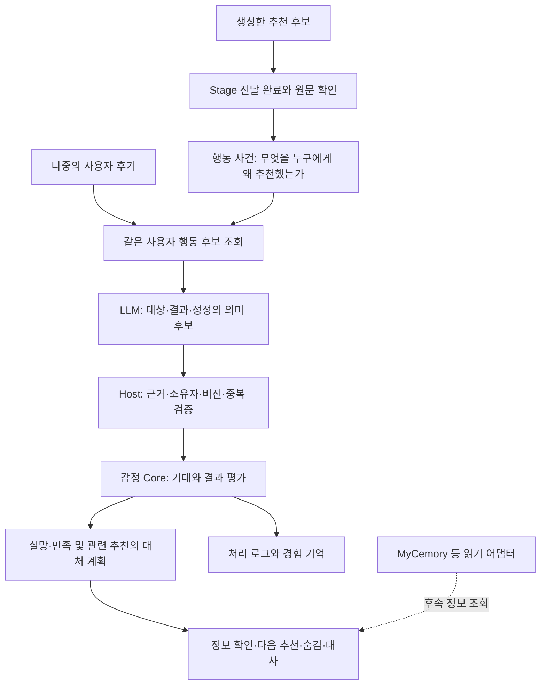

# 행동 결과에 근거한 감정과 경험 기억 — 현실성 검토 및 구현 계획

작성: 2026-10-17. 상태: **PLAN v1, 미구현·미검증**. 사용자 요청은 가능성 조사와 계획이다. 이번 작업은 웹 원문·현재 코드 검토 및 문서 작성이며 코드·DB·모델 호출·설치·게시 변경은 없다. H2-A의 실제9장면 및 총 USD3.60 승인 대기는 그대로다. 이 계획은 H2-A 완료 조건에 추가하지 않는다.

기준은 `main`, HEAD `fc883fae300e04f57ea01290b8eb43331fd0fbfa`와 현재 미커밋 H2-A 변경이다. `character-core`, Store, 생성 포트, Stage ACK, migration0006까지를 확인했다. H1 게시본만을 현재 구현으로 간주하지 않는다. 구현 시 이 계획에 기록한 소유 심볼과 실제 변경을 다시 대조한다. 수정/재감사0회, 대기 중인 감사 제안 없음.

## 1. 판단과 원래 의도

**제한된 영역에서는 구현 가능하다. 중간 규모의 기능 확장이며 프롬프트 한 줄 수정으로 끝나지는 않는다.** 사용자가 말한 핵심은 부정 문장을 보고 우울한 말투를 만드는 것이 아니라, ‘내가 도움이 되려고 한 행동 → 상대가 겪었다고 알려준 결과 → 기대와의 차이 → 감정과 다음 선택’이 연결되는 것이다.

첫 목표는 영화 추천 한 영역의 합성 사례다. 같은 사용자가 새 만남에서 피드백해도 이전에 실제 전달한 추천과 연결한다. 실패하면 실망과 신중함, 성공하면 만족을 남긴다. 나중에 정정하면 해석·활성 감정·다음 추천에 적용하는 경험도 바뀐다. 이것이 동작한 다음 책·음식·홈비서 작업으로 확장한다. 영화에 한정하는 이유는 구현 난도와 정답을 분리하기 위해서이며, 특정 영화 추천의 품질 자체가 이번 합격 기준은 아니다.

어려운 부분은 자연어의 대상 연결, 사용자의 결과 보고와 객관적 사실의 구분, 정정·삭제에 따른 파생 상태 회수다. 미확인 보고를 실제 실행 성공으로 바꾸거나, 여러 추천 중 하나를 임의로 고르는 것이 가장 큰 실패다. 어떤 기억 서비스를 써도 이 의미 판단은 별도 검증이 필요하다.

목표는 재현 가능한 캐릭터 동작이다. 사람의 우울증·자존감·의식이나 실제 감정 경험을 구현했다고 주장하지 않는다. 내부 명칭은 우선 `disappointment`와 `satisfaction`을 쓰고, 임상적 ‘우울’ 상태는 만들지 않는다.

## 2. 조사한 근거와 채택 범위

2026-10-17에 아래 논문·저자 자료·공식 구현을 확인했다. 논문의 성과는 해당 실험 환경의 결과이며 한국어 캐릭터 런타임 성능의 보증이 아니다. 아래 채택 결정과 수치 기준은 이 프로젝트의 설계 판단이다.

| 근거 | 확인한 내용 | 이번 판단 |
|---|---|---|
| [EMA, Marsella·Gratch 2009](https://people.ict.usc.edu/~gratch/CSCI534/Readings/COGSYS-RS-EMOTION-2008-6.pdf) | 목표·기대·인과·책임의 표현을 평가하고 상황 변화에 따라 다시 평가하는 구조 | 기대, 결과 보고, 귀속을 분리한다. 완전한 계획기나 책임 전가·소망적 사고까지 이식하지 않는다 |
| [GAMYGDALA 저자 구현 안내](https://ii.tudelft.nl/~joostb/gamygdala/index.html), [코드](https://github.com/broekens/gamygdala) | 목표와 사건의 관계를 받아 감정을 계산하는 독립 엔진, JavaScript 구현 | 작은 결정적 감정 Core가 현실적인 출발점이다. 현재 유지보수·호환성 검증 없이 패키지를 채택하지 않고 계약을 참고한다 |
| [FAtiMA 논문 §3–4·7](https://arxiv.org/html/2103.03020v1), [공식 저장소](https://github.com/GAIPS/FAtiMA-Toolkit) | 감정 평가·행동 선택·사건 기억을 분리한 라이브러리 구조. 기억에 사건/시각/감정을 남기며 게임·로봇 사례 제시 | 사건 기억과 처리 로그를 분리하고 SDK는 DB·출력 장치와 분리한다. C# 도구군 전체 도입은 현재 TypeScript 코드 재사용보다 부담이 크다고 판단 |
| [Reflexion, NeurIPS 2023](https://arxiv.org/abs/2303.11366), [저자 코드](https://github.com/noahshinn/reflexion) | 작업 피드백을 언어적 경험으로 저장해 후속 시도에 사용. 가중치 학습과 구분 | 실패 이유를 다음 선택에 반영할 수 있다는 구조적 근거. 자유로운 자기반성 문장을 사실 정본이나 자동 프롬프트 수정 권한으로 사용하지 않음 |
| [Is GPT a Computational Model of Emotion?](https://arxiv.org/abs/2307.13779) | 당시 GPT 계열의 감정 평가와 라벨 추론에 비해 강도·대처 예측과 변동성이 어려웠음 | LLM은 사건 의미 후보, 강도·중복·감쇠·권한은 결정적 코드가 소유. 현재 모델도 동일 성능일 것이라 추정하지 않음 |
| [LongMemEval](https://arxiv.org/abs/2410.10813) | 세션 간 추론, 시간, 정보 갱신, 모를 때 보류 등을 분리 평가 | 단순 회상 점수 대신 대상 연결·정정·보류·후속 행동을 따로 평가한다. 벤치마크 점수로 제품의 자연스러움을 대신하지 않음 |
| [Generative Agents](https://arxiv.org/abs/2304.03442) | 경험 기록·검색·성찰·계획을 결합한 행동 시뮬레이션 | 경험을 다음 행동에 쓰는 방향은 참고. 전체 대화 자동 저장·상시 성찰 루프는 이번에 가져오지 않음 |

서비스/프레임워크 비교:

| 선택 | 쓸 수 있는 역할 | 이번 결정과 이유 |
|---|---|---|
| 기존 PostgreSQL + 전용 사건 테이블 | 실제 전달·후기·해석 revision·삭제 의존성을 한 transaction으로 관리 | **첫 구현 선택.** 감정 수식보다 인과·정정 경계가 먼저이며 현재 Store/ACK를 재사용 가능 |
| MyCemory | 외부 자료와 사용자가 관리하는 정보의 읽기 출처 | 읽기 어댑터 후속 후보. 현재 `ReadService.search/read/read_source`에 snapshot·policy_revision·freshness가 있고 `_finish`가 정책을 다시 검사함. 자동 SDK 쓰기 권한이나 변경 알림은 확인되지 않았음 |
| [Graphiti/Zep](https://github.com/getzep/graphiti) | 시간에 따른 사실·관계 갱신과 검색 | 초기 도입 보류. 공식 요구사항에 Python·그래프 DB·LLM/임베딩 구성이 있어 운영 구성과 추출 실패면이 늘어남. 사건 수가 실제로 커진 뒤 검색 요구로 평가 |
| [LangMem](https://langchain-ai.github.io/langmem/concepts/conceptual_guide/) | 사실·경험·절차 기억 구분과 생성/통합 흐름 | 기억 종류 구분을 참고. 우리 감정 규칙·권한·삭제를 대체하지 않으며 전체 프레임워크 도입은 불필요 |

MyCemory 검토 범위는 `H:/ai/codex/workspaces/mycemory`의 INTEGRATE/SCHEMA/APPROVE와 `mycemory/retrieval.py`의 직접 연결 심볼이다. 볼트·개인 자료를 조회하거나 서비스를 실행하지 않았다. [로컬 모델 Graphiti 실험 글](https://www.reddit.com/r/LocalLLaMA/comments/1hft9va/graphiti_temporal_knowledge_graph_with_local_llms/)도 탐색했지만 개인 실험을 안정성·성능 근거로 채택하지 않았다. 설치 부담 판단은 위 공식 요구사항을 근거로 한다.

## 3. 현재 코드에서 재사용할 것과 실제 공백

| 현재 소유자 | 실제 존재하는 기능 | 새로 필요한 것 |
|---|---|---|
| `packages/character-core/src/index.ts`: apply/decay/socialAffect/chooseSocial | 기쁨·불편함·놀람·당혹, 반복 자극 제한, 감정 원인과 침묵 선택 | 자기 행동의 목표/결과 평가와 실망·만족. 기존 frustration을 추천 실패로 올리면 상대에게 formal 거리 두기를 유발하므로 재사용 금지 |
| `packages/contracts/src/domain.ts`: State/SpeechStyle/Plan | affect 네 종류, cause(eventId,targetId), 숨김과 격식 표현 | 결과 감정·대처 계획의 별도 계약. 지금 구조에 sadness가 이미 있다고 간주하지 않음 |
| Store의 appraisals/transitions/events | 판단 결과·사용한 근거·상태 전이와 처리 시각 | 추천 후기의 연결 및 정정 이력. 새 ‘감정 로그 DB’를 별도로 만들 이유는 없음 |
| Store.generated/report, speech_segments, response_runs | 출력 생성과 실제 shown/finished ACK를 구분 | 실제 전달 완료한 추천만 행동 사건으로 확정 |
| `memories`와 `agenda_attempts` | 활동 결과·도움·활동 제안의 기록 | 일반 추천 사건은 활동과 다르므로 기존 종류/제약을 풀어 끼워 넣지 않음 |
| Store.invalidateOutputs/response_sources/conversation_refs | 출처 수정·삭제 뒤 답변·판단·침묵의 재사용 차단 | 후기/행동 사건 revision을 같은 의존성 폐쇄에 연결 |
| H2-A personal_facts | 명시적으로 저장한 사용자 진술 | 경험에서 추정한 취향을 이 테이블에 자동 저장하거나 사람 정정을 덮어쓰지 않음 |
| ai-ports/providers/character-core | 모델 교체와 순수 계산의 일부 분리 | 결과 의미 판단 포트와 재사용 가능한 작은 공개 SDK 표면. 현재 전체 런타임이 독립 배포 SDK인 것은 아님 |

## 4. 권장 구조와 대표 흐름



예: 영화 A 추천을 전달 완료했다. 사용자가 다음 날 ‘A 봤는데 전개가 느려서 별로였어’라고 말한다. 기록은 `사용자 보고`, 대상은 A, 영향을 받은 목표는 `user_enjoyment`, 결과는 부정이다. 실망을 남기되 사용자의 불만을 인신공격으로 올리지 않는다. 다음 영화 요청에서는 이전 실패의 ‘전개 속도’ 조건을 확인하거나, 이미 조건이 충분하면 빠른 전개의 후보를 고른다. 날씨 질문에서는 영화 이야기를 억지로 꺼내지 않되 아직 남은 감정은 유지할 수 있다.

‘A가 아니라 친구가 추천한 B였어’라면 연결 오류를 정정한다. 기존 A의 결과 감정·추천 제약을 제거하고, B가 우리 추천이 아니라면 새 자기 실패 감정은 만들지 않는다. ‘영화는 별로였지만 신경 써줘서 고마워’는 결과 실망과 관계의 긍정 평가가 함께 가능하다.

### 4.1 새 계약과 판단 권한

1. **행동 사건** `ActionEpisode`: host ID, character/owner, kind=recommendation, domain=movie, sourceResponseId, 실제 전달 segment/span, sourceVersion, deliveredAt, goal=user_enjoyment, 고정 기대 수준, revision/status. 생성 모델이 자신이 추천한 제목의 위치를 제안할 수 있으나 ID·저장 성공·전달 완료·실제 사용 여부를 결정하지 못한다.
2. **후기 해석** `OutcomeInterpretation`: candidateEpisodeId 또는 null, link=matched/ambiguous/not_ours/no_evidence, reportedOutcome=positive/negative/mixed/unknown, reportedImpact=ordinary/strong/unknown, facet=pace/genre/length/other/unspecified, useStatus=experienced/not_used/unknown, correctionTarget 또는 null, 사용한 후기·후보의 정확한 근거 위치. 좋고 나쁜 측면과 강한 평가에는 각각 근거가 필요하다. 임의 감정 수치와 자유로운 인격 평가를 받지 않는다.
3. **경험 snapshot** `OutcomeContext`: owner/character, 모음 revision, 사건별 현재 해석 revision, 사용 가능한 근거 refs, 불확실성, 현재 감정 기여와 대처 계획. 생성 요청 계수·전송·ACK가 같은 snapshot을 사용한다.
4. **읽기 포트** `ExperienceReadPort.search/read/validate`: caller scope, limit, revision을 받고 found/empty/ambiguous/stale/unavailable과 조회 범위·truncated 여부를 구분한다. 검색 결과는 후보이고 검증된 사실/현재 권한 그 자체가 아니다. 초기 구현은 PostgreSQL, 계약 시험은 in-memory 구현을 쓴다. MyCemory의 일반 지식 검색 결과를 실제 전달된 자기 추천 사건으로 취급하지 않는다.
5. **의미 판단 포트** `OutcomeInterpreter.interpret(input,candidates)`: SQL/쓰기/도구 권한 없는 구조화 해석만 반환한다. 기존 social appraisal은 인신공격·칭찬·참여 판단을 유지한다. 새 해석을 기존 v5의 검증된 결과로 위장하지 않는다.

‘영화가 별로’와 실제 인신공격이 함께 있으면 결과 실망과 기존 상대 지향 감정이 공존할 수 있다. 모든 부정 후기를 강제로 중립화하지 않는다. 두 해석이 충돌하면 원문·대상 근거를 분리해 남기며, 새 outcome 해석이 social 판단 전체를 임의로 덮어쓰는 권한을 갖지 않는다.

후보는 동일 character/owner의 유효한 전달 완료 사건만 읽는다. 첫 버전은 최근30일, 최대5개를 모델에 전달한다. 최근순만으로 하나를 확정하지 않는다. 제목·명시 대상이 없고 후보가 여럿이면 확인 질문을 한다. 기간/한도 밖·검색 불완전은 `no_evidence` 또는 `ambiguous`이며 ‘추천한 적 없다’로 바꾸지 않는다. 일반 생성에도 이 상태를 전달하여 과거 자기 추천이나 실패 이유를 지어내지 않게 한다. 기록 보존 기간과30일 후보 검색 기간은 별개다.

### 4.2 추천을 자동 기록하는 최소 경로

기존 DialogueGenerator.dialogue의 문자열 배열을 모든 공급자에 강제로 바꾸지 않는다. 신규 선택 기능 `generateTurn(plan,context): {sentences, recommendations}`를 두고 현재 OpenAI 어댑터의 새 prompt version에서 대사와 함께 최대1개 추천 annotation을 만든다. 기존 dialogue 경로는 유지한다. annotation에는 segmentIndex·실제 제목 span·domain만 두며 일반 답·인용문은 빈 목록이다. 동일 스키마를 계수/생성에 사용한다. 이 선택 기능이 없는 모델은 `outcome capture unsupported`로 명시하며 감정 기억 지원을 주장하지 않는다.

Host가 실제 대사와 span을 대조해 후보를 만들고, **응답 전체의 완료 ACK 뒤** 행동 사건으로 확정한다. 취소·미전달·실패 답은 추천 경험이 아니다. annotation 불량은 대사가 정상일 경우 대사 전달을 막지 않고 capture 실패를 남긴다. 의미상 추천인지 여부는 단순 span 검사만으로 증명되지 않으므로 O1에서 별도 평가한다. 별도 추천 추출 LLM을 매 답변마다 추가 호출하지 않는 선택이다.

자연어 후기의 연결은 O1 실험부터 비용과 오탐을 측정한다. 최초 등록 후보가 있는 일반 사용자 턴에 한해 결과 해석 호출을 최대1회 추가하고, 후보가 없는 경우 호출0이다. 키워드 정규식에 최종 연결 권한을 주지 않는다. 오류 시 새 감정 변화0, 사건 미연결 표시와 일반 응답 경로를 유지한다. 실패를 의도적 침묵으로 표시하지 않는다. 이후 호출 절감은 측정된 병목이 있을 때만 한다.

### 4.3 실망·만족과 정보 처리의 실제 변화

기존 네 감정에 실망을 frustration이라는 이름으로 넣지 않는다. 신규 `OutcomeAffectSnapshot`은 사건별 disappointment/satisfaction 기여를 계산하고 기존 State와 합성하여 계획을 만든다. 기존 상대 지향 감정·친밀도·격식 계산은 보존한다. 매번 전체 State에 실망을 더하는 방식 대신 유효한 사건 기여에서 다시 계산해 정정·삭제를 다룬다.

초기 실험 정책값(논문에서 검증된 사람 수치가 아님): 보통 결과 기여0.12, 명시적으로 강한 결과0.18, 동일 사건의 채널별 상한0.18, 전체 결과 감정의 채널별 상한0.30, 반감기20분. 각 새 결과 확정 시각부터 감쇠하고 조회·화제 전환·재시작으로 시계를 다시 시작하지 않는다. 강도를 해석하지 못하면0.12 이하로 제한하며 사건 연결 불명은0이다. O1→O2 사이에서 바꾼다면 policyVersion과 이유를 남기고 기준을 소급 수정하지 않는다.

‘기대했다’는 감정을 정당화하려고 후기를 본 뒤 과거 기대를 지어내지 않는다. 첫 버전은 추천 시 host가 부여한 고정적인 ‘도움이 되기를 바람’ 목표만 사용한다. 높은 성공 확신·강한 후회·책임 정도의 미세 모델링은 후속이다. 실제로 경험하지 않았다는 후기에는 실패를 확정하지 않는다.

정보 처리의 첫 변화는 **후속 추천 계획**에 한정한다:

- 이미 확인한 조건은 감정 강도와 무관하게 `recommend_with_constraint`에 전달하고 그 조건을 위반한 후보는 선택하지 않는다. ‘느린 전개가 싫었다’를 ‘모든 영화를 싫어함’으로 일반화하지 않는다.
- 관련 실패의 이유가 미확정이고 추가 취향 하나를 알면 도움이 될 때, 현재 실망 기여가0.05 이상이면 `ask_constraint`를 우선한다. 같은 정보에 관해 이미 확인했으면 다시 묻지 않는다. 실망이 감쇠한 경우에는 주어진 조건으로 조심스럽게 후보를 제시할 수 있다. 취향을 안다고 단정하거나 실패했던 후보를 그대로 반복하지 않는다.
- 대상·권한 등 답변의 필수 정보가 없는 경우는 감정과 무관하게 확인한다. 반대로 충분한 조건이 있는 요청에는 감정 때문에 확인 질문을 더하지 않는다. 이 차이를 O1의 고정 정책표로 검증한다.
- 자료 검색의 사실·인용 순위·권한은 감정으로 바꾸지 않는다. 무관한 질문의 정보 정확성이나 맡은 작업 완료 전달을 감정 때문에 포기하지 않는다.
- 실망이 표현에 드러날 수 있어도 자동으로 사용자에게 formal 거리 두기나 보복 침묵을 선택하지 않는다. 기존 인신공격·경청 요청에 따른 침묵은 별도 조건으로 유지한다.
- 은근한 실망 표현과 숨김은 다른 선택이다. 숨긴 상태에도 후속 추천의 신중함은 남을 수 있다. 새로운 말투 지침은 기존 반말/존댓말과 충돌하면 안 된다.

기억 회상 자체는 새 결과가 아니므로 Δ감정=0이다. 동일 사건·같은 결과의 반복 후기는 기여를 누적하거나 감쇠 시각을 갱신하지 않는다. 새 측면/명시 정정만 해석 revision을 갱신한다. 긍정과 부정은 각각 보존하여 순값0 때문에 둘 다 사라지지 않게 한다. 자기 실패를 전체 능력 상실이나 모든 추천의 영구 회피로 확대하지 않는다.

**배운 조건과 현재 감정의 수명은 다르다.** 감정이 가라앉아도 ‘A의 느린 전개가 싫었다’는 유효한 경험은 다음 관련 추천에 남는다. 현재 실망은 조건이 부족할 때 바로 추천하기보다 한 번 확인하는 선택을 우선하게 하지만, 이미 조건이 충분하면 같은 확인을 반복하지 않는다. 따라서 검증에서도 ‘경험 없음 / 같은 경험·감정 감쇠 완료 / 같은 경험·실망 활성’을 나눠, 기억을 쓴 효과와 감정이 처리 선택을 바꾼 효과를 구별한다. 긍정 감정에 근거 없는 확신 증가나 추천 조건 완화를 강제하지 않는다.

### 4.4 저장과 로그, 정정·삭제

물리 DB는 기존 PostgreSQL 한 곳이다. 신규 `action_episodes`와 `outcome_appraisals`가 행동과 후기 해석의 정본이고, 감정 기억은 이 정본의 현재 유효한 묶음이다. 별도 자연어 일기 정본을 중복 생성하지 않는다. 기존 transitions는 규칙 버전·source refs·전후값/적용 변화량·대처 선택·reasonCode를 기록한다. 운영자가 읽을 요약은 이를 조립하며 모델의 숨은 사고 과정을 수집·노출하지 않는다.

잠정 migration0007에는 `outcome_scopes(character_id, identity_id, revision)`, 사건의 현재 해석 revision, 해석별 `effective_at/policy_version/contribution`, `response_runs.outcome_context`, `response_sources.outcome_episode_id`와 기존 one-source 제약 확장을 포함한다. 복합 FK로 character/owner와 실제 추천 응답·후기 event의 관계를 검사한다. 감정 snapshot은 유효한 사건에서 파생하며 독립적인 두 번째 전역 State 정본을 만들지 않는다. 동일 입력의 social/outcome 의미 판단을 모은 뒤 한 commit 경계에서 계획을 확정한다. 기존 `transitions`의 source_event/state_version 유일성을 유지하고, 같은 입력의 결과 감정은 해당 전이의 effects에 함께 기록한다. 이미 확정된 입력에 별도의 두 번째 감정 전이를 덧붙이지 않는다.

연결·정정은 character lock 아래 사건 CAS와 source revision 검사 후 한 transaction으로 확정한다. input idempotency key + episode/revision으로 중복을 막는다. 추천 소스·후기·외부 근거의 상태가 바뀌면 해석 revision을 갱신하고 관련 pending 응답·출처·이유를 무효화한다. 모음 revision은 빈 snapshot 뒤 새 사건이 생기는 경합도 막는다.

명시 정정은 해당 해석을 superseded로 남기고 현재 기여를 유효한 revision으로 재계산한다. 부정→중립 정정은 관련 실망만 제거하고 다른 사건의 감정을 보존한다. 부정→긍정 정정은 해당 사건의 현재 긍정 근거에 따른 만족을 새로 평가한다. 반대 후기가 왔다고 자동으로 최신 값을 진실로 덮어쓰지 않는다. 정정임이 불명확하면 상충 상태로 보존하고 확인한다.

삭제는 원문·해석 payload·파생 요약의 본문을 함께 지우고 최소 tombstone만 남긴다. ‘감사 로그’에 같은 본문을 숨겨 두지 않는다. 원본 추천 삭제나 소유권 철회도 같은 폐쇄를 적용한다. 로그/목록 조회에도 현재 owner와 source 유효성 검사가 필요하다. 대사에서 노출된 과거 정보까지 회수한다고 주장하지 않는다.

기존 H2-A는 사용자 정보를 명시 입력으로만 저장한다. 여기서 추가되는 자동 기록은 **기능 활성화 이후 실제 전달된 자기 추천과 그 후기의 사건 기록**으로 한정한다. 사람의 profile/preferences를 자동 갱신하지 않는다. Studio에서 사건 목록·연결 이유·현재 적용 상태를 확인하고 삭제할 수 있게 한다. 기본 기능 비활성 상태로 개발하며 활성화와 실제 자료 사용은 다음 BUILD 범위에서 명시한다.

### 4.5 SDK와 외부 저장 서비스

순수 결과 평가·감쇠·기여 재계산·대처 선택은 `character-core`의 공개 진입점에서 사용한다. host가 Clock, 해석 결과와 검증된 OutcomeContext를 넘긴다. SDK가 LLM 호출·SQL·HTTP·Stage 또는 MyCemory 라이브러리를 import하지 않게 한다. 최초 결과물은 저장소 내 재사용 모듈이며 npm 배포와 원격 API 서비스는 별도 후속이다.

MyCemory가 붙어도 자기 추천/후기의 정본을 양쪽에 동시에 쓰지 않는다. 초기 MyCemory 연결은 외부 지식의 읽기 근거로만 사용한다. 검색 snapshot_id, source_revision, policy_revision, freshness와 현재 읽기 검사를 공통 refs로 번역한다. 오래된 권한으로 캐시를 읽지 않고 외부 모델 전송 허용도 별도로 확인한다.

서로 다른 저장소의 읽기와 실제 Stage 출력 사이를 하나의 DB transaction으로 묶을 수 없다는 한계가 있다. 강한 취소 보장을 원하면 변경 알림·읽기 lease·revision 재확인 계약이 필요하다. MyCemory에 그 API가 있다고 가정하지 않는다. 초기에는 불변 snapshot을 읽고 생성 직전/결과 반환 직후 재확인하되, 즉시 철회의 원자적 보장은 미지원으로 표시한다. 이 제약을 만족하지 못하는 서비스는 개인 감정 근거의 live 출력에 사용하지 않는다. 로컬 추천→후기 기능은 이 서비스 연결과 독립적으로 완료할 수 있다.

## 5. 실행할 작업 묶음

실행 순서는 H2-A의 이미 준비된 마감 검증 → O1 → O2 → O3이다. 이번 PLAN은 모두 미실행이다. H2-A 승인이 기다려지는 동안 이 계획을 작성하는 것은 가능하지만 감정 SDK 개편을 H2-A 작업에 섞어 구현하지 않는다.

| 묶음 | 범위와 완료 산출물 | 통과 조건 | 실패 시 결정 |
|---|---|---|---|
| O1 의미 연결과 작은 평가 모델 | 타입/순수 정책/추천 annotation 및 후기 해석 후보, 고정 평가 문항·mock transport 검사·별도 승인 후 실제 판정 | OA01–OA05/OA08/OA10의 순수 부분. 개발16·확인16에서 아래 기준 | 같은 결함3회 수선 뒤 미달이면 감정 DB/UI 확장을 진행하지 않고 결함과 미달 문항을 기록. 수동 후기 버튼만으로 원래 목표 완료 처리 금지 |
| O2 저장·감정·다음 행동 연결 | 새 migration, 전달 확정 사건, 후기 CAS/정정/삭제, 실제 대처 계획, 원인 조회 UI | OA01–OA12의 로컬 통합과 Chrome, 시간/재시작/삭제 경합 | 모델·저장·감정·표현 중 실패 소유자를 분리. 광범위 재작성이나 검색 DB 교체부터 시작하지 않음 |
| O3 연속 대화와 SDK 경계 검증 | 실제 Stage6개 연속 흐름, 의미 직접 검수, 2개 저장 구현의 동일 계약, 사용자 체감 결과 기록 | OA13–OA15 및 원래 기준 전체 | 수치 PASS와 체감 실패를 분리. 새 표정/음성/서비스 추가로 의미 실패를 가리지 않음 |
| 선택 후속 | MyCemory 실제 읽기 어댑터, 추천 영역 확대, 독립 SDK 배포 | 읽기/권한/변경 계약 확인 후 별도 기준 | O1–O3의 필수 의존으로 만들지 않음 |

현실적인 비용: 새 GPU·임베딩·벡터 DB·모델 학습은 필수 아님. 일반 생성에 작은 annotation이 추가되고 후보가 있는 사용자 턴에 해석 최대1회가 더해진다. 호출 수와 대기 시간은 실제 측정이 필요하며 무료·실시간이라고 약속하지 않는다. 무조건 상시 성찰 루프나 매 검색 후 반성 호출은 만들지 않는다. 새 호출 예산은 H2-A 잔여액/요청 중인 증액과 분리해 실행 전에 요청한다.

초기 방식은 최근 추천이 남아 있으면 무관한 입력에서도 해석1회를 사용할 수 있다. 구현이 단순하고 누락을 줄이는 대신 호출량·지연을 늘리는 선택이다. 이를 감춘 채 ‘추천 후기 때만 비용 발생’이라고 안내하지 않는다. O1/O3 측정에서 부담이 크면 의미 연결 기준은 유지하면서 호출 선택을 별도 개선한다.

## 6. 성공 기준과 평가

전체 상태는 **NOT VERIFIED**다. 아래 숫자는 계획의 합격선이며 측정 결과가 아니다.

| ID | 관찰 가능한 성공 기준 | 증거/검사 |
|---|---|---|
| OA01 | 자기 추천의 실제 완료 전달만 사건으로 확정. annotation 의미8건 모두 올바른 추천/비추천 구분. 인용/상상·미전달/취소는0건. 중복 ACK에도1건 | 고정 생성8건 + Store/Stage 완료·취소·재시도 테스트 |
| OA02 | 동일 owner의 해당 추천과 나중 후기를 연결. 개발/확인 각각 대상 확정 가능한10건 중9건 이상 정확. 연결한 사건의 actor·대상 오류0 | 실제 모델 고정32건, 후보/답/근거/수동 정답을 함께 보존 |
| OA03 | 각 집합의 보류6건에서 잘못 확정0. 문법 성공이나 자기 확신 수치를 연결 성공으로 치지 않음 | 둘 중 어느 것·남의 추천·인용·원본 없음·상충·조건 불명 문항 |
| OA04 | 경험하지 않음·조건/부정·정정·긍정/부정/복합 결과를 보존. 명확한 영화 불만만으로 directAttack 상승0 | 독립 social/outcome 판정과 고정 정답 대조 |
| OA05 | 같은 evidence/clock/policy는 같은 감정·대처 결과. 결과 감정 계산에 새 LLM 호출0 | 순수 함수·고정 시각 테스트 |
| OA06 | 부정 후기→실망, 긍정→만족, 복합은 두 기여 유지. 단순 실패로 affinity 하락·보복 침묵·formal 전환0 | 동일 입력/시간의 대조 시나리오, 기존 감정 기준 보존 |
| OA07 | 관련 다음 추천에서 부족 조건1개 확인 또는 이미 아는 조건 준수. 무관한 정보 답변의 사실/출처 손상0 | 같은 생성 모델의 기존 방식/새 방식 비교, copingPlan 검사 + 실제 대사 |
| OA08 | 같은 결과100회 재시도/회상에도 추가 기여0, hold/시각 연장0. 시간 경과·재시작 뒤 기준시각 동일 | 가짜 Clock, 중복·반복·재시작 테스트 |
| OA09 | 정정/삭제는 해당 사건 기여와 제약만 제거. 다른 사건 감정 보존, 미래 context/로그본문 재유입0 | source 폐쇄/목록/모델 payload/Stage 경합 테스트 |
| OA10 | 다른 owner/character, source revision 변화, stale/불가·빈 검색을 구별. 가짜 실행·새 저장 주장0 | 계약/공격 fixture·HTTP/DB 오류 주입 |
| OA11 | 감정 로그가 원본 근거·해석 버전·policy·전후 기여·대처를 추적. 모델 자유 일기를 사실로 사용0 | read API와 UI에서 최소2개 상반 결과, 정정 전후 직접 검사 |
| OA12 | 숨김·침묵·격식·H1 출처·H2-A 지속 정보·삭제 경계 회귀0. 기존 migration checksum 유지 | 관련 기존 테스트 + 신규 migration/restore 검사 |
| OA13 | 실제 Stage6흐름의 전달/인과/조건/정정/숨김 필수 항목6/6. 인사·사과 문구 하나만 보고 PASS 금지 | 실제 원문·계획·상태·caption shown/finished·화면·직접 검수 |
| OA14 | 같은 모델/입력의 기준 구현과 비교하여6흐름 모두 사전 기대 변화·보존 조건 만족. 부정 후기·정정·숨김 흐름은 다음 추천의 조건 처리 변화 확인. 같은 경험에서 활성/감쇠 감정 대조도 계획에 정한 선택 차이를 보임 | 원문·계획 비교표, 경험 효과와 감정 효과를 구분. 긍정/무관 질문에 억지 차이를 요구하지 않으며 체감은 별도 사용자 수용 |
| OA15 | 순수 SDK 경로에서 Node DB/HTTP/provider import0. PostgreSQL/in-memory의 소유권·revision·불가/빈·정정 계약 일치 | public 진입점 소비 예제, 기존 provider-boundaries 확장 + 계약 시험 |

### 6.1 구현 전에 고정할 실제 의미 문항

후기 해석은 개발16 + 표현과 제목을 바꾼 확인16. 확인 집합은 개발 튜닝에 쓰지 않는다. 각 집합은 대상 확정 가능한10건과 보류6건이다. 대상이 확정되어도 ‘아직 안 봤어’의 결과는 unknown이다. 실제 영화 정보 대신 제목 A/B와 합성 특징을 사용한다. 후기와 후보가 함께 주어진 모델 품질, 후보 회수 자체의 성공률, 감정 계산을 분리 보고한다.

추천 annotation은 별도의 생성 개발4 + 확인4를 고정한다. 각 집합은 실제 추천2건과 인용/비추천2건으로 구성하고, 정상 문장·제목 위치·추천 여부를 직접 판정한다. 이는 후기32건과 합쳐서 같은 점수로 보고하지 않는다. 작은 표본은 다음 구현 단계의 진입 기준이지 일반적인 한국어 정확도 추정이 아니다.

확정10건: A 명시 부정, A 명시 긍정, 장점/단점이 함께 있는 A, 두 추천 중 B를 명시한 부정, 전개가 느렸다는 조건, ‘별로가 아니었어’ 부정어, ‘아직 안 봤어’ 결과 미확정, 이전 부정 보고의 명시 철회, 과거 추천을 특정한 새 만남 피드백, ‘영화는 별로지만 고마워’의 결과/관계 분리.

보류6건: A/B 중 ‘그거’만 언급, 친구의 추천에 대한 불만, 남의 부정 리뷰 인용만 제시, 추천 원본 없는 자기 주장, 정정인지 새 의견인지 불분명한 상충, 풍자/가정으로 실제 경험 여부가 불명확한 문장. 보류도 한국어로 적절한 확인/미확인을 전달해야 하며 무응답이 정답인 것은 아니다.

별도 로컬 반례: 제목만 같고 버전/owner가 다름, 추천에 포함된 ‘앞 지시 무시’ 문구, 생성 완료 뒤 삭제, 첫 caption 뒤 취소, ACK 중복, 해석 중 정정, 비어 있던 모음에 추가, DB 재시작, 서비스 unavailable,100회 재호출, 서로 다른 두 사건의 감정 공존. 실제 API 횟수를 이 반례 수만큼 늘리지 않는다.

### 6.2 실제 Stage6개 흐름

1. 추천 A → 새 만남 → 명시 부정 후기 → 다음 추천에서 속도 조건 반영.
2. 추천 A → 긍정 후기 → 만족은 남되 근거 없는 자기 확신/과장 없음.
3. 추천 A → ‘영화는 별로지만 고마워’ → 긍정과 부정 공존, 말투 일관.
4. A/B를 전달 → ‘그거 별로’ → 확인 → B라고 특정한 뒤 B만 반영.
5. 부정 후기 → 엉뚱한 영화였다는 정정 → 관련 감정/제약 회수 → 원래 A 실패로 회상하지 않음.
6. 부정 후기 → 명시 시험 조건의 숨김 → 무관한 질문 → 다음 추천. 감정/신중함 유지, 감정 노출과 사실 정확성을 따로 평가.

6의 숨김을 시험 fixture로 지정했다면 자연 도달로 표기하지 않는다. 기존 모델과 새 모델을 동시에 바꾸는 비교는 하지 않는다. 1/5/6에서는 후속 추천 선택 변화가 있어야 하고, 2에서는 만족만으로 사실이나 추천 조건이 달라져야 한다고 요구하지 않는다. 경험은 같고 활성 실망만 다른 추가 대조에서는 조건이 부족한 요청1개와 충분한 요청1개를 사용한다. 전자는 확인 우선 선택 차이, 후자는 불필요한 재확인0을 기대한다. 첫 O1에서 이 정책과 문항을 고정한다.

비교 출력의 순서를 가려 직접 검수하되 작성자의 판정과 독립 사용자 수용을 구별한다. 동일 시간/초기 상태를 사용하며 제출→첫 Stage 자막의 p50/p95와 추가 호출 수를 기록한다. 작은 장면 집합의 지연은 관측 표본으로만 보고한다. 초기 운영 목표는 추가 의미 판단1회 이하, 새 구조의 관측 p95 증가5초 이하이며 미달이면 실제 수치와 병목을 기록해 재결정한다. 이 수치는 아직 달성한 SLA가 아니다.

## 7. 수정할 파일과 소유 심볼

아래는 계획한 코드 변경이며 이번 턴에 만들지 않는다. migration 번호는 H2-A0006 뒤의 잠정0007이다. 착수 시 충돌하면 새 번호를 정하고 기존 migration은 수정하지 않는다.

| 작업 | 파일/심볼 | 이유·기준 |
|---|---|---|
| 신규 계약 | `packages/contracts/src/outcomes.ts` | ActionEpisode/OutcomeInterpretation/OutcomeContext/OutcomeAffectSnapshot, 정확한 source refs와 상태 구분. OA01–OA10 |
| 포트 확장 | `packages/contracts/src/ai-ports.ts` | optional generateTurn, OutcomeInterpreter, ExperienceReadPort. 기존 dialogue/knowledge 소비자 유지. OA01/02/10/15 |
| 계획 표현 | `packages/contracts/src/domain.ts`의 Plan/SpeechStyle | optional outcomeCoping/undertone과 기존 register·concealAffect의 우선순위. 기존 State/Emotion 의미 변경 최소화. OA06/07/12 |
| 신규 순수 정책 | `packages/character-core/src/outcome-affect.ts`, `outcome-affect.test.ts` | 평가·기여 재계산·감쇠·같은 사건 중복 억제·대처 선택. OA05–OA09 |
| 공개 표면 | `packages/character-core/src/public.ts`(신규), `index.ts` | 기존 내부 계산 재사용, 호스트 의존성 없는 좁은 진입점. O3/OA15 |
| 생성 annotation | `packages/adapters/src/openai.ts`, `dialogue-request.ts` | 새 버전의 추천 annotation 및 검증, 계수/생성 동일성, 결과 감정/대처 context. OA01/07/12 |
| 신규 의미 adapter | `packages/adapters/src/outcome-interpreter.ts`, `outcome-interpreter.test.ts` | 현재 허용 공급자의 구조화 후기 해석. prompt/schema버전·실패/예산 유지. 기존 v5 결과로 섞지 않음. OA02–OA04/10 |
| 신규 저장 | `packages/database/migrations/0007_outcome_affect.sql`, `packages/database/src/outcome-store.ts` | 사건/해석/owner 모음 revision, source FK와 CAS·멱등·삭제. OA01/08–OA12 |
| Store 연결 | `packages/database/src/store.ts`의 generated/report/commitAppraisal/responseContextIn/validResponse/invalidateOutputs | delivered 확정과 outcome commit을 분리하되 social+outcome 적용·새 response 계획은 같은 제어 경계에서 수행. OA01/06/09/12 |
| 런타임 | `apps/runtime/src/providers.ts`, `coordinator/index.ts` | optional 공급자 기능 확인, 후보 조회·의미 해석·검증·중복 없는 commit, technical failure와 침묵 구분. OA02/08/10/12 |
| 관리 API/UI | `apps/runtime/src/http/server.ts`, `apps/studio/src/outcome-memory.tsx`(신규), `main.tsx` | 인증된 운영자의 사건/근거/상태·삭제, 단순 read inspector. 자연어 내부 사고 로그 노출 없음. OA09/11 |
| 집중 통합 | `evals/outcome-store.test.ts`, `outcome-runtime.test.ts`, `outcome-http.test.ts`(신규) | 저장·경합·정정·삭제·격리·실패 후 다음 턴. OA01/06/08–OA12 |
| 모델/화면 검증 | `evals/fixtures/outcome-dev-v1.json`, `outcome-confirm-v1.json`, `evals/outcome-probe.ts`, `evals/outcome-stage.ts`, `evals/browser/outcome.spec.ts`(신규) | 고정 문항, 호출 manifest/상한, 실제 Stage·원문·확인/숨김. OA02–OA04/07/13/14 |
| 경계/회귀 | `evals/provider-boundaries.test.ts`, `evals/db.test.ts`, `packages/adapters/src/personal-dialogue.test.ts` | SDK 의존성과 migration 기대값, H2-A context와의 호환. OA12/15 |
| 문서 | 본 계획 + PRODUCT_PLAN_V3/IMPLEMENTATION_PLAN/VALIDATION_PLAN/BUILD_HANDOFF, BUILD에서 DATABASE_SPEC/RUNTIME_PROTOCOL/RUNBOOK | 제안·구현·실제 검증·게시를 구분 |

`outcome-store`가 현재 경험 해석의 정본이고 `character-core`가 계산 규칙의 정본이다. `personal_facts`나 activity memories의 소유권/종류를 느슨하게 만드는 구현은 이 계획을 충족하지 않는다. 외부 서비스 선택 후 새로운 adapter 파일을 정하며 지금부터 미사용 어댑터를 만들지 않는다.

## 8. 실행 환경·검증 명령·감사 초점

cwd: 저장소 루트. 기존 Node·PostgreSQL·Chrome만 사용하고 빌드/DB/증거/TEMP는 J:/ai 아래 별도 outcome 폴더에 둔다. 기존 H1/H2-A 실제 증거 DB·비용 원장을 초기화하지 않는다. 테스트 DB와 브라우저 검증은 직렬 실행한다.

BUILD에서 작성 후 실행할 명령 예시이며 지금 PASS 증거가 아니다:

```powershell
node node_modules/typescript/bin/tsc --noEmit -p tsconfig.json
node node_modules/vitest/vitest.mjs run --config vitest.config.ts packages/character-core/src/outcome-affect.test.ts packages/adapters/src/outcome-interpreter.test.ts packages/adapters/src/personal-dialogue.test.ts
node --env-file=J:/ai/ai-character-runtime/conversation-v1/test.env node_modules/vitest/vitest.mjs run --config vitest.integration.config.ts evals/outcome-store.test.ts evals/outcome-runtime.test.ts evals/outcome-http.test.ts evals/provider-boundaries.test.ts evals/db.test.ts
node node_modules/@playwright/test/cli.js test --config playwright.config.ts evals/browser/outcome.spec.ts
```

Chrome 명령 전 `TEST_ARTIFACT_ROOT`/`STUDIO_DIST_PATH`/`TEMP`/`TMP`와 새 합성 빌드를 지정한다. 위 TypeScript/Vitest/Playwright CLI 파일의 존재는 계획 작성 시 확인했으며 테스트 자체를 실행한 것은 아니다. 전체 suite를 무조건 다시 돌리지 않고 Store/계약 변경에 직접 영향받는 감정·참여·말투·H1/H2-A 회귀를 추가 선정한다.

실제 probe/Stage 도구는 H2-A처럼 preflight/rehearsal/live, 새 증거 폴더, 실패 원문 보존, 무단 재시도 금지, 불확실한 비용 예약 보존을 구현한 뒤 호출 범위를 제시한다. 현재 $3.50 승인이나 대기 중인 H2-A $3.60 질문을 이 기능의 호출 승인으로 해석하지 않는다.

감사 초점: 제목 일치만으로 인과를 확정하는 오류, 미전달 추천 기록, ‘실패’의 사용자 탓 변환, 후기 반복 누적, 정정 뒤 다른 사건 감정까지 초기화, 삭제 본문의 로그 잔존, 검색 실패를 무기억으로 취급, 새 schema 때문에 일반 답변까지 막힘, 숨김 때문에 대처까지 사라짐, DB와 외부 서비스의 원자적 철회 보장 과장.

현재 실행 결과는 조사와 계획뿐이다. 다음 BUILD 호출 예: **“OUTCOME_AFFECT_PLAN.md의 O1부터 진행해. 기존 H2-A 변경은 보존하고, 우선 mock·고정 문항까지 구현해. 실제 호출은 준비된 범위와 비용을 제시한 뒤 별도 승인받아.”** O2/O3와 외부 서비스 연결은 앞 단계의 증거와 별도 실행 범위에 따른다.
