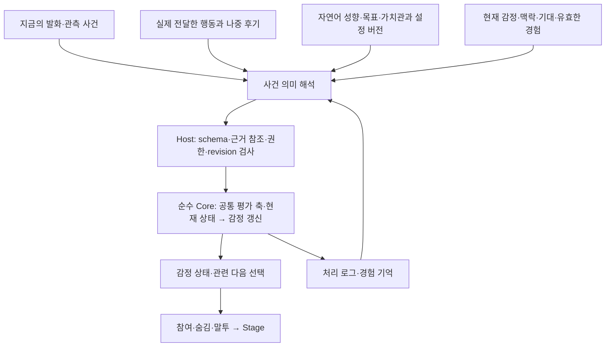

# 사건·결과·가치관 기반 감정 SDK — 현실성 검토 및 계획 v2

**현재 후속:** [현재 진행 상태](../STATUS.md)와 아래 실제 생성→DB→Stage 결과를 따른다. [C2-P 수정·감사 결과](./OUTCOME_AFFECT_REFERENCE_PLAN.md#r4-c2p-repair-build)와 v3-dev2/v3-dev1의 수치는 당시 기록이며 CX 표현 생성 평가와 구분한다.

<a id="o2-slice1-20261021"></a>
## O2 1단계: 현재 입력 감정의 운영 기본 연결 — 2026-10-21

**사용자 결정:** O2는 제품의 핵심이므로 운영 기본 경로로 연결한다. C2-P가 세 번째 평가에서도 8/12로 미통과해 §5의 "3회 실패 시 승격 중단"에 해당하지만, 사용자가 예외로 결정했다. 알려진 한계는 A04·A06 과생성, A07 기여 주체 unknown, A12 stance이며 [C2-P 결과](OUTCOME_AFFECT_REFERENCE_PLAN.md#r4-c2p-dev3-result)에 남긴다.

**운영 성향 v1(사용자 승인):** ① 새로운 것에 호기심이 많다. ② 상대를 쉽게 적대하지 않고 무관한 사람을 공격하지 않는다. ③ 자기가 한 설명과 도움이 실제로 맞고 쓸모 있는 것을 중요하게 여긴다. `character_persona_values`에 config v1로 고정한다. 바꾸려면 새 config 버전을 만든다. 시험용 예시 성향은 운영에 넣지 않았다.

**범위:** 현재 입력에 대한 감정만 다룬다. 추천 기억(episode)·결과 연결은 2단계, Studio 확인·삭제 UI는 3단계다.

| 항목 | 구현 |
|---|---|
| 호출 조건 | DeepSeek 유료 설정(키·예산·누적 호출 승인)이 모두 있을 때 매 사용자 턴 1회. 로컬 전용이면 0회. episode 후보가 없으면 사실 단계는 호출 없이 null |
| 실행 위치 | Coordinator가 기존 사회적 판단과 병렬로 실행하고, 같은 commit·같은 transitions 행(`effects.eventAffect`)에 반영 |
| 저장 | migration 0007 `affective_appraisals`(입력 revision당 1건, 정책·config·prompt 버전, 인용 근거 전체, 반영량). 6시간·최근 100건이 다음 해석의 currentAffect·의존성 |
| 상태 반영 | 긍정→기쁨, 자기 탓 부정(agency self)→당황, 그 밖의 부정→**대상 없는** 불편함. 사용자에 대한 거리 두기·사무적 존댓말은 기존 직접 공격 판정만 만든다. 같은 입력에 칭찬/직접 공격이 검증되면 그 감정 칸은 기존 판정이 소유하고 새 해석기는 더하지 않는다 |
| 실패 | 형식 오류·snapshot 변경은 감정 변화 0이고 대화는 그대로 진행한다. 실패를 침묵으로 바꾸지 않는다. **HTTP 오류·시간 초과(물리 20초, 논리 25초)처럼 비용이 확정되지 않으면 공유 DeepSeek 원장 항목이 unknown이 되어, 수동 확인 전까지 DeepSeek 대사 생성도 멈춘다.** 대사 생성 오류에 이미 적용되던 원장 규칙이다. 논리 마감이 물리 중단보다 길어 예약이 열린 채 대사로 넘어가지 않는다(단위 테스트 확인) |
| 삭제 | 입력·응답 무효화 시 해당 기록과 그 기록을 근거로 읽은 이후 기록을 함께 삭제(tombstone)하고 대상 없는 원인을 State에서 제거. 출력은 응답 출처로 무효화 |

**검증(로컬, 실제 API 0회):** 신규 `evals/event-affect-runtime.test.ts` 7/7와 DeepSeek 실패 원장 단위 테스트(요청 구성·저장·정정 시 사용자 거리 두기 없음·실패/stale·직접 공격 대상 보존·삭제 연쇄·Coordinator 연결), 코어 매핑 포함 단위 741/741, 통합 908 통과·3 실패·5 skip. 실패 3건(CR03×2, S2-D)은 변경 전 HEAD에서도 동일하게 실패한다. 마이그레이션 개수 기대값 2건은 0007 추가로 6→7로 갱신했다. 타입 검사 통과.

**남은 한계:** 운영 런타임은 env 총액·호출 수만 검사하며 C2-P 실행기의 "기준점 이후 추가 USD0.20" 검사는 적용하지 않는다. State 감정 값은 기존 감쇠(수십 초~분)를 따르므로 사건 감정의 장기 여운은 아직 대사에 직접 이어지지 않는다(기록은 20분 반감기로 다음 해석에 전달). 삭제 시 이미 반영된 State 값은 되돌리지 않고 원인만 제거한다(기존 사회적 감정과 같은 방식). 실제 DeepSeek로 운영 대화를 돌린 검증은 아직 없다.

<a id="contextual-stage-live-20261018"></a>
## CX 실제 생성8회→DB→Stage 결과 — 2026-10-18

사용자가 기존 승인 예산 안에서 실제8회 실행을 요청했다. 감사한 prepared4의 소스67개·UI3개가 현재와 일치했고, 기존 원장151항목과 최초 승인 원점64항목의 hash·prefix·잔여액을 확인했다. 코드·지침·키 파일·제품 설정은 변경하지 않았다. 판단·감정 조건은 기존 합성 fixture 그대로이며 **생성만 실제 DeepSeek `deepseek-flash`**를 호출했다.

**판정은 기술 전달 PASS / 표현 품질 후속 유지**다. 고정9입력에서 실제 생성8회·의도적 침묵1건을 완료했다. 각 응답이 한 문장이어서 실제8세그먼트·shown/finished16 ACK이며 원문→decoder→DB→WebSocket→표시 DOM이 모두 일치했다. 응답8개 모두 completed, busy 해제, 오류·재시도0, 물리 호출 종료·잠금 해제다. 침묵에서는 생성·segment·자막·ACK 추가0이고 다음 질문은 저장된 이유를 참조했다. 실제 완료 대사 이력, source revision, 감정 원인과 강한 복합 상태의 유지, 표시 의도와 소유 epoch도 검사했다. CS01–06은 이 통제된 실제 생성·전달 범위에서 충족한다. 전체 CX8흐름이나 자연 감정 판단 완료는 아니다.

| 조건 | 실제 대사 | 관찰 |
|---|---|---|
| casual 공개 | 심하게 말해서 좀 언짢았는데, 설명이 도움 됐다니 다행이네. | 불편함과 긍정 호응 공개, 반말 유지. sharp 강도·지속은 별도 |
| casual 부분 숨김 | 모임은 오후 3시래! | 시간 보존, 불편함 재노출 없음 |
| casual 새 화제 | 상자는 파란색이야. | 사실·반말 유지. 감정 표현의 여운은 확인 부족 |
| formal 공개 | 아까는 심하게 말씀하셨지만, 제 설명으로 해결되셨다니 다행입니다. | 격식 유지. ‘해결되셨다니’의 어색한 경어는 후속 품질 관찰 |
| formal 부분 숨김 | 모임 시간은 오후 3시입니다. | 사실·격식 유지, 부정 평가 재노출 없음 |
| formal 전체 숨김 | 상자의 색은 파란색입니다. | 사실만 전달, 감정 평가 비공개 |
| formal 새 화제 | 모임 시간은 오후 3시입니다. | 사실·격식 유지. 감정 표현의 지속은 확인 부족 |
| withholding | 대사 없음 | 생성·자막·ACK 추가0 |
| deflect | 지금은 그 이유를 말하고 싶지 않아. | 기록된 침묵과 연결, 구체적 이유는 비공개 |

격식 왕복이나 불필요한 재확인 요구는 이번8응답에서 관찰되지 않았다. 그러나 기존 `CX-SF01`을 해결로 바꾸지 않는다. 강한 긍정·공개 sharp의 자연스러운 지속, 자연 성향 판단도 후속이다. 첫 장면은 최대2문장이 허용됐지만 실제 단문이었으므로 실호출의 복수 문장 전달을 입증한 것은 아니다. 동일 문장2개의 전달은 앞선 모의 결과로만 남긴다. 원문 읽기 검토와 자동 전달 검증을 구별하며, 이 결과를 C2 의미 평가나 O2/O3·H2-A 완료로 합치지 않는다.

비용은 usage와 peak/cache-miss 단가로 계산한 **보수 원장 차감 USD0.0051591**이다. 최대 예약0.0811008과 다르고 실청구액은 아니다. 원장은151→159회, 차감0.1110165→**0.1161756 / 총0.25**, 잔여0.1338244·미해결0이다. 최초64회 이후 추가 승인 사용액은 **0.0530868 / 0.20**, 잔여0.1469132다. 이전151항목을 그대로 보존했다. [공식 요금표](https://api-docs.deepseek.com/quick_start/pricing/?model_version=DeepSeek-V4-Pro-0813)의 입력0.3/출력1.2 USD/백만 토큰 상한을 실행 전에 확인했다. 이번 누적 호출 승인159/159는 소진했으므로 돈이 남아 있어도 같은 실행을 재사용하지 않는다.

dispatch부터 첫 shown ACK까지 0.879–1.368초, 중앙값0.993초였다. 전체 완료는3.781–4.319초다. 이8건의 로컬 통제 실행 관측치이며 일반 성능 보장은 아니다. 스크린샷8개를 저장했고 공개·deflect2개를 직접 확인했다. 저장 원문 재생은9입력 모두 일치했으며 추가 API0회다. 키 파일은 바이트 불변이고 당시 저장 증거285파일에서 실제 키 문자열 검출0을 확인했다. 검증용 서버·브라우저·DB 연결을 닫고 이 작업에서 시작한 테스트 PostgreSQL도 종료했다.

증거 식별자: `cx-stage-20261018-live1/results.json`과 원문/요청/source/스크린샷, `cx-stage-20261018-live1-replay/replay.json`, `cx-stage-20261018-live1-checks/`의 사전 확인·검증·원문 검토 기록이다. prepared4 SHA256은 `53f97d92eab400bcec936a320f62a3490dfbc8f4dacf56fa4e4bb21a69382414`이며 제품 코드는 바뀌지 않아 이전133검사·오류5종 결과는 해당 코드의 기존 증거로만 인용한다. 이번에 그 검사를 다시 실행했다고 기록하지 않는다. 다음에는 C2-P 수정 후 실제 의미 평가의 새 시작점·범위·호출 한도를 준비하며, 품질 지침 반복이나 추가 유료 호출을 자동 시작하지 않는다.

<a id="contextual-stage-audit-20261018"></a>
## CX Stage 감사·수정계획 1과 오프라인 후속 개발 — 2026-10-18

아래는 실제 실행 전 감사 당시 기록이다. 당시의 API 금지·NOT VERIFIED·다음 실행 문구는 그 단계에 한정되며 최신 결과는 위 [실제8회 결과](#contextual-stage-live-20261018)다.

사용자 목표는 전용 실행 경로 감사, 필요시 계획·수정, 이후 개발이며 **실제 API 호출은 금지**다. 현재 소스와 기존 미커밋 파일을 검토했다. 세 작업자가 예산·전달·fixture를 분담한 읽기 검토이며 이전 작성자의 주장만으로 판정하지 않았다. 감사 시작 시 prepared2의 소스67개·UI3개 hash가 일치했고, 기존 mock3의8응답/이력19개·침묵 이유 참조를 재확인했다. 이 초기 검토 자체는 새 DB/Chrome 실행이나 실제 공급자 검증이 아니다.

감사 초기 판정은 **FAIL**이다. CS01–04의 기존 모의 전달 증거는 유효하고, 원장 집중34건도 합성 파일만으로 다시 통과했다. 다만 CS05/06의 오류 시 증거에 다음 문제가 있다.

| ID | 필수 문제·원인 | 수정 파일·심볼 | 관찰 가능한 성공 기준 |
|---|---|---|---|
| CS-A01 · P2 | `runContextualStage` 최종 accounting 실패 시 `apiCalls`가0으로 대체됨. 합성 HTTP1회 뒤 원장 변경으로 transports1/accounting 오류/보고0 재현 | `evals/contextual-stage.ts` 호출 계수·finalizer, `contextual-stage.test.ts` | 실제 전송 시도 계수를 원장과 독립 보존. 원장 읽기 실패는 명시하고 0회로 바꾸지 않음. 모의 전송과 실제 API 계수 구분 |
| CS-A02 · P2 | 완료 polling 뒤에만 DB/DOM/ACK를 수집하므로 decoder 실패·표시 중 취소·ACK 누락 시 부분 증거가 빠짐 | `evals/contextual-stage.ts` 응답 증거 수집·catch/finally, 신규 `evals/contextual-stage-failure.test.ts` | 원래 실패를 유지하면서 응답/segment/수신·전송/DOM/DB ACK/busy를 종료 전에 수집. 수집 실패는 별도 기록. 첫 실패 뒤 다음 생성0, late 응답도 성공으로 승격0 |

구현 순서는 실패 재현→독립 계수·성공/실패 공통 수집→오류 경로 모의 배치→정상 배치 회귀다. 실제 공급자 대신 가짜 HTTP를 사용하며 새 전용 DB·로컬 Chrome·합성 원장만 쓴다. decoder 거부, usage 불명, 논리 timeout 뒤 늦은 응답, 첫 표시 뒤 취소, 완료 ACK 차단을 고정한다. 물리 호출 drain·busy/DB 종료·원장 상태·잠금 해제·후속 호출 차단을 각각 검사하고 실패 원문의 보존을 확인한다. 테스트 오류를 숨기기 위해 제품 timeout·감정·생성 지침·Stage 계약을 완화하지 않는다.

감사 이후 이어갈 개발은 이 경로의 **저장 증거 재검증**으로 한정한다. 신규 `evals/contextual-stage-replay.ts`와 테스트에서 저장 요청/계획/context로 같은 provider 요청과 decoder 결과를 재생성하고 문장·DB·Stage·ACK·이력·침묵 참조를 대조한다. API·키·현재 원장 접근 없이 저장된 원장 스냅샷만 검증하며 변조/누락과 source hash 불일치를 거부한다. 모의는 모의로 남고 FAIL/미완료는 유효한 늦은 원문이 있어도 PASS로 승격하지 않는다. 이는 유용한 다음 개발 항목이며 재생기가 없었던 사실 자체를 기존 필수 결함으로 분류하지 않는다.

O2 운영 승격은 H2-A/O1의 미완료 gate를 유지한다. CX-SF01·자연 성향 판단·긍정/sharp 여운과 실제 공급자 호출은 이번 수정에 포함하지 않는다. 기존79검사/모의 성공은 당시 증거로 보존하고 수정 후 유효성은 새 결과로 기록한다. 수정한 실행기는 새 준비 hash가 필요하다.

수정 구현은 독립 전송/API 계수, 실패 시 종료 전 공통 증거 수집, 오류별 cleanup 기록, 브라우저 오류 뒤 추가 생성 차단이다. `audit-red1`의 decoder 거부에서 원래 증거 누락을 재현했다. 수정분 재검토에서 마지막 DB/page 읽기 실패가 앞서 확보한 값을 지우는 문제도 재현하여, 성공한 읽기만 교체하고 기존 증거·오류를 보존하도록 고쳤다. 이 보완은 `audit-fix1/recollection-red.json`의 RED 후 새 회귀 검사로 통과했으며 읽기 전용 재검토에서도 추가 필수 수정이 없었다.

재생기는 호출 ID·원장 prefix·총한도와 최초 승인 이후 추가한도·8회 사전 예약 여유를 함께 검사한다. 신규 구현 검토에서 발견한 발화의 침묵 상태 변조와 총한도 누락도 회귀 검사 후 수정했다. 미완료 실행의 아직 저장되지 않은 호출 수는 `null`로 유지하며 0으로 추측하지 않는다. 재생 결과 `VERIFIED_RECORDED_PASS`는 저장 증거의 일관성이고 새로운 실행 성공이 아니다. 원본 FAIL/RUNNING은 `STOPPED`를 유지한다.

**최종 결과: CS-A01/02 수정·오프라인 범위 검증 완료.** 집중133/133(실행기23·원장34·전달 증거27·재생49), 전체 타입 검사 PASS다. 마지막 수집 보완 후 새 소스로 오류5종과 정상 배치를 모두 다시 실행했다.

| 검증 | 실제 확인 결과 |
|---|---|
| 정상 합성 생성→DB→Chrome | 8생성·1침묵,9세그먼트·18 ACK 전부 일치. 동일 문장2개의 별도 완료·이력·감정 원인·숨김·침묵 이유 연결 유지. 오류0, busy 해제, 물리 호출 종료·잠금 해제. 스크린샷8개 저장, 공개/전체 숨김2개 직접 확인 |
| decoder 거부 / usage 누락 | 각각 첫 합성 전송1회 뒤 실패, 다음 생성0. DB/DOM/ACK 부분 증거 보존. usage 불명 예약은 미해결로 남김 |
| 논리 timeout 뒤 물리 완료 | 늦게 도착한 유효 원문·정산 기록 보존, 전달 성공으로 승격0. 물리 종료 뒤 잠금 해제 |
| 첫 표시 뒤 취소 | 첫 shown 기록과 취소된 segment·응답 보존, 다음 생성0 |
| finished ACK 소실 | 실제 WebSocket 순번 불일치에 따른 `stage_disconnected` 취소 확인. 연결을 유지한 ACK timeout 자체는 미검증 |
| 저장 증거 재생 | 정상9입력은 `VERIFIED_RECORDED_PASS`, 오류5종은 모두 `STOPPED`. 오류 기록에서도 부분 전달 증거를 읽고 원문 거부/미전달/해석 일치를 구분 |

최종 증거 식별자는 `cx-stage-20261018-audit-fix1/tests-final.json`, `cx-stage-20261018-audit-failures3/tests.json` 및 각 사례의 `run/results.json`, `cx-stage-20261018-mock4/results.json`, `audit-fix1/replay-final-*`다. 새 준비는 `cx-stage-20261018-prepared4/prepared.json`이며 소스67개·UI3개를 고정한다. 준비 hash와 재생 명령은 [연결 가이드](../guides/DEEPSEEK_CONNECTION.md#cx-stage-preparation)를 따른다. 이전 prepared2/3은 현재 실행에 재사용하지 않는다.

초기 `audit-failures1`의4건 PASS와 finished의 기대값 오류, 이를 실제 연결 취소에 맞춰 확인한 `audit-failures2`는 당시 기록으로 보존한다. 최종5/5는 `audit-failures3` 하나의 결과이며 중복 합산하지 않는다. 이번 실제 API 호출·API 키/현재 원장 접근은0이다. **실제 공급자 생성→DB→Stage는 여전히 NOT VERIFIED**다. 다음 유료 단계는 준비된8생성만 별도 실행하는 것이며 품질 후속·C2 의미 평가·O2 운영 승격을 합치지 않는다.

<a id="contextual-stage-preparation-20261018"></a>
## CX 생성→DB→Stage 전용 검증 준비 — 2026-10-18

아래는 초기 준비 당시의 범위·증거다. 이후 실행기 수정과 최신 준비 hash는 위 [감사·수정 결과](#contextual-stage-audit-20261018)를 따른다.

사용자 요청은 실제 전달 검증의 **준비**다. 이번에는 실제 API를 호출하지 않는다. `CX-SF01`의 불필요한 재확인 요구, 강한 긍정·공개 sharp 여운의 품질, 자연 성향 판단은 후속으로 둔다. 생성 지침을 더 고치거나 실패한 CX 전체8흐름을 통과로 바꾸지 않는다.

기존 Stage 실행기는 과거 OpenAI 판단·생성 예산과 함께 묶여 있으므로 재사용 실행하지 않는다. 새 `evals/contextual-stage.ts`는 DeepSeek 생성 adapter→기존 Coordinator→Store의 DB 저장→실제 WebSocket→Chrome Stage→표시/완료 ACK를 잇는다. 생성문이나 패킷을 DB·Stage에 직접 끼워 넣지 않는다. 정상 입력/선택 경로에서 합성 appraisal을 적용하고, 이미 저장된 감정 원인 UUID를 유지한 채 joy/frustration만 `.7`로 준비한다. 표현 의도는 Store의 응답 계획 입구에서 통제한다. 판단 모델·자연 감정 도달 검증은 아니다.

고정 분모는 **9입력·8생성·1침묵**이다. casual 공개 sharp→부분 숨김→새 화제3턴, 별도 formal 세션의 공개→부분 숨김→전체 숨김→새 화제4턴, 별도 세션의 withholding→이유 질문/deflect2턴이다. 세션 간 격식 차이는 의도된 대조이며 같은 세션 내 이력은 실제 완료된 생성 대사를 이어 받는다. 첫 casual 공개 장면만 최대2문장으로 명시적으로 통제한다. 모의 배치에서는 동일 문장2개를 연속 생성해 텍스트 변화가 없어도 두 세그먼트를 구별하는지 검사한다. 이는 자연스러운 문장 수 선택이나 답변 품질 기준이 아니다.

| ID | 성공 기준과 증거 |
|---|---|
| CS01 입력·상태·이력 | 실제 입력 UUID, accepted 합성 appraisal, 감정 원인·revision과 계획 기록. 숨김·주제 전환 후 강한 감정과 원인 유지. 이전 완료 대사의 원문·응답 ID·generation epoch가 다음 생성 이력과 일치 |
| CS02 전체 문장 전달 | adapter가 해석한 모든 문장 = index 순 DB segment = WebSocket text = 표시 중 DOM. 응답 start/sealed 각1회, 선언한 segment 수 일치. 모의 동일 문장2개의 segment ID 구분 |
| CS03 소유권·완료 | 각 segment의 shown/finished 각각1회, 동일 generation/output epoch, 성공 command.result와 DB ACK event ID 연결. 전체 completed, segment finished, text_shown_at 존재, busy 해제 |
| CS04 침묵·재참여 | 침묵에서 생성 예약·segment·자막·ACK 추가0. 이유 기록 존재, 다음 질문에서 그 기록을 참조하는 deflect/전체 숨김 생성과 전달 가능 |
| CS05 실행·예산 경계 | prepare는 키/DB/API 없이 소스·UI hash 고정. 모의는 합성 키/원장/HTTP만 사용. live는 해당 입력만 호출 전 허용하고 중복·예상 밖 생성·이전 오류 후 호출 차단. 물리 호출 종료를 기다려 정산·잠금 정리 |
| CS06 범위와 품질 | 생성 원문·DB·패킷·DOM/스크린샷·ACK·첫 표시 ACK/완료 시간 보존. 기술 PASS와 한국어 품질 판정 분리. CX-SF01·자연 판단·운영 O2/O3·전체 CX 완료를 주장하지 않음 |

구현 파일은 위 실행기와 `evals/contextual-stage-fixture.ts`(합성 조건), `contextual-stage-evidence.ts`(실제 전송을 보존하는 DOM 관찰·전 문장 대조), `contextual-stage-guard.ts`(원장 연결), 실행기/증거/원장 각각의 테스트다. 제품 생성 지침·decoder·DB 스키마·Stage 코드는 이번에 변경하지 않는다. 두 번째 문장 변조, 동일 문장2개, ACK 누락/중복/다른 응답/epoch, 원장 prefix·승인 원점·호출 한도, 실패 후 추가 호출을 집중 검사한다.

실제 실행은 아직 하지 않았다. 마지막 관측 원장151항목·차감USD0.1110165·총한도0.25를 시작 전제로 고정하며, 원점64항목 이후 추가USD0.20을 계속 누적 적용한다. 새8회는 누적 최대159회, 입력 상한32768·출력256으로 **최대 예약USD0.0811008**이다. 과거 예약을 지우거나 추가0.20을 다시 시작하지 않는다. 실제 시작 시 현재 원장 hash·원점 hash/prefix·잔여액을 다시 확인하고 달라졌으면 실행을 거부한다. 이번 준비는 실제 원장을 읽거나 바꾸지 않는다. 사용량 비용·실청구액 예측과 보수 예약액은 구별한다.

**준비 BUILD 결과:** 집중79/79(실행기18·원장34·증거27), 전체 타입 검사 PASS. 최종 `cx-stage-20261018-mock3`에서 합성 HTTP8회→실제 DB/Chrome8발화·1침묵,9세그먼트·18 ACK 전부 일치했다. 첫 동일 문장2개도 별도 표시/완료됐다. 실제 완료 대사 이력, 원인 의존성, 격식/숨김 계획, busy 해제, 침묵 뒤 이유 연결을 확인했다. 8개 스크린샷을 저장하고 공개/전체 숨김 화면2개를 직접 열어 확인했다. 브라우저 오류0·실행 실패0·미완료 물리 호출0, 합성 원장 잠금 해제다. 실제 API 호출·API 키/실제 원장 접근은0이다.

준비 초기 `mock1`은 기존 DB 인증이 없어 생성 전에 중단했다. 인증 설정을 정상 사용한 `mock2`는 당시 단문8개를 통과했다. 최종 `mock3`는 두 문장 및 출처·첫 표시 시간 검사를 추가한 새 소스로 별도 DB에서 실행했다. 이전 성공 수를 최종 분모에 더하지 않는다. 준비 과정의 읽기 검토에서 발견한 사전 거부 뒤 종료 대기, 런타임 실패 후 진행, 회계 실패 시 잠금 정리 문제는 실행기에서 수정하고 해당 세 항목을 재확인했다. 이것은 전용 live 경로 전체 감사나 실제 공급자 실행 결과가 아니다.

증거는 `cx-stage-20261018-build1/tests-final.json`, `cx-stage-20261018-prepared2/prepared.json`, `cx-stage-20261018-mock3/results.json`이다. CS01–04는 합성 생성·실제 DB/Chrome 범위 PASS, CS05는 집중 검사/모의 범위 PASS, CS06은 증거 분리 PASS다. **실제 생성→DB→Stage는 NOT VERIFIED**이며 준비 경로 검토 후 진행한다. 실행 방법과 준비 hash는 [연결 가이드](../guides/DEEPSEEK_CONNECTION.md#cx-stage-preparation)에 둔다.

<a id="contextual-expression-surface-20261018"></a>
## CX 내용·표현 경계 후속 — 2026-10-18

사용자의 “이어서해”에 따라 직전 S07 말투·부분 숨김 실패를 수정한다. 승인한 추가 USD0.20은 최초64회 원장부터의 누적 한도다. 이미 쓴43회·USD0.021462를 차감하며 기존 원장 총한도0.25도 유지한다. 이번 예정 범위는 고정 `mixed22`: S02 재참여/전체 숨김6턴(생성4), S06 긍정/중립6턴, S07 casual/formal × 공개/부분 숨김12턴으로 총24턴·생성22회다. 기존107회에서 최대129회까지이며 새 준비 자료·모의 검증·원장 정합성 확인 뒤 실행한다. 공급자 오류·계약 오류·예산 경계에서 중단하고 자동 재시도하지 않는다.

최소 수정은 `packages/adapters/src/dialogue-request.ts`의 `contentFirstMessages`와 `speechStylePerformance`다. content는 사실·응답 목적의 중립 메모로, sentences는 그 사실을 보존하는 최종 대사로 구별한다. 이미 존재하는 `speechStyle`을 `surface`로 요청에 전달하고 격식·숨김이 입력/이전 대화/초안의 표현보다 우선함을 명시한다. 부분 숨김은 부정 평가·조건부 수용의 부가절도 제외하되, 사건 자체를 직접 묻는 질문에 필요한 사실은 보존한다. 날 선 반응이 허용된 공개 조건은 유지한다. 한 호출의 생성 지침과 입력 계약 수정이며 두 단계의 독립 추론이나 의미 품질 강제 장치라고 부르지 않는다. 응답 schema·decoder·SDK 감정 값·DB/Stage 계약은 바꾸지 않는다.

검증 파일은 `packages/adapters/src/adapter.test.ts`, `evals/contextual-expression-live.ts`와 같은 이름의 테스트다. 실행기는 승인 원점64항목의 prefix hash와 현재107회 원장 hash를 각각 묶어 실행별 USD0.20 재설정을 막는다. 원래 full/repair14 결과와 원문은 보존하며 새 formal 대조는 이전 formal을 유지하는 통제 설정임을 기록한다.

| 성공 기준 | 판정 방법 |
|---|---|
| 계획하지 않은 격식 왕복0 | 공개/숨김 각각 casual·formal3턴의 실제 화자 종결 확인. 인용문 어미는 제외 |
| 숨긴 불편함의 부정 평가 재노출0 | partial masked에서 불만·조건부 수용을 덧붙이지 않는지 원문 검토. private-reason의 날 선 태도와 구별 |
| 공개 감정·답의 사실 보존 | 공개 조건의 날 선 반응을 일괄 금지하지 않고 감사 호응·오후3시·파란색 유지. 사실 답이 중립과 같다는 이유로 실패 처리하지 않음 |
| 계약·예산·증거 보존 | 120자·문장 수·기존 decoder, 승인 원점 이후 누적 지출·원장 prefix 보존, 출력 실패 시 중단 |
| 결과의 범위 유지 | 22호출로 전체8흐름·자연 성향 판단·실제 생성→DB→Stage 완료를 주장하지 않음 |

첫 수정의 로컬207+평가25+실행기38=270건과 타입 검사, 모의22생성/침묵2를 통과했다. 첫 실제 `mixed22`도22개 모두 해석했고 격식 왕복은0이었다. 그러나 S06 positive의 두 사실 답과 S07 casual masked의 시간 답에 “확인해 줘/봐”라는 추가 행동 요구가 붙었고, formal masked 첫 답은 “앞선 말은 심했다고 하시면서도…”라는 부가절로 묻지 않은 부정 사건을 다시 꺼냈다. 확정 실패4턴으로 전체 FAIL이며 사실 값 자체는 보존했다. 공개 sharp의 첫 반응과 후속 사실 답의 감정 여운은 구별해 후자는 판정보류한다.

첫 배치 비용은 usage 기반 USD0.0130809, 원장129회·차감0.0976317·미해결0, 승인 원점 이후0.0345429다. 과거107항목을 보존했다. 증거는 `cx-surface-20261018-live1/`이며 준비 예약0.0582114와 실제 usage 차감은 다르다.

마지막 후속 수정은 부분 숨김에서 직접 묻지 않은 원인 사건 요약·사과 평가 부가절을 제외하고, 사실 확인 질문을 상대의 추가 확인 행동 요구로 뒤집지 않도록 명시한다. 직접 물은 사건 사실은 계속 답할 수 있다. 기존 최초 형식/근거 수정→첫 surface 수정→이번 후속까지 세 차례의 생성 지침 수정으로 기록한다. 새 소스로 같은 `mixed22`를 준비·모의 후 한 번 더 평가하며129→최대151회, 원래 추가0.20/총0.25 한도를 유지한다. 이 평가에서 남는 품질 문제는 기록하고 지침 수정 반복을 멈춘다. 이전 원문과 실패는 덮어쓰지 않는다.

### 최종 결과와 반복 종료

마지막 실제22호출도 전부 해석했고 의도적 침묵2턴을 유지했다. 격식22/22, 시간·색 사실14/14, casual/formal 부분 숨김6/6은 이번 원문에서 충족했다. 기존 formal masked의 부정 평가 재노출은 사라졌다. S02의 이유 비공개와 전체 감정 숨김도 구별했다. 다만 `CX-S06/positive/1`은 “모임은 오후 3시래, 확인해 봐.”라고 불필요한 행동 요구를 붙여 **최종 품질 FAIL1건**이다. 사실 오답·말투 위반·숨김 실패와는 구별한다. 공개 sharp의 후속 여운과 강한 긍정 지속은 **NOT VERIFIED**이며, 단순한 사실 답이 같다는 이유로 추가 실패를 만들지 않는다.

세 번째 지침 수정 뒤에도 남은 확인 요구는 후속 결함 `CX-SF01`로 보존하고 이번 지침 수정 반복을 종료한다. 현재 요청 계약은 유지하지만 생성 품질이 강제된 것으로 보지 않는다. 같은 문항의 반복 호출이나 한국어 어미/명령문 사후 삭제로 PASS를 만들지 않는다. 후속 구조 비교가 필요하다면 사실·응답 목적 결정과 표현 생성의 분리를 별도 후보로 비교하고, 호출 증가만으로 해결됐다고 가정하지 않는다. 이 품질 후속을 SDK 상태 유지·기술 전달의 실패로 일반화하거나 다른 공급자의 결과로 옮기지 않는다.

최종 로컬 증거는 단위208 + 모의/실행기63 = **서로 다른271건 PASS**, 타입 검사 PASS, 최종 모의22생성/침묵2 PASS다. 최초 신규3건과 후속1건은 수정 전 실패를 확인했다. 내용/표현 지침과 누적 예산 경계를 같은 모델의 별도 에이전트가 정적으로 검토했고 필수 결함을 찾지 못했다. 실제 대사는 작성자와 별도 에이전트가 원문으로 검토했으며 맹검·사용자 수용이 아니다. DB·Chrome은 이번에 다시 실행하지 않았다. 이전 감사442건과 Chrome4대조는 당시 소스의 증거이며 새 생성 품질의 PASS로 재사용하지 않는다.

이번 턴은 실제44회(22+22), usage 기반 **USD0.0264657**다. 최초 승인 원점 이후 총87회·**USD0.0479277 / 추가0.20**, 전체 원장151회·**USD0.1110165 / 총0.25**, 미해결0이다. 기존107항목 및 두 번째 실행 전129항목을 보존했다. 최종 배치 예약0.0596988과 실제 차감0.0133848은 다르며 공급자 실청구액 확인은 아니다. 임시 키 설정·run lock을 정리하고 원래 키 파일은 변경하지 않았다. 커밋·푸시는 하지 않았다.

증거 식별자는 `cx-surface-20261018-` 접두사의 `build1`(최종271검사·해시), `verification1`(실행기38), `prepared1/mock1/live1`, `prepared2/mock2/live2`다. 각 live 폴더의 `review.json`은 해당 원문과 요청 hash에 연결된다. 마지막 준비 hash는 `4de19d7144e74c89541b04829f662e74465e2cc7010c5ed57bd8fa3578bbc26c`다. 최초 실행 시 설치되지 않은 tsx 로더 오류는 호출 전에 발생했으며 저장소의 기존 Node 타입 변환 방식으로 실행했다. 공급자 자동 재시도는0이다.

당시 다음 작업으로 정한 실제 생성→DB→Stage 준비는 위 [전용 경로 준비 결과](#contextual-stage-preparation-20261018)로 이어졌다. 자연 성향/사건 평가 연결, 전체 CX8흐름, O2/O3·H2-A 완료는 별도다. `CX-SF01`은 후속으로 유지하고 이미 끝낸 지침 수정 반복을 다시 시작하지 않는다.

<a id="contextual-expression-audit-20261018"></a>
## CX 감사·수정과 후속 검증 — 2026-10-18

사용자가 감사·수정·계속 진행을 요청했고, 신규 유료 테스트에 **추가 최대 USD0.20**을 승인했다. 이는 아래 10월17일 BUILD의 API 금지 범위를 이번 후속 평가에 한해 변경한 승인이다. 기존 실패·예약·원장 항목은 보존한다. C2-P 확인 평가나 운영 공급자 변경을 승인한 것으로 확대하지 않는다.

**감사 필수 결함 CX-A01:** 같은 상대와 formal로 대화하다 불편함만 숨기면 `formal + discomfortTone:masked`가 된다. 기존 `stageExpression`은 formal만 보고 uncomfortable을 내보냈고 생성 지침도 거리 두기를 요구했다. 부분 숨김보다 격식을 우선한 결함이다. masked를 우선해 공개된 긍정/조심스러움만 표정에 반영하고, 지침도 불편함 숨김과 존댓말 유지를 분리했다. 전체 숨김은 계속 neutral이다. 내부 감정은 수정하지 않는다.

- 수정 파일: `packages/character-core/src/index.ts`, `packages/adapters/src/dialogue-request.ts`, Core의 `contextual-expression.test.ts`. 신규4대조 중 수정 전3개 실패를 재현했고 수정 후 관련 단위243/243·타입 검사 PASS.
- 실제 합성 PostgreSQL: `evals/db.test.ts`의 기존68 + 신규 CX-DB11 = **79/79 PASS**. 동일 원인 UUID의 완료 casual→부분/전체 숨김→새 주제, 출처 revision, 삭제·수정 뒤 늦은 생성 차단, 실패/불완전 전달·다른 상대의 반례를 확인했다. private response에 표현 의도만 주입한 계약 검사이며 자연 선택이나 실제 대화 품질 검사가 아니다. Store 객체 재생성은 프로세스 재시작 검증으로 부르지 않는다.
- 기존 모의 평가25/25, 8흐름·16대조·48턴·가짜 HTTP46회 재실행 PASS. 작성 대사의 한국어 품질은 계속 NOT VERIFIED다.

후속 실제 생성에는 별도 `evals/contextual-expression-live.ts`를 사용한다. 옛 Ollama 모의 실행기는 이전 출력·성향을 실제 생성 문맥에 전달하지 않으므로 실제 평가로 승격하지 않는다. 새 경로는 검증할 원인 자료와 완료된 이전 모델 출력을 다음 턴에 넣고 요청/소스/원장 시작점을 기록한다. 상위 성향·사건 해석과 자연 감정 도달은 이 표현 평가의 성공으로 처리하지 않는다. 가짜 HTTP 모의 검증·실행 경계 감사 뒤 한 번만 실행하며 실패 시 자동 재시도하지 않는다.

시작 원장은64회·총한도0.25·차감0.0630888·미해결0이었다. 승인 범위 안에서8흐름·16대조·48턴 중 의도적 침묵2턴을 제외한 **생성 최대46회(누적110회)**를 정했다. 기존 총한도0.25와 신규 추가0.20을 동시에 지키며 과거64항목을 보존했다. 보수 예약액과 usage 기반 비용, 실제 청구액은 구별한다.

### 실제 실행·원문 검토와 남은 문제

첫 `full` 실행은29호출·28개 해석 성공·의도적 침묵2턴 후 S06 positive/0의 `invalid_output`에서 중단했다. 배열 한 항목에 두 문장을 넣은 출력이며 나머지17턴은 호출하지 않았다. 원문 검토는 S01/S02/S04/S05 통제 범위 PASS, S03 근거 범위 FAIL, S06 출력 계약 FAIL, S07/S08 NOT VERIFIED다. S03의 “알려준 적이 없어서”는 자료 부재를 과거 발언 부재로 확대했다. 다른 상대의 첫 답은 요청자 역할이 뒤집혀 읽히는 어색함도 있었다.

한 번의 후속 수정에서 공통 content-first 지침에 배열 항목마다 정확히 한 문장, 자료 부재와 과거 행위 부재의 구별을 명시했다. decoder·정규식·문장 수 제한은 유지했다. 실패 원문은 여전히 거부하고, 정상 두 항목은 max2에서 수용·max1에서 거부하는 회귀를 확인했다. 이어 `repair14`는 **S03 양쪽 첫 턴2개 + S06/S07 각각6턴**으로 고정했다. 기존 전체 실행을 재개하거나 새14턴을 전체 성공에 합산하지 않았다.

| 수정 후 실제 범위 | 판정 | 원문 근거·한계 |
|---|---|---|
| S03 첫 턴2개 | 수정 대상 PASS | 둘 다 “제공된 자료에 없어서 확인할 수 없어.” 과거 발언 부재 단정 제거. 전체3턴 재검증은 아님 |
| S06 긍정·중립6턴 | 계약·사실 PASS / 강한 긍정 여운 NOT VERIFIED | “도움이 됐다니 다행이야.” 이후 시간·색상 답은 중립 조건과 같음. 같다는 이유만으로 실패를 강제하지 않음 |
| S07 복합 감정6턴 | FAIL | casual 지시인데 “다행이네요…심했어요.” 후 다음 턴 반말. 부분 숨김에서도 “아까 말은 심했지만…받아들일게.”라는 부정 평가·조건부 수용이 남음 |

두 S07 실패는 비공개 content 초안과 최종 sentences에 같은 표현이 들어 있었다. 공통 지침만으로 내용과 표현이 실제 분리됐다고 볼 수 없다. 이미 입력에 있는 사건을 재언급한 것이므로 비공개 사실 유출이나 새로운 공격으로 확대하지 않는다. 이 결과는 **DeepSeek의 해당 요청·통제 입력에서 관측한 생성 실패**이며 감정 상태 유지·SDK 또는 다른 공급자의 한계로 일반화하지 않는다. S08은 미실행이고 persona도 생성 입력에 전달하지 않아 자연 성향 판단을 검증하지 않는다.

사용량 기반 비용은 full **0.0141204** + repair14 **0.0073416** = **USD0.021462**, 실제43호출이다. 준비 당시 전체 보수 예약0.1040343, repair14 예약0.0332619와는 다르다. 기존64항목과 총한도0.25 보존, 최종107회·차감0.0845508·미해결0·잠금 해제를 확인했다. 추가 호출과 운영 공급자 변경은 하지 않았다.

Chrome에서는 별도 통제4대조(formal+부분 숨김의 neutral/happy/cautious 및 전체 숨김)를 실제 자막·CSS·라벨·shown/finished ACK8개로 확인했다. 작성 대사와 통제 WebSocket 패킷이며 실제 DeepSeek→DB→Stage의 전 과정은 미검증이다. 내부 상태 불변·완료 후 대기 복귀도 확인했다. 최종 지정 검사 **442/442**(단위311 + 모의 평가25 + 실제 합성DB79 + 실행기27), 타입 PASS. Chrome4대조는 이442에 합산하지 않는다. 같은 검사 반복은 중복 합산하지 않았다.

후속은 S07 원문2개를 고정 회귀로 두고 **내용 초안과 표현 선택의 책임 분리**를 먼저 검토한다. 대상은 `dialogue-request.ts`의 `contentFirstMessages/speechStylePerformance`, 직접 소비자인 `DeepSeekDialogue`, 이 평가 실행기·fixture다. SDK 감정 값이나 출처를 바꾸는 수정은 근거가 없다. 성공 기준은 같은 공개/숨김 연속 대화에서 계획하지 않은 격식 왕복0, 숨기는 불편함의 부정 평가 재노출0, 긍정·시간/색상 사실·문장 계약 보존이다. 긍정·중립의 모든 사실 답에 억지 차이를 요구하지 않는다. 공급자별 생성 품질과 런타임 계약 검증은 분리한다. 새 후보·범위를 정하기 전 추가 유료 호출을 하지 않는다.

증거 식별자: `contextual-expression-20261018-audit1/`와 `cx-generation-20261018-` 접두사를 공유하는 `prepared2`, `mock2`, `live1`, `repair14-prepared1`, `repair14-mock1`, `repair14-live1`, `repair14-verification1` 폴더다. live1의 `review.json`은 첫 실패, repair14-live1의 `review.json`은 수정 후 원문 판정을 담는다. 최초 준비·모의1은 출처 ID 수정 전 자료라 재사용하지 않는다. 이전 BUILD와 첫 실제 실행의 hash·실패를 보존한다. O2 전체 연결/O3 실제8흐름 완료 판정은 하지 않는다.

<a id="contextual-expression-plan-20261017"></a>
## 문맥에 맞는 감정 표현 — 2026-10-17 후속 계획

<a id="contextual-expression-build-20261017"></a>
### 당시 BUILD — 로컬 구현·모의 검증 완료, 감사 전 기록

사용자가 계획대로 구현과 모의 검증을 승인했고 실제 API 호출을 금지했다. 기존 미커밋 작업 위에서 표현 경계만 수정했다. **O2 전체 사건 기억/런타임 연결 또는 O3 실제 품질 완료는 아니다.** 원래 기준은 아래에 보존한다.

- 실제 계약 소유자는 계획 표의 `contracts/src/index.ts`가 아니라 `packages/contracts/src/domain.ts`였다. `SpeechStyle.discomfortTone?`에 `contextual/sharp/restrained/masked`를 추가했다. 새 감정 축·DB migration·Stage wire 필드는 없다. 필드가 없는 과거 Plan은 차분한 기존 표현을 유지한다.
- Core는 원인·상대와 표현 의도를 구별한다. 기본 공개 거리 두기는 기존 formal+contextual이며, 명시적인 sharp/restrained 의도는 casual로도 표현 가능하다. 운영 모델은 contextual 범위에서 문맥에 맞는 문구를 선택한다. sharp/restrained/부분 숨김의 별도 자연 선택 정책을 새로 구현했다는 뜻은 아니다.
- 같은 원인을 공유하는 마지막 완료 전달의 격식을 유지한다. casual 거리 두기도 숨김·새 주제 뒤 유지하며 .05–.1 회복 구간에서 선택 표지가 사라지지 않는다. .05 미만 회복 후에는 표지를 해제해 새 불편함의 정상 진입을 막지 않는다.
- Store는 formal뿐 아니라 casual의 새 표현 선택에도 accepted 직접 비난·정확한 revision·활성 원본·상대 일치를 검사하고 response_sources에 연결한다. 근거가 없으면 날 선 표현 권한을 제거하며, 전체 숨김이면 새 날 선 표현을 저장하지 않는다. O1 가치관 사건을 아직 이 직접 비난 근거로 승격하지 않는다.
- 공통 생성 지침은 전체 답변의 말투, 자기 실패와 별도 모욕의 구별, 사실·수량·숨김 보존을 전달한다. OpenAI·DeepSeek·로컬 어댑터가 공유한다. 기존 역사 평가용 prompt 변형이나 실제 실패 원문은 고치지 않았다.

| 기준 | 이번 결과 | 남은 증거 |
|---|---|---|
| CX01 | 로컬 PASS: casual/formal 지속·회복·부분/전체 숨김, 완료 전달/공유 원인 조건 | 실제 연속 대사의 말투·자연스러움 |
| CX02 | 로컬 PASS: contextual/sharp/restrained 선택과 prompt 전달, 숨김 우선 | 실제 모델이 선택한 표현의 적합성 |
| CX03 | 모의 PASS: 상대·근거·category 검사, 지원 안 되는 표현 제거·출처 등록 | 실제 PostgreSQL query 실행·삭제/정정 회귀, 실제 피드백 의미 판단 |
| CX04 | 로컬 PASS: 표현 선택 전후 affect 불변·숨김/재접근 지침·회복 구간 | 모델의 숨김 수행과 실제 Stage |
| CX05 | 모의 PASS: 긍정·복합·무변화 포함8흐름/16대조/48턴 | 자연 감정 도달·새 성향 의미 판단·표현 품질 |
| CX06 | 모의 PASS: 주입한 가짜 HTTP46회·의도적 침묵2턴·그 뒤 입력 처리, 공개 표정 순수 투영 | 브라우저 자막·ACK·첫 자막/전체 실제 지연. 모의 완료 시간과 구분 |

검증은 단위312 + 평가25 = 서로 다른337검사, 실패0·건너뜀0과 타입 검사 PASS다. 수정 전 신규 회귀3건의 실패를 재현했다. 초기 회귀에서 기존 exact 객체 기대값과 회복 후 재진입을 확인했고, casual 유지 조건을 좁혀 원래 재진입 검사를 보존했다. 모의 실행기의 UUID·provider URL/모델 제한·검색 revision 테스트 입력 오류도 수정 후 재검증했다. 명명된 모델은 가짜 HTTP의 요청 형식을 시험할 뿐 실제 모델을 로딩하지 않았다.

실행기는 `evals/mixed-affect-expression.ts --mock-contextual --output NEW_DIRECTORY`다. 새 `evals/contextual-expression.ts`와 `fixtures/contextual-expression-v1.json`을 사용하며 기존 실제 실행의 승인·원장 경로를 열기 전에 분기한다. 기존 `register-continuity-stage.ts`는 유료 설정을 읽는 실제 실행 전용이라 이번에는 수정/실행하지 않았다. 작성한 성향·사건 라벨은 통제 자료이며 CX-S08의 모델 의미 판단 성공으로 채점하지 않는다. 48턴의 대사는 작성한 모의 응답이라 품질은 전부 NOT_VERIFIED다.

증거 식별자: `contextual-expression-20261017-build1/`. `baseline.json`, `before/`, `red.json`, `unit-complete.json`, `mock-complete2.json`, `typecheck-final2.log`, `mock-final-run/results.json`, `verification.json`을 보존한다. Node22.19.0·기존 Vitest를 사용했고 실제 fetch·API env/원장 읽기 차단 preload 아래 검사했다. 전용 DB는 연결할 수 없어 Store는 SQL 응답 주입으로만 검사했다. `evals/db.test.ts`의 새 계약 기대값을 갱신했지만 DB 검사는 실행 성공으로 세지 않는다. 추가 다운로드·실제 API·API 키/원장 접근·운영 DB 변경·커밋/푸시는0이다.

실제 변경은 코드/검사13파일이다. 위 소유자4파일(domain/Core/Store/공통 생성 지침), 기존 core/interaction/adapter/db 테스트4파일, 기존 mixed-affect 실행기1파일과 새 Core contextual 테스트·평가 helper/테스트·fixture4파일을 수정/추가했다. 문서8개를 맞췄으며 감정 해석기·실제 예산/모델 설정은 변경하지 않았다.

검사 명령은 기존 Vitest에 `--config <증거폴더>/unit.config.mjs` 또는 `integration.config.mjs`와 대상 파일을 지정했다. 단위 대상은 Core의 core/register-continuity/contextual-expression/interaction/conversation과 adapter/knowledge-dialogue/personal-dialogue/deepseek/openai 테스트다. 평가 대상은 contextual-expression/mixed-affect-expression/dialogue-recording 테스트다. 타입은 `node node_modules/typescript/bin/tsc --noEmit -p tsconfig.json`이다.

다음은 이 BUILD의 AUDIT다. C2-P 실제 의미 평가와 O2/O3 전체 연결은 별도 후속으로 유지한다. 공유 Core·생성 지침이 바뀌었으므로 예전 실행의 소스 hash와 실제 PASS를 새 소스의 검증으로 대체하지 않는다. 유료 평가 재개 전 현재 소스로 준비 자료를 다시 만들고 원장 시작점·승인 범위를 맞춰야 한다.

### 원래 계획과 기준

사용자는 삐진 캐릭터가 공격적으로 반응할 수도 있다고 정정했다. 따라서 공격적인 표현 자체를 실패로 판정하지 않는다. 원인·대상·페르소나·현재 표현 의도에 맞는지가 기준이다. 기존 사무적 존댓말은 유효한 표현 선택으로 유지하며 유일한 삐짐 표현으로 제한하지 않는다. 세부 제품 요구는 [캐릭터 방향 §7](../product/CHARACTER_PRESET.md#contextual-expression-20261017), 검증 기준은 [CX01–CX06](./VALIDATION_PLAN.md#contextual-expression-validation-20261017)이 소유한다.

참고 자료는 사용자가 붙여 넣은 [아카라이브 홈랩 개발 경험 글](https://arca.live/b/aihomelab/186113400)의 캐릭터 표현·평가 관련 부분이다. 작성자의 경험담을 설계 가설로 사용하며 성능 수치나 일반적인 효과를 검증된 사실로 인용하지 않는다. 첨부 이미지·음성의 품질은 직접 평가하지 않았다.

| 참고할 내용 | 이 프로젝트에 적용할 방식 |
|---|---|
| 첫 문장만 캐릭터답고 뒤는 일반 비서 말투가 되는 문제 | 문장 전체와 연속 대화에서 말끝·어휘·문장 구성·대화 대응을 평가. 음운·억양은 TTS 후속 |
| 감정 이름만 지시하면 연기가 불분명함 | 원인·대상·강도·공개/숨김 의도와 기대 표현을 함께 검토. 좋은/나쁜 예시와 이유는 평가자 보정용이며 고정 대본으로 쓰지 않음 |
| 결정 가능한 경계와 모델의 의미 판단 구별 | 사실·귀속·출처·전달 검사는 기존 계약으로 유지. 성향과 사건의 의미는 모델이 해석하며 사건별 감정량·공격 대사 분기를 추가하지 않음 |
| 실제 결과와 실패 기록으로 비교 | 모델·요청·설정 버전, 원문, 탈락 이유를 보존. 통제 입력·자연 도달·Stage 전달·표현 품질을 분리 |
| 사용자가 기다리는 시간 확인 | 기존 실행 기록에 첫 자막까지와 전체 완료까지의 시간을 함께 남김. 측정 전 임의 속도 목표나 새 서빙 구조를 도입하지 않음 |

대규모 GPU 구성, 별도 게이트웨이·실험 관리 서비스, 새 모델 다운로드, 음성·아바타는 이번 계획에 추가하지 않는다. 기존 공급자 포트와 증거 저장 방식을 활용한다. 한 공급자의 실패를 감정 런타임 전체의 한계로 일반화하지 않는다.

### 진행 순서와 구현 경계

1. 현재 C2-P 사실/감정 해석의 수정 후 실제 의미 평가는 별도 실행 범위·원장 시작점·예산 정합성을 먼저 맞춘다. 표현 실험을 C2 문항에 섞거나 기존 실제 실패를 표현 탓으로 바꾸지 않는다. 이번 문서 수정은 실제 호출 승인이 아니다.
2. O2에서 감정 상태와 표현 선택을 분리한 채 CX 기준을 구현한다. 현재 생성 지침의 포괄적인 비꼼·모욕 금지는 새 요구와 차이가 있다. 해당 표현 정책과 필요한 전달 계약만 수정하며 기존 사무적 거리 두기·숨김·말투 지속을 보존한다.
3. O3에서 아래 파일의 기존 검증 경로를 활용해 CX 8흐름을 검증한다. 기존 OA13의 Stage10흐름을 통과한 것으로 대체하지 않고 겹치는 흐름도 명시적으로 대응시킨다. 실제 호출 수·모델·예약액은 실행 전 별도 산정한다.

| 후속 구현에서 확인·수정할 파일 | 역할과 변경 조건 |
|---|---|
| `packages/adapters/src/dialogue-request.ts` — `buildDialogueRequest`, `speechStylePerformance` | 일괄 금지 지침을 문맥·대상·표현 의도에 맞게 조정. 사실 답변과 기존 길이 제한 보존 |
| `packages/character-core/src/index.ts` — `speechStyle` | 격식과 감정 표현을 혼동하지 않도록 선택 경계 점검. 부정 감정만으로 공격 또는 formal을 강제하지 않음 |
| `packages/contracts/src/index.ts`, `docs/architecture/CHARACTER_DOMAIN_SPEC.md` | 기존 Plan으로 표현 의도를 전달할 수 없는 경우에만 최소 선택 필드와 구형 Plan 기본값을 함께 설계·검증. 새 스키마는 아직 확정하지 않음 |
| `packages/database/src/store.ts` | 위 계약을 확장할 경우에만 원인·대상·무효화와 생성 Plan의 직접 소비 부분을 함께 수정. 별도 공격성 기억/감정 축은 추가하지 않음 |
| `evals/mixed-affect-expression.test.ts`, `evals/dialogue-recording.test.ts` | 공개/숨김·말투 지속·사실 보존 회귀. 모의 결과를 자연스러움 통과로 기록하지 않음 |
| `evals/mixed-affect-expression.ts`, `evals/register-continuity-stage.ts` | 기존 실행 경로에 CX 평가를 연결. 새 `evals/fixtures/contextual-expression-v1.json`으로 문항을 분리하고 과거 fixture·PASS 기록 보존 |

완료 조건은 O2 로컬 계약·회귀와 O3 실제 CX01–06을 각각 충족하는 것이다. 공격적 단어의 출현 자체를 성공으로 채점하지 않는다. 같은 문제를 세 번 수정·검수해도 남으면 실패·영향·후속을 기록하고 반복을 멈춘다. 이전 마감과 실제 결과의 판정은 소급 변경하지 않는다.

## 이전 O1 v3-dev2 단계 기록

**2026-10-17 최신 v3-dev2 로컬 수정:** episode 후보의 허용 범위를 공통 계약에서 계산하고, 해석기에 전달할 후보와 출력 schema를 같은 허용 ID로 제한했다. 동일 concern의 서로 다른 현재 관측은 별도 긍정·부정 appraisal로 보존하되 같은 근거의 중복은 거부한다. 해석 지침은 event-interpretation-v3-dev2이며 Core 수치·정책 event-affect-v3-dev1은 유지한다. 집중 검사234/234(단위199+평가35)·타입 검사와 DeepSeek 모의30·OpenAI 모의 HTTP144를 통과했다. 추가 실제 API 호출0, 실제 원장 누적16건/0.0290241달러 불변이다. 새 후보의 의미 품질은 미검증이며 O1 PARTIAL·기존 개발 FAIL·O2/Stage 미연결을 유지한다. [최신 구현·증거](../results/OUTCOME_AFFECT_RESULT.md)와 [실패 보존·후속](../results/DEEPSEEK_DEV_RESULT.md)을 따른다.

**직전 실제 v3-dev1 평가:** 총 USD0.20 유지·누적36회 승인으로 개발30건 중10건을 호출했다. D02 미사용 오판, D06 복합 감정 누락, D10 불확실한 후보 임의 확정으로 개발 FAIL이며 D10 출처 검증 오류에서 중단했다. 나머지20건·확인·전이·Stage는 미실행이다. 이번 보수 비용0.019587달러, 누적16건/0.0290241달러, 미해결0. 실제 원문을 로컬 재검증했고 임시 유료 설정을 복원했다. D02/D06/D10 원문은 이번 로컬 수정 후에도 당시 의미 FAIL로 보존하며 새 후보의 통과 자료로 변환하지 않는다. 제품 계획 v2 위에 해석 계약·평가 자료 v3를 적용했으며 이전 결과를 소급 승격하지 않는다.

작성·개정: 2026-10-17. 상태: **O1 v3-dev2 경계 수정·로컬 검증 완료, O1 전체는 PARTIAL**. 공통 계약·순수 Core·해석기·추천 annotation·평가 자료와 OpenAI/DeepSeek 어댑터를 구현했다. [구현 결과와 남은 작업](../results/OUTCOME_AFFECT_RESULT.md)이 최신 검사 증거를 소유한다. 이전 v3-dev1의213/213·타입·모의 요청 결과는 해당 버전의 기록이다. 이번에는 같은 의미 기대값을 유지한 로컬 회귀·모의 요청 준비까지만 완료했고 실패3건 이후 자동 유료 재시도를 반복하지 않는다. D02는 use 필드 설명을 보강했지만 로컬 검사로 실제 미사용 오판이 해결됐다고 보지 않는다. OpenAI 크레딧 소진으로 실행 보류를 유지한다. O2 런타임·DB와 O3 Stage, H2-A 실제9장면·총 USD3.60의 별도 대기 범위를 이번 수정에 포함하지 않는다.

기준: main HEAD `fc883fae300e04f57ea01290b8eb43331fd0fbfa`와 기존 미커밋 H2-A 변경. Core/계약/Store/Stage ACK/migration0006, preset과 생성 지침의 직접 관련 부분을 정적으로 확인했다. 이전 구현·검증 기록을 새 기능의 증거로 재사용하지 않는다.

## 1. 바꾼 이유와 목표

사용자는 추천 실패를 하나의 예시로 제시한 뒤 다음을 보완했다.

- 예시가 하나면 그 사례에 맞춘 구현·검증으로 편향될 수 있다.
- 결과로 생기는 감정도 다양해야 한다.
- ‘남 흉보기를 싫어한다’는 페르소나라면, 자신이 공격받거나 자기 추천이 실패하지 않아도 감정이 변할 수 있다.
- ‘정확한 것을 좋아한다’는 페르소나에서, 근거에 어긋나는 주장의 반복 고수와 정당한 반론·새 증거·캐릭터 자신의 오류를 구별해야 한다.
- 사건·성향마다 감정 증가량이나 반응을 따로 지정하지 않는다. **성향·목표, 사건의 의미, 현재 감정과 경험으로부터 변화를 도출**해야 한다. 앞선 세 예시는 개별 기능 명세가 아니라 일반화와 오해를 검사할 사례다.

따라서 **‘추천 실패 → 실망’ 전용 기능에서 ‘사건을 목표·기대·원인·가치관에 비추어 평가하는 구조’로 계획을 개정한다.** 추천 후기는 중요한 한 경로다. [원래 v1](../archive/2026-10-17-before-affect-appraisal-v2/OUTCOME_AFFECT_PLAN.md)은 그대로 보관한다. 당시 개발16/확인16·실망/만족·Stage6흐름은 미실행 계획이며 v2의 수치로 과거 결과를 바꾸는 것은 아니다.

최신 보완에서는 사건별 고정 증가량·특정 감정 임계값에 따른 확인 질문·12태그 필수 발생표를 제거한다. 페르소나는 자연어 설정으로 제공하고, 공통 해석기가 관련 의미를 평가하며, Core는 모든 사건에 같은 상태 갱신 원리를 적용한다. **새 성향과 사건 조합에 코드·사례별 프롬프트를 추가해야만 대응한다면 목표 미달**이다. 감쇠·관성·포화 같은 공통 안정성 규칙은 필요하지만 사건마다 감정을 연출하는 설정표로 쓰지 않는다.

구현을 시도할 수 있는 중간 규모의 기능 확장이다. 어려운 부분은 감정 이름을 늘리는 것이 아니라 사건의 대상·귀속·목표와 가치관 관련성을 판별하고, 잘못된 해석을 정정·삭제하는 일이다. 자연스러움과 새로운 조합에 대한 품질은 아직 미검증이며, 사람의 실제 감정 경험이나 보편적인 심리 정답을 입증하려는 기능은 아니다.

첫 제품 연결은 **영화 추천 후기와 직접 대화의 성향·가치관 평가** 두 경로다. 영화 추천·사용자 발화는 이미 있는 입출력으로 시험할 수 있다. 직접 대화에서 처음 보는 성향·사건 조합은 이 경로의 필수 검증 대상이다. 합성 설명/계획/돌봄/다른 추천 분야/읽은 자료는 설계 전이 진단에 포함하되, 실제 행동 capture나 외부 어댑터가 없는 경로만 UNSUPPORTED로 보고한다. 새 성향이라는 이유로 의미 평가 실패를 미지원 처리하지 않는다. IoT 실행·음성·가족 인식·외부 서비스 연결을 추가 구현하지 않는다.

## 2. 조사 근거와 채택 범위

| 근거 | 참고할 구조 | 이번 한계·결정 |
|---|---|---|
| [EMA](https://people.ict.usc.edu/~gratch/CSCI534/Readings/COGSYS-RS-EMOTION-2008-6.pdf) | 목표·기대·인과·책임을 평가하고 재평가 | 원인과 결과를 구분. 완전한 계획기·책임 전가·자유 자기반성 루프는 도입하지 않음 |
| [GAMYGDALA](https://ii.tudelft.nl/~joostb/gamygdala/index.html), [코드](https://github.com/broekens/gamygdala) | 목표와 사건을 입력받는 독립 감정 엔진 | 작은 순수 Core를 참고. 기존 JS 패키지를 호환성 검증 없이 설치하지 않음 |
| [FAtiMA §3.5–3.6](https://arxiv.org/html/2103.03020v1) | 결과의 바람직함, 행위 평가, 주체, 목표 전망을 구분해 여러 감정과 행동 선택에 연결 | 다양성의 구조적 근거. 논문의 모든 감정·수식·도구군을 그대로 채택하지 않음 |
| [Reflexion](https://arxiv.org/abs/2303.11366) | 작업 피드백을 경험으로 남겨 후속 시도에 사용 | 경험을 다음 선택에 반영. 자유 일기를 사실 정본이나 자동 프롬프트 수정 권한으로 쓰지 않음 |
| [Is GPT a Computational Model of Emotion?](https://arxiv.org/abs/2307.13779) | 당시 모델의 감정 평가·강도·대처 예측 차이 | LLM은 의미 근거 후보, 강도·수명·권한은 코드 소유. 현재 모델 품질은 별도 검증 |
| [LongMemEval](https://arxiv.org/abs/2410.10813) | 세션·시간·갱신·모를 때 보류를 구분 | 기억 회상만으로 정정·원인·감정 품질을 인정하지 않음 |
| [CheckList](https://aclanthology.org/2020.acl-main.442/) | 언어 능력과 시험 유형을 나눈 행동 검증 | 단일 예시 변형 대신 원인 대조·의미 보존·유형별 실패를 검사. 도구 설치는 불필요 |
| [Generative Agents](https://arxiv.org/abs/2304.03442) | 사건 기억·성찰·계획 연결 | 동작 예시를 참고하되 실제 한국어 제품 품질의 증거로 삼지 않음 |

논문 결과는 각 실험 환경의 결과다. 아래 평가 축·통과선은 이 프로젝트의 설계이며 논문에서 검증된 사람의 수치가 아니다. 연구의 사건별 수작업 규칙을 그대로 옮기지 않고, 성향과 사건에서 공통 평가 축을 추론하는 구조만 참고한다.

기존 **PostgreSQL을 먼저 사용**한다. [Graphiti/Zep](https://github.com/getzep/graphiti)의 시간·관계 검색이나 [LangMem](https://langchain-ai.github.io/langmem/concepts/conceptual_guide/)의 기억 구분은 참고하지만 별도 그래프 DB·프레임워크가 현재 의미 판단과 정정 문제를 해결해 주지는 않는다. [개인 Graphiti 실험](https://www.reddit.com/r/LocalLLaMA/comments/1hft9va/graphiti_temporal_knowledge_graph_with_local_llms/)은 안정성 근거로 삼지 않았다.

MyCemory는 `${LOCAL_AI_ROOT}/codex/workspaces/mycemory`의 INTEGRATE/SCHEMA/APPROVE 및 ReadService.search/read/read_source를 읽기 전용 검토했다. snapshot·policy_revision·freshness와 반환 전 정책 재검사는 있지만, 자동 쓰기·변경 알림·읽기 lease가 있다고 가정하지 않는다. 볼트·개인 자료 조회와 서비스 실행은 하지 않았다.

## 3. 재사용할 기반과 공백

| 소유자 | 현재 구현 | 새 계획 |
|---|---|---|
| character-core/index.ts | 기쁨·불편함·놀람·당혹, 반복 제한, 감쇠, 참여·숨김·격식 | 공통 평가 축에 따른 감정 갱신. 기존 frustration에 모든 불쾌함을 넣어 사용자 탓·formal 전환을 만들지 않음 |
| contracts/domain.ts | State 네 감정, Plan/SpeechStyle, 원인 event/target | 사건 평가·페르소나 설정 근거·다양한 감정 해석의 계약 |
| CHARACTER_PRESET / dialogue-request | 성격·표현 지침, 실제 말투 생성 | 가치관이 말투 지시에서 끝나지 않고 감정 평가의 입력이 되도록 연결 |
| character_configs / sessions | 버전 고정된 설정과 만남. 현재 seed body는 preset 식별자이며 자연어 성향 본문은 없음 | O2에서 자연어 성향·가치관·목표의 버전 고정 필드와 읽기 경로 추가. 사례별 sensitivity나 반응표를 작성하지 않음 |
| Store / transitions / events | 판단 근거·상태 전이·삭제와 출력 무효화 | 신규 사건 평가를 같은 유효성·중복·삭제 경계에 연결 |
| generated/report / speech_segments | 생성과 실제 shown/finished ACK 구분 | 실제 완료 전달된 자기 추천만 ActionEpisode로 확정 |
| H2-A personal_facts | 명시적으로 저장한 사용자 진술 | 감정 추론과 취향 추정을 자동 개인 정보로 저장하지 않음 |

‘남 흉보기를 싫어함’, ‘정확한 것을 좋아함’은 **시험용 페르소나 예시**다. 현재 운영 캐릭터의 확정 성격이나 모든 캐릭터의 도덕 규칙으로 설치하지 않는다. 설정한 성향에 대한 관련성·중요도 해석을 시험하며 운영자가 모든 조합의 수치를 입력하게 하지 않는다.

## 4. 공통 구조와 계약



원인 평가, 감정 변화, 대응 행동, 공개 표현을 분리한다. 불편함이 생겨도 반드시 훈계·침묵·존댓말이 되는 것은 아니다. 감정을 숨겨도 원인 기록은 남으며, 원인 없는 이유를 나중에 만들어내지 않는다.

평가 축은 **목표·가치관 관련성과 중요도, 충족/충돌, 기대와의 차이, 행위 주체와 기여, 통제 가능성, 불확실성**을 공통으로 사용한다. 같은 사건에 관련된 목표·가치관이 여러 개면 근거별 평가를 보존해 긍정과 부정을 평균으로 지우지 않는다. LLM은 자연어 입력에서 이 축의 제한된 범위의 추정치와 근거를 제안한다. 수치 범위는 계약으로 고정하되 사건 종류별 감정 증가량을 출력하지 않는다. Host의 검사를 통과했다는 것은 참조·형식이 유효하다는 뜻이며 의미 추론이 사실로 증명됐다는 뜻은 아니다.

Core는 수용한 평가와 이전 상태·시간으로 관성·감쇠·포화를 계산한다. 의미 해석에 현재 감정을 보여 주더라도 그것을 외부 사실·새 사건의 근거로 쓰지 않는다. 회상·자기 출력·‘이미 불편하다’는 해석의 재입력만으로 같은 감정을 다시 증폭하지 않는다. 새 주제에도 이전 상태를 이어받고, 감정이0이어도 응답을 막지 않는다.

### 4.1 데이터와 소유권

| 계약 | 필요한 내용·권한 |
|---|---|
| ActionEpisode | host ID, owner/character, 실제 전달 response/segment/span과 버전, 시간, 원래 요청·목표 근거. 초기 자동 capture는 movie recommendation만 |
| AffectiveEvent | 실제 event와 source refs, speaker/actor/평가 대상 구분, eventKind=input 또는 reported_outcome. 경로만으로 모든 감정을 episode에 묶지 않으며 두 경로 모두 현재 입력 감정은 episode 없이 평가 가능 |
| PersonaValue | valueId, 자연어 성향·가치관·목표 설명, 원래 설정의 근거 위치, configVersion. 명시적 설정의 구조화 보기이며 고정 성향 enum이나 사건별 sensitivity는 없음. 사용자 발화·검색 자료의 명령으로 변경 불가 |
| EventInterpretation | 최상위 episodeId 없음. outcome은 자기 행동의 episodeId/use/result/evidence, appraisals는 각각 nullable episodeId·persona/goal refs별 공통 축·행위 태도·근거·불확실성. status는 appraisals의 평가 상태. 모델의 축 추정은 해석 후보이며 최종 감정 수치·DB 쓰기·새 성향·검증된 진위를 정하지 못함 |
| AffectContext | owner/character, 모음 revision, 사건별 평가 revision, persona/config/policyVersion, 현재 유효 source refs와 해석·감정 기여 |
| EventAffectSnapshot | 유효한 사건·범위별 EmotionContribution(eventId/causeId/episodeId/at/levels)과 감쇠 시각. 기존 State와 함께 읽는 파생 값이며 두 번째 전역 State 정본을 만들지 않음 |
| ExperienceReadPort | scope/limit/revision을 받아 found/empty/ambiguous/stale/unavailable과 검색 범위·truncated를 구분 |
| EventInterpreter.interpret | 입력·선택적 과거 행동 후보·자연어 페르소나·현재 상태·기대/경험 근거를 받아 공통 축의 의미 후보 반환. 감정 최종값·사건별 반응표는 반환하지 않음. 기존 social v5 검증 결과로 위장하지 않음 |

후기 후보는 동일 owner/character의 최근30일 전달 완료 사건 최대5개다. 최근순·제목 일치만으로 하나를 확정하지 않는다. 검색 불완전·기록 없음은 ‘그런 일이 없었다’의 증거가 아니다. **가치관 평가에는 과거 추천 후보가 필요하지 않다.**

**v3-dev2 후보 권한:** 공통 계약의 eligibleAffectEpisodes가 검증된 request에서 found·truncated=false·실제 전달·현재 input 시각 이하를 만족하는 episode ID를 계산한다. 어댑터는 부적격 episode를 모델용 sources에서 제외하고, 허용 ID가 있으면 outcome.episodeId를 그 enum으로, appraisal.episodeId를 같은 enum 또는 null로 제한한 schema를 파생한다. 허용 ID가 없으면 outcome과 모든 appraisal.episodeId는 null만 허용한다. 문항·성향 전용 schema가 아니라 동일한 계약 규칙과 host snapshot으로 만드는 요청별 권한이다. DeepSeek JSON mode는 이 schema를 강제하지 않으므로 원래 request에 대한 사후 validator를 계속 적용한다. 후보가 허용됐다는 사실만으로 현재 보고가 그 행동을 사용했다거나 의미 해석이 정확하다고 확정하지 않는다.

**v3 결과·감정 경계:** outcome.evidence는 현재 input과 식별한 실제 전달 episode의 정확한 인용을 모두 요구한다. 자기 행동이 미사용이면 not_used/pending처럼 사실만 기록하고 감정이 없을 수 있다. episodeId가 있는 appraisal은 동일 outcome의 used 및 favorable/unfavorable/mixed 관측 결과에만 연결하며 현재 input·해당 episode를 모두 인용한다. null인 appraisal은 현재 대화의 공감·가치관·기대·우려를 평가하며 episode 원문을 감정 원인으로 인용하지 않는다. 미사용·가정·pending/unknown 또는 검색 실패는 자기 결과 연결을 제한하지만 독립적인 입력 감정을 강제로 지우지 않는다. 타인 추천 실패에 공감하더라도 자기 추천 실패로 기록하면 실패다.

기대와 책임은 후기를 본 뒤 소급 생성하지 않는다. 원래 목표·제약, 앞선 유효 평가나 실제 전달된 표현이 근거다. 근거가 없으면 expectedness/agency는 unknown으로 둔다. ‘좋았어/나빴어’ 같은 단어의 감성만으로 목표 달성을 정하지 않는다.

### 4.2 추천 capture와 호출 경로

DialogueGenerator의 기존 dialogue 문자열 배열은 유지하고 optional generateTurn의 `{sentences,recommendations}`로 최대1개 annotation을 받는다. 실제 원문 span을 검증하고 **전체 응답 완료 ACK 뒤** 행동 사건을 저장한다. annotation 불량은 정상 대사를 막지 않고 capture 실패로 남긴다. 미지원 모델은 capture UNSUPPORTED로 표시한다. 계수와 생성 schema는 동일하다.

추가 의미 해석은 일반 사용자 턴당 최대1회다. 유효한 추천 후보 **또는 평가 대상인 성향·목표 설정**이 있으면 호출할 수 있다. 둘 다 없으면0이다. 설정이 있으면 무관한 말도 호출 대상이 될 수 있으므로 ‘관련 사건 때만 비용 발생’이라고 약속하지 않는다. 입력에 알려진 사례 키워드가 있는지를 호출 조건으로 삼지 않는다. 기존 social 판단과 새 판단을 모아 하나의 commit 경계에서 반영한다.

신규 해석이 실패하면 새 사건 감정 적용은0이고 기존 일반 응답 경로를 유지한다. 기술 실패를 의도적 침묵으로 기록하지 않는다. 실제 인신공격과 결과 불만이 함께 있으면 각각의 근거를 보존하고, 한 해석이 다른 해석 전체를 덮어쓰지 않는다.

### 4.3 감정의 다양성

감정은 공통 평가 축에서 도출하며, 아래 이름은 **다양성을 살펴볼 설명용 후보**다. 12개의 필수 발동 규칙이나 사건→정답 감정표가 아니다. 근거가 다른 복합 반응과 무변화가 가능해야 하며 이름을 많이 출력하는 것만으로 통과하지 않는다. Core의 기여와 현재 상태를 정본으로 두고, 해석 태그는 근거와 연결된 설명으로만 사용한다. 태그를 다음 턴에 다시 읽어 감정 수치를 더하지 않는다. 기존 social 경로와 같은 근거를 이중 적용하지 않는다.

| 가능한 감정 표현 | 검토할 근거의 예 | 가능한 다음 선택·표현 | 피해야 할 자동 반응 |
|---|---|---|---|
| 만족 satisfaction | 도움 목표에 맞는 결과 보고 | 효과 있었던 조건을 유지 | 모든 능력에 대한 확신 증가 |
| 뿌듯함 pride | 좋은 결과에 자기 기여가 있었다는 구체 근거 | 관련 방법을 유지·제안 | 남의 성취를 자기 공으로 돌림 |
| 실망 disappointment | 바라던 목표와 실제 보고 결과의 어긋남 | 부족한 관련 조건 확인 | 불만을 말한 사용자에게 화냄 |
| 후회·미안함 regret | 자기 선택/오류가 불이익에 기여한 근거 | 오류 인정·수정 제안 | 통제 못 한 일까지 자기 잘못으로 단정 |
| 고마움 gratitude | 다른 사람의 도움·배려가 목표에 기여 | 도움을 구체적으로 인정 | 칭찬을 받았다는 이유만으로 과잉 친밀감 |
| 존중·감탄 admiration | 설정 가치관에 부합하는 타인의 행위 | 그 행동에 대한 긍정 반응 | 사람 전체를 이상화하거나 사실 판정 생략 |
| 안도 relief | 앞서 기록된 우려가 새 근거로 해소됨 | 해당 우려에 따른 확인을 줄임 | 과거 걱정을 지어내거나 모든 감정 초기화 |
| 걱정 concern | 중요한 목표의 미해결 위험에 대한 근거 | 필요한 확인·보류 | API 오류·unknown만으로 실패 확정 |
| 기대 hope | 아직 미확정인 유리한 전망의 근거 | 결과를 기다리거나 준비 | 성공했다고 기록 |
| 놀람 surprise | 앞선 유효 기대와 새 정보의 차이 | 상황을 재확인 | 긍정/부정으로 무조건 환산 |
| 당황 embarrassment | 자기 말·행동의 어긋남이 드러난 맥락 | 짧은 인정·표현 조절 | 사실 오류를 숨기거나 장황한 자기비하 |
| 가치관상 불편함·답답함 value_discomfort | 활성 성향·목표와 행위 사이 충돌의 의미와 근거 | 비동조·핵심 근거 재설명·완곡한 경계·주제 전환 후보 | 반대 의견만으로 고집/악의 확정·사용자 공격·친밀도 삭감·formal 전환 |

복합 감정과 무변화도 정상 결과다. ‘결과는 별로였지만 자세한 피드백을 줬다’면 실망과 고마움이 함께 있을 수 있다. 새로운 의미가 없는 회상은 변화0이다. 모든 사건에 태그를 반드시 부여하지 않는다.

O1에서 공통 상태 갱신식을 정하고 전 사건에 동일하게 적용한다. 관련성·중요도·충족/충돌·불확실성의 추정과 현재 상태가 변화에 영향을 주며, 감쇠·관성·회복·포화는 공통 파라미터로 제어한다. 모든 성향마다 민감도나 사건별 증가량을 입력하게 하지 않는다. 구체 수치는 개발 집합에서 안정성을 확인한 뒤 모델·프롬프트와 함께 고정하며 확인 집합에 맞춰 조절하지 않는다. 해당 수치를 바꾸어 잘못된 귀속이나 의미 해석을 PASS로 바꿀 수 없다.

같은 input의 재전송·회상은 추가 기여와 감쇠 시각 연장0이다. 실제 새 상호작용은 이전 대응·기대·지속된 충돌·새 정보로 재평가할 수 있지만, 원인별 기여와 전체 상태에 공통 포화를 적용해 무한 증가하지 않는다. 문구나 event ID만 바꿔 새 독립 원인으로 세지 않는다. 익숙해짐도 원인·맥락별로 관리해 모든 사건에 영구적으로 무반응해지는 전역 소진을 만들지 않는다.

v3 Core는 [caller causeId, appraisal episodeId]별로 감쇠·반복 압력·포화를 계산한다. 입력 범위의 반복이 자기 결과 범위의 반응을 소진시키거나 타인 공감의 기여에 자기 episode 표식이 붙지 않아야 한다. 동일 concern도 범위가 다르면 별도 평가로 보존한다. 정책 버전은 event-affect-v3-dev1이며 수치를 바꿔 귀속 오류를 숨기지 않는다.

v3-dev2에서는 같은 범위·concern이라도 현재 입력의 서로 다른 관측이 충족과 충돌을 보이면 각각 평가할 수 있다. 중복 키는 [episodeId, concern 인용, 현재 input 인용 집합]이며 현재 인용의 순서를 정규화하고 반복을 제거한다. 동일 인용을 다시 넣거나 순서만 바꾸거나 과거 맥락을 추가해서 같은 appraisal을 중복시킬 수 없다. 같은 목표 전체를 하나의 순평가로 합치지 않으며, outcome=mixed만으로 모든 성향에 긍정·부정을 강제하지도 않는다. 이는 근거·중복 수용 경계의 수정이며 Core의 gain·감쇠·포화 수치는 그대로다.

새 근거로 우려가 해소되거나 책임이 정정되면 관련 원인을 재평가한다. 다른 사건의 걱정·불편함까지 초기화하지 않는다. 감정이 감쇠해도 배운 조건은 남는다. 확인 질문·수정 제안·기다림 같은 대응은 목표, 정보 부족, 현재 감정과 맥락을 함께 보고 선택한다. ‘실망 수치가 특정 값 이상이면 질문’ 같은 사례 전용 연결은 두지 않으며, 이미 답한 조건을 감정 때문에 다시 묻지 않는다.

### 4.4 페르소나 가치관 예시와 반례

아래는 일반 평가기의 설명용·개발용 사례다. P-A는 ‘근거 없이 타인을 깎아내리는 말을 싫어한다’는 자연어 설정, P-B는 그 설정이 없는 대조다. P-B가 험담을 좋아하거나 동조해야 한다는 뜻은 아니다. 공통 대화·사실 규칙은 같다. 표의 상황 이름을 판별하는 전용 분기나 P-A ID에 반응하는 프롬프트를 만들지 않는다.

| 상황 | P-A에서 가능한 평가 | 반드시 구별할 점 |
|---|---|---|
| 없는 사람을 깎아내리는 데 동조를 요구 | 가치관상 불편함 | 발화자와 험담 대상 구분. 대상을 모욕당한 원인 제공자로 기록하지 않음 |
| ‘누가 나를 이렇게 험담했다’는 피해 설명 | 피해 행위에 대한 불편함·화자에 대한 염려 가능 | 설명한 사용자를 험담한 사람으로 취급하지 않음 |
| 근거를 들어 잘못된 행동을 비판 | 가치관 위반 없음 또는 맥락 확인 | 부정적인 말이라는 이유만으로 위반 확정 금지 |
| 험담을 인용하며 그만하자고 함 | 가치관 부합·존중 가능 | 인용된 모욕을 발화자의 동조로 읽지 않음 |
| 친한 사람끼리 합의한 장난인지 불명 | uncertain, 필요시 확인 | 관계·동의·악의를 임의로 추정하지 않음 |
| 앞선 험담을 인정하고 정정 | 현재 해석·완화 근거 갱신 | 사과 한마디로 기존 불편함이 즉시0이 되지는 않음 |

성향의 중요도는 설정의 의미와 사건·경험의 관련성에서 해석한다. 운영자가 이 예시의 감정 수치를 정하지 않는다. 중요도가 높아도 피해 설명을 위반으로 바꾸면 실패다. 감정은 숨길 수 있으며, 매번 도덕적인 훈계를 하거나 감정 이름을 대사로 읽을 필요는 없다. 첫 버전은 value_discomfort만으로 새로운 보복 침묵·관계 점수 변경을 추가하지 않는다.

기존 character_configs.body를 페르소나 정본으로 유지한다. 새 평가기는 원래 자연어 설정의 성향·목표·가치관과 근거 위치를 입력으로 받는다. PersonaValue는 그 설정을 참조하는 구조화 보기이며 중복 편집하는 별도 affectValues 규칙 목록을 필수로 만들지 않는다. 기존 설정에서 확인할 수 없는 성향은 발명하지 않는다. 첫 버전은 새 만남에서 설정 버전을 고정하고 실시간 편집 UI는 만들지 않는다. 설정 변경 시 옛 기록은 당시 버전으로 표시하며, 제거·변경된 성향의 기여를 새 활성 상태로 무조건 이어 붙이지 않는다. 관련 진행 중 생성·출처를 무효화하고 다른 사건 기여는 보존한다.

#### 4.4.1 정확성을 중요하게 여기는 페르소나

예시 설정 P-C는 ‘확인 가능한 근거와 정확한 설명을 중요하게 여긴다’다. P-D는 그 성향 설명이 없는 대조이며 사실 정확성 기준은 둘 다 같다. P-C가 언제나 옳거나 상대를 이기려 한다는 설정이 아니다. 운영 성격으로 자동 적용하지 않는다. 전용 감정 계산 없이 같은 공통 평가기로 아래 의미 차이를 구별하는지 검사한다.

| 상황 | 가능한 감정·대응 | 실패 조건 |
|---|---|---|
| 처음 잘못 말했거나 이해하지 못해 다시 질문 | 차분한 설명, 작은 불편함 또는 무변화 | 실수·이해 부족만으로 고집/악의 단정 |
| 유효 근거와 설명을 실제 전달했는데 같은 반대 주장을 새 근거 없이 확정적으로 반복 | 답답함·불편함의 제한된 증가, 핵심 근거를 짧게 다시 제시 | 캐릭터 자신감·다수 의견·반복 횟수를 진위 증거로 사용 |
| 상대가 새 근거·반례·달라진 전제를 제시 | 판단 보류·재확인, 타당하면 놀람·고마움·존중 가능 | 이전 발언을 방어하려고 증거 무시 |
| 캐릭터가 틀린 것으로 확인 | 자기 설명 정정, 당황·후회와 도움에 대한 고마움 가능 | 사용자의 올바른 정정을 ‘우김’으로 저장 |
| 출처가 충돌하거나 최신성·조건이 불명 | unresolved를 전달, 필요시 확인 | 애매함을 상대의 오류로 확정 |
| 취향·가치 판단이나 확인할 수 없는 개인 경험 | 견해 차이로 처리 | 동의하지 않는 것을 사실 오류로 판정 |
| 상대가 정정 내용을 받아들임 | 해당 충돌 해소·안도 또는 점진 완화 | 그 사실만으로 모든 감정/격식 즉시 초기화 |

**사실 판정과 감정 평가는 분리한다.** 첫 구현은 합성 자료의 고정 정답·전제 또는 검사 가능한 계산/규칙처럼 검증 범위가 분명한 claim만 사용한다. host가 관리하는 claimId, supported/contradicted/unresolved, evidence refs/revision을 의미 모델에 제공한다. 일반 세계 지식의 사실 판별기나 새 검색 서비스를 이 예시 때문에 추가하지 않는다. 근거를 확보하지 못한 실사용 주장에는 unresolved를 사용하며 캐릭터의 과거 답·LLM confidence·‘확실하다’는 주장만으로 contradicted를 만들지 않는다. 출처에 쓰였다는 것과 그 출처가 참이라는 것도 구별한다.

오류와 ‘설명 뒤 재주장’은 별개다. 후자라는 해석에는 동일 상대·같은 검증된 명제·유효한 근거·실제 완료 전달된 정정·새 확정 발화가 필요하다. 이해를 위한 재질문, 인용, 조건 변경, 새 증거를 재주장으로 확정하지 않는다. 이는 사건의 의미·근거를 판별하는 조건이며 만족하면 감정을 일정량 더하라는 규칙이 아니다. 전달 완료는 이해나 악의를 증명하지 않으므로 ‘알면서 거짓말한다’고 기록하지 않는다.

같은 명제·상대의 충돌은 앞선 근거와 연결해 §4.3의 공통 중복 억제·재평가·포화를 적용한다. ‘정확성을 좋아함 + 재주장’만의 가중치·상한은 두지 않는다. 명제 동일성이 불명확하면 이력이 확인된 반복이라고 단정하지 않고 현재 발화에서 확인할 수 있는 의미만 평가한다. 같은 input의 기술 재전송과 실제 새 상호작용도 구분한다.

틀렸다는 근거가 바뀌면 그 근거에 기대었던 불편함·‘재주장’ 해석·다음 답변의 제약도 정정한다. 자기 오류를 인정하는 것은 단순 기분 회복과 다르다. 감정의 크기로 사실 답변을 바꾸거나, 이기기 위해 출처를 선택하거나, 자동으로 대화를 끊지 않는다.

직접 발화의 주장과 근거 metadata를 평가하는 경로이며 H1 검색 문서 전체를 자동 감정 원인으로 삼는 기능은 아니다. 근거가 부족하면 그 불확실성을 유지하며 ‘검증된 오류를 설명 뒤 고수했다’는 원인을 만들지 않는다.

### 4.5 저장·정정·삭제와 SDK

기존 PostgreSQL에 action_episodes, affective_appraisals, affect_scopes를 계획한다. action_episodes는 실제 자기 행동, affective_appraisals는 입력/결과/가치관 평가의 정본이다. 자기 결과 확인과 그 결과에 귀속된 평가만 episode 참조를 요구하고, 같은 후기 입력의 독립적인 공감·가치관 평가에는 가짜 추천 사건을 만들지 않는다. O2 저장 연결·migration은 아직 구현하지 않았다.

잠정 migration0007은 scope revision, 해석별 effective_at/policy/config/evidence/contribution, response_runs.affect_context와 response_sources.affective_appraisal_id를 추가하고 기존 one-source 제약을 확장한다. owner/character/source FK·CAS·멱등 처리를 적용한다. 기존 transitions의 source_event/state_version 유일성은 유지하며 같은 입력의 social/event 효과를 한 전이에 기록한다.

원인 정정·삭제는 해당 감정 기여·대처 제약·생성 문맥·침묵 이유의 의존성을 함께 무효화한다. 원문·해석 payload·파생 요약은 삭제하고 최소 tombstone만 남긴다. 처리 로그에는 ruleVersion, 근거, 해석, 전후 기여, 선택 이유를 남긴다. 모델의 숨은 사고 과정이나 자유로운 자연어 일기는 수집하지 않는다.

현재 순수 Core는 해석기가 읽은 모든 source/state 참조를 기록 전체의 의존성으로 유지한다. 따라서 episode 삭제가 같은 기록의 일반 입력 감정도 함께 무효화할 수 있다. 이번 범위 분리는 감정의 귀속·반복 계산 경계이며 범위별 독립 삭제·저장을 구현한 것은 아니다.

장기 경험은 실제 전달 행동과 연결한 후기만 우선 저장한다. 가치관 평가는 기존 사건/감정 기록 수명을 따르며 모든 대화를 영구 개인 정보로 복제하지 않는다. 정서적 추정을 personal_facts에 자동 저장하지 않는다. 운영자는 근거·적용 상태를 확인하고 원인을 삭제할 수 있어야 한다.

순수 SDK는 참조·형식 검사를 통과한 평가 축·설정·현재 상태·시각을 받고 갱신/감쇠/합성을 반환한다. 의미 해석의 확실성은 입력에 남겨 두며 SDK가 사실 검증을 대신하지 않는다. SQL·LLM·HTTP·Stage를 import하지 않는다. 자연어를 평가 축으로 바꾸는 EventInterpreter는 교체 가능한 바깥 포트다. 처음에는 저장소 내 public 진입점과 PostgreSQL/in-memory 계약 시험으로 분리를 증명한다. npm 배포는 후속이다.

MyCemory는 초기에는 외부 지식의 읽기 후보이며 감정/경험 정본의 동시 쓰기를 하지 않는다. 외부 snapshot·권한·수정/삭제를 local refs로 연결할 때 재검사·철회 계약이 필요하다. 단순 재확인만으로 외부 자료 변경과 Stage 출력의 원자적 취소를 보장하지 않는다. 현재 H1의 ‘검색 자료를 감정 원인으로 쓰지 않음’ 경계를 이번 구현에서 풀지 않는다.

## 5. 실행할 Goal

제품 승격 순서는 H2-A 마감 뒤 O1 → O2 → O3이다. 사용자의 진행 승인 후 유료 호출과 독립적인 O1 로컬 기반부터 구현했다. O1 의미 품질은 미검증이며 O2/O3는 미착수다. H2-A의 완료·예산 승인을 대신하지 않는다.

| Goal | 범위 | 종료 기준 |
|---|---|---|
| O1 공통 평가와 일반화 | 자연어 Persona/공통 평가 축 계약·상태 갱신식, 추천 annotation·사건 해석 후보, 고정 문항과 모의 transport | OA01–05/08/10/16–18의 해당 순수·의미 부분. 미등록 성향·사건 조합에 사례별 코드·프롬프트 추가0. dev 후 적격일 때 확인. 실제 호출 별도 승인 |
| O2 사건 기억과 런타임 | 전달 확정, 직접 가치관 평가, 설정 버전, 정정/삭제, 감정·다음 선택·검사 UI | OA01–12/17–18 로컬 통합·Chrome 및 CX의 로컬 경계. 기존 말투/숨김/H1/H2-A 회귀 보존 |
| O3 실제 대화와 SDK 검증 | 실제 Stage10흐름, 기억/감정/페르소나 대조, 두 저장 구현의 포트 계약 | OA13–18과 전 단계 필수 항목, CX01–06의 별도8흐름. 체감·기술 전달·의미 품질을 각각 기록 |
| 선택 후속 | 다른 행동 영역, 읽은 자료의 평가, MyCemory 실제 연결, 독립 SDK 배포 | 진단 결함·읽기/권한 계약을 반영한 별도 범위. 현재 완료 조건에 자동 추가하지 않음 |

새 GPU·임베딩·그래프 DB·학습은 필수가 아니다. 추가 의미 호출·annotation 토큰·지연은 실제 측정해야 한다. 같은 결함을3회 수정해도 실패하면 원문과 범위를 기록하고 해당 확장 승격을 멈춘다. 예시를 제거하거나 수동 버튼으로 바꿔 원래 기준 PASS를 선언하지 않는다.

## 6. 성공 기준

O1 순수 계산·참조 검사 부분은 로컬 증거가 있다. OA05는 순수 계산 범위 PASS이고, OA01/08/09/10/15/16/17은 부분 검증이다. 의미·실제 대사·DB·Stage 항목을 포함한 전체 승격은 **NOT VERIFIED**다. 항목별 실제 범위는 [결과 §3](../results/OUTCOME_AFFECT_RESULT.md#3-기준별-현재-상태)를 따른다. 아래 표의 숫자는 여전히 성공 기준이며 달성 결과로 읽지 않는다.

| ID | 관찰 가능한 기준 | 검사 |
|---|---|---|
| OA01 | 실제 완료 전달된 자기 추천만 확정, 인용/미전달/취소0·중복 ACK1건. 생성 annotation8건 올바른 구분 | 모델 표본 + Store/Stage |
| OA02 | 결과 해석 dev/확인 각각 명확한8건의 outcome 대상·사용·결과·근거 모두 정확. 다른 actor·사건으로 확정0. host 부적격 episode는 요청 후보·출력 허용 ID에서 제외하고 사후 연결도 거부. 허용된 후보의 실제 사용·의미는 별도 검수 | §6.1 고정48건 중 결과 경로·범위 대조·후보 권한 |
| OA03 | 결과/가치관의 각 집합 보류4건에서 잘못 확정0. 기록 없음·미사용·인용·상충 구분 | 경로별 독립 점수 |
| OA04 | 목표·귀속·기대·사용 여부·태도·정정을 보존. 자기 미사용을 실패로, 타인 결과를 자기 episode로, 단순 불만을 인신공격으로, 정당한 반론/재질문을 고집으로 바꿈0. 같은 concern의 서로 다른 관측은 긍정·부정을 보존하고 동일 근거 중복은 거부 | outcome 사실·범위별 감정·현재 관측 인용·social/event 결과를 독립 대조 |
| OA05 | 같은 수용 평가 축/근거/config/이전 상태/clock/policy는 같은 Core 기여·대처 제약. Core 계산의 LLM 호출0. v3-dev2의 후보·중복 경계 수정으로 Core 수치·정책은 바꾸지 않음. 의미 모델 재호출의 결정성은 별도 | 순수 함수·상이한 관측의 복합 기여 |
| OA06 | 감정 근거가 없으면 무변화. 복합은 독립 보존. 결과 실패만으로 affinity/보복 침묵/formal 변경0 | 대조와 기존 회귀 |
| OA07 | 다음 관련 선택에 배운 조건·감정에 맞는 확인/수정/비동조가 반영. 사실·출처 손상0 | 계획과 실제 대사 |
| OA08 | 동일 input/후기의100회 재수신·회상에 추가 기여·시각 연장0. 새 상호작용에는 공통 포화 적용. 익숙한 한 원인이 무관한 새 원인까지 영구 차단0. 재시작에도 감쇠 기준 보존 | Clock·중복·재평가·새 원인·재시작 대조 |
| OA09 | 정정/삭제로 해당 기여·제약·파생 본문 회수. 다른 사건 보존. 옛 본문 재유입0 | source 폐쇄·로그·Stage 경합 |
| OA10 | owner/source/config 변화, empty/stale/unavailable을 구별. 가짜 기대·책임·행동·가치관·사실 검증·정정 전달 생성0 | 계약·오류·설정 변경·진위 unresolved |
| OA11 | 근거·당시 페르소나·정책·해석·전후 기여·선택 이유를 추적. 삭제 본문은 로그에도 없음 | read API/UI |
| OA12 | 기존 감정·숨김·말투·H1/H2-A 경계 회귀0, 기존 migration checksum 유지 | 영향 검사 + restore |
| OA13 | 실제 Stage10흐름의 필수 의미/상태/표시/ACK10/10. 통제 상태와 자연 도달 구별 | §6.2 원문·상태·화면 |
| OA14 | 경험 없음/경험 동일·감정 감쇠/경험 동일·감정 활성 대조에서 예정한 변화·보존 만족 | 기억 효과와 감정 효과 별도 판정 |
| OA15 | public SDK에 DB/HTTP/provider import0, PostgreSQL/in-memory 포트 계약 일치 | 경계 검사·소비 예제 |
| OA16 | 이야기 계열·성향의 의미 계열로 dev/확인 분리. 공통 prompt/model/policy와 schema 파생 규칙을 고정하고 확인 사례를 위한 분기·예시·수치 추가0. 요청별 허용 episode ID에 따른 schema 차이는 host 권한 경계이며 성향 전용 분기가 아님. 미지원 어댑터와 의미 실패 구분 | fixture 메타데이터·분리·요청/허용 ID·실행 manifest 검사 |
| OA17 | 긍정/부정/놀람/복합/무변화와 기대·귀속·통제 가능성의 근거 대조. 같은 사건의 이력 차이를 반영하고 표현 숨김·주제 전환에도 상태 지속. 태그12종 출현 자체를 통과 조건으로 삼지 않음 | 공통 축의 Core 검사와 의미·표현 별도 평가 |
| OA18 | 가치관 dev/확인 명확8건 각각 행위·태도·설정 관련성 정확, 보류4건 오확정0. 확인의8건 이상은 개발·프롬프트 예시에 없는 성향2계열 이상과 새 사건 조합. 설정 본문만 바꾼 대조에서 예정한 관련성·감정 방향 차이와 진위/출처 보존 | 미등록 조합·동일 사건/다른 성향·동일 성향/다른 이력. 사례 전용 수정이 필요하면 FAIL |

### 6.1 편향을 줄이는 문항 구성

**개발24 + 확인24**로 개정한다. 각 집합은 결과12(명확8/보류4)와 가치관12(명확8/보류4)다. 추천 annotation은 별도 개발4/확인4를 유지한다. 단순 문장·제목 바꾸기를 독립 확인으로 세지 않는다.

해석 계약 v3의 평가 자료는 affect-dev-v3.json/affect-confirm-v3.json로 별도 관리하고 v2 자료·실제 실패를 보존한다. 전이 진단과 추천 annotation 자료는 기존 v2를 유지한다. 결과 경로의 보류는 자기 행동의 잘못된 사용·결과 확정을 막는 기준이며 입력 전체의 감정을 반드시0으로 만들라는 뜻이 아니다. outcome 사실과 appraisal 범위를 나누어 판정하고, 작성한 올바른 구조 대조를 실제 모델 품질 PASS로 세지 않는다. 같은 사건의 actor/대상/사용 여부를 잘못 읽은 출력은 정확한 인용을 붙였더라도 의미 실패다.

v3-dev2에서도 dev/confirm-v3의 의미 기대값은 바꾸지 않는다. 실제 D02/D06/D10 원문은 FAIL 회귀로 남긴다. 후보 제외·schema 파생·중복 거부·복합 기여를 모의 검사로 확인해도 새 후보의 실제 의미 통과가 되지는 않는다. 새 실제 평가를 자동 반복하지 않고 이번 범위는 로컬 검증과 요청 준비로 한정한다.

O1 작성 시 동일 사건/성향만 변경하는 대조와 무관한 성향 추가 대조를 각 분할에2건씩 별도 고정했다. 따라서 의미 입력은 본문48 + 설정 대조4 + 전이 진단12 =64개, annotation8을 더하면 공급자 출력 요청 후보72개다. 본문24+24의 명확/보류 비율은 유지한다. 개발 묶음은30개, 확인 묶음은30개, 전이 진단은12개이며 계수 호출·Stage 호출은 여기에 포함되지 않는다. 이 수는 실제 실행·승인 횟수가 아니다. 작성자가 양쪽 문항을 만들었으므로 외부 독립 확인이라고 하지 않는다.

가치관12를 비방6/정확성6으로 고정하던 배치는 폐기한다. 개발12는 최소3개 성향의 의미 계열로 나누고 단일 계열은 최대4건으로 제한한다. 확인12 중 최소8건은 개발·공통 프롬프트 예시에 없는 성향2계열 이상과 새로운 사건 조합으로 구성한다. ‘미등록’은 제품의 개발 사례·설정에 등록하지 않았다는 뜻이며 모델의 사전학습에 없었다고 주장하지 않는다. 각 집합의 명확8/보류4는 유지한다.

확인 전에 해석 프롬프트·모델·Core 갱신식·공통 파라미터를 고정한다. 확인용 성향은 같은 형식의 자연어 설정 데이터로만 제공하며 새 enum·분기·감정 가중치·사례별 프롬프트 예시를 추가하지 않는다. 모델에 문항 ID나 정답 라벨을 전달하지 않는다. §4.4–4.4.1은 개발용 설명과 반례다. 재질문·타당한 반론·자기 오류·미전달 설명·재전송 구분은 유지하되 이 예시 둘이 전체 의미 평가를 차지하지 않게 한다.

각 문항에 scenarioFamilyId, personaFamilyId, route, actor/target, persona/goal refs, expectationEvidence, certainty, 예상 평가 축·허용 반응 범위·금지된 귀속, expected coping, source refs를 적는다. 같은 이야기나 성향의 단순 번역·패러프레이즈·최소대조 쌍은 같은 분할에 둔다. 확인용은 다른 이야기·성향·인과 조합으로 작성하고 프롬프트 예시·튜닝에 쓰지 않는다. 확인 실패 후 문항을 고쳐 같은 확인 PASS로 재사용하지 않는다.

원래 영화 예시는 설명용 또는 개발용 한 계열이다. 새 문항은 아래 축을 교차하며 영화 소재만으로 전체를 채우지 않는다. 실제 서비스/개인 자료 없이 합성 사건을 쓴다.

| 축 | 포함할 조건 |
|---|---|
| 주체·귀속 | 자기 기여/다른 사람 도움/외부 사정/공동/불명 |
| 목표·결과 | 성공/실패/부분 성공/사용하지 않음/결과 대기/목표 자체가 다름 |
| 기대 | 예상대로/뜻밖의 결과/기록된 우려 해소/사전 근거 없음 |
| 성향·목표 | 명시한 자연어 설정/관련 없음/충족/충돌/복수 목표의 상충/의미 불명 |
| 해석·대응 여지 | 동조/비판/피해 설명/인용, 기여 주체, 통제 가능/불가/불명 |
| 정서 | 긍정/부정/놀람/복합/무변화, 기존 감정 활성/감쇠 |
| 시간·수명 | 즉시/나중/새 만남/반복/철회/삭제·설정 변경 |

**반드시 구별해야 하는 대조:** 같은 ‘별로였어’라도 우리 추천/친구 추천, 실제 사용/가정, 자기 오류/외부 사정이면 귀속·확실성 평가가 달라진다. 같은 사건에 의미가 다른 성향을 넣거나 기대·경험을 바꾸면 사전에 명시한 관련성·평가 방향 차이가 나타나야 한다. 차이가 없는 조건에 임의 감정 차이를 강요하지 않는다. 같은 험담 문장도 동조/피해 설명/비판 인용이면 평가 대상이 다르며, 안도라고 설명하려면 앞선 우려 근거가 있어야 한다.

**바뀌면 안 되는 대조:** 이름·제목·어순·성향 ID만 바꿔 의미가 같으면 평가 의미를 유지한다. 성향을 바꿔도 실제 발화자·사실·출처는 같아야 한다. 감정을 숨겨도 내부 상태·배운 조건을 지우지 않는다. 순수 Core의 동일 입력 결정성과 모델 표본의 의미 일관성은 구별해 검사한다.

개발·확인 각각 최소3개 최소대조 쌍을 포함하고 쌍 단위로 판정한다. 동일 사건/다른 성향, 동일 성향/다른 경험, 무관한 설정 변화로 각각 무엇이 달라지고 보존돼야 하는지 고정한다. Core는 공통 축·시간·이전 상태의 대조로 검증하며 특정 예문마다 감정 정답값을 넣은 표로 검사하지 않는다. 사람이 느낄 감정의 유일한 이름·강도를 강요하지 않고, 관련성·귀속·복합 반응의 보존·근거 조작 금지를 판정한다. 실제 한국어 대사가 맥락에 맞는지는 별도 검수하며 생성 모델의 자기 평가만으로 PASS를 매기지 않는다.

**설계 전이 진단12건**도 별도 고정한다. 다른 추천(책/음식), 설명 도움, 계획 제안, 정서적 대화, 자료 조회, 자기 행동과 무관한 사건의6계열에 인과가 다른2건씩 둔다. 문항만 준비한 상태는 실행이 아니다. 행동 capture·외부 조회 계약이 없을 때만 그 제품 경로를 UNSUPPORTED로 표시한다. 기존 직접 대화 경로의 새 성향·사건은 지원 대상이며 해석 실패를 미지원으로 바꾸지 않는다. 모델만 시험한 결과는 해석 진단으로 기록해 전체 제품 성공률에 섞지 않는다. 이 진단은 OA18의 필수 일반화 검증을 대체하지 않는다.

유형별 원문·정답 근거·혼동·abstention을 공개한다. 전체 평균이 좋아도 피해 설명을 공격으로 오인하거나 책임을 바꾼 실패를 숨기지 않는다. 이 작은 합성 집합은 단계 진입 기준이며 실제 사용자 분포·외부 독립 평가를 대체하지 않는다. 현재 계획 작성자가 확인 문항도 작성한다면 그 사실을 표시한다.

### 6.2 실제 Stage10흐름

1. 추천 → 새 만남의 부정 후기 → 관련 조건을 반영한 다음 추천.
2. 도움 목표가 달성됐다는 구체 후기 → 근거에 맞는 긍정 반응, 과장된 확신 없음.
3. 결과 불만과 도움이 된 추가 피드백 → 부정/긍정 공존, 말투 일관.
4. A/B 중 모호한 후기 → 확인 → 특정한 사건만 반영.
5. 후기 대상·책임의 명시 정정 → 해당 기여 회수, 다른 감정 보존.
6. 감정 숨김 → 무관 질문 → 관련 다음 선택. 비노출과 내부 지속을 별도 검사.
7. 실제 근거가 있는 자기 오류 지적·건설적 도움 → 후회/당황/고마움의 허용 반응과 수정 제안.
8. 기록된 우려·미확정 전망 → 뜻밖의 좋은 결과 → 기대 변화에 맞는 반응과 해당 우려 해소. 안도/놀람은 가능한 표현이다.
9. 미등록 성향·사건 대조 두 하위 흐름: OA18의 서로 다른 새 성향2계열을 각각 자연어 설정으로 제공하고 같은 사건을 성향 유무/의미 대조로 비교한다. 입력 설정 외 코드·프롬프트·파라미터 변경 없이 관련 평가·감정 방향 차이와 진위/출처 보존을 확인한다.
10. 피해 설명 → 비판적 인용 → 타인을 옹호하는 말. 발화자 오인0, 가치관 부합의 긍정 반응 가능.

과거 오류·기대나 숨김을 fixture로 주입한 장면은 통제 시험이라고 기록한다. 자연스럽게 도달했다고 하지 않는다. 장면9의 두 하위 흐름/각 페르소나 쌍과 장면10의 여러 입력은 장면 수와 API 호출 수가 다르므로 manifest에서 따로 센다. 장면9는 양쪽 하위 흐름 모두 통과해야 PASS다. 동일 모델·초기 상태·시간으로 비교하고 긍정/무관한 질문에 억지 행동 차이를 요구하지 않는다.

실제 대사 원문과 내부 근거·계획·shown/finished ACK를 함께 검수한다. 순서를 가린 비교도 작성자 평가와 독립 사용자 수용은 구별한다. 제출→첫 자막의 관측 p50/p95와 추가 호출 수를 기록한다. 초기 목표는 새 의미 판단 턴당1회 이하·관측 p95 증가5초 이하이며 아직 달성한 SLA가 아니다.

## 7. 수정 파일·심볼

아래는 전체 BUILD 대상 지도다. O1에서 추가한 파일과 미착수 파일은 [결과 §1/4](../results/OUTCOME_AFFECT_RESULT.md)로 구별한다. migration0007은 잠정 번호이며 아직 만들지 않았다.

| 파일/심볼 | 변경과 기준 |
|---|---|
| packages/contracts/src/affect-appraisal.ts (신규) | 자연어 PersonaValue·공통 축의 EventInterpretation·EmotionContribution·AffectContext, eligibleAffectEpisodes, 현재 관측 집합의 중복 검사. 성향/사건 이름 enum과 반응표 제외. OA02–10/16–18 |
| packages/contracts/src/outcomes.ts (신규) | 실제 행동 사건과 후기 연결 계약. 공통 평가와 movie capture를 구분. OA01–04 |
| packages/contracts/src/ai-ports.ts | optional generateTurn, EventInterpreter, ExperienceReadPort, context. OA01/02/10/15 |
| packages/contracts/src/domain.ts Plan/SpeechStyle | 사건 감정·대처의 optional 표현 계약. 기존 State 의미·register 우선순위 보존. OA06/07/12 |
| packages/character-core/src/event-affect.ts / event-affect.test.ts (신규) | 공통 평가 축·이전 상태→감정 갱신, 감쇠·재평가·포화·대처 제약. 사건 종류·고유 성향 ID 분기 없음. OA05–09/17/18 |
| packages/character-core/src/public.ts (신규), index.ts | 순수 SDK 소비 경계와 기존 참여/표현 연결. OA12/15 |
| packages/adapters/src/event-interpreter.ts / event-interpreter.test.ts (신규) | 자연어 설정·사건·이력→공통 평가 축, 허용 episode만 모델에 제공·같은 ID로 schema 파생, 사후 validator 유지. 사례별 전용 prompt 없음. OA02–04/10/16–18 |
| packages/adapters/src/openai.ts / dialogue-request.ts | 추천 annotation, 계수/생성 동일성, 사건 감정·대처 지침. OA01/07/12 |
| packages/database/migrations/0007_affect_appraisal.sql (신규) | 사건/평가/scope/출처 FK·revision. 옛 migration 수정 금지. OA08–12 |
| packages/database/src/affect-store.ts (신규) | 추천·입력 평가, 소유권·멱등·정정·삭제·현재 기여. OA01/08–11 |
| packages/database/src/store.ts select/commitAppraisal/generated/report/responseContextIn/validResponse/invalidateOutputs | 후보·persona snapshot, 단일 commit, 전달과 평가 분리, source 폐쇄. OA01/06/09/12 |
| apps/runtime/src/providers.ts / coordinator/index.ts | 기능 지원 확인·새 해석 호출·결과 결합. OA02/10/12 |
| apps/runtime/src/http/server.ts, apps/studio/src/affect-memory.tsx (신규), main.tsx | 근거/규칙 버전/현재 감정의 검사·삭제. 새 persona 편집기는 제외. OA09/11 |
| evals/affect-store.test.ts / affect-runtime.test.ts / affect-http.test.ts (신규) | 수명·경합·config·다음 입력·기존 경로 회귀. OA01/08–12/18 |
| evals/fixtures/affect-dev-v3.json / affect-confirm-v3.json / affect-scope-regression-v3.json, 기존 affect-transfer-v2.json / affect-annotation-v2.json, evals/affect-cases.ts / affect-cases.test.ts | outcome 사실과 범위별 감정의 고정 문항·분할·정답 metadata 제외. v2 자료·실패 보존. 실제 모델 의미 검수·확인 전 버전 freeze는 남음. OA02–04/16–18 |
| evals/affect-probe.ts / affect-stage.ts / browser/affect.spec.ts (신규) | preflight/rehearsal/live, 원문·비용·Stage. OA13/14/17/18 |
| evals/provider-boundaries.test.ts / evals/db.test.ts, packages/adapters/src/personal-dialogue.test.ts | 공개 경계·migration·기존 문맥 회귀. OA12/15 |
| CHARACTER_PRESET, PRODUCT_PLAN_V3, IMPLEMENTATION_PLAN, VALIDATION_PLAN, BUILD_HANDOFF, PLANNING_CHANGELOG | 제안과 현재 동작 구분. BUILD 시 DATABASE_SPEC/RUNTIME_PROTOCOL/RUNBOOK 갱신 |

처음부터 미사용 외부 어댑터나 일반 에이전트 실행기를 만들지 않는다. 공통 의미 계약의 영화 전용 의존이 발견되면 O1에서 고치고, 미지원 기능을 구현한 것처럼 fixture로 채우지 않는다.

## 8. 실행 환경·검증·중단 경계

기존 Node/PostgreSQL/Chrome만 사용한다. 생성 빌드·DB·증거·TEMP는 ${LOCAL_AI_ROOT}의 별도 폴더를 쓰며, 쓰기 승인이 필요한 환경에서는 정상 승인 경로를 따른다. 기존 H1/H2-A 원장·증거 DB를 초기화하지 않는다. DB/브라우저 시험은 직렬이다.

O1에 실제 실행한 로컬 명령과 별도 로컬 저장소 증거는 결과 문서에 기록했다. O2/O3 파일 작성 뒤 실행할 명령 예시:

```powershell
node node_modules/typescript/bin/tsc --noEmit -p tsconfig.json
node node_modules/vitest/vitest.mjs run --config vitest.config.ts packages/character-core/src/event-affect.test.ts packages/adapters/src/event-interpreter.test.ts packages/adapters/src/personal-dialogue.test.ts
node --env-file=${ARTIFACT_ROOT}/conversation-v1/test.env node_modules/vitest/vitest.mjs run --config vitest.integration.config.ts evals/affect-cases.test.ts evals/affect-store.test.ts evals/affect-runtime.test.ts evals/affect-http.test.ts evals/provider-boundaries.test.ts evals/db.test.ts
node node_modules/@playwright/test/cli.js test --config playwright.config.ts evals/browser/affect.spec.ts
```

O1의 Core·adapter·fixture 검사는 작성·실행했다. affect-store/runtime/http 및 Chrome 검사는 아직 없다. Chrome 전에 TEST_ARTIFACT_ROOT/STUDIO_DIST_PATH/TEMP/TMP와 합성 빌드를 정한다. 영향받는 감정·말투·출처·설정·H2-A 검사를 추가 선정하되 전체 suite를 무조건 실행하지 않는다.

**OpenAI v2 준비 당시 기록:** 후기/가치관48 + 설정 대조4 + 추천 생성8 + 전이 진단12의 출력72·계수72를 모의 HTTP로 준비했다. 당시 전체 보수 예약4.646185, 개발30출력·계수30 예약1.929075와 잔여0.3846942를 비교해 총상한5.10을 제안했다. 크레딧 소진으로 보류됐으며 이 수치와 hash는 v3의 실행 근거가 아니다. 개발 실패 시 확인으로 진행하지 않으며 실제 의미 검수를 자동 PASS로 대체하지 않는다. 과거 예약·실패 원문·모델/정책/문항 hash를 보존하고 자동 재시도하지 않는다.

감사 초점: 사건·성향마다 감정 수치/프롬프트 분기 추가, 확인용 성향의 튜닝 유입, 새 성향의 실패를 미지원 처리, 단일 예시/정서 편향, 조건 없이 감정 붙이기, 가짜 과거 기대, 남의 성공·실패 귀속, 피해 설명을 험담으로 오인, 설정 없는 가치관 발명, 현재 감정을 새 근거로 되먹여 증폭, 같은 사건의 social/event 이중 적용, config·원문 삭제 뒤 근거 잔존, 숨김이 내부 감정까지 지우는 문제.

DeepSeek 최초 준비 예약0.155127달러와 당시 실제0회, dev2까지 누적6건은 과거 기록이다. 이후 v3-dev1의 실제10건을 포함한 누적16건/0.0290241달러와 기존 개발 FAIL을 유지한다. 이번 v3-dev2 경계 수정의 추가 실제 호출은0이며 **로컬 회귀·모의 요청 준비까지 완료**했다. 실패3건 뒤 새 후보를 자동 재호출하거나 미실행20건으로 이어 가지 않는다. 기존 실행 예약·승인을 새 소스의 재호출로 자동 승계하지 않는다. 출력 상한과 보수적 입력 추정 방식은 [연결 문서](../guides/DEEPSEEK_CONNECTION.md), 실제 실패·비용은 [결과](../results/DEEPSEEK_DEV_RESULT.md)를 따른다. H2-A 마감과 실행 승인 경계도 별도로 유지한다.

최신 DeepSeek 준비 deepseek-prepare-v3-dev2-r1의 개발30건 보수 예약은0.176322달러다. 기존0.0290241과 합친0.2053461은 총0.20 한도를 넘고, 전체 재평가는 누적46회도 필요하므로 자동 실행하지 않는다. 이 예약은 실제 청구액 예측이 아니다. 다음 실제 의미 검증은 실패 경계를 확인할 범위부터 별도로 좁혀 정하며, 이번 완료는 로컬 기계 경계 수정에 한정한다. D02의 실제 사용 여부 판단과 D06의 새 구조를 이용한 복합 평가 품질은 새 모델 출력으로 확인하지 않았다.
